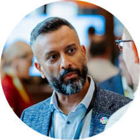
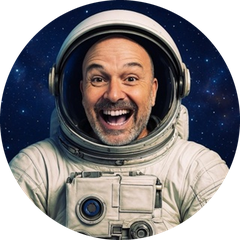
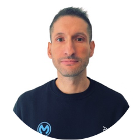
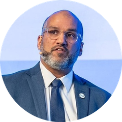

# octoloom-assets

Images for the [Octoloom for Agent Fabric](https://marketplace.visualstudio.com/items?itemName=octoloom.octoloom) VS Code extension listing.

**Documentation: https://a2d-agentic-asset-designer.github.io/octoloom-assets/** (getting started, tutorials, templates, every view and button, skills for your AI assistant).

- [`docs/`](docs) and `mkdocs.yml`: the documentation site, generated by `docs-src/build_docs.py` and published by `.github/workflows/docs.yml`.
- [`skills/`](skills): skills that teach an AI assistant to build agent networks like the templates.
- [`templates/`](templates) and [`tutorials/`](tutorials): the template projects and one tutorial per template.

## Meet the Octoloomies

The people weaving Octoloom. Click a photo to visit their LinkedIn profile.

<table>
  <tr>
    <td align="center" width="16%">
       
      <a href="https://www.linkedin.com/in/amir-khan-ak/"><b>Amir Khan</b></a> 
      Initiator Loomie
    </td>
    <td align="center" width="16%">
       
      <a href="https://www.linkedin.com/in/georgejeffcock/"><b>George Jeffcock</b></a> 
      Co-initiator Loomie
    </td>
    <td align="center" width="16%">
       
      <a href="https://www.linkedin.com/in/gabriel-bustos-s%C3%B6lch-1375a31/"><b>Gabriel Bustos Sölch</b></a> 
      Loom Inspector
    </td>
    <td align="center" width="16%">
       
      <a href="https://www.linkedin.com/in/tommasobolis/"><b>Tommaso Bolis</b></a> 
      Tentacoder
    </td>
    <td align="center" width="16%">
       
      <a href="https://www.linkedin.com/in/tasbura/"><b>Burak Tas</b></a> 
      Knot Finder
    </td>
    <td align="center" width="16%">
       
      <b>Shad Iman</b> 
      Executive Loomie
    </td>
  </tr>
</table>
