Templates

# Templates

Octoloom ships **43 ready-to-run templates**. Open one with **New Project** (Home → *New Probabilistic / Deterministic Network* → *Use cases* or *Technical*). Every upstream is a public A²D mock, so a template deploys and answers without any backend of yours.

| Kind | What it is |
|---|---|
| Use case | A business network: agents, MCP servers and an LLM broker or an AgentScript flow. |
| Governed | The same use case with built-in Agent Fabric gateway policies. |
| Secured | A use case whose agents, MCP servers or LLM need authentication (client credentials, API key, OAuth 2.0). |
| Fully mocked | The LLM is an A²D LLM mock too: deploy and chat without an OpenAI key. |
| Informatica IDMC | Uses Informatica IDMC MCP servers (needs an IDMC org). |

## Probabilistic (Agent Network 1.0)

-   **[Employee Onboarding](v1-employee-onboarding.md)**

    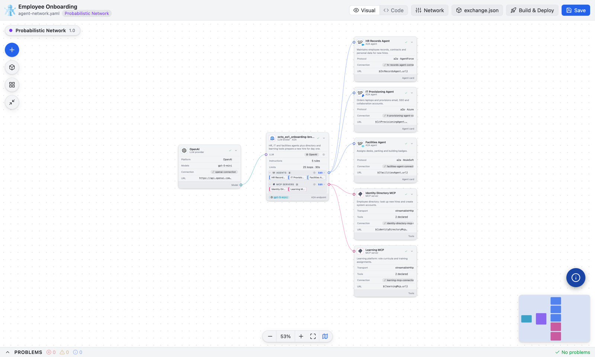{ loading=lazy }

    <small>Use case · 3 agents · 2 MCP · 0 policies</small>

    HR, IT and facilities agents plus directory and learning tools prepare a new hire for day one.

-   **[Employee Onboarding: governed](v1-employee-onboarding-governed.md)**

    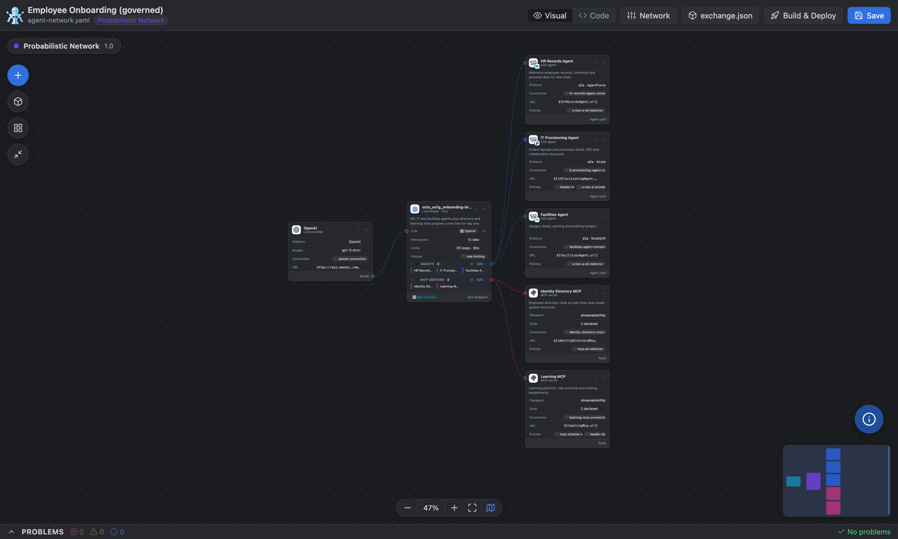{ loading=lazy }

    <small>Governed · 3 agents · 2 MCP · 6 policies</small>

    HR, IT and facilities agents plus directory and learning tools prepare a new hire for day one. Adds built-in policies: rate-limiting, mcp-pii-detector, mcp-schema-validation, header-injection, a-two-a-pii-detector, a-two-a-prompt-decorator.

-   **[Customer Service Broker](v1-customer-service.md)**

    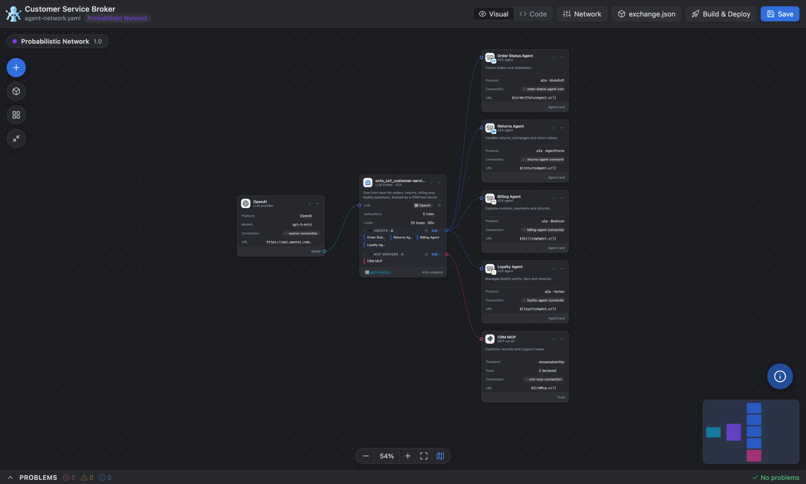{ loading=lazy }

    <small>Use case · 4 agents · 1 MCP · 0 policies</small>

    One front door for orders, returns, billing and loyalty questions, backed by a CRM tool server.

-   **[Customer Service Broker: governed](v1-customer-service-governed.md)**

    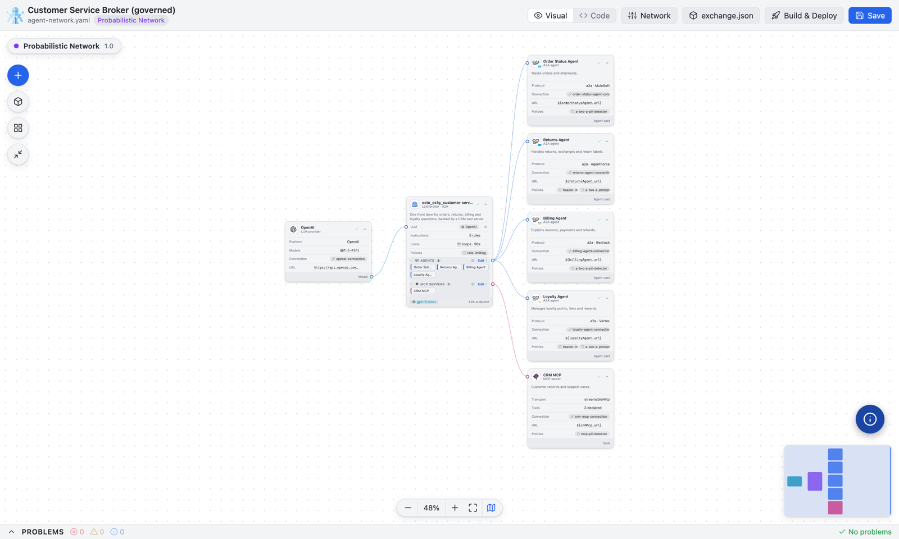{ loading=lazy }

    <small>Governed · 4 agents · 1 MCP · 5 policies</small>

    One front door for orders, returns, billing and loyalty questions, backed by a CRM tool server. Adds built-in policies: rate-limiting, mcp-pii-detector, a-two-a-pii-detector, header-injection, a-two-a-prompt-decorator.

-   **[IT Helpdesk](v1-it-helpdesk.md)**

    { loading=lazy }

    <small>Use case · 3 agents · 3 MCP · 0 policies</small>

    Triage and access agents work with ITSM, monitoring and knowledge-base tools to resolve tickets.

-   **[IT Helpdesk: governed](v1-it-helpdesk-governed.md)**

    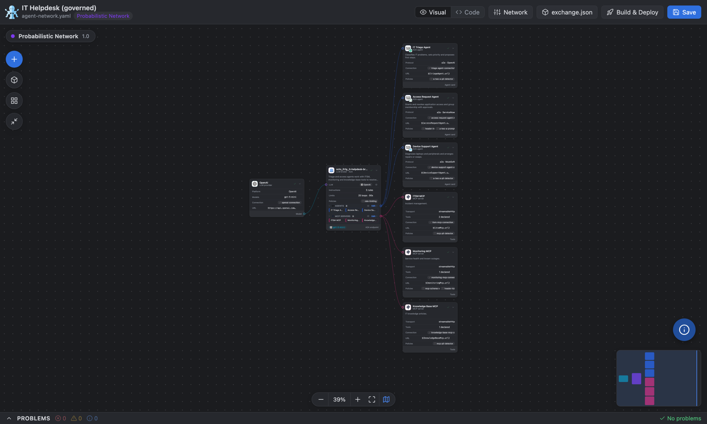{ loading=lazy }

    <small>Governed · 3 agents · 3 MCP · 6 policies</small>

    Triage and access agents work with ITSM, monitoring and knowledge-base tools to resolve tickets. Adds built-in policies: rate-limiting, mcp-pii-detector, mcp-schema-validation, header-injection, a-two-a-pii-detector, a-two-a-prompt-decorator.

-   **[Travel & Expense](v1-travel-expense.md)**

    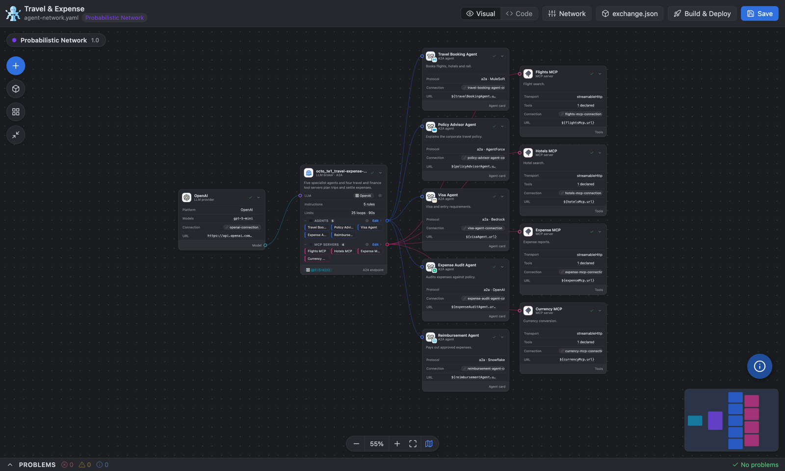{ loading=lazy }

    <small>Use case · 5 agents · 4 MCP · 0 policies</small>

    Five specialist agents and four travel and finance tool servers plan trips and settle expenses.

-   **[Travel & Expense: governed](v1-travel-expense-governed.md)**

    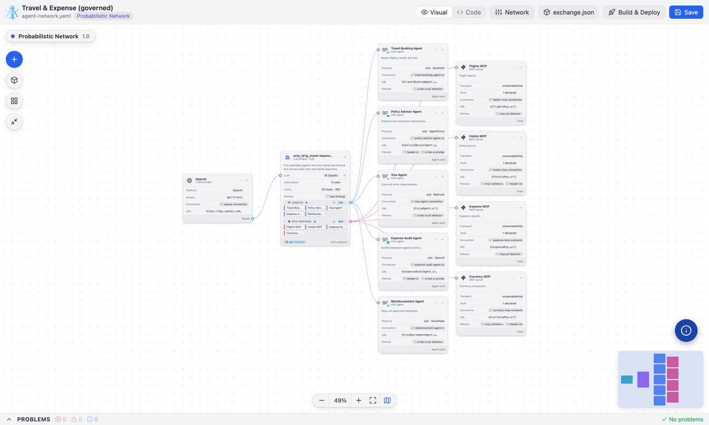{ loading=lazy }

    <small>Governed · 5 agents · 4 MCP · 6 policies</small>

    Five specialist agents and four travel and finance tool servers plan trips and settle expenses. Adds built-in policies: rate-limiting, mcp-pii-detector, mcp-schema-validation, header-injection, a-two-a-pii-detector, a-two-a-prompt-decorator.

-   **[Procurement Assistant](v1-procurement.md)**

    { loading=lazy }

    <small>Use case · 2 agents · 5 MCP · 0 policies</small>

    A tool-heavy broker: two agents and five procurement tool servers turn requests into purchase orders.

-   **[Procurement Assistant: governed](v1-procurement-governed.md)**

    { loading=lazy }

    <small>Governed · 2 agents · 5 MCP · 6 policies</small>

    A tool-heavy broker: two agents and five procurement tool servers turn requests into purchase orders. Adds built-in policies: rate-limiting, mcp-pii-detector, mcp-schema-validation, header-injection, a-two-a-pii-detector, a-two-a-prompt-decorator.

-   **[HR Leave Requests](v1-hr-leave.md)**

    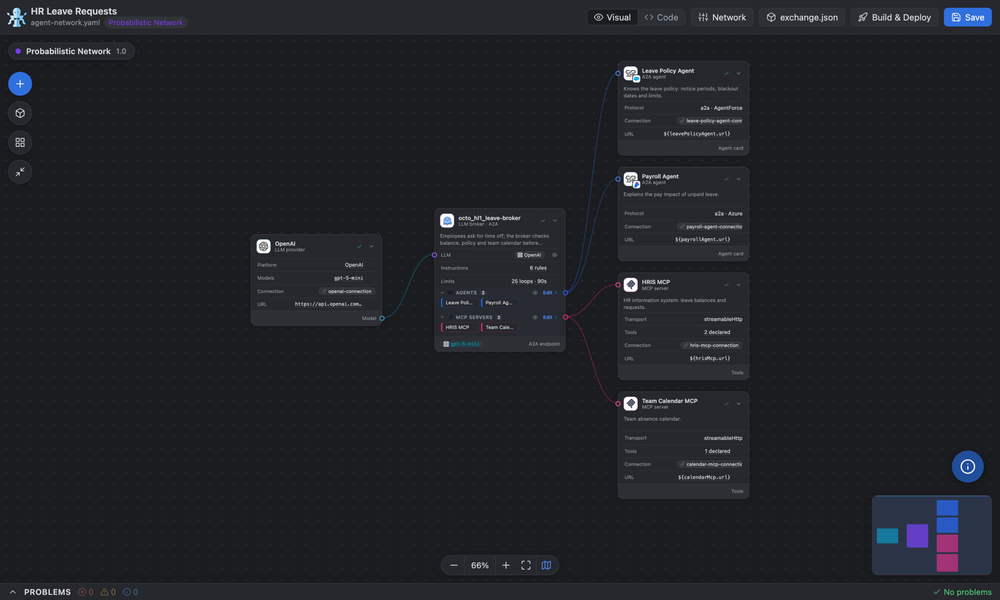{ loading=lazy }

    <small>Use case · 2 agents · 2 MCP · 0 policies</small>

    Employees ask for time off; the broker checks balance, policy and team calendar before submitting the request.

-   **[HR Leave Requests: governed](v1-hr-leave-governed.md)**

    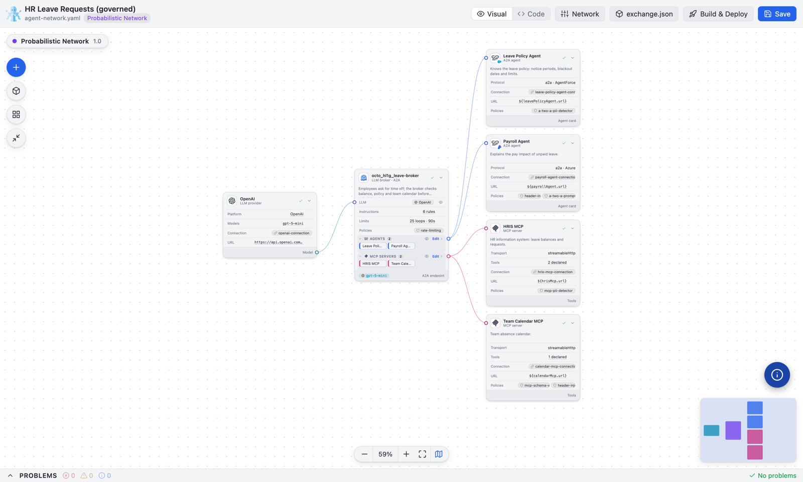{ loading=lazy }

    <small>Governed · 2 agents · 2 MCP · 6 policies</small>

    Employees ask for time off; the broker checks balance, policy and team calendar before submitting the request. Adds built-in policies: rate-limiting, mcp-pii-detector, mcp-schema-validation, header-injection, a-two-a-pii-detector, a-two-a-prompt-decorator.

-   **[HR Leave Requests: secured](v1-hr-leave-secured.md)**

    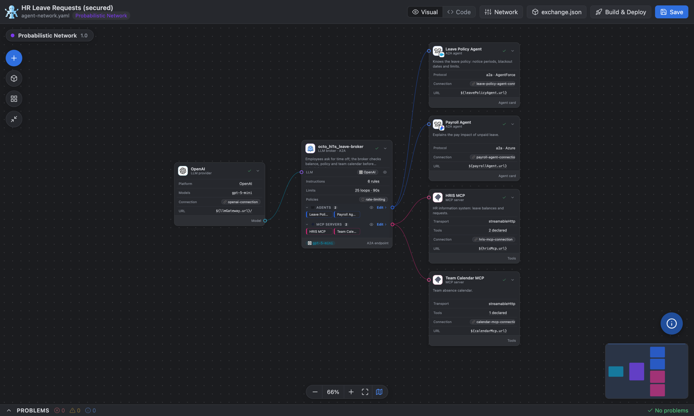{ loading=lazy }

    <small>Secured · 2 agents · 2 MCP · 1 policies</small>

    Employees ask for time off; the broker checks balance, policy and team calendar before submitting the request. Secured: authenticated connections (Basic, Client ID enforcement) with secret variables, the LLM behind a gateway URL.

-   **[Patient Intake (demo data)](v1-patient-intake.md)**

    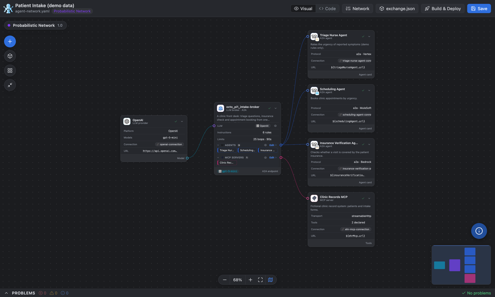{ loading=lazy }

    <small>Use case · 3 agents · 1 MCP · 0 policies</small>

    A clinic front desk: triage questions, insurance check and appointment booking from one conversation. Fictional patients only.

-   **[Patient Intake (demo data): governed](v1-patient-intake-governed.md)**

    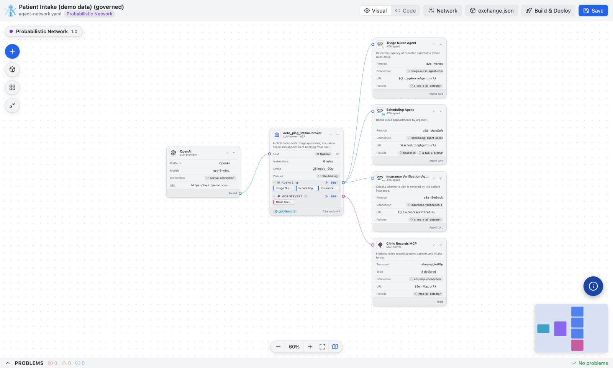{ loading=lazy }

    <small>Governed · 3 agents · 1 MCP · 5 policies</small>

    A clinic front desk: triage questions, insurance check and appointment booking from one conversation. Fictional patients only. Adds built-in policies: rate-limiting, mcp-pii-detector, a-two-a-pii-detector, header-injection, a-two-a-prompt-decorator.

-   **[Patient Intake (demo data): secured](v1-patient-intake-secured.md)**

    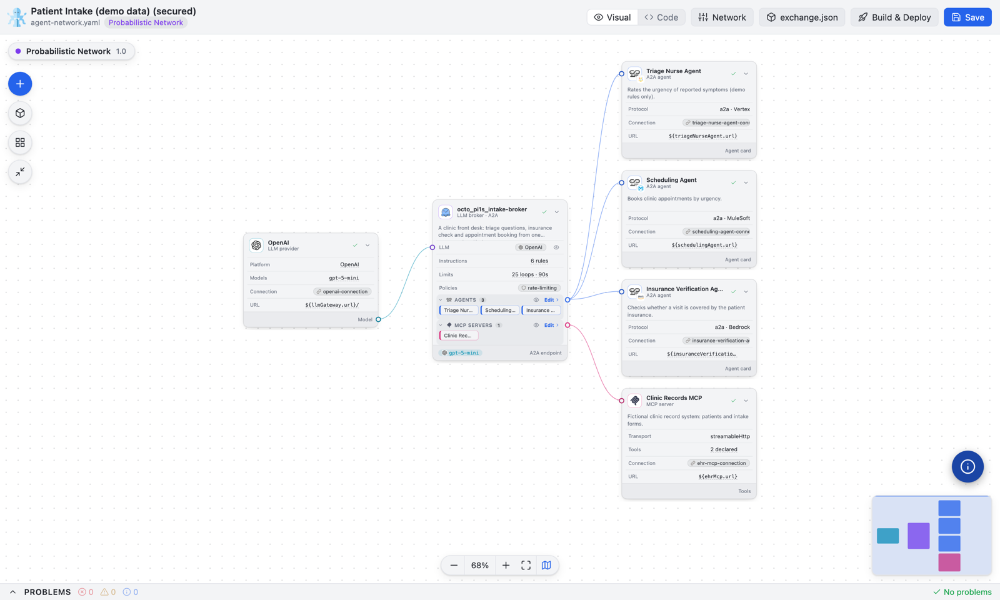{ loading=lazy }

    <small>Secured · 3 agents · 1 MCP · 1 policies</small>

    A clinic front desk: triage questions, insurance check and appointment booking from one conversation. Fictional patients only. Secured: authenticated connections (Basic, Client ID enforcement) with secret variables, the LLM behind a gateway URL.

-   **[Hotel Concierge (fully mocked)](v1-hotel-concierge.md)**

    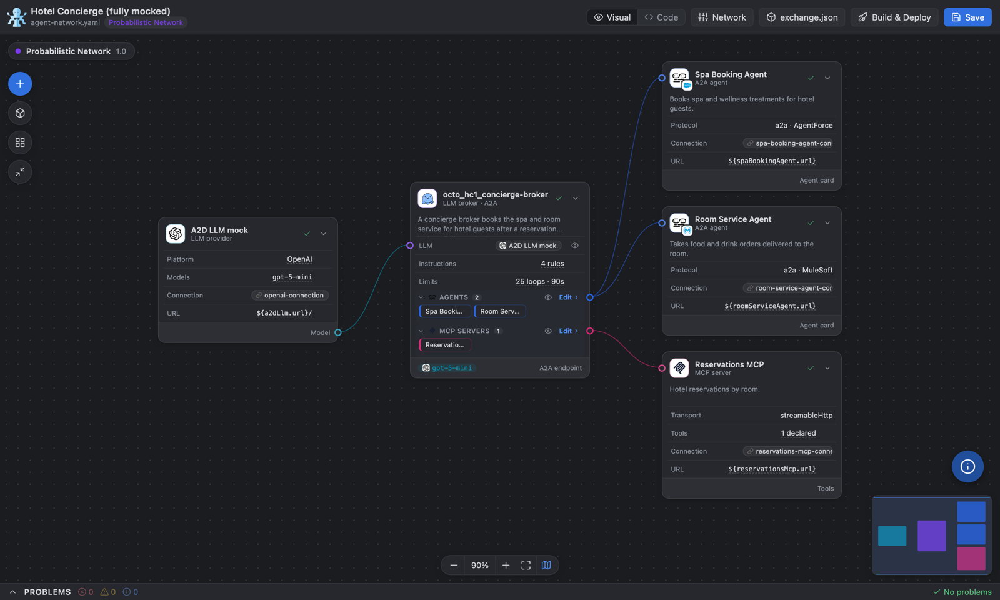{ loading=lazy }

    <small>Fully mocked · 2 agents · 1 MCP · 0 policies</small>

    A concierge broker books the spa and room service for hotel guests after a reservation lookup. Fully mocked: the LLM is an A²D LLM mock too, so no OpenAI key is needed.

-   **[Library Services (fully mocked)](v1-library-services.md)**

    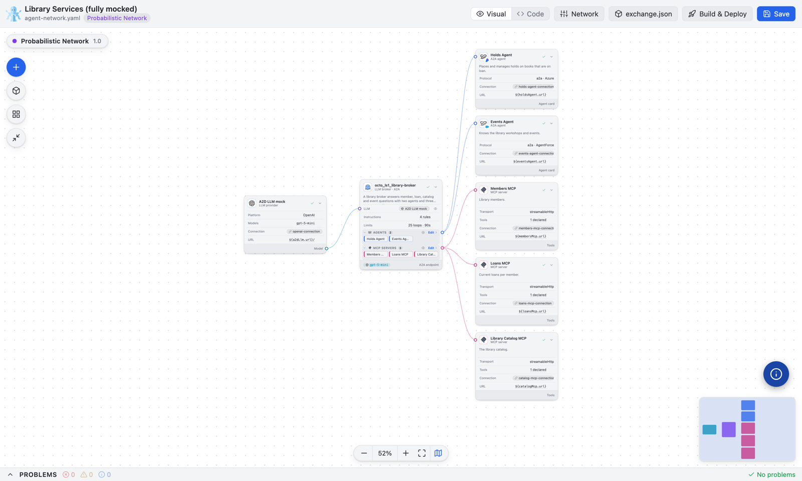{ loading=lazy }

    <small>Fully mocked · 2 agents · 3 MCP · 0 policies</small>

    A library broker answers member, loan, catalog and event questions with two agents and three tool servers. Fully mocked: the LLM is an A²D LLM mock too, so no OpenAI key is needed.

-   **[Fleet Maintenance (fully mocked)](v1-fleet-maintenance.md)**

    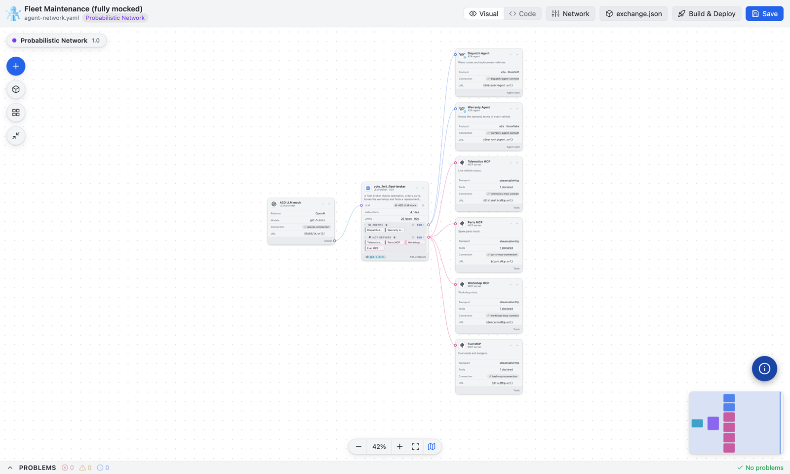{ loading=lazy }

    <small>Fully mocked · 2 agents · 4 MCP · 0 policies</small>

    A fleet broker checks telematics, orders parts, books the workshop and finds a replacement truck: two agents, four tool servers. Fully mocked: the LLM is an A²D LLM mock too, so no OpenAI key is needed.

-   **[IDMC Customer Data Steward (needs Informatica IDMC)](v1-idmc-customer-steward.md)**

    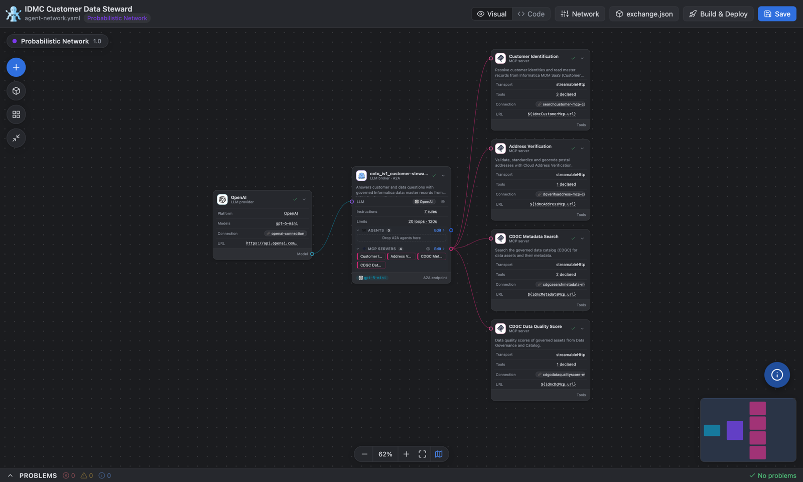{ loading=lazy }

    <small>Informatica IDMC · 0 agents · 4 MCP · 0 policies</small>

    One LLM broker over four Informatica shared MCP servers: verify addresses, search the data catalog (CDGC), read data quality scores and look up MDM master records. Needs your own Informatica IDMC org and an IDMC MCP client (OAuth 2.0 client credentials).

| Template | Kind | Agents | MCP | Policies | Tutorial |
|---|---|---|---|---|---|
| [Employee Onboarding](v1-employee-onboarding.md) | Use case | 3 | 2 | 0 | [Tutorial](../tutorials/v1-employee-onboarding.md) |
| [Employee Onboarding: governed](v1-employee-onboarding-governed.md) | Governed | 3 | 2 | 6 | [Tutorial](../tutorials/v1-employee-onboarding-governed.md) |
| [Customer Service Broker](v1-customer-service.md) | Use case | 4 | 1 | 0 | [Tutorial](../tutorials/v1-customer-service.md) |
| [Customer Service Broker: governed](v1-customer-service-governed.md) | Governed | 4 | 1 | 5 | [Tutorial](../tutorials/v1-customer-service-governed.md) |
| [IT Helpdesk](v1-it-helpdesk.md) | Use case | 3 | 3 | 0 | [Tutorial](../tutorials/v1-it-helpdesk.md) |
| [IT Helpdesk: governed](v1-it-helpdesk-governed.md) | Governed | 3 | 3 | 6 | [Tutorial](../tutorials/v1-it-helpdesk-governed.md) |
| [Travel & Expense](v1-travel-expense.md) | Use case | 5 | 4 | 0 | [Tutorial](../tutorials/v1-travel-expense.md) |
| [Travel & Expense: governed](v1-travel-expense-governed.md) | Governed | 5 | 4 | 6 | [Tutorial](../tutorials/v1-travel-expense-governed.md) |
| [Procurement Assistant](v1-procurement.md) | Use case | 2 | 5 | 0 | [Tutorial](../tutorials/v1-procurement.md) |
| [Procurement Assistant: governed](v1-procurement-governed.md) | Governed | 2 | 5 | 6 | [Tutorial](../tutorials/v1-procurement-governed.md) |
| [HR Leave Requests](v1-hr-leave.md) | Use case | 2 | 2 | 0 | [Tutorial](../tutorials/v1-hr-leave.md) |
| [HR Leave Requests: governed](v1-hr-leave-governed.md) | Governed | 2 | 2 | 6 | [Tutorial](../tutorials/v1-hr-leave-governed.md) |
| [HR Leave Requests: secured](v1-hr-leave-secured.md) | Secured | 2 | 2 | 1 | [Tutorial](../tutorials/v1-hr-leave-secured.md) |
| [Patient Intake (demo data)](v1-patient-intake.md) | Use case | 3 | 1 | 0 | [Tutorial](../tutorials/v1-patient-intake.md) |
| [Patient Intake (demo data): governed](v1-patient-intake-governed.md) | Governed | 3 | 1 | 5 | [Tutorial](../tutorials/v1-patient-intake-governed.md) |
| [Patient Intake (demo data): secured](v1-patient-intake-secured.md) | Secured | 3 | 1 | 1 | [Tutorial](../tutorials/v1-patient-intake-secured.md) |
| [Hotel Concierge (fully mocked)](v1-hotel-concierge.md) | Fully mocked | 2 | 1 | 0 | [Tutorial](../tutorials/v1-hotel-concierge.md) |
| [Library Services (fully mocked)](v1-library-services.md) | Fully mocked | 2 | 3 | 0 | [Tutorial](../tutorials/v1-library-services.md) |
| [Fleet Maintenance (fully mocked)](v1-fleet-maintenance.md) | Fully mocked | 2 | 4 | 0 | [Tutorial](../tutorials/v1-fleet-maintenance.md) |
| [IDMC Customer Data Steward (needs Informatica IDMC)](v1-idmc-customer-steward.md) | Informatica IDMC | 0 | 4 | 0 | [Tutorial](../tutorials/v1-idmc-customer-steward.md) |

## Deterministic (Agent Network 2.0, AgentScript)

-   **[Insurance Claims (FNOL to Payout)](v2-insurance-claims.md)**

    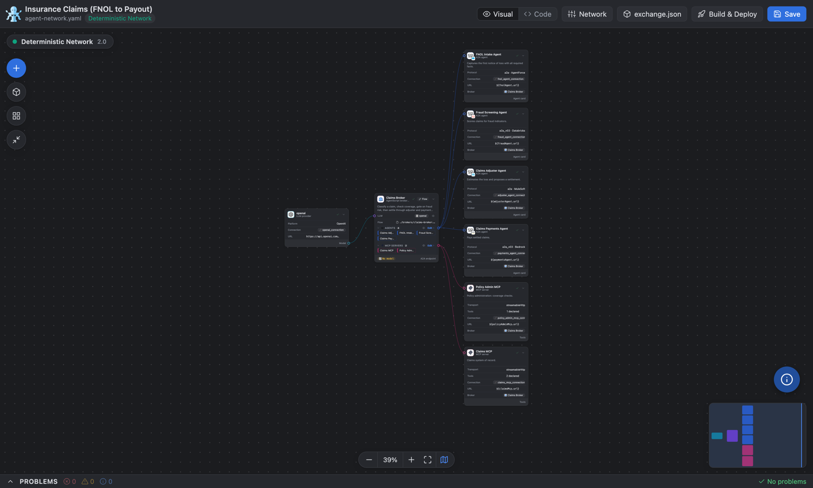{ loading=lazy }

    <small>Use case · 4 agents · 2 MCP · 0 policies</small>

    Classify a claim, check coverage, gate on fraud risk, then settle through adjuster and payment agents.

-   **[Insurance Claims (FNOL to Payout): governed](v2-insurance-claims-governed.md)**

    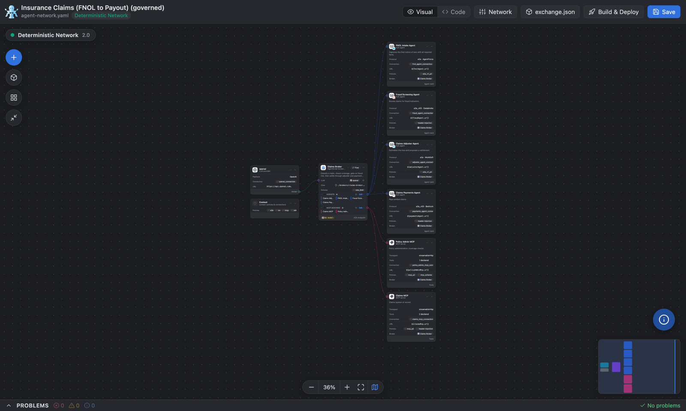{ loading=lazy }

    <small>Governed · 4 agents · 2 MCP · 5 policies</small>

    Classify a claim, check coverage, gate on fraud risk, then settle through adjuster and payment agents. Adds built-in policies: a2a-v1-pii-detector, header-injection, mcp-pii-detector, mcp-schema-validation, rate-limiting.

-   **[Retail Returns](v2-retail-returns.md)**

    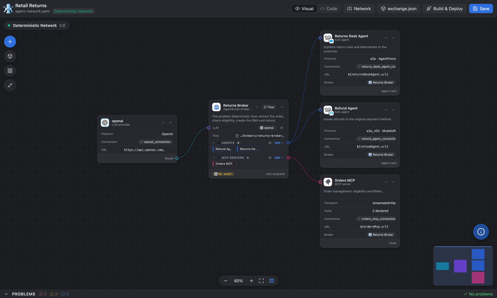{ loading=lazy }

    <small>Use case · 2 agents · 1 MCP · 0 policies</small>

    The smallest deterministic flow: extract the order, check eligibility, create the RMA and refund.

-   **[Retail Returns: governed](v2-retail-returns-governed.md)**

    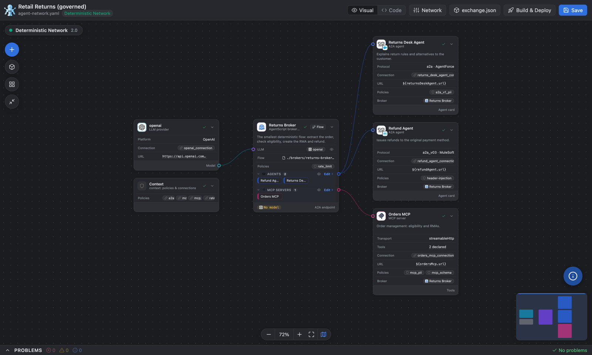{ loading=lazy }

    <small>Governed · 2 agents · 1 MCP · 5 policies</small>

    The smallest deterministic flow: extract the order, check eligibility, create the RMA and refund. Adds built-in policies: a2a-v1-pii-detector, header-injection, mcp-pii-detector, mcp-schema-validation, rate-limiting.

-   **[Loan Origination](v2-loan-origination.md)**

    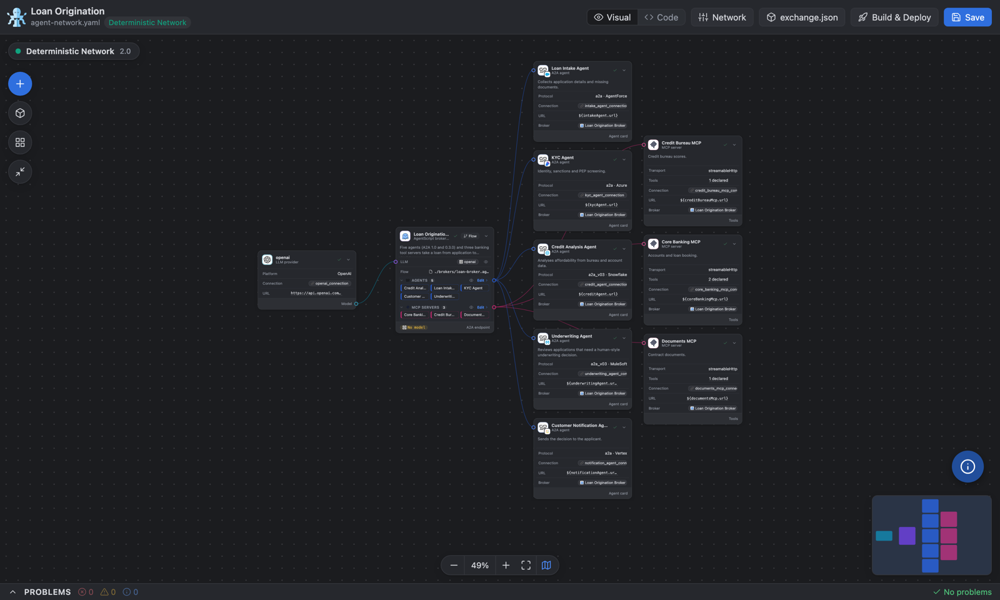{ loading=lazy }

    <small>Use case · 5 agents · 3 MCP · 0 policies</small>

    Five agents (A2A 1.0 and 0.3.0) and three banking tool servers take a loan from application to decision.

-   **[Loan Origination: governed](v2-loan-origination-governed.md)**

    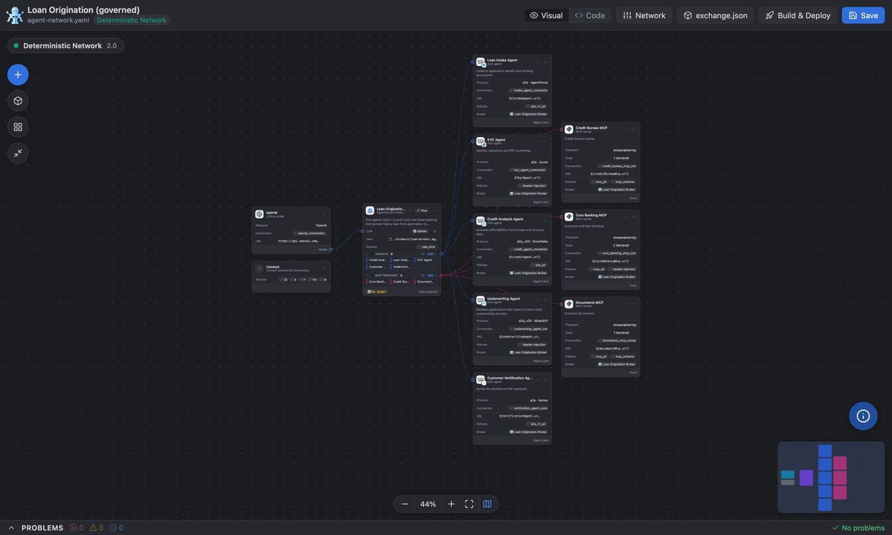{ loading=lazy }

    <small>Governed · 5 agents · 3 MCP · 6 policies</small>

    Five agents (A2A 1.0 and 0.3.0) and three banking tool servers take a loan from application to decision. Adds built-in policies: a2a-v1-pii-detector, header-injection, a-two-a-pii-detector, mcp-pii-detector, mcp-schema-validation, rate-limiting.

-   **[Field Service Dispatch](v2-field-service.md)**

    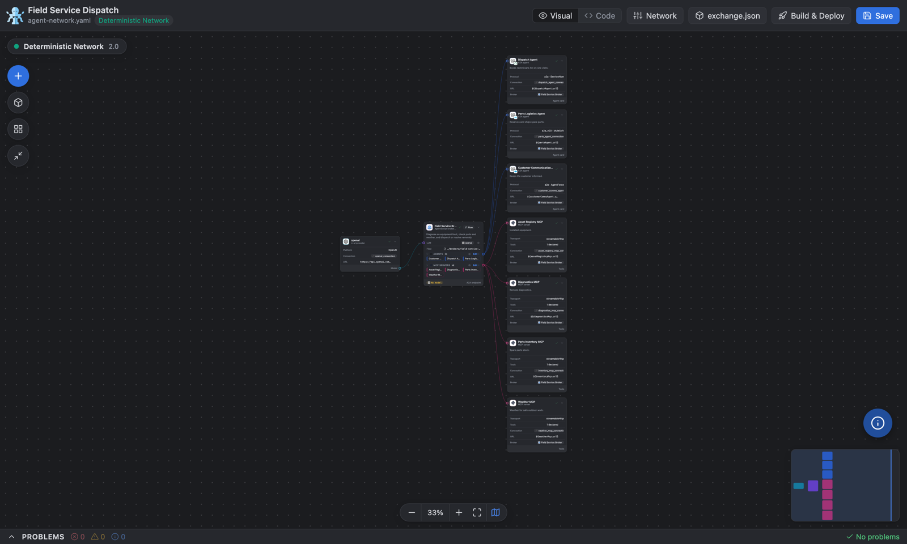{ loading=lazy }

    <small>Use case · 3 agents · 4 MCP · 0 policies</small>

    Diagnose an equipment fault, check parts and weather, and dispatch or resolve remotely.

-   **[Field Service Dispatch: governed](v2-field-service-governed.md)**

    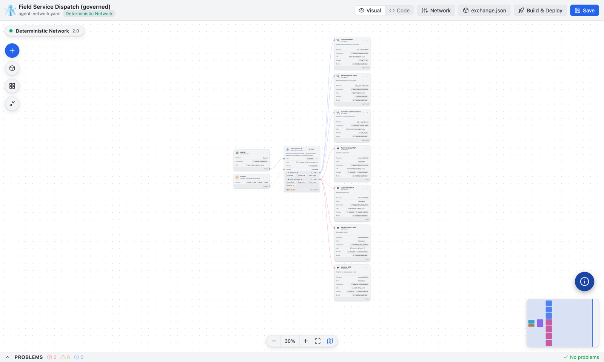{ loading=lazy }

    <small>Governed · 3 agents · 4 MCP · 5 policies</small>

    Diagnose an equipment fault, check parts and weather, and dispatch or resolve remotely. Adds built-in policies: a2a-v1-pii-detector, header-injection, mcp-pii-detector, mcp-schema-validation, rate-limiting.

-   **[Marketing Campaign Studio](v2-campaign-studio.md)**

    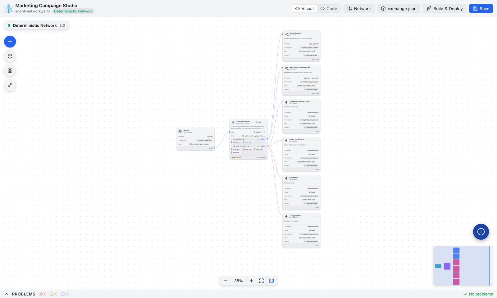{ loading=lazy }

    <small>Use case · 2 agents · 4 MCP · 0 policies</small>

    A tool-heavy deterministic flow: two agents and four marketing tool servers build and launch a campaign.

-   **[Marketing Campaign Studio: governed](v2-campaign-studio-governed.md)**

    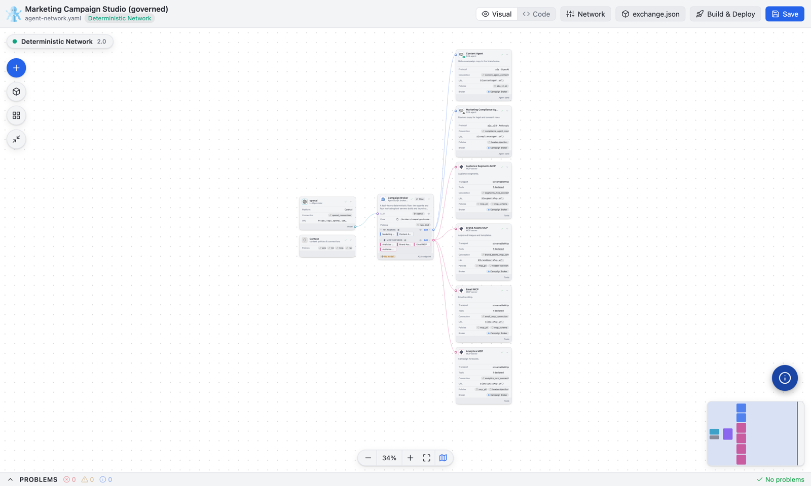{ loading=lazy }

    <small>Governed · 2 agents · 4 MCP · 5 policies</small>

    A tool-heavy deterministic flow: two agents and four marketing tool servers build and launch a campaign. Adds built-in policies: a2a-v1-pii-detector, header-injection, mcp-pii-detector, mcp-schema-validation, rate-limiting.

-   **[Supply Chain Disruption](v2-supply-chain.md)**

    { loading=lazy }

    <small>Use case · 4 agents · 3 MCP · 0 policies</small>

    A late or short shipment is assessed against stock; severe delays are rerouted and customers told, other cases get a mitigation plan.

-   **[Supply Chain Disruption: governed](v2-supply-chain-governed.md)**

    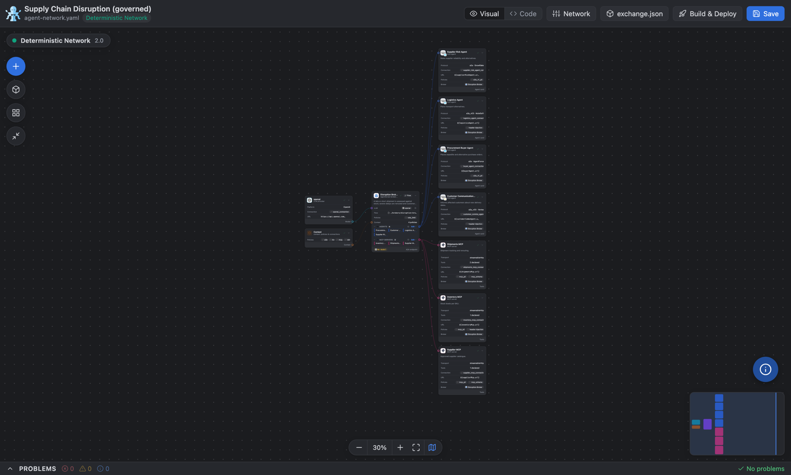{ loading=lazy }

    <small>Governed · 4 agents · 3 MCP · 5 policies</small>

    A late or short shipment is assessed against stock; severe delays are rerouted and customers told, other cases get a mitigation plan. Adds built-in policies: a2a-v1-pii-detector, header-injection, mcp-pii-detector, mcp-schema-validation, rate-limiting.

-   **[Supply Chain Disruption: secured](v2-supply-chain-secured.md)**

    { loading=lazy }

    <small>Secured · 4 agents · 3 MCP · 2 policies</small>

    A late or short shipment is assessed against stock; severe delays are rerouted and customers told, other cases get a mitigation plan. Secured: authenticated connections (Basic, Client ID enforcement) with secret variables, the LLM behind a gateway URL, outbound message logging.

-   **[KYC / AML Onboarding](v2-kyc-onboarding.md)**

    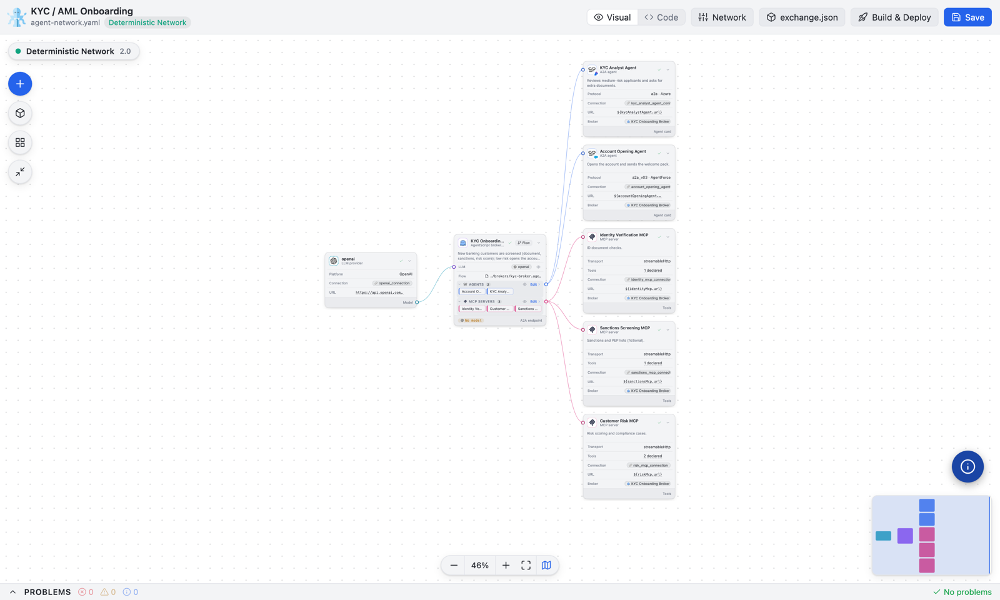{ loading=lazy }

    <small>Use case · 2 agents · 3 MCP · 0 policies</small>

    New banking customers are screened (document, sanctions, risk score); low risk opens the account, medium goes to an analyst, high opens a compliance case.

-   **[KYC / AML Onboarding: governed](v2-kyc-onboarding-governed.md)**

    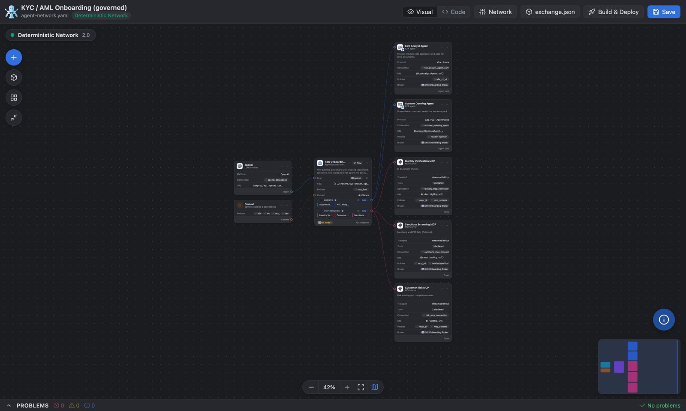{ loading=lazy }

    <small>Governed · 2 agents · 3 MCP · 5 policies</small>

    New banking customers are screened (document, sanctions, risk score); low risk opens the account, medium goes to an analyst, high opens a compliance case. Adds built-in policies: a2a-v1-pii-detector, header-injection, mcp-pii-detector, mcp-schema-validation, rate-limiting.

-   **[KYC / AML Onboarding: secured](v2-kyc-onboarding-secured.md)**

    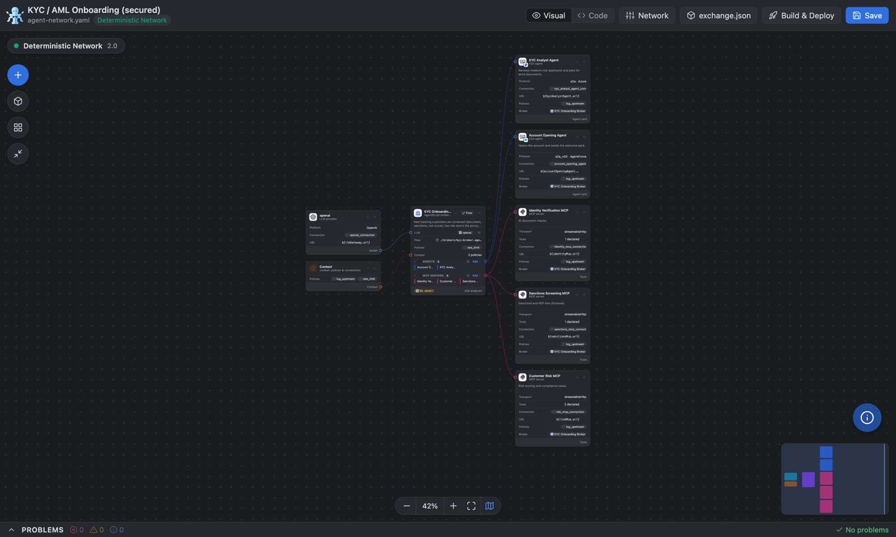{ loading=lazy }

    <small>Secured · 2 agents · 3 MCP · 2 policies</small>

    New banking customers are screened (document, sanctions, risk score); low risk opens the account, medium goes to an analyst, high opens a compliance case. Secured: authenticated connections (Basic, Client ID enforcement) with secret variables, the LLM behind a gateway URL, outbound message logging.

-   **[IT Incident Response](v2-incident-response.md)**

    { loading=lazy }

    <small>Use case · 5 agents · 2 MCP · 0 policies</small>

    Alerts are classified; P1s become a major incident with on-call page and status page, others go to the network, database or application specialist.

-   **[IT Incident Response: governed](v2-incident-response-governed.md)**

    { loading=lazy }

    <small>Governed · 5 agents · 2 MCP · 5 policies</small>

    Alerts are classified; P1s become a major incident with on-call page and status page, others go to the network, database or application specialist. Adds built-in policies: a2a-v1-pii-detector, header-injection, mcp-pii-detector, mcp-schema-validation, rate-limiting.

-   **[IT Incident Response: secured](v2-incident-response-secured.md)**

    { loading=lazy }

    <small>Secured · 5 agents · 2 MCP · 2 policies</small>

    Alerts are classified; P1s become a major incident with on-call page and status page, others go to the network, database or application specialist. Secured: authenticated connections (Basic, Client ID enforcement) with secret variables, the LLM behind a gateway URL, outbound message logging.

-   **[Event Ticketing (fully mocked)](v2-event-ticketing.md)**

    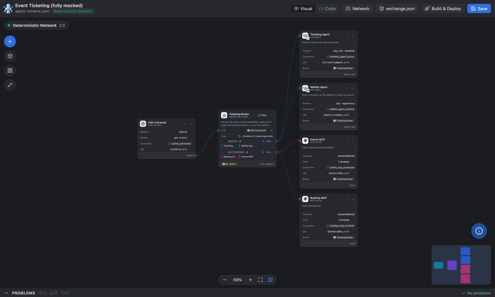{ loading=lazy }

    <small>Fully mocked · 2 agents · 2 MCP · 0 policies</small>

    Extract the event, check availability, reserve the seats and issue the tickets, or join the waitlist. Fully mocked: the LLM is an A²D LLM mock too, so no OpenAI key is needed.

-   **[Warranty Repair (fully mocked)](v2-warranty-repair.md)**

    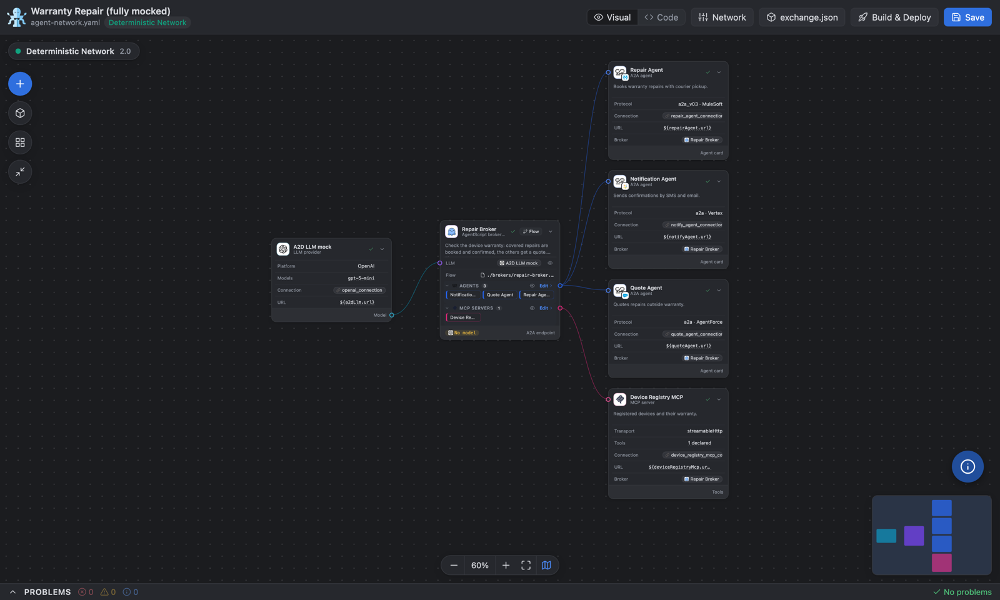{ loading=lazy }

    <small>Fully mocked · 3 agents · 1 MCP · 0 policies</small>

    Check the device warranty: covered repairs are booked and confirmed, the others get a quote. Three agents, one tool server. Fully mocked: the LLM is an A²D LLM mock too, so no OpenAI key is needed.

-   **[Utility Outage (fully mocked)](v2-utility-outage.md)**

    { loading=lazy }

    <small>Fully mocked · 3 agents · 2 MCP · 0 policies</small>

    A known outage gets status updates and a bill credit; an unknown one gets a ticket and a field crew. Three agents, two tool servers. Fully mocked: the LLM is an A²D LLM mock too, so no OpenAI key is needed.

-   **[IDMC Data Trust (needs Informatica IDMC)](v2-idmc-data-trust.md)**

    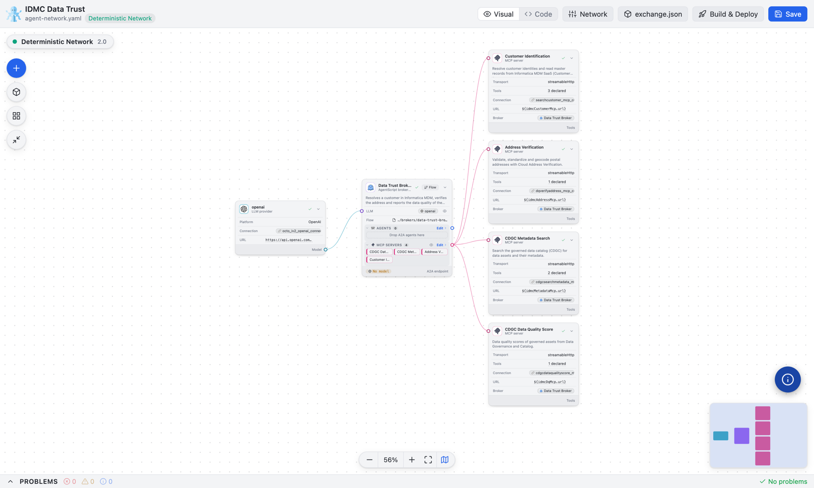{ loading=lazy }

    <small>Informatica IDMC · 0 agents · 4 MCP · 0 policies</small>

    A deterministic flow over four Informatica shared MCP servers: classify the request, then verify the address, search the catalog with data quality scores, or resolve the customer in MDM. Needs your own Informatica IDMC org and an IDMC MCP client (OAuth 2.0 client credentials).

| Template | Kind | Agents | MCP | Policies | Tutorial |
|---|---|---|---|---|---|
| [Insurance Claims (FNOL to Payout)](v2-insurance-claims.md) | Use case | 4 | 2 | 0 | [Tutorial](../tutorials/v2-insurance-claims.md) |
| [Insurance Claims (FNOL to Payout): governed](v2-insurance-claims-governed.md) | Governed | 4 | 2 | 5 | [Tutorial](../tutorials/v2-insurance-claims-governed.md) |
| [Retail Returns](v2-retail-returns.md) | Use case | 2 | 1 | 0 | [Tutorial](../tutorials/v2-retail-returns.md) |
| [Retail Returns: governed](v2-retail-returns-governed.md) | Governed | 2 | 1 | 5 | [Tutorial](../tutorials/v2-retail-returns-governed.md) |
| [Loan Origination](v2-loan-origination.md) | Use case | 5 | 3 | 0 | [Tutorial](../tutorials/v2-loan-origination.md) |
| [Loan Origination: governed](v2-loan-origination-governed.md) | Governed | 5 | 3 | 6 | [Tutorial](../tutorials/v2-loan-origination-governed.md) |
| [Field Service Dispatch](v2-field-service.md) | Use case | 3 | 4 | 0 | [Tutorial](../tutorials/v2-field-service.md) |
| [Field Service Dispatch: governed](v2-field-service-governed.md) | Governed | 3 | 4 | 5 | [Tutorial](../tutorials/v2-field-service-governed.md) |
| [Marketing Campaign Studio](v2-campaign-studio.md) | Use case | 2 | 4 | 0 | [Tutorial](../tutorials/v2-campaign-studio.md) |
| [Marketing Campaign Studio: governed](v2-campaign-studio-governed.md) | Governed | 2 | 4 | 5 | [Tutorial](../tutorials/v2-campaign-studio-governed.md) |
| [Supply Chain Disruption](v2-supply-chain.md) | Use case | 4 | 3 | 0 | [Tutorial](../tutorials/v2-supply-chain.md) |
| [Supply Chain Disruption: governed](v2-supply-chain-governed.md) | Governed | 4 | 3 | 5 | [Tutorial](../tutorials/v2-supply-chain-governed.md) |
| [Supply Chain Disruption: secured](v2-supply-chain-secured.md) | Secured | 4 | 3 | 2 | [Tutorial](../tutorials/v2-supply-chain-secured.md) |
| [KYC / AML Onboarding](v2-kyc-onboarding.md) | Use case | 2 | 3 | 0 | [Tutorial](../tutorials/v2-kyc-onboarding.md) |
| [KYC / AML Onboarding: governed](v2-kyc-onboarding-governed.md) | Governed | 2 | 3 | 5 | [Tutorial](../tutorials/v2-kyc-onboarding-governed.md) |
| [KYC / AML Onboarding: secured](v2-kyc-onboarding-secured.md) | Secured | 2 | 3 | 2 | [Tutorial](../tutorials/v2-kyc-onboarding-secured.md) |
| [IT Incident Response](v2-incident-response.md) | Use case | 5 | 2 | 0 | [Tutorial](../tutorials/v2-incident-response.md) |
| [IT Incident Response: governed](v2-incident-response-governed.md) | Governed | 5 | 2 | 5 | [Tutorial](../tutorials/v2-incident-response-governed.md) |
| [IT Incident Response: secured](v2-incident-response-secured.md) | Secured | 5 | 2 | 2 | [Tutorial](../tutorials/v2-incident-response-secured.md) |
| [Event Ticketing (fully mocked)](v2-event-ticketing.md) | Fully mocked | 2 | 2 | 0 | [Tutorial](../tutorials/v2-event-ticketing.md) |
| [Warranty Repair (fully mocked)](v2-warranty-repair.md) | Fully mocked | 3 | 1 | 0 | [Tutorial](../tutorials/v2-warranty-repair.md) |
| [Utility Outage (fully mocked)](v2-utility-outage.md) | Fully mocked | 3 | 2 | 0 | [Tutorial](../tutorials/v2-utility-outage.md) |
| [IDMC Data Trust (needs Informatica IDMC)](v2-idmc-data-trust.md) | Informatica IDMC | 0 | 4 | 0 | [Tutorial](../tutorials/v2-idmc-data-trust.md) |
