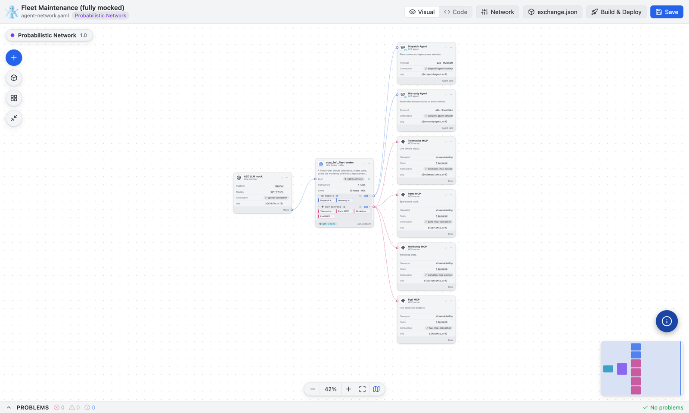
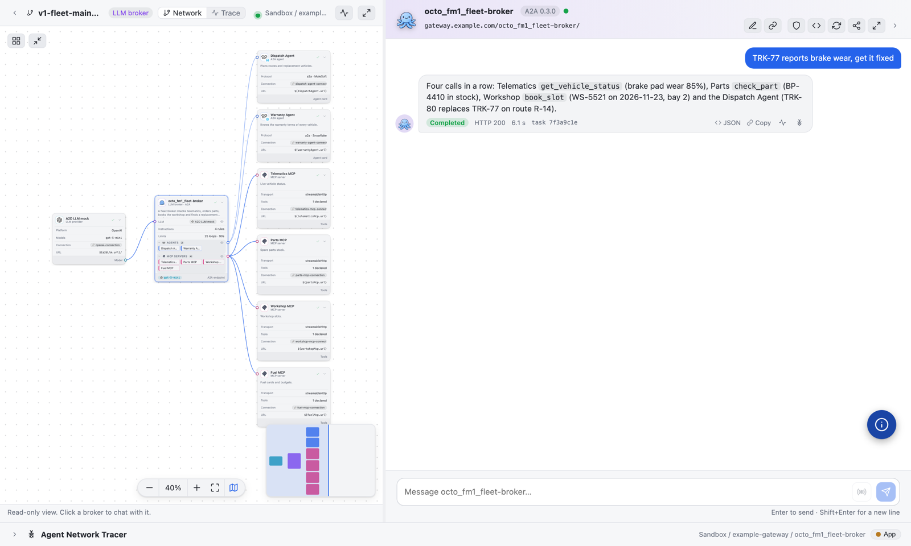

# Fleet Maintenance (fully mocked)

> A fleet broker checks telematics, orders parts, books the workshop and finds a replacement truck: two agents, four tool servers. Fully mocked: the LLM is an A²D LLM mock too, so no OpenAI key is needed.

| | |
|---|---|
| Style | Probabilistic (Agent Network 1.0) |
| Kind | Fully mocked |
| Agents / MCP servers | 2 / 4 |
| A2A protocol | 0.3.0 |
| Policies | none |
| Asset prefix | `octo_fm1` |
| Tutorial | [Fleet Maintenance (fully mocked): tutorial](../tutorials/v1-fleet-maintenance.md) |
| Files | [templates/v1-fleet-maintenance](https://github.com/A2D-Agentic-Asset-Designer/octoloom-assets/tree/main/templates/v1-fleet-maintenance) |

<small>The network canvas</small>

<small>Chat with the deployed broker</small>

A fleet broker checks telematics, orders parts, books the workshop and finds a replacement truck: two agents, four tool servers. Fully mocked: the LLM is an A²D LLM mock too, so no OpenAI key is needed.

- Style: Probabilistic (Agent Network 1.0): the LLM broker picks agents and tools from its instructions.
- Agents: Dispatch Agent (A2A 0.3.0, MuleSoft), Warranty Agent (A2A 0.3.0, Snowflake)
- MCP servers: Telematics MCP (get_vehicle_status); Parts MCP (check_part); Workshop MCP (book_slot); Fuel MCP (get_fuel_card)

Fully mocked: the agents, the MCP servers **and the LLM** are public A2D mocks, so the network runs without an OpenAI key or any other system. The LLM mock answers the prompts below with scripted tool calls and replies; any other prompt gets a short hint. No credentials are stored in this template.

## Deploy in 3 steps

1. **Setup & Connect**: connect Agent Fabric (connected app client ID and secret, organization). A²D is not needed: the mock URLs are already the defaults in `exchange.json`.
2. In `exchange.json`, fill in `ingressgw.url` (ingress gateway base url). In **Projects & Deploy**, click **Deploy** on this project (or **Build & Deploy** in the editor) and pick your gateway. Octoloom asks for each secret variable; nothing you type is stored:
   - `a2dLlm.apiKey`: the A²D LLM mock key: keep the default, any value works
3. When the status light turns green (**Deployed and running**), click **Open chat** and paste a prompt below. The **Tracer** icon under a reply opens the task in the Agent Network Tracer, with each agent and tool call.

## Try it

- **TRK-77 reports brake wear, get it fixed**
  - You should see: Four calls in a row: Telematics `get_vehicle_status` (brake pad wear 85%), Parts `check_part` (BP-4410 in stock), Workshop `book_slot` (WS-5521 on 2026-11-23, bay 2) and the Dispatch Agent (TRK-80 replaces TRK-77 on route R-14).
- **Is TRK-77 still under warranty?**
  - You should see: The Warranty Agent: drivetrain until 2027-02-28, brake pads not covered.
- **How much fuel budget is left for TRK-12?**
  - You should see: Fuel MCP `get_fuel_card`: FC-1212 used 615 of 800 CHF, 185 CHF left.

The LLM is an A²D LLM mock: it answers the prompts above with the same tool calls and replies every time (the broker is probabilistic, but its LLM is scripted). Swap `a2dLlm.url` for a real OpenAI-compatible endpoint to let a real model drive it.
