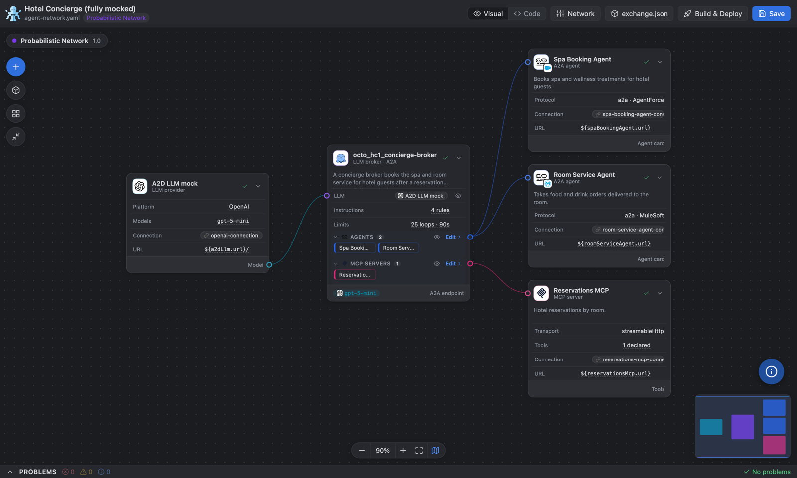
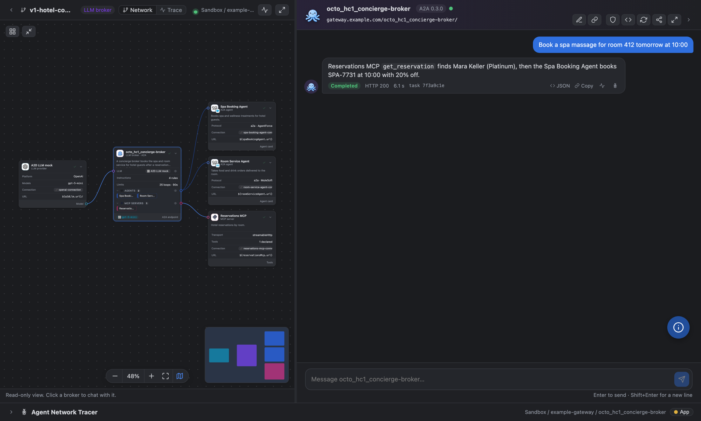

# Hotel Concierge (fully mocked)

> A concierge broker books the spa and room service for hotel guests after a reservation lookup. Fully mocked: the LLM is an A²D LLM mock too, so no OpenAI key is needed.

| | |
|---|---|
| Style | Probabilistic (Agent Network 1.0) |
| Kind | Fully mocked |
| Agents / MCP servers | 2 / 1 |
| A2A protocol | 0.3.0 |
| Policies | none |
| Asset prefix | `octo_hc1` |
| Tutorial | [Hotel Concierge (fully mocked): tutorial](../tutorials/v1-hotel-concierge.md) |
| Files | [templates/v1-hotel-concierge](https://github.com/A2D-Agentic-Asset-Designer/octoloom-assets/tree/main/templates/v1-hotel-concierge) |

<small>The network canvas</small>

<small>Chat with the deployed broker</small>

A concierge broker books the spa and room service for hotel guests after a reservation lookup. Fully mocked: the LLM is an A²D LLM mock too, so no OpenAI key is needed.

- Style: Probabilistic (Agent Network 1.0): the LLM broker picks agents and tools from its instructions.
- Agents: Spa Booking Agent (A2A 0.3.0, AgentForce), Room Service Agent (A2A 0.3.0, MuleSoft)
- MCP servers: Reservations MCP (get_reservation)

Fully mocked: the agents, the MCP servers **and the LLM** are public A2D mocks, so the network runs without an OpenAI key or any other system. The LLM mock answers the prompts below with scripted tool calls and replies; any other prompt gets a short hint. No credentials are stored in this template.

## Deploy in 3 steps

1. **Setup & Connect**: connect Agent Fabric (connected app client ID and secret, organization). A²D is not needed: the mock URLs are already the defaults in `exchange.json`.
2. In `exchange.json`, fill in `ingressgw.url` (ingress gateway base url). In **Projects & Deploy**, click **Deploy** on this project (or **Build & Deploy** in the editor) and pick your gateway. Octoloom asks for each secret variable; nothing you type is stored:
   - `a2dLlm.apiKey`: the A²D LLM mock key: keep the default, any value works
3. When the status light turns green (**Deployed and running**), click **Open chat** and paste a prompt below. The **Tracer** icon under a reply opens the task in the Agent Network Tracer, with each agent and tool call.

## Try it

- **Book a spa massage for room 412 tomorrow at 10:00**
  - You should see: Reservations MCP `get_reservation` finds Mara Keller (Platinum), then the Spa Booking Agent books SPA-7731 at 10:00 with 20% off.
- **Room 415 wants breakfast in the room at 07:30**
  - You should see: `get_reservation` finds Tom Berg, then the Room Service Agent places order RS-2208 for 07:30.
- **When is the checkout of room 412?**
  - You should see: `get_reservation`: Mara Keller checks out on 2026-11-24.

The LLM is an A²D LLM mock: it answers the prompts above with the same tool calls and replies every time (the broker is probabilistic, but its LLM is scripted). Swap `a2dLlm.url` for a real OpenAI-compatible endpoint to let a real model drive it.
