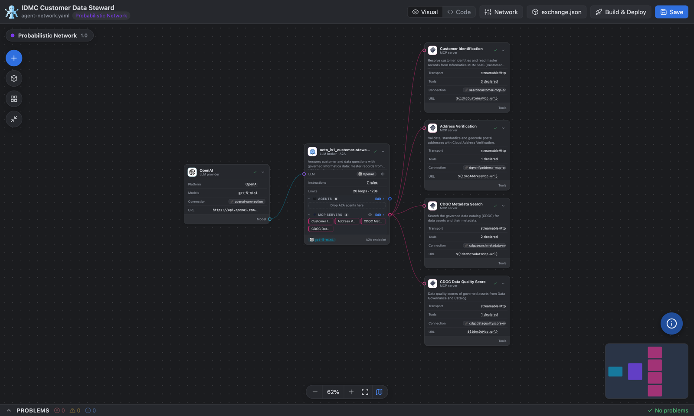
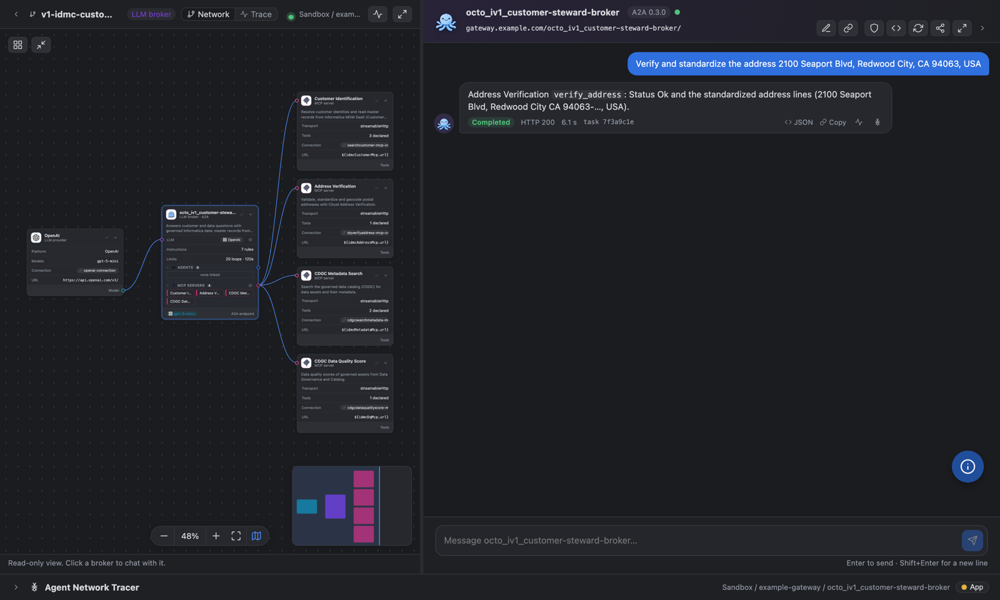

# IDMC Customer Data Steward (needs Informatica IDMC)

> One LLM broker over four Informatica shared MCP servers: verify addresses, search the data catalog (CDGC), read data quality scores and look up MDM master records. Needs your own Informatica IDMC org and an IDMC MCP client (OAuth 2.0 client credentials).

| | |
|---|---|
| Style | Probabilistic (Agent Network 1.0) |
| Kind | Informatica IDMC |
| Agents / MCP servers | 0 / 4 |
| A2A protocol | 0.3.0 |
| Policies | none |
| Asset prefix | `octo_iv1` |
| Tutorial | [IDMC Customer Data Steward (needs Informatica IDMC): tutorial](../tutorials/v1-idmc-customer-steward.md) |

<small>The network canvas</small>

<small>Chat with the deployed broker</small>

A probabilistic broker over four Informatica IDMC shared MCP servers: it looks customers up in MDM SaaS, verifies and standardizes addresses, and answers catalog and data quality questions from Data Governance and Catalog (CDGC).

- Style: Probabilistic (Agent Network 1.0): the LLM broker picks the tools from its instructions.
- Agents: none (one broker)
- MCP servers: Customer Identification (search_master_record, get_master_record_details); Address Verification (verify_address); CDGC Metadata Search (search_metadata, get_asset_details); CDGC Data Quality Score (get_asset_score)
- Authentication: every MCP connection uses OAuth 2.0 client credentials (`idmc.clientId`, `idmc.clientSecret`, `idmc.tokenUrl`).

No credentials are stored in this template.

## Before you start: what you need in Informatica IDMC

This template does not run on mocks. It calls four **Informatica shared MCP servers**, so you need an IDMC org with these in place:

1. **An IDMC org and its pod.** Log in to IDMC and note the pod in the address bar: `https://<pod>.informaticacloud.com` (for example `dmp-us`, `dm-us`, `dm-em`). The defaults in `exchange.json` use `dmp-us`. For another pod, replace `dmp-us` in the four URL variables and in `idmc.tokenUrl`.
2. **The services behind the four MCP servers**, licensed and enabled in the org:
   - Customer Identification (`searchcustomer`): needs **MDM SaaS Customer 360** with person or organization business entities. Without it, customer lookups answer "business entity … is not valid" and the broker carries on with the other steps.
   - Address Verification (`dqverifyaddress`): Data Quality address verification.
   - CDGC Metadata Search (`cdgcsearchmetadata`) and CDGC Data Quality Score (`cdgcdataqualityscore`): **Data Governance and Catalog** with catalogued assets (and data quality scores for the score tool).
   In IDMC, open **MCP Servers** (or the IDMC MCP server registry) and check that the four shared servers are listed and enabled for the org.
3. **An IDMC MCP client** (OAuth 2.0 client credentials): in IDMC, create an MCP client for the shared MCP servers and copy its **Client ID** and **Client Secret**. The token URL of your pod is `https://<pod>.informaticacloud.com/authz-service/oauth/token` (variable `idmc.tokenUrl`). The gateway gets and renews the bearer token itself, so there is no session to refresh.
4. **The server URLs.** Each URL variable holds the full server URL, `https://mcp.<pod>.informaticacloud.com/mcp-servers/public/<server>`, and the transport path of each MCP server is `/mcp`. Do not shorten the URL to the host: the broker calls `<url>/mcp`, and IDMC answers the host alone with 405 (text/html), which shows as a 502 in the chat. Octoloom warns in Problems when a connection URL is only the IDMC host.

Keep the Client ID and Client Secret out of the files: Octoloom asks for them at Deploy (and Run locally) and stores nothing.

## Deploy in 3 steps

1. **Setup & Connect**: connect Agent Fabric (connected app client ID and secret, organization). The IDMC side needs no connection in Octoloom: the gateway authenticates with the IDMC MCP client. The `groupId` in `exchange.json` is filled with your organization at Build. Run **Validate Project** first for a dry run of build, publish and deploy.
2. In `exchange.json`, fill in `ingressgw.url` (ingress gateway base url). Check the pod in the four URL variables and `idmc.tokenUrl`. In **Projects & Deploy**, click **Deploy** on this project (or **Build & Deploy** in the editor) and pick your gateway. Octoloom asks for each secret variable; nothing you type is stored:
   - `openai.apiKey`: your OpenAI API key (required)
   - `idmc.clientId`: the Client ID of your IDMC MCP client (required)
   - `idmc.clientSecret`: the Client Secret of your IDMC MCP client (required)
3. When the status light turns green (**Deployed and running**), click **Open chat** and paste a prompt below. The trace icon under a reply shows each step and tool call.

## Try it

- **Verify and standardize the address 2100 Seaport Blvd, Redwood City, CA 94063, USA**
  - You should see: Address Verification `verify_address`: Status Ok and the standardized address lines (2100 Seaport Blvd, Redwood City CA 94063-…, USA).
- **Which catalog assets hold customer data, and what is their data quality score?**
  - You should see: CDGC Metadata Search `search_metadata`: a list of catalog hits (data collections, classifications, protections, fields) with name and type, then CDGC Data Quality Score `get_asset_score`: the score of the most relevant asset, or that no score is recorded.
- **Check the address 2100 Seaport Blvd, Redwood City, CA 94063 and tell me which catalog assets hold customer address or contact data**
  - You should see: `verify_address` with Status Ok first, then the catalog hits for customer address and contact data from `search_metadata`.
- **Find the customer John Smith, address 2100 Seaport Blvd, Redwood City, CA 94063**
  - You should see: Customer Identification `search_master_record`: the master record (business ID, name, address) when MDM SaaS Customer 360 is in place; without it, one sentence with the MDM error ("business entity … is not valid"), then the address check.

The hits, scores and records come from your own IDMC org, so they differ from org to org.

In some Agent Fabric runtimes `verify_address` answers "Required arguments are missing for the field [IO]" even when the broker sends a complete address. The broker then reports the error and continues with the other steps. For address checks, the **IDMC Data Trust** (v2) template calls the same tool reliably.

The broker is probabilistic: the LLM picks the tools, so the wording and the order of the calls can change between runs.
