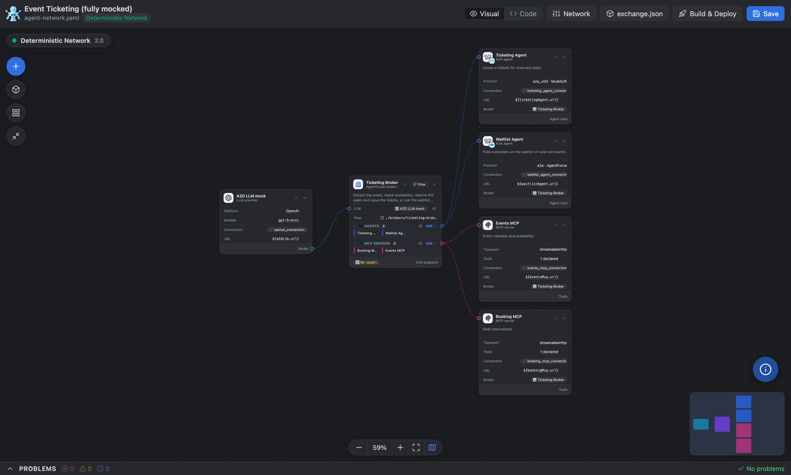
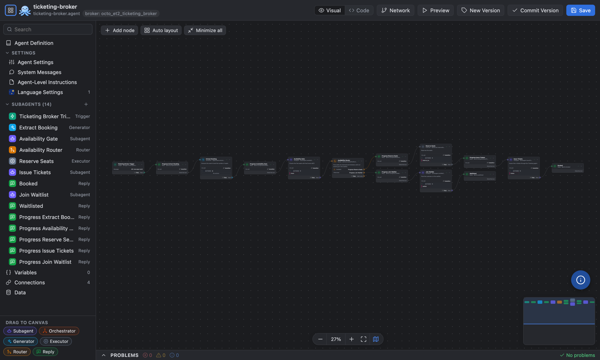
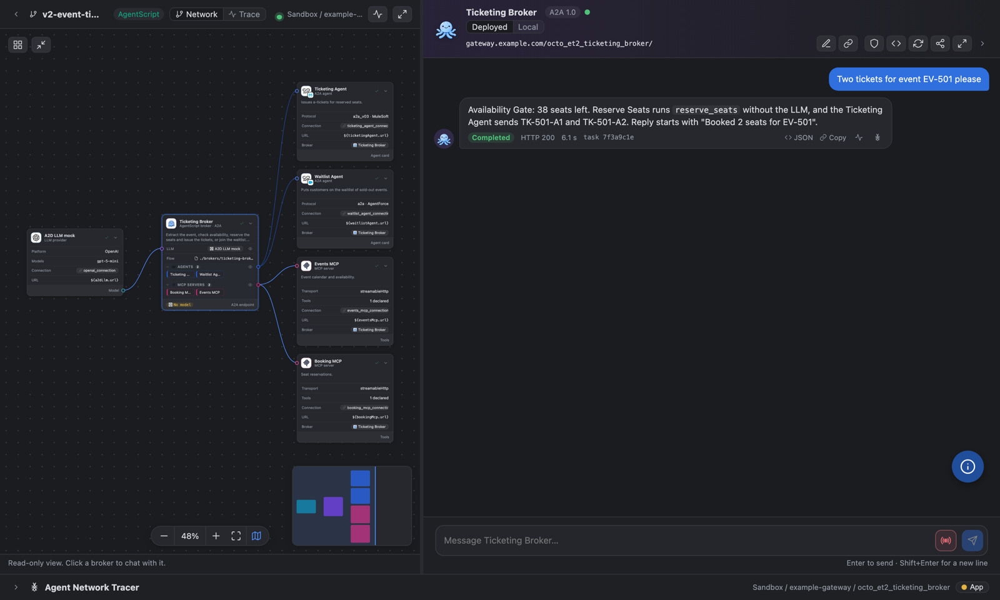

# Event Ticketing (fully mocked)

> Extract the event, check availability, reserve the seats and issue the tickets, or join the waitlist. Fully mocked: the LLM is an A²D LLM mock too, so no OpenAI key is needed.

| | |
|---|---|
| Style | Deterministic (Agent Network 2.0, AgentScript) |
| Kind | Fully mocked |
| Agents / MCP servers | 2 / 2 |
| A2A protocol | 0.3.0, 1.0 |
| Policies | none |
| Asset prefix | `octo_et2` |
| Tutorial | [Event Ticketing (fully mocked): tutorial](../tutorials/v2-event-ticketing.md) |
| Files | [templates/v2-event-ticketing](https://github.com/A2D-Agentic-Asset-Designer/octoloom-assets/tree/main/templates/v2-event-ticketing) |

<small>The network canvas</small>

<small>The broker flow (AgentScript)</small>

<small>Chat with the deployed broker</small>

Extract the event, check availability, reserve the seats and issue the tickets, or join the waitlist. Fully mocked: the LLM is an A²D LLM mock too, so no OpenAI key is needed.

- Style: Deterministic (Agent Network 2.0): an AgentScript flow in `brokers/` decides each step.
- Agents: Ticketing Agent (A2A 0.3.0, MuleSoft), Waitlist Agent (A2A 1.0, AgentForce)
- MCP servers: Events MCP (check_availability); Booking MCP (reserve_seats)

Fully mocked: the agents, the MCP servers **and the LLM** are public A2D mocks, so the network runs without an OpenAI key or any other system. The LLM mock answers the prompts below with scripted tool calls and replies; any other prompt gets a short hint. No credentials are stored in this template.

## Deploy in 3 steps

1. **Setup & Connect**: connect Agent Fabric (connected app client ID and secret, organization). A²D is not needed: the mock URLs are already the defaults in `exchange.json`.
2. In **Projects & Deploy**, click **Deploy** on this project (or **Build & Deploy** in the editor) and pick your gateway. Octoloom asks for each secret variable; nothing you type is stored:
   - `a2dLlm.apiKey`: the A²D LLM mock key: keep the default, any value works
3. When the status light turns green (**Deployed and running**), click **Open chat** and paste a prompt below. The **Tracer** icon under a reply opens the task in the Agent Network Tracer, with each agent and tool call.

## Try it

- **Two tickets for event EV-501 please**
  - You should see: Availability Gate: 38 seats left. Reserve Seats runs `reserve_seats` without the LLM, and the Ticketing Agent sends TK-501-A1 and TK-501-A2. Reply starts with "Booked 2 seats for EV-501".
- **Four seats for EV-502**
  - You should see: Availability Gate: sold out. The Waitlist Agent (A2A 1.0) adds you at position 3 (WL-502-19).

The LLM is an A²D LLM mock: it answers the prompts above with the same tool calls and replies every time (the flow in `brokers/` decides the branches, the mock fills in the LLM steps). Swap `a2dLlm.url` for a real OpenAI-compatible endpoint to let a real model drive it.

**Live progress** (the antenna button next to Send) is on by default: while the broker works, the chat lists the progress updates of the flow (one per step) and keeps them above the answer.
