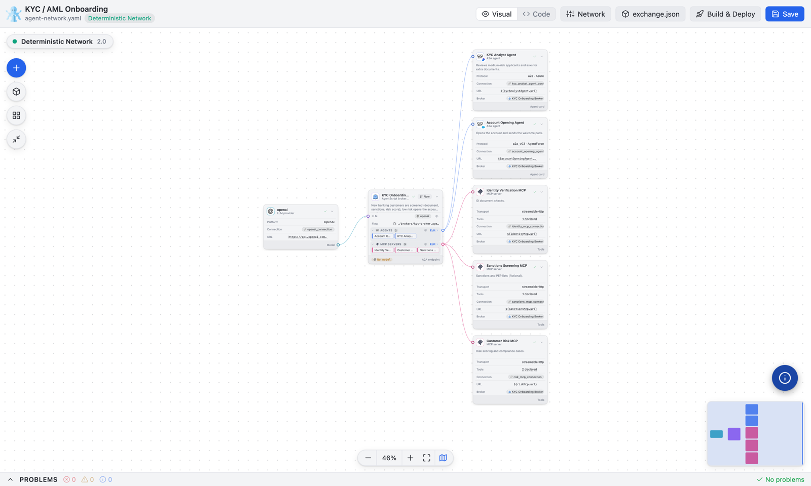
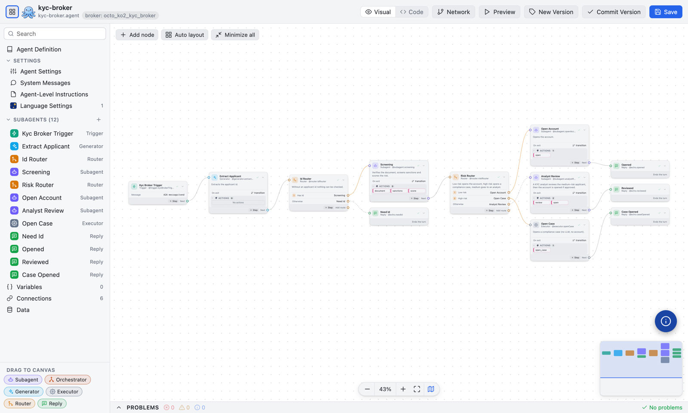
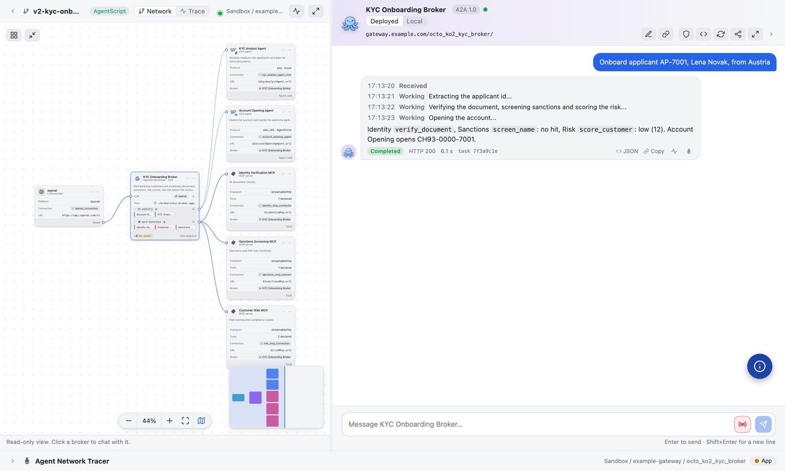

# KYC / AML Onboarding

> New banking customers are screened (document, sanctions, risk score); low risk opens the account, medium goes to an analyst, high opens a compliance case.

| | |
|---|---|
| Style | Deterministic (Agent Network 2.0, AgentScript) |
| Kind | Use case |
| Agents / MCP servers | 2 / 3 |
| A2A protocol | 1.0, 0.3.0 |
| Policies | none |
| Asset prefix | `octo_ko2` |
| Tutorial | [KYC / AML Onboarding: tutorial](../tutorials/v2-kyc-onboarding.md) |
| Files | [templates/v2-kyc-onboarding](https://github.com/A2D-Agentic-Asset-Designer/octoloom-assets/tree/main/templates/v2-kyc-onboarding) |

<small>The network canvas</small>

<small>The broker flow (AgentScript)</small>

<small>Chat with the deployed broker</small>

New banking customers are screened (document, sanctions, risk score); low risk opens the account, medium goes to an analyst, high opens a compliance case.

- Style: Deterministic (Agent Network 2.0): an AgentScript flow in `brokers/` decides each step.
- Agents: KYC Analyst Agent (A2A 1.0, Azure), Account Opening Agent (A2A 0.3.0, AgentForce)
- MCP servers: Identity Verification MCP (verify_document); Sanctions Screening MCP (screen_name); Customer Risk MCP (score_customer, open_case)

All agents and MCP servers are public A2D mocks, so the network runs without any other system. No credentials are stored in this template.

## Deploy in 3 steps

1. **Setup & Connect**: connect Agent Fabric (connected app client ID and secret, organization). A²D is not needed: the mock URLs are already the defaults in `exchange.json`.
2. In **Projects & Deploy**, click **Deploy** on this project (or **Build & Deploy** in the editor) and pick your gateway. Octoloom asks for each secret variable; nothing you type is stored:
   - `openai.apiKey`: your OpenAI API key (required)
3. When the status light turns green (**Deployed and running**), click **Open chat** and paste a prompt below. The **Tracer** icon under a reply opens the task in the Agent Network Tracer, with each agent and tool call.

## Try it

- **Onboard applicant AP-7001, Lena Novak, from Austria**
  - You should see: Identity `verify_document`, Sanctions `screen_name`: no hit, Risk `score_customer`: low (12). Account Opening opens CH93-0000-7001.
- **Onboard applicant AP-7002 from Germany**
  - You should see: Risk medium (48): the KYC Analyst confirms the source of funds, and Account Opening opens CH93-0000-7002 with enhanced monitoring.
- **Onboard applicant AP-7003, Victor Example, from Panama**
  - You should see: Sanctions hit (0.93), risk high (91): Risk `open_case` opens CMP-2026-0419. No account.
- **Onboard applicant AP-9999**
  - You should see: No document on file, so the risk band is medium and the KYC Analyst asks for more proof; no account is opened.

The broker is deterministic: the branches are fixed in the flow in `brokers/` (open the `.agent` file to see them). The LLM only reads the ids from your prompt and writes the reply text, so the same input takes the same branch.

**Live progress** (the antenna button next to Send) is on by default: while the broker works, the chat lists the progress updates of the flow (one per step) and keeps them above the answer.
