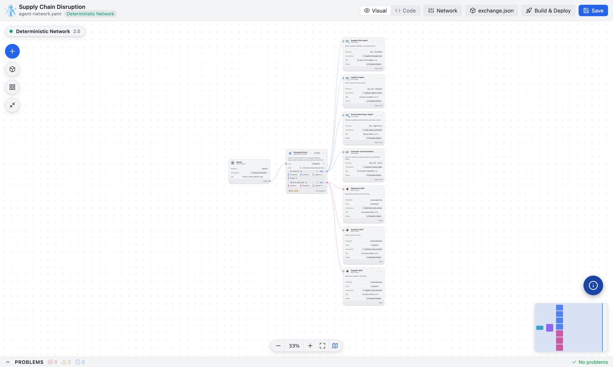
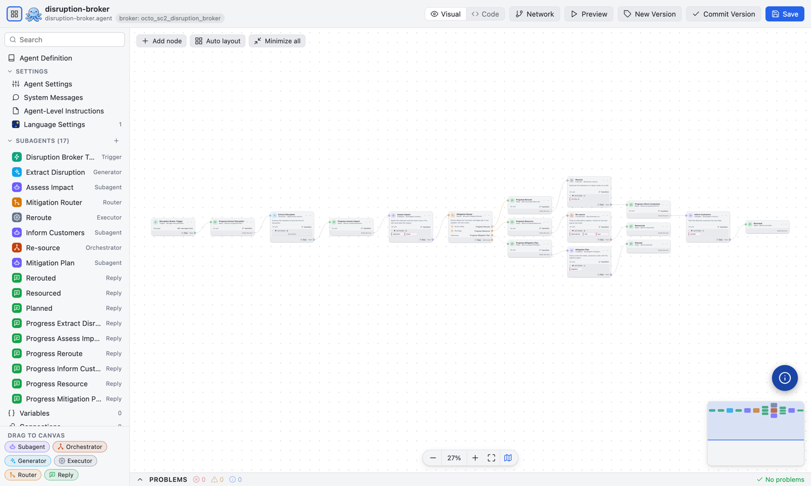
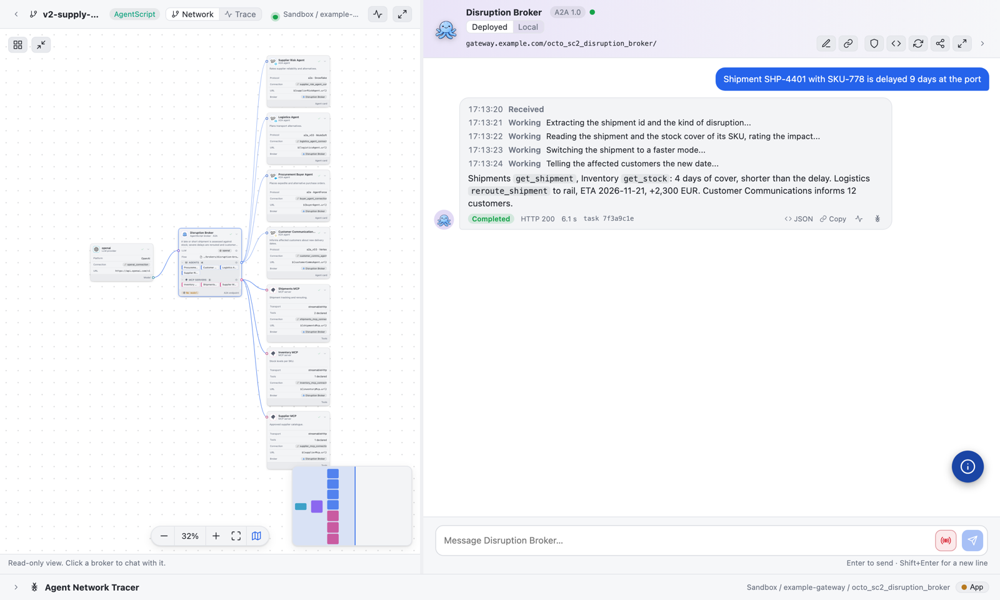

# Supply Chain Disruption

> A late or short shipment is assessed against stock; severe delays are rerouted and customers told, other cases get a mitigation plan.

| | |
|---|---|
| Style | Deterministic (Agent Network 2.0, AgentScript) |
| Kind | Use case |
| Agents / MCP servers | 4 / 3 |
| A2A protocol | 1.0, 0.3.0 |
| Policies | none |
| Asset prefix | `octo_sc2` |
| Tutorial | [Supply Chain Disruption: tutorial](../tutorials/v2-supply-chain.md) |
| Files | [templates/v2-supply-chain](https://github.com/A2D-Agentic-Asset-Designer/octoloom-assets/tree/main/templates/v2-supply-chain) |

<small>The network canvas</small>

<small>The broker flow (AgentScript)</small>

<small>Chat with the deployed broker</small>

A late or short shipment is assessed against stock; severe delays are rerouted and customers told, other cases get a mitigation plan.

- Style: Deterministic (Agent Network 2.0): an AgentScript flow in `brokers/` decides each step.
- Agents: Supplier Risk Agent (A2A 1.0, Snowflake), Logistics Agent (A2A 0.3.0, MuleSoft), Procurement Buyer Agent (A2A 1.0, AgentForce), Customer Communications Agent (A2A 0.3.0, Vertex)
- MCP servers: Shipments MCP (get_shipment, reroute_shipment); Inventory MCP (get_stock); Supplier MCP (find_alternative_supplier)

All agents and MCP servers are public A2D mocks, so the network runs without any other system. No credentials are stored in this template.

## Deploy in 3 steps

1. **Setup & Connect**: connect Agent Fabric (connected app client ID and secret, organization). A²D is not needed: the mock URLs are already the defaults in `exchange.json`.
2. In **Projects & Deploy**, click **Deploy** on this project (or **Build & Deploy** in the editor) and pick your gateway. Octoloom asks for each secret variable; nothing you type is stored:
   - `openai.apiKey`: your OpenAI API key (required)
3. When the status light turns green (**Deployed and running**), click **Open chat** and paste a prompt below. The **Tracer** icon under a reply opens the task in the Agent Network Tracer, with each agent and tool call.

## Try it

- **Shipment SHP-4401 with SKU-778 is delayed 9 days at the port**
  - You should see: Shipments `get_shipment`, Inventory `get_stock`: 4 days of cover, shorter than the delay. Logistics `reroute_shipment` to rail, ETA 2026-11-21, +2,300 EUR. Customer Communications informs 12 customers.
- **Supplier reports a shortage of SKU-912 for shipment SHP-4402**
  - You should see: Inventory: 21 days of cover. Supplier Risk: SUP-12 is high risk; `find_alternative_supplier`: SUP-31 in 5 days at +4%. Buyer places PO-66120 for 4,000 units, delivery 2026-11-18.

The broker is deterministic: the branches are fixed in the flow in `brokers/` (open the `.agent` file to see them). The LLM only reads the ids from your prompt and writes the reply text, so the same input takes the same branch.

**Live progress** (the antenna button next to Send) is on by default: while the broker works, the chat lists the progress updates of the flow (one per step) and keeps them above the answer.
