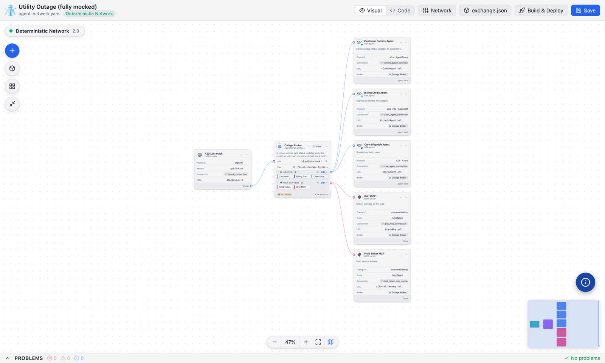
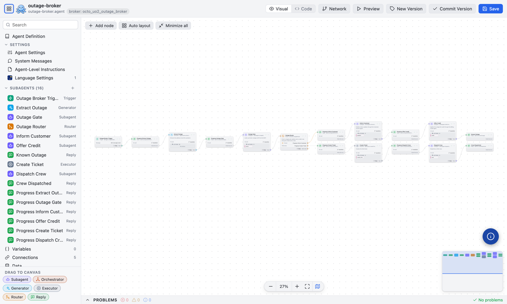
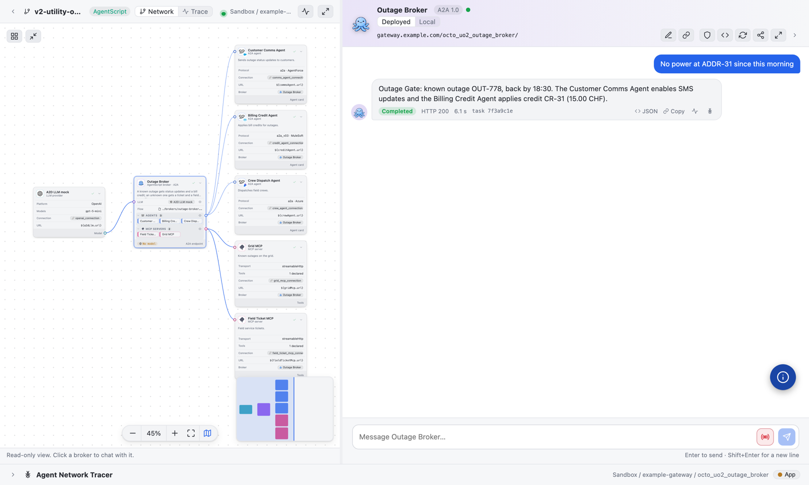

# Utility Outage (fully mocked)

> A known outage gets status updates and a bill credit; an unknown one gets a ticket and a field crew. Three agents, two tool servers. Fully mocked: the LLM is an A²D LLM mock too, so no OpenAI key is needed.

| | |
|---|---|
| Style | Deterministic (Agent Network 2.0, AgentScript) |
| Kind | Fully mocked |
| Agents / MCP servers | 3 / 2 |
| A2A protocol | 1.0, 0.3.0 |
| Policies | none |
| Asset prefix | `octo_uo2` |
| Tutorial | [Utility Outage (fully mocked): tutorial](../tutorials/v2-utility-outage.md) |
| Files | [templates/v2-utility-outage](https://github.com/A2D-Agentic-Asset-Designer/octoloom-assets/tree/main/templates/v2-utility-outage) |

<small>The network canvas</small>

<small>The broker flow (AgentScript)</small>

<small>Chat with the deployed broker</small>

A known outage gets status updates and a bill credit; an unknown one gets a ticket and a field crew. Three agents, two tool servers. Fully mocked: the LLM is an A²D LLM mock too, so no OpenAI key is needed.

- Style: Deterministic (Agent Network 2.0): an AgentScript flow in `brokers/` decides each step.
- Agents: Customer Comms Agent (A2A 1.0, AgentForce), Billing Credit Agent (A2A 0.3.0, MuleSoft), Crew Dispatch Agent (A2A 1.0, Azure)
- MCP servers: Grid MCP (get_outage); Field Ticket MCP (create_ticket)

Fully mocked: the agents, the MCP servers **and the LLM** are public A2D mocks, so the network runs without an OpenAI key or any other system. The LLM mock answers the prompts below with scripted tool calls and replies; any other prompt gets a short hint. No credentials are stored in this template.

## Deploy in 3 steps

1. **Setup & Connect**: connect Agent Fabric (connected app client ID and secret, organization). A²D is not needed: the mock URLs are already the defaults in `exchange.json`.
2. In **Projects & Deploy**, click **Deploy** on this project (or **Build & Deploy** in the editor) and pick your gateway. Octoloom asks for each secret variable; nothing you type is stored:
   - `a2dLlm.apiKey`: the A²D LLM mock key: keep the default, any value works
3. When the status light turns green (**Deployed and running**), click **Open chat** and paste a prompt below. The **Tracer** icon under a reply opens the task in the Agent Network Tracer, with each agent and tool call.

## Try it

- **No power at ADDR-31 since this morning**
  - You should see: Outage Gate: known outage OUT-778, back by 18:30. The Customer Comms Agent enables SMS updates and the Billing Credit Agent applies credit CR-31 (15.00 CHF).
- **The lights flicker at ADDR-44**
  - You should see: Outage Gate: no known outage. Create Ticket runs `create_ticket` without the LLM, and the Crew Dispatch Agent sends crew C-12 (about 45 minutes).

The LLM is an A²D LLM mock: it answers the prompts above with the same tool calls and replies every time (the flow in `brokers/` decides the branches, the mock fills in the LLM steps). Swap `a2dLlm.url` for a real OpenAI-compatible endpoint to let a real model drive it.
