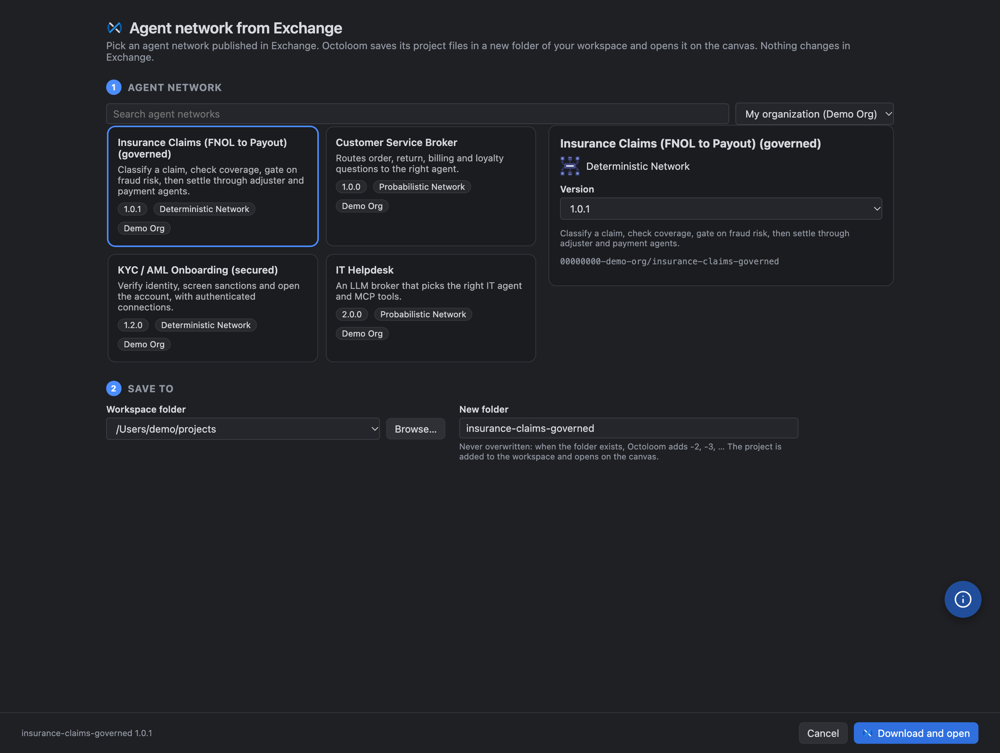

# Agent network from Exchange

Continue work on an agent network that is already published in Exchange, by you on another machine or by a colleague. Click the **Exchange icon** next to **+** in Projects & Deploy, or choose **From Exchange** in the **+** menu. The dialog lists only **Agent Network** assets: your organization first, or everything you can see. You can search them and pick a version. Each one shows whether it is Deterministic (v2) or Probabilistic (v1).

**Download and open** saves the version's project files (`agent-network.yaml`, `exchange.json` and `brokers/*.agent`) in a **new folder** of your workspace folder. Existing folders are never overwritten: Octoloom adds `-2`, `-3`, and so on. The project is added to the workspace and opens on the canvas. Only read calls go to Exchange. Secrets are not part of the asset, so you set them again at deploy. If the `exchange.json` version is already in Exchange, bump it before the next Publish.

## Buttons and components

The same text as the in-app **Explain** button (click the floating info button, then the item).

### Agent network from Exchange

Downloads an agent network that is published in Exchange (by you or a colleague) and opens it as an Octoloom project. The dialog lists only Agent Network assets, Deterministic and Probabilistic. The chosen version is saved in a new folder of your workspace, which is never overwritten.

**When to use it:** To reuse, review, govern or redeploy a network that lives in Exchange, or to continue work on another machine.

**Examples:**

- Click the Exchange icon next to + in Projects & Deploy, or choose From Exchange in the + menu
- Search by name, switch between your organization and everything you can see, and pick a version
- Secrets are not in Exchange: set them again when you deploy
- If the exchange.json version is already published, bump it before the next Publish
