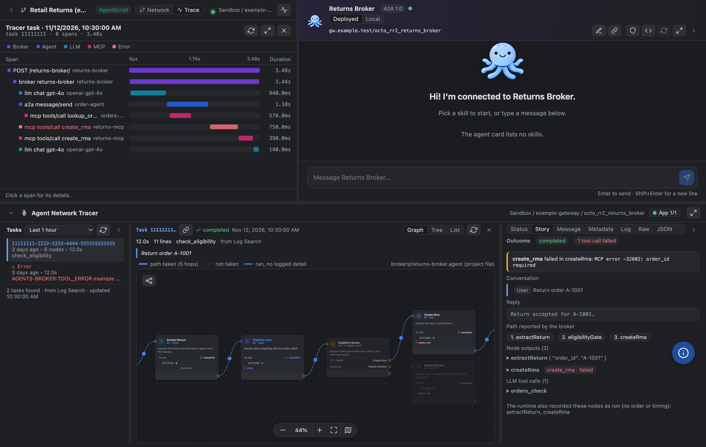
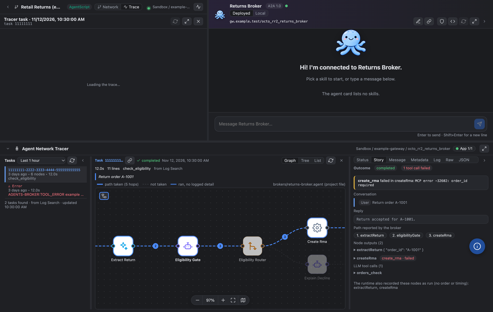

# Agent Network Tracer

Click the **Tracer** button on a project's **Deployed and running** box in Projects & Deploy, or the **Tracer** icon under a deployed chat reply. The chat panel opens with the Tracer below the network and the chat. The **Full height** icon at the right end of the Tracer header hides the network and the chat; press it again to bring them back.

- **Tasks** (left): the broker's tasks in the period you pick, newest first, with their nodes, time and tools. Error-only runs are marked in red. Opening a task also shows its span waterfall in the chat's **Trace** view above (top left).
- **Task** (middle): **Graph** draws the broker's `.agent` flow with Octoloom's own cards and the path the task took: numbered hops, and dimmed nodes it didn't reach. **Minimize all** (the workflow icon at the top left of the graph, one node branching to two) turns the cards into icons, as on the flow canvas, so long flows fit; press it again (**Open all**, two linked cards) to bring them back. **Tree** lists the nodes in order (iterations for v1 brokers) and **List** shows every log line.

  

- **Detail** (right): **Status** (data sources), **Story** (the conversation, node outputs and failed tools the broker stored), **Message**, **Metadata**, **Log**, **Raw** and **JSON**. The task's Observability spans are in the chat's **Trace** view above, which opens when you open the task.
- **JSON** is the whole task as one document (`octoloom.tracer.task/v1`) or NDJSON, to send to Splunk or Datadog. Credentials are masked.
- Drag the edges of the Tasks and Detail columns to resize them; the arrow buttons hide or show them.
- **Read-only**: the Tracer only reads from Log Search, runtime logs, Object Store and Observability, and never changes anything in your organization. The organization, environment and broker come from the project's deployment. The Agent Fabric connected app makes the calls from VS Code; tokens never reach the webview.
- The **access pill** (for example *App 10/10*) checks each Anypoint API the Tracer uses. When one fails, it names the permission to add to the connected app, or offers to trace with your own Anypoint Code Builder sign-in instead. The choice is remembered per connection.
- Deployed brokers only: local runs have no Anypoint logs.

## Buttons and components

The same text as the in-app **Explain** button (click the floating info button, then the item).

### Agent Network Tracer

Shows what a deployed broker did for each task: the nodes it ran, the tools and LLMs it called, what failed and why. Read-only: it only reads logs and task state from Anypoint (Log Search, runtime logs, Object Store and Observability spans) and never changes anything in your organization. The organization, environment and broker come from the project's deployment, and the Agent Fabric connected app makes the calls. Three columns: Tasks, the task (Graph, Tree or List) and the detail of what you pick.

**When to use it:** After a chat turn or a failed task on a deployed broker, to see the path it took and where it went wrong. It needs a deployed, running broker: local runs have no Anypoint logs.

**Examples:**

- Tracer button on a "Deployed and running" box in Projects & Deploy: opens the chat with the Tracer below it
- Tracer icon under a deployed chat reply: opens that turn's task (logs arrive about 20 seconds after a turn)
- Graph: the broker's .agent flow with the path taken (numbered hops); nodes not reached are dimmed. Tree: the nodes in order; List: every log line
- Click a node or a line, then read it in Message, Metadata or Log (the spans are in the chat's Trace view); Story shows the conversation and node outputs the broker stored
- JSON: the whole task as one document (or NDJSON) for Splunk or Datadog, with credentials masked
- The access pill (App 10/10) checks each Anypoint API; when one fails it names the permission to add to the connected app, or traces with your own Anypoint Code Builder sign-in instead
- Drag the edges of the Tasks and detail columns to resize them; the arrow buttons hide or show them. Full height hides the network and the chat; the full-height icon in the chat header does the opposite (chat only)
- v1 brokers: Mule logs carry no trace id, so the spans are found by time (the [BROKER] span that covers the task) and marked "matched by time"; v2 brokers match by trace id
- Opening a task in the Tasks list also shows its span waterfall in the chat's Trace view (top left); the Full height icon at the right of the Tracer header gives the Tracer the whole panel
- Minimize all (the workflow icon top left of the Graph: one node branching to two) turns every node into its icon so long flows fit; the path taken stays highlighted. Press it again (Open all, two linked cards) to bring the cards back. The choice is kept per broker file
- Large environments: the broker is found among all API Manager instances (every page is read), so it works with hundreds of APIs. Runtime logs and the Object Store are found through the deployment named in the broker's upstream URL (http://<deployment>:8081/<broker>/)
