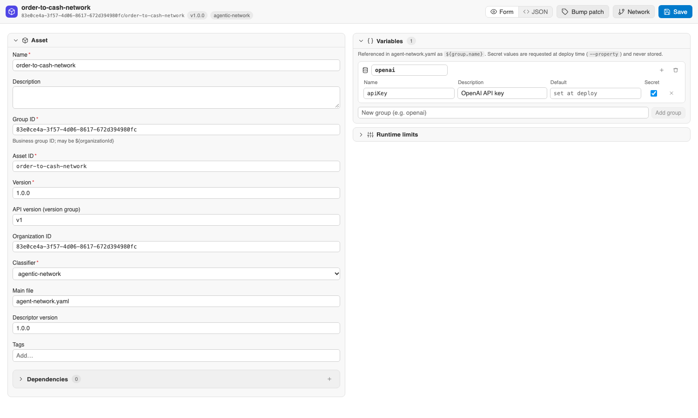

# Asset editor (`exchange.json`)

A form for the Exchange descriptor: asset identity, version, variables and their defaults (secrets are masked), and dependencies.

## Buttons and components

The same text as the in-app **Explain** button (click the floating info button, then the item).

### exchange.json editor

A form over the exchange.json of a project: its name, version, variables and the Exchange assets it depends on. The fields that must match agent-network.yaml and the connected organization (Group ID, Organization ID, classifier, main, descriptor version) and the dependency list sit behind a lock: read-only each time the form opens, one click on the lock opens them for editing, another click locks them again. The JSON view always edits everything, and the file stays a normal file in the Explorer. Under Asset, the network description is the one Exchange shows on the asset page; it comes from agent-network.yaml. Findings about the project show at the top with a Fix button.

**When to use it:** Before publishing, or when a dependency or variable changes.

**Examples:**

- Bump the version before a new publish
- Click the lock on Protected Exchange defaults to change the Group ID, click it again to lock it
- "main is net.yaml": click Set main to agent-network.yaml
- Network description empty: click Copy the exchange.json description, it never overwrites one that is there

### exchange.json

Opens the Exchange descriptor of this project in its form: name, version, variables, dependencies and runtime limits.

**When to use it:** To change the version, a variable default or what Exchange shows.

**Examples:**

- Set a variable default for deploy and local runs
