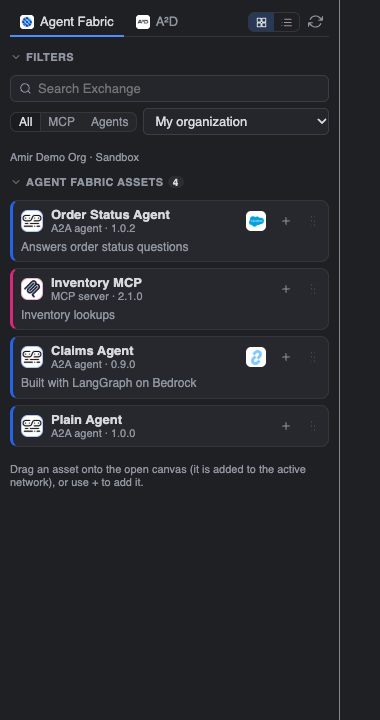
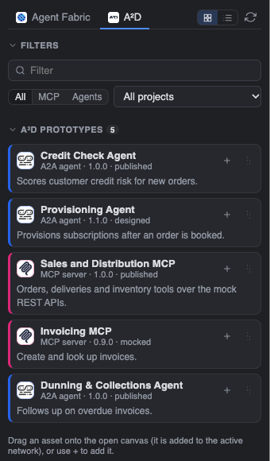
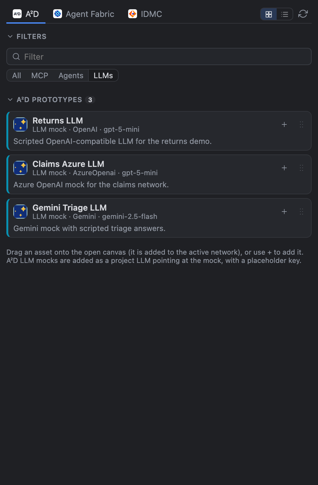
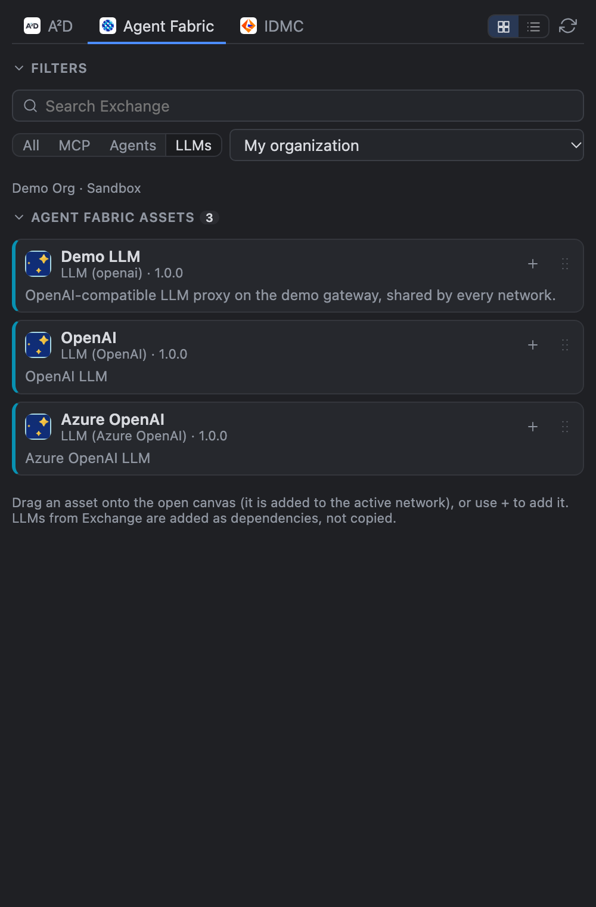
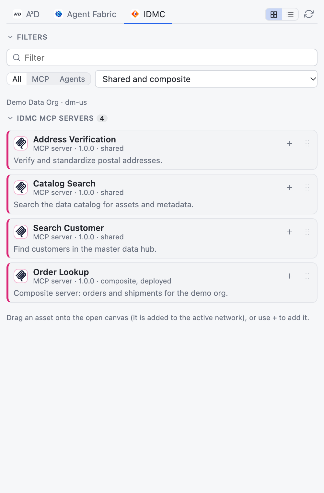

Design

# Asset Palette

<strong>Every asset you can drop on a canvas: Agent Fabric (Exchange) agents, MCP servers and LLMs, A²D prototypes and mocks, Informatica IDMC MCP servers.</strong> Reuse what is already published or mocked instead of typing URLs.

!!! info "Where to find it"
    Side bar → **Asset Palette** · **Palette** button on the canvas

<figure markdown>
{ loading=lazy }
{ loading=lazy }
<figcaption>Agent Fabric tab, LLMs filter</figcaption>
</figure>

| # | Control | What it does |
|---|---|---|
| 1 | **A²D** | A²D · prototype MCP servers, agents and LLM mocks |
| 2 | **Agent Fabric** | Agent Fabric · Exchange |
| 3 | **IDMC** | Headless IDMC · shared and composite MCP servers |
| 4 | **Cards** | Show the results as cards |
| 5 | **Rows** | Show the results as rows |
| 6 | **Refresh** | Read the data again |
| 7 | **All** | Show all |
| 8 | **MCP** | Show MCP servers |
| 9 | **Agents** |  |
| 10 | **LLMs** | LLM providers per network |
| 11 | **Add to the active editor** |  |

## How to use it

1. Pick the tab: **A²D**, **Agent Fabric** or **IDMC**.
2. Filter by type (All, MCP, Agents, LLMs) or search.
3. Drag an asset onto the open canvas: it is added to the network with its connection.

## More screenshots

<figure markdown>
{ loading=lazy }
{ loading=lazy }
<figcaption>A²D tab: LLM mocks</figcaption>
</figure>

<figure markdown>
{ loading=lazy }
{ loading=lazy }
<figcaption>IDMC tab: shared and composite MCP servers</figcaption>
</figure>

<figure markdown>
{ loading=lazy }
{ loading=lazy }
<figcaption>A connection error with its details</figcaption>
</figure>

<figure markdown>
{ loading=lazy }
{ loading=lazy }
<figcaption>A pod without Headless IDMC: the message names the AI Engineering license</figcaption>
</figure>

## In detail

- **Agent Fabric** tab: MCP servers, A2A agents and LLMs published in Exchange for your organization. You can include public assets.
- When loading assets fails, the error has an **info** button with the details: HTTP status, the server's answer, the network cause and the URL.
- **A²D** tab: your A²D prototype MCP servers and agents with their hosted mocks, filtered by A²D project.
- **IDMC** tab: the shared Informatica MCP servers of your pod and the composite MCP servers of your org. Headless IDMC needs the **AI Engineering** license in your Informatica org and a pod that runs Headless IDMC (the `hdm.<pod>` host; for example `dmp-em` has none). Without them the tab says so in plain words, and connecting warns you.
- Search, filter (All / MCP / Agents, plus LLMs on the Agent Fabric and A²D tabs; IDMC has no LLMs), and switch between card and row layouts.
- Expand a card to see its URL, Exchange coordinates, tools and skills.
- **Drag** an asset onto the canvas, or click **+**, to add it to the active network:
  - **Agent Fabric** assets are *referenced*, not copied. Octoloom adds the broker link or tool, a connection, an `exchange.json` variable for the URL, and an `exchange.json` **dependency** (`agent-metadata` / `mcp-metadata`, with group and version). The CLI resolves the card, skills and tools from that dependency at build time, so nothing is published twice. Assets from another business group get a `namespace` on the reference.
  - **LLMs** from Exchange (for example your LLM proxy, or MuleSoft `openai`) are referenced the same way: an `llm-metadata` dependency, an LLM connection with a URL variable and a secret `apiKey` variable, and, dropped on a broker, the broker's LLM. Publish creates no new LLM asset. LLMs with an input format (MuleSoft `openai`) work in Deterministic (v2) networks only; the Probabilistic (v1) build rejects them (error 3061).
  - **A²D** assets have no Exchange asset yet, so Octoloom declares them in the network (agent card or MCP tools) with their connection and URL variable.
  - **A²D LLM mocks** (OpenAI, Azure OpenAI, Bedrock OpenAI, Gemini) are declared as a project LLM (v2 `registry.llms`, v1 `llmProviders`) with a connection to the mock URL, a URL variable and a placeholder `apiKey` (`a2d-mock-key`), without an Exchange dependency. Dropped on a broker, the broker switches to the mock's first model. The fully mocked templates are built this way.
- Each card shows an origin tag (**A²D** or **Agent Fabric**) and its framework logo.
- New Deterministic (v2) projects and the v2 templates reference MuleSoft `openai` instead of declaring their own LLM. For a v2 project that declares an OpenAI LLM in `registry.llms`, Problems offers a Fix that switches it to MuleSoft `openai`.

 

## Buttons and components

The same text as the in-app **Explain** button (click the floating **i**, then the item).

### Assets

The assets you can add to a network: agents and MCP servers from Exchange, A²D, Headless IDMC and your project, and LLMs from Exchange and A²D. Each card is one asset. The Agent Fabric and A²D tabs have the LLMs filter; IDMC has MCP servers and agents only. A²D LLMs are LLM mocks: fake OpenAI, Azure OpenAI or Gemini LLMs hosted by A²D that answer from scenarios (broker answers, tool calls, errors, delays), so a network runs without a real model key. Dropping one adds a project LLM (registry.llms in v2, llmProviders in v1) and an LLM connection to the mock URL, with no Exchange dependency; a mock that accepts any key gets the placeholder key a2d-mock-key, and dropped on a broker it becomes the broker LLM with the first model of the mock. The IDMC tab lists the shared Informatica MCP servers of your pod and the composite MCP servers of your org (it needs the AI Engineering license in your Informatica org and a pod that runs Headless IDMC); adding one sets its IDS-SESSION-ID authentication from the secret variable idmc.sessionId in exchange.json. LLMs (the LLMs filter) are published LLM assets: dropping one on a broker adds an exchange.json dependency (llm-metadata), an LLM connection with a URL variable and a secret apiKey variable, and makes it the broker LLM. The LLM is referenced, never copied, so publish creates no new LLM asset. LLMs with an input format (such as MuleSoft openai) work in Deterministic (v2) networks only; the Probabilistic (v1) build rejects them (error 3061).

**When to use it:** While building a network, to find what to drag onto the canvas.

**Examples and details:**

- Drag an asset card onto the network canvas to add it
- Filter the list, or search Exchange
- The hue of a card tells its kind: agent, MCP server or LLM
- IDMC tab: pick Shared or Composite, then drag a server such as Search Customer onto the canvas
- LLMs: drop your LLM proxy (an LLM asset in Exchange) on a broker; set its URL and API key variables in exchange.json or at deploy time
- A²D tab, LLMs: drop an LLM mock on a broker to deploy and chat without an OpenAI key; the reply is the mock scenario answer

### LLMs from Exchange

A network can declare its own LLM (registry.llms in v2, llmProviders in v1): every publish then creates a new LLM asset in Exchange for that project. Referencing a published LLM instead (an exchange.json dependency with classifier llm-metadata and a connection ref with its name and namespace) reuses one asset. New Deterministic (v2) projects and v2 templates reference MuleSoft openai. A Problem (info) points at a v2 project-declared LLM; for an OpenAI LLM its Fix switches the connections to MuleSoft openai and adds the dependency in one undoable edit.

**When to use it:** When your Exchange fills up with one LLM asset per project, or to share one LLM proxy across networks.

**Examples and details:**

- v2: connection ref { name: openai, namespace: <MuleSoft org> } plus the llm-metadata dependency: build has no "Building LLM" step
- v1: spec.llm.ref of the broker names an LLM asset without an input format, plus the dependency; MuleSoft openai is rejected (3061)
- Problems: "LLM … is declared in registry.llms" → Fix: Use MuleSoft's openai from Exchange
- Broker inspector, LLM provider: referenced LLMs are listed as "Exchange asset · v1.0.0"; pick another to replace it, or Remove LLM from broker
- On the canvas a referenced LLM has a dashed icon tile, like every asset from Exchange
