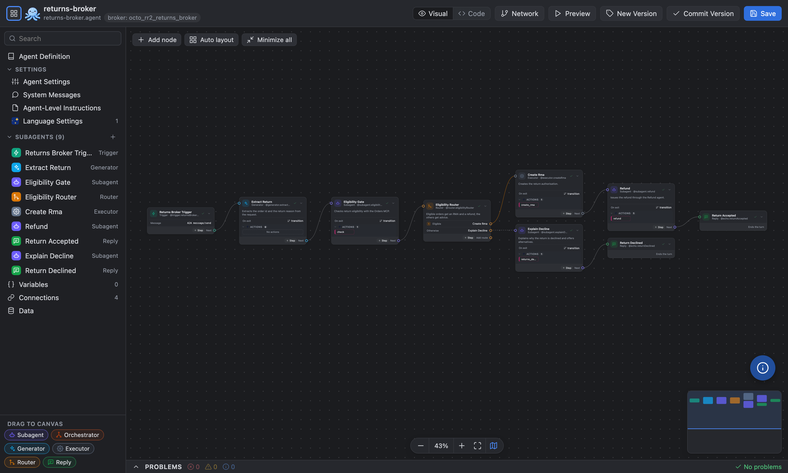
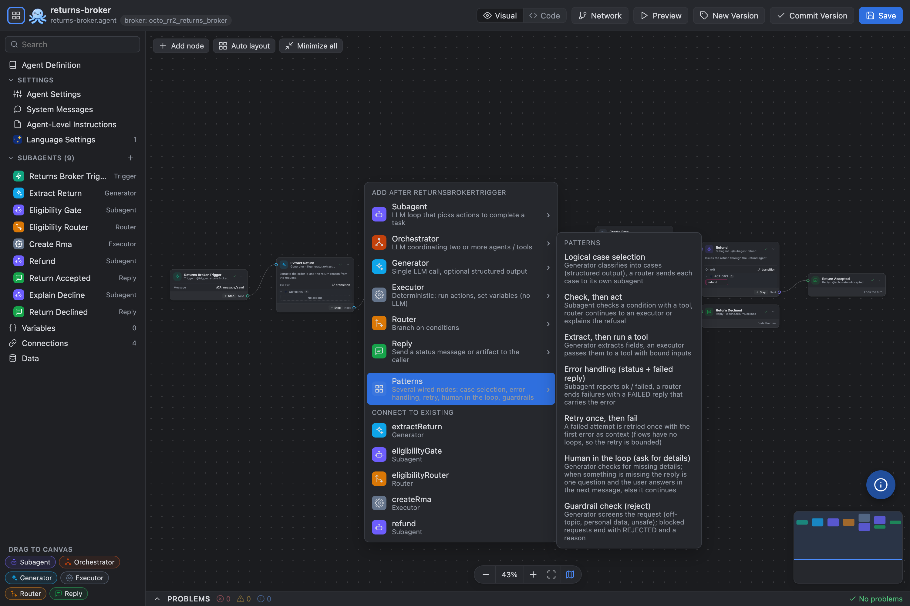

# Broker flow editor (`brokers/*.agent`)



- Every subagent is a node, and transitions, routes and actions are edges.
- The outline lists agent settings, system messages, instructions, language settings and all subagents.
- Drag new nodes onto the canvas: Subagent, Orchestrator, Generator, Executor, Router, Reply.
- **+ Step** or right-click opens a multi-level menu: each node type has an empty entry and templates (structured extraction, classifier, yes/no branch, tool gate, run tool with bound inputs, completed/failed reply…). *Patterns* insert several wired nodes:
  - **Logical case selection**: generator with an enum output → router → one subagent per case.
  - **Check, then act** and **Extract, then run a tool**.
  - **Error handling**: a subagent with an `ok / failed` status → router → reply, or a FAILED reply with the error.
  - **Retry once, then fail**: a second attempt gets the first error as context. Flows have no loops, so the retry is bounded.
  - **Human in the loop**: a generator checks for missing details; when something is missing the reply is one question, answered in the next message.
  - **Guardrail check**: blocked requests end as REJECTED with a reason.

  Replies include Completed, Failed, Canceled and Rejected. Every path must end in a terminal state; the CLI rejects a branch that ends with input required.
- Executors and subagents / orchestrators can run both MCP tools and A2A agents (per the AgentScript reference); the action picker groups them by kind (MCP tools, A2A agents), explains each and suggests the bindings (`with message = ...` for A2A, tool inputs for MCP). Executors cannot slot-fill, so an A2A action run by an executor without `with message = ...` is flagged.
- Drag from an output port onto a card to connect it; click a connection to delete it. A node's type is fixed once created.
- A flow needs a trigger, at least one agent node (generator, subagent or orchestrator) and an echo node; Problems reports what is missing. `@kind.name` references to nodes that don't exist are reported too, as the CLI would.
- Removing a broker from the network offers to delete its `.agent` flow file (moved to the Trash, so you can restore it).
- Instruction fields (and v1 broker instructions) have an **Insert template** picker, with templates for error handling, retry, asking the user for missing details and guardrail screening.


- **Preview** (chat with the deployed broker; A2A 0.3.0 or 1.0 detected from its card, URL prefilled from the last deployment), **New Version** and **Commit Version** actions for AgentScript brokers.

## Buttons and components

The same text as the in-app **Explain** button (click the floating info button, then the item).

### AgentScript flow

The canvas of one .agent file: its nodes (trigger, generator, router, sub-agent, orchestrator, executor, echo) and the paths between them. It edits the AgentScript text.

**When to use it:** Designing the behaviour of one agent.

**Examples:**

- Add a node from the palette on the left
- Select a node to edit it in the inspector
- Switch to the code view to see the AgentScript

### Trigger

Entry point of the flow. Receives the A2A message for a broker interface and transitions to the first node.

**When to use it:** Exactly one per broker file.

**Examples:**

- Start with a generator that extracts ids from the message
- Go straight to a subagent for a simple assistant

```text
trigger mainTrigger:
  kind: "a2a"
  target: "brokers://my_broker/a2a"
  on_message: ->
    transition to @generator.extract
```

### Generator

One LLM call. With outputs.properties it returns typed fields (structured output); add enum to constrain values for a router.

**When to use it:** Extract ids, classify a request, summarize or rewrite text. No tools.

**Examples:**

- Extract order_id and reason from "Return ORD-1001, too small"
- Classify into "billing" | "shipping" | "other"
- Summarize a long complaint in two sentences

```text
generator classify:
  prompt: ->
    | {!@request.payload.message.parts[0].text}
  outputs:
    properties:
      case:
        type: "string"
        enum:
          - "billing"
          - "other"
```

### Router

Deterministic branch. Evaluates routes top to bottom and follows the first whose when condition is true; otherwise is the fallback.

**When to use it:** After a generator or subagent with structured outputs. Conditions use ==, != and and.

**Examples:**

- eligible == "yes" → create the RMA, otherwise explain
- case == "billing" → billing subagent
- risk == "high" and amount > 1000 → manual review

```text
router pick:
  routes:
    - target: @subagent.billing
      when: @generator.classify.output.case == "billing"
  otherwise:
    target: @subagent.general
```

### Subagent

An LLM loop that may call the actions you list (MCP tools or A2A agents) up to max_number_of_loops times, then returns text or structured outputs.

**When to use it:** A step needs judgment plus tools: look something up, ask a specialist agent, check a rule.

**Examples:**

- Tool gate: call check_eligibility, output eligible yes/no
- Delegate to a Refund agent
- Answer a question using a knowledge-base tool

### Orchestrator

Like a subagent, but meant to coordinate several agents and tools in one step, usually following numbered system instructions.

**When to use it:** Two or more agents or tools must be combined and the order can vary.

**Examples:**

- Record FNOL, check coverage, screen fraud, then decide
- Plan a trip with flight, hotel and policy agents

### Executor

Deterministic, no LLM. Runs actions with bound inputs (run @actions.x with a = expr) and sets variables.

**When to use it:** The inputs are known from earlier outputs and the call must happen exactly as written.

**Examples:**

- Create an RMA with order_id from the generator
- Refer a claim to SIU with a fixed reason
- Store a value in @variables

```text
executor createRma:
  do: ->
    run @actions.create_rma
      with order_id = @generator.extract.output.order_id
```

### Reply

Sends a status update or message to the caller and sets the task state (completed, failed, canceled, rejected). Every path must end in a terminal state: the CLI build rejects a branch that ends with input required.

**When to use it:** At the end of every path. To ask for missing details, reply completed with the question; the user answers in the next message.

**Examples:**

- Completed: "Refund RF-1001 issued"
- Completed with a question: "Which order do you mean?"
- Failed: "The order system is unavailable"
- Rejected: "I can't help with that"

### Flow outline

The outline of the .agent file on the left: every node by kind, and the palette of nodes you can add.

**When to use it:** To find a node in a long flow or add a new one.

**Examples:**

- Click a node in the outline to select it on the canvas
- Drag a node kind from the palette onto the canvas

### Patterns

Patterns insert several wired nodes at once from + Step or the right-click menu: logical case selection, check then act, extract then run a tool, error handling (status output + failed reply), retry once then fail, human in the loop (ask one question when details are missing) and guardrail check (blocked requests end as rejected). Names are made unique and the last node links to the existing reply.

**When to use it:** You need a common flow shape: replace the placeholder instructions and conditions afterwards. Matching instruction templates (Error handling, Retry, Ask the user, Guardrail screen) are in the Insert template picker.

**Examples:**

- Error handling: subagent status ok / failed → router → reply or FAILED with the error
- Retry once: attempt → router → second attempt with the first error → router → FAILED
- Human in the loop: generator complete yes / no → question reply or continue
- Guardrail check: generator allowed / blocked → REJECTED with reason or continue
