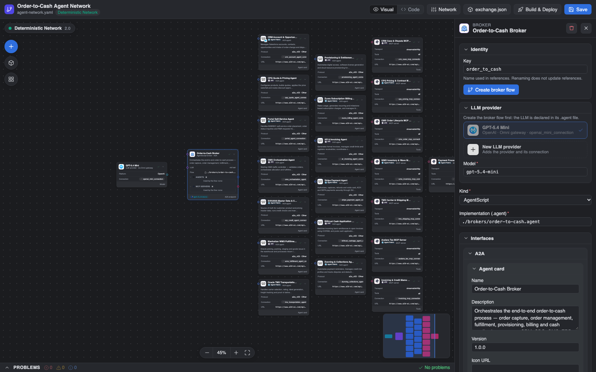
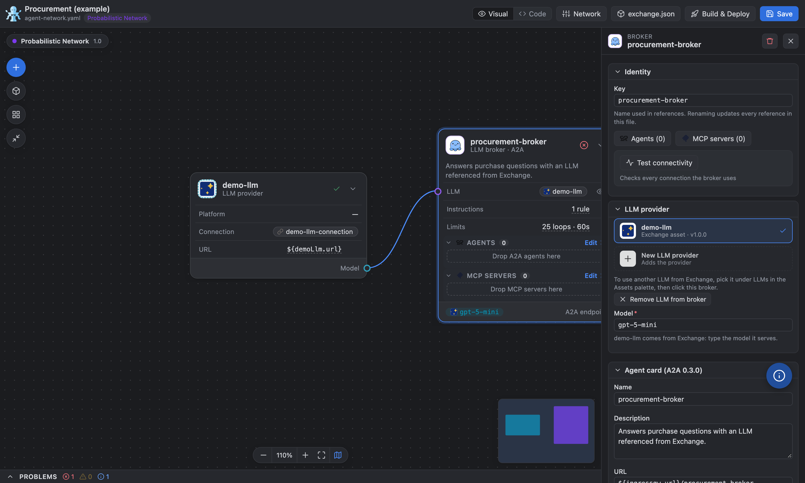

# Broker LLM provider

Select a broker and choose its LLM provider and model in the inspector:

- **v1**: writes `spec.llm` (provider reference, connection, model).
- **v2**: writes the `llm` block and `config.default_llm` of the broker's `.agent` file.
- A v2 broker's **Kind** and **Implementation** are in a *Protected broker settings* section with a lock, like the protected part of `exchange.json`: read-only until you unlock it.

An LLM whose URL points to a MuleSoft / Flex gateway is labelled **via Omni gateway**. Variables are resolved from the `exchange.json` defaults; secrets are never shown.

## Buttons and components

The same text as the in-app **Explain** button (click the floating info button, then the item).

### LLM provider

The model provider and models brokers may use. The key comes from a connection secret at deploy time. A dashed icon tile means the LLM is referenced from Exchange (an exchange.json dependency, classifier llm-metadata), not declared in this project; its Platform and Models are read-only on the card.

**When to use it:** Every network that has a 1.0 broker or AgentScript LLM nodes.

**Examples:**

- OpenAI gpt-5-mini
- Azure OpenAI deployment
- Dashed tile: MuleSoft openai from Exchange, shared by every project that references it
