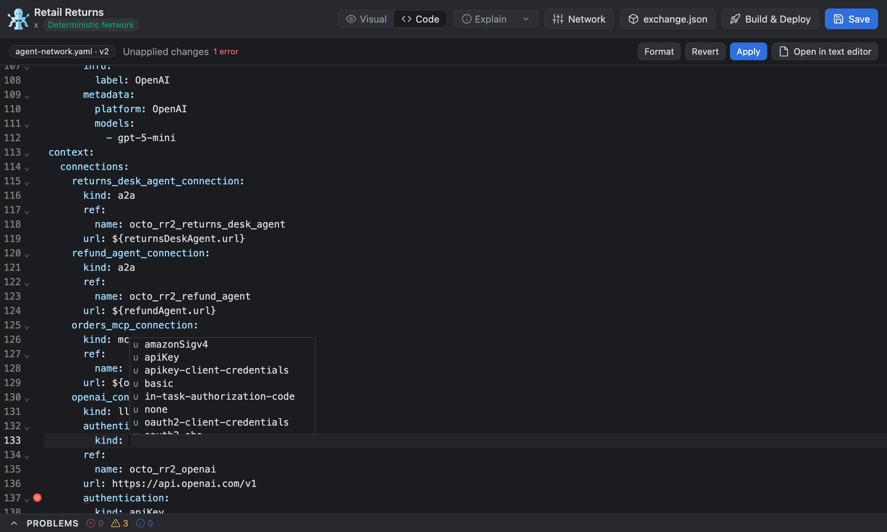
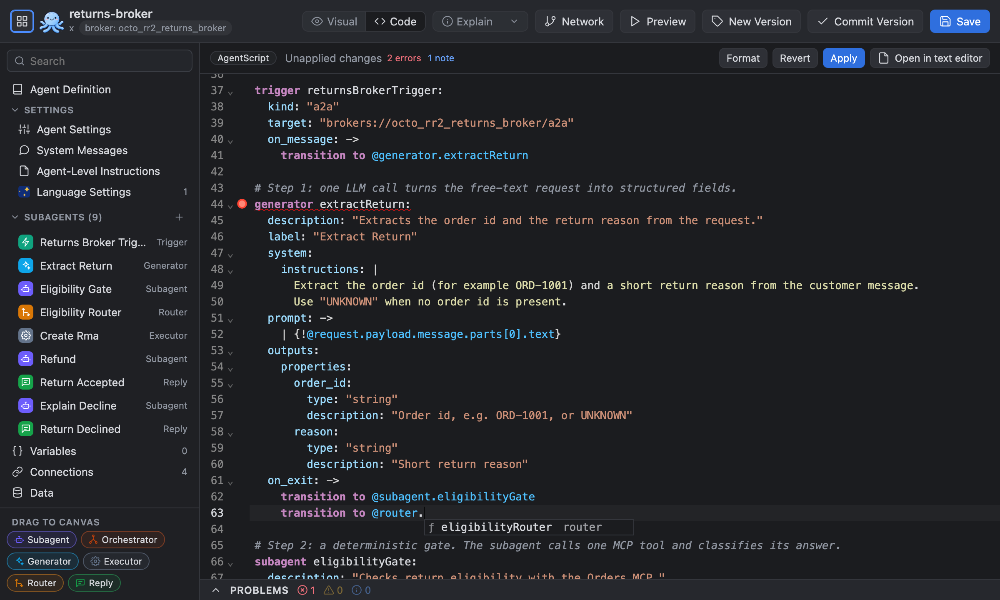

# Code view (YAML, AgentScript, JSON)

Every editor has a **Code** tab with a full code editor, aware of the Agent Fabric v1 and v2 reference and of AgentScript.

- **Syntax colours** for `agent-network.yaml`, `brokers/*.agent` and `exchange.json`, following your VS Code theme: keys, values, quoted strings, numbers, comments, and `:` / list `-` in YAML.
- **Autocomplete** (IntelliSense) from the reference: keys valid at the cursor for v1 or v2, allowed values (authentication kinds, transports, platforms, input formats, A2A protocol bindings), names of declared agents, MCP servers, LLMs, connections and policies, `${variables}` from `exchange.json`. In AgentScript: node kinds, block keys, statements (`transition to`, `run`, `with`, `set`), `@` references (`@actions.…`, `@router.…`, `@variables.…`), A2A task states and MCP tool names.
- **Checks** while you type: syntax errors, the same validation as the Problems panel (for example references to missing components or connections, undeclared variables, an MCP connection URL that already ends with the server's transport path such as `/mcp`), keys that are not in the reference, and lines with off-level indentation. Errors, warnings and notes are counted in the toolbar; hover the underline or press <kbd>F8</kbd> for the next one.
- **Format** (<kbd>Shift</kbd>+<kbd>Alt</kbd>+<kbd>F</kbd>): re-indent to 2 spaces per level. Auto-indent on Enter, folding, bracket matching, find and replace like VS Code (<kbd>Ctrl/Cmd</kbd>+<kbd>F</kbd>, <kbd>Ctrl/Cmd</kbd>+<kbd>H</kbd>): a find box at the top right with match case, whole word and regex toggles, the match count, previous / next, select all, replace and replace all.
- **Apply** (<kbd>Ctrl/Cmd</kbd>+<kbd>S</kbd>) writes to the file, **Revert** drops your edits, **Open in text editor** opens the file in VS Code.

## Buttons and components

The same text as the in-app **Explain** button (click the floating info button, then the item).

### Code view

The text of the file behind the canvas, with syntax colours (keys, values, strings, comments). Changes here and on the canvas are the same edit.

**When to use it:** To check or change the exact YAML or AgentScript.

**Examples:**

- Switch between Visual and the source in the toolbar
- Problems link to the line they are about
- Ctrl/Cmd+F finds, Ctrl/Cmd+H replaces: the find box at the top right works like VS Code (Aa match case, ab whole word, .* regex, Enter / Shift+Enter next and previous)

### Visual / Code

Switches between the visual editor (canvas or form) and the source text of the same file. Both edit the file itself; nothing is converted or stored elsewhere.

**When to use it:** Code for a quick text edit, search (Cmd/Ctrl+F) or to see exactly what is saved; Visual for everything else.

**Examples:**

- An edit in Code shows on the canvas at once
- YAML errors: Fix in code opens the line
