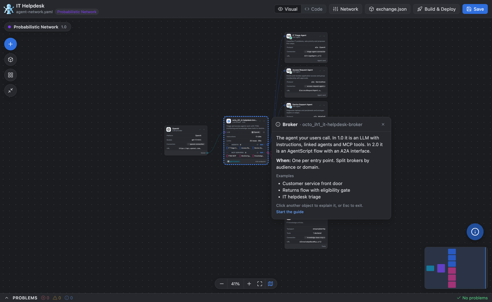
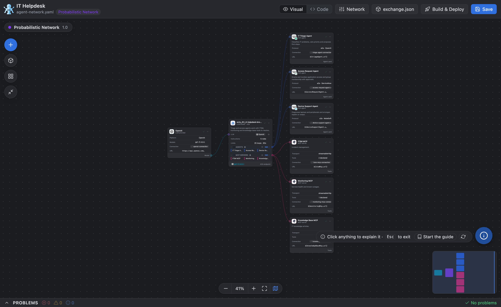

# Explain anything

Every Octoloom editor and panel (canvases, broker flow, `exchange.json`, chat, Governance, Welcome, New project) has one round, dark blue **info button** floating near the bottom right, above the minimap. It replaces the Explain buttons the views used to have. Click it (or focus it and press Enter) to turn on Explain mode:

- **Hover** any object: it is outlined and named (Broker, Agent, Canvas tools, Problems, Trace…).
- **Click** it: the click is not passed to the view, so nothing is changed, opened or deployed. A card opens beside the object with what it is, when to use it and examples. For a card, it also shows the object's own name.
- **Click another object** to explain it next; **Esc** closes the card, and Esc again (or the info button) leaves Explain mode.
- **Start the guide:** on the network canvas and the broker flow, the hint next to the button (and each explanation card) has **Start the guide**, which replays the guided tour of that canvas.
- **Toolbar and project buttons** each have their own card (Visual / Code, Preview, New Version, Commit Version, Build, Publish, Run locally…). The Publish card says how versions work: Publish uses the version in `exchange.json` as it is and never bumps it, and a version already in Exchange can't be published again.
- **Drag** the button anywhere. It feels like one button: every open Octoloom tab follows, so it is in the same place when you switch tabs (and after a restart). In a split view each editor group shows its own copy at that place. Double-click it to put it back everywhere.

## Buttons and components

The same text as the in-app **Explain** button (click the floating info button, then the item).

### Explain anything

The floating info button on every Octoloom editor and panel (canvases, broker flow, chat, Governance, Welcome, New project). Turn it on, then click any card, panel, tool or canvas: instead of acting, the view tells you what that object is, when to use it and examples. Nothing is changed while it is on.

**When to use it:** Whenever you are unsure what something on screen does. Drag the button anywhere; every Octoloom tab follows, so it stays in the same place when you switch tabs.

**Examples:**

- Click the button (or press Enter on it), then click a broker card to read about brokers
- Hover first: the object that will be explained is outlined and named
- Esc, the close button or the info button again leaves Explain mode
- Drag the button out of the way; double-click it to put it back in its default place
