Using Octoloom

# Features

<strong>Every view of Octoloom, with screenshots.</strong> Each page says what the view is for, why you use it, where to find it and how to use it step by step. Every numbered control is explained under its screenshot.

## Start

-   **[Home page](welcome-page.md)**

    { loading=lazy }

    Your start page: create a network, reopen a recent project, open a tutorial and see your own usage numbers.

-   **[Setup & Connect](setup-connect.md)**

    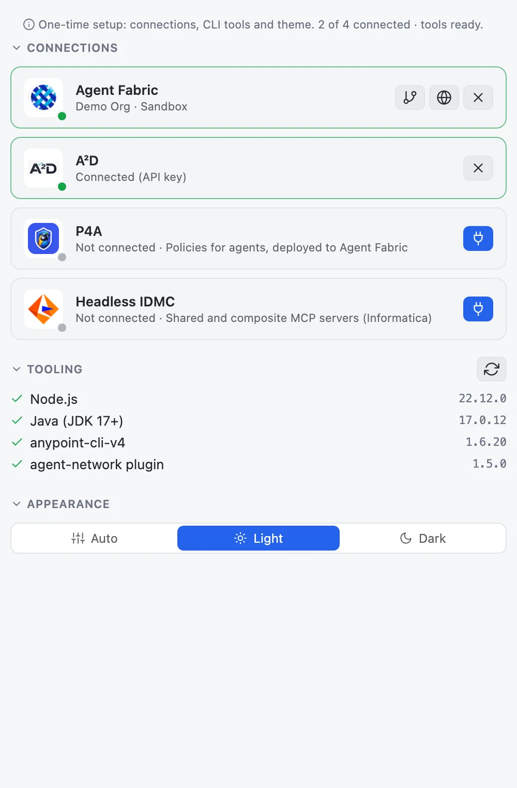{ loading=lazy }

    One-time setup: connections (Agent Fabric / Anypoint, A²D, P4A, Informatica IDMC), the CLI tools and the theme.

-   **[New project](new-project-from-templates.md)**

    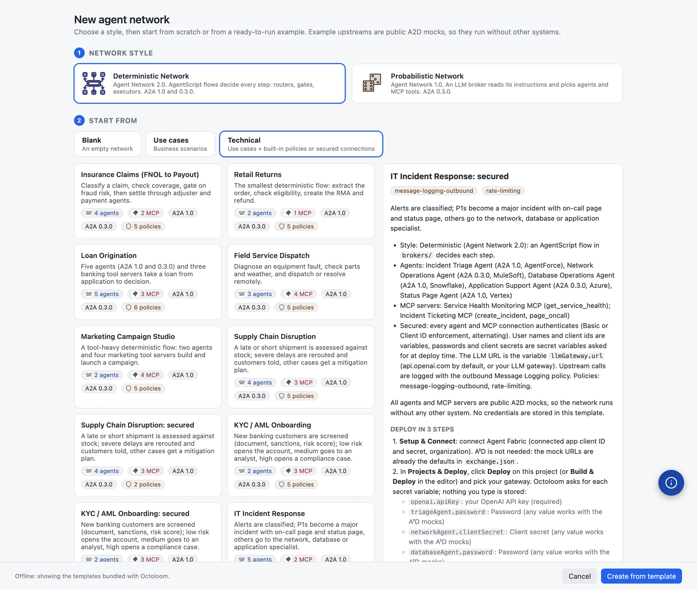{ loading=lazy }

    A dialog that creates an agent network from a ready-to-run template (use case, governed, secured, fully mocked, Informatica IDMC) or a blank one.

-   **[Network from Exchange](agent-network-from-exchange.md)**

    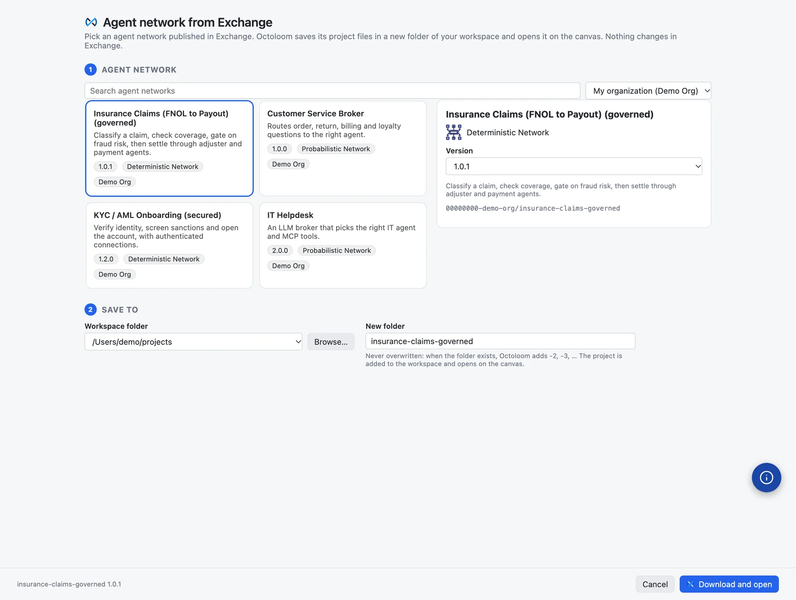{ loading=lazy }

    Download an agent network published in your Exchange into a project folder and open it on the canvas.

## Design

-   **[Network canvas](network-canvas-agent-network-yaml.md)**

    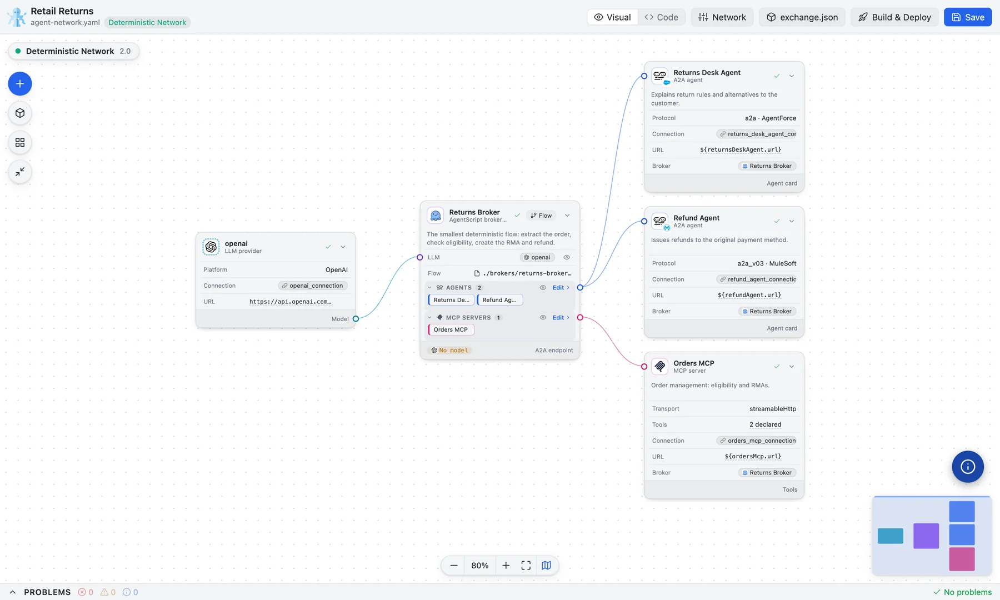{ loading=lazy }

    The visual editor of `agent-network.yaml`: brokers, agents, MCP servers, LLMs and their connections as cards, with an inspector on the right.

-   **[Broker flow editor](broker-flow-editor-brokers-agent.md)**

    { loading=lazy }

    The canvas of an AgentScript broker (`.agent`): trigger, generators, routers, subagents, orchestrators, executors and replies as a flow.

-   **[Asset Palette](asset-palette-agent-fabric-and-a2d.md)**

    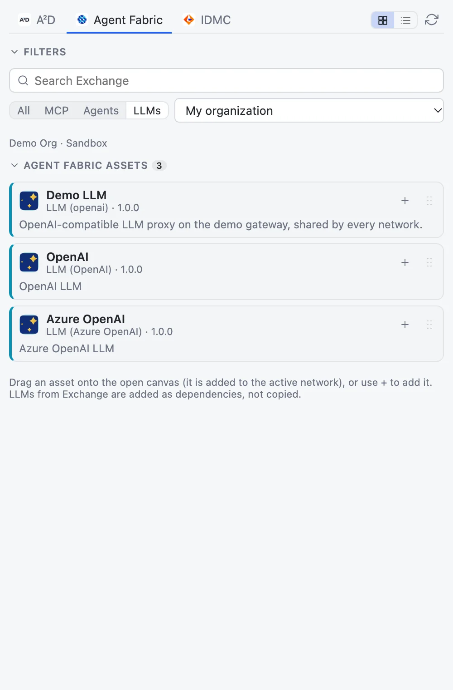{ loading=lazy }

    Every asset you can drop on a canvas: Agent Fabric (Exchange) agents, MCP servers and LLMs, A²D prototypes and mocks, Informatica IDMC MCP servers.

-   **[Code view](code-view-yaml-agentscript-json.md)**

    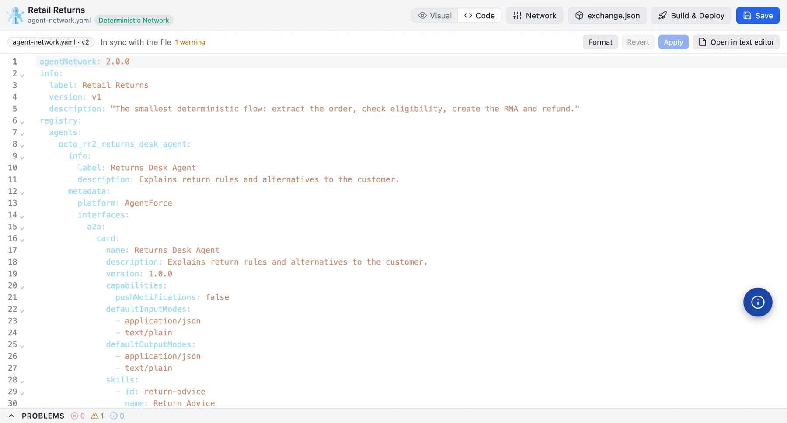{ loading=lazy }

    The text of the open file (YAML, AgentScript or JSON) with syntax colours and a find / replace widget, next to the visual editor.

-   **[exchange.json form](asset-editor-exchange-json.md)**

    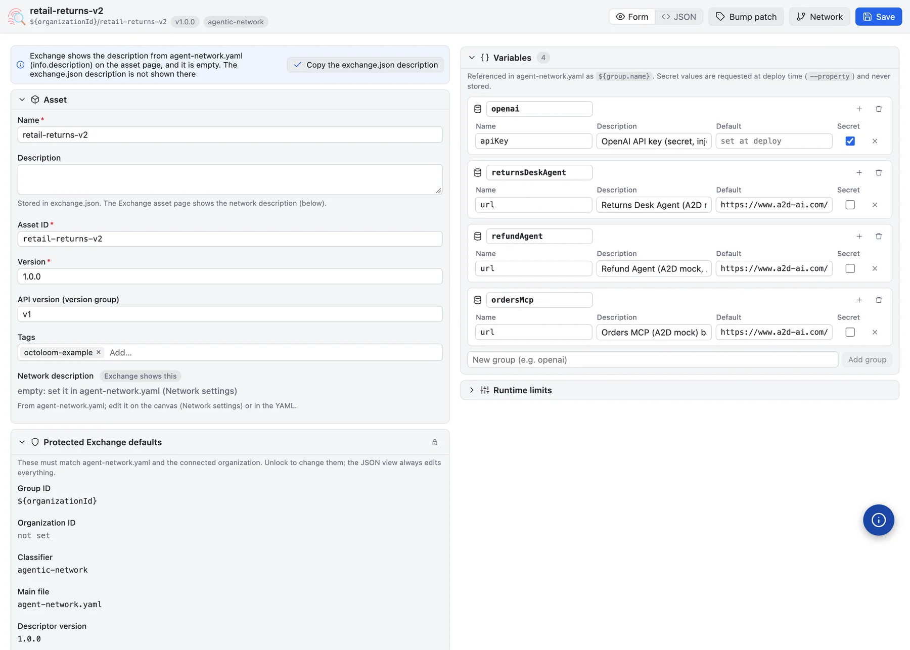{ loading=lazy }

    A no-code form for `exchange.json`: the asset name, version, description, tags, variables and dependencies Exchange shows.

-   **[Minimize to icons](minimize-to-icons.md)**

    

    Shrink one card, or all of them, to an icon tile to see the shape of a big network.

## Connect and secure

-   **[LLM provider](broker-llm-provider.md)**

    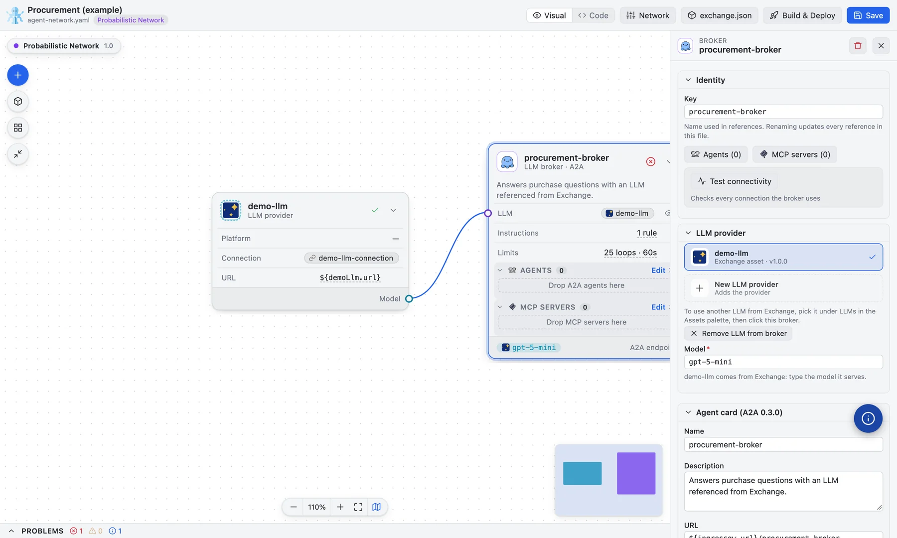{ loading=lazy }

    The language model a broker uses: OpenAI, Azure OpenAI, Gemini, an A²D LLM mock or an LLM published in Exchange.

-   **[LLM authentication](llm-authentication-api-key-or-oauth-2-0-jwt.md)**

    { loading=lazy }

    How a broker authenticates to its LLM: an API key or OAuth 2.0 (JWT).

-   **[Policies and P4A](policies-and-p4a.md)**

    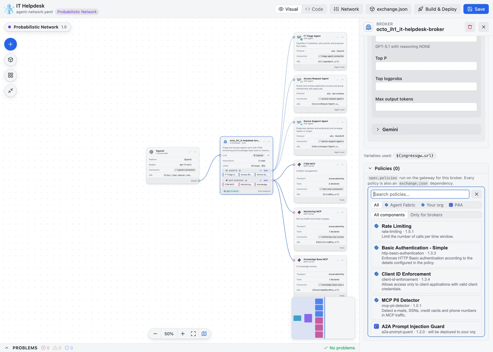{ loading=lazy }

    Agent Fabric gateway policies on a broker or a connection (rate limiting, JWT validation, PII detection, schema validation, …), including the P4A policies.

## Govern

-   **[Governance](governance-rulesets-for-brokers-agents-and-mcp-servers.md)**

    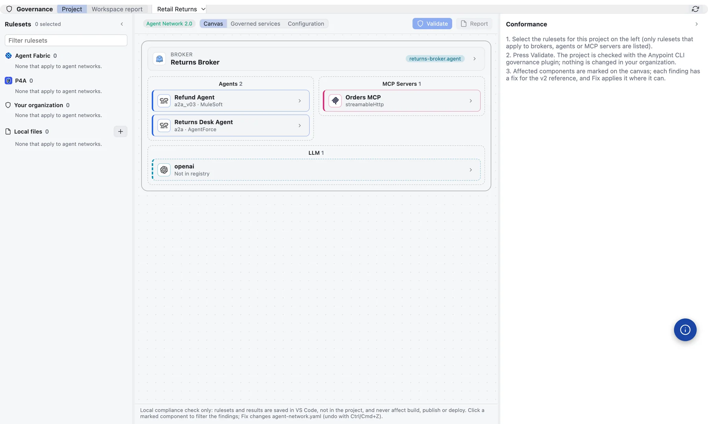{ loading=lazy }

    Local compliance checks with Anypoint governance rulesets (Agent Fabric, P4A, your organization, local files) for brokers, agents and MCP servers.

-   **[Coverage map](coverage-map.md)**

    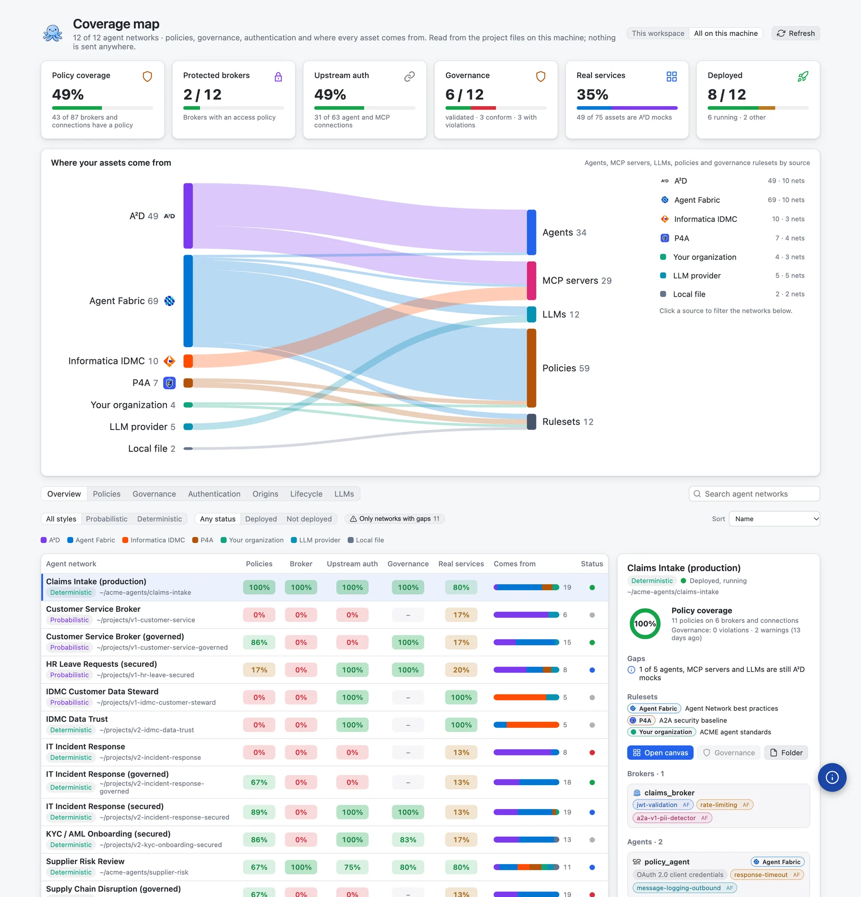{ loading=lazy }

    One table of every agent network on this machine: policy coverage, protected brokers, upstream authentication, governance results, real services vs mocks, deployments.

## Deploy and run

-   **[Projects & Deploy](projects-deploy.md)**

    { loading=lazy }

    Every agent network project of the workspace with its status, and the buttons to validate, build, publish, deploy, run locally and undeploy.

## Chat and observe

-   **[Broker chat](broker-chat.md)**

    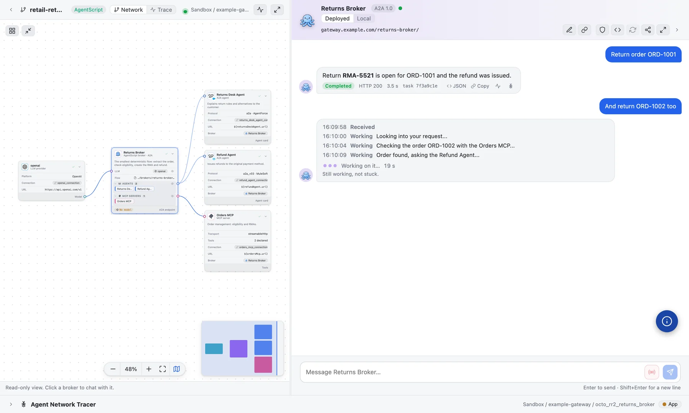{ loading=lazy }

    Talk to a deployed (or locally running) broker over A2A, next to the read-only network, the trace of each reply and the Agent Network Tracer.

-   **[Agent Network Tracer](agent-network-tracer.md)**

    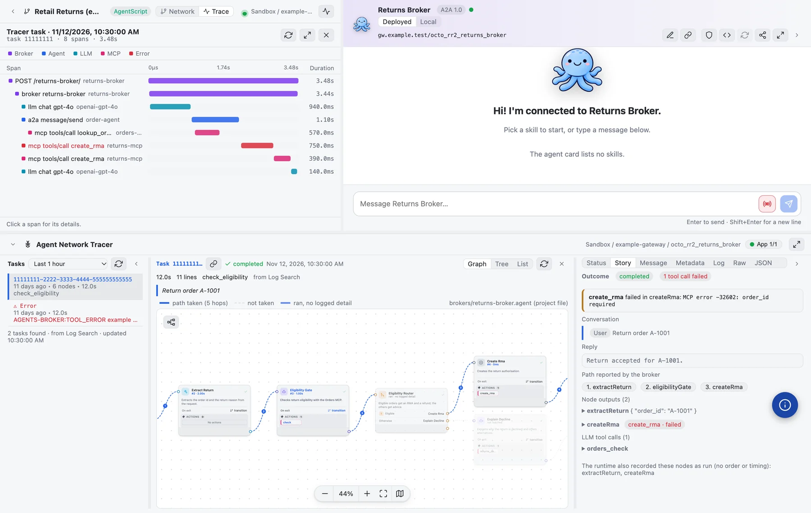{ loading=lazy }

    The tasks of a broker from the Agent Fabric logs: the path each task took through the flow, its story, messages and raw logs.

## Help

-   **[Explain anything](explain-anything.md)**

    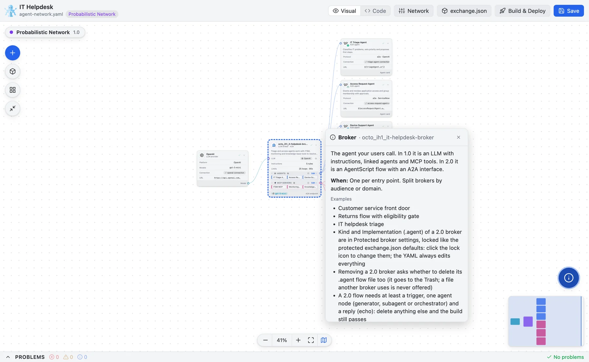{ loading=lazy }

    Click the button, then any object: a panel explains what it is, when to use it and gives examples. It also starts the guided tour.

