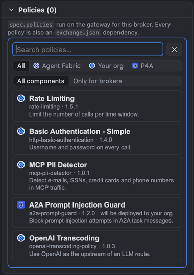
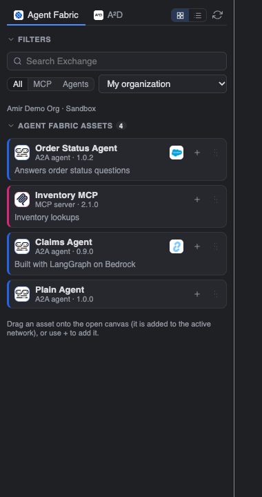
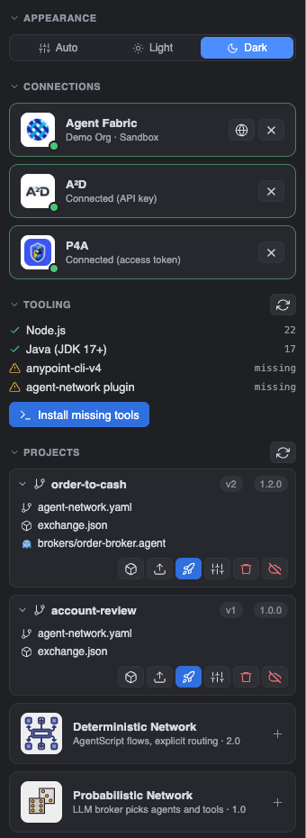
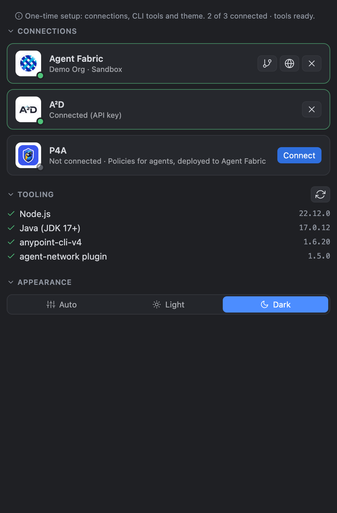

# Features

Every view of Octoloom, in the order you meet them. Each page ends with the buttons and components of that view, as the **Explain** button describes them.

- **[Welcome page](welcome-page.md)**: When VS Code starts, Octoloom opens its **Welcome** page next to the VS Code one. It doesn't open when you click the Octoloom icon later. You can also open it with the home button in **Projects & Deploy** or with **Octol…
- **[Coverage map](coverage-map.md)**: **Home → Your statistics → Coverage map** (or **Octoloom: Coverage Map**) opens one tab with every agent network on this machine (the projects Octoloom has seen on this user profile) or only the open workspace's.
- **[New project: from templates](new-project-from-templates.md)**: **New Project** opens a dialog with **37 ready-made examples**: 15 business use cases, each as a plain network and as a **governed** variant with built-in Agent Fabric policies (rate limiting, PII detection, schema valid…
- **[Agent network from Exchange](agent-network-from-exchange.md)**: Continue work on an agent network that is already published in Exchange, by you on another machine or by a colleague. Click the **Exchange icon** next to **+** in Projects & Deploy, or choose **From Exchange** in the **+…
- **[Network canvas (agent-network.yaml)](network-canvas-agent-network-yaml.md)**: - Cards for **brokers, agents, MCP servers and LLMs**, with edges for the references between them. Ports sit on the exact row an edge refers to. On a v2 canvas the **Context** card (the `context.policies` and connections…
- **[Broker LLM provider](broker-llm-provider.md)**: Select a broker and choose its LLM provider and model in the inspector:
- **[LLM authentication: API key or OAuth 2.0 (JWT)](llm-authentication-api-key-or-oauth-2-0-jwt.md)**: By default an LLM connection uses an **API key** and the gateway adds its transcoding policy. For an LLM behind your own gateway that expects a **JWT**, choose *OAuth 2.0 client credentials* on the connection: the egress…
- **[Policies and P4A](policies-and-p4a.md)**: 
- **[Broker flow editor (brokers/*.agent)](broker-flow-editor-brokers-agent.md)**: - Every subagent is a node, and transitions, routes and actions are edges. - The outline lists agent settings, system messages, instructions, language settings and all subagents. - Drag new nodes onto the canvas: Subagen…
- **[Code view (YAML, AgentScript, JSON)](code-view-yaml-agentscript-json.md)**: Every editor has a **Code** tab with a full code editor, aware of the Agent Fabric v1 and v2 reference and of AgentScript.
- **[Asset editor (exchange.json)](asset-editor-exchange-json.md)**: A form for the Exchange descriptor: asset identity, version, variables and their defaults (secrets are masked), and dependencies.
- **[Asset palette: Agent Fabric and A²D](asset-palette-agent-fabric-and-a2d.md)**:  
- **[Setup & Connect](setup-connect.md)**: 
- **[Governance: rulesets for brokers, agents and MCP servers](governance-rulesets-for-brokers-agents-and-mcp-servers.md)**: Open it from the shield button in a project's header in **Projects** (after the version; one project) or in the Projects header (workspace report), or run **Governance: Validate Against Rulesets**.
- **[Minimize to icons](minimize-to-icons.md)**: **Toolbars stay on one row.** When an editor is too narrow for the top bar (Visual / Code, Network, Build & Deploy, Save…), the button labels hide and only the icons stay, with their names as tooltips. The labels come ba…
- **[Explain anything](explain-anything.md)**: Every Octoloom editor and panel (canvases, broker flow, `exchange.json`, chat, Governance, Welcome, New project) has one round, dark blue **info button** floating near the bottom right, above the minimap. It replaces the…
- **[Broker chat](broker-chat.md)**: Click the chat icon next to a deployed broker URL in the project's deployment box, or run **Chat with Deployed Broker**.
- **[Agent Network Tracer](agent-network-tracer.md)**: Click the **Tracer** button on a project's **Deployed and running** box in Projects & Deploy, or the **Tracer** icon under a deployed chat reply. The chat panel opens with the Tracer below the network and the chat. The **Full …
