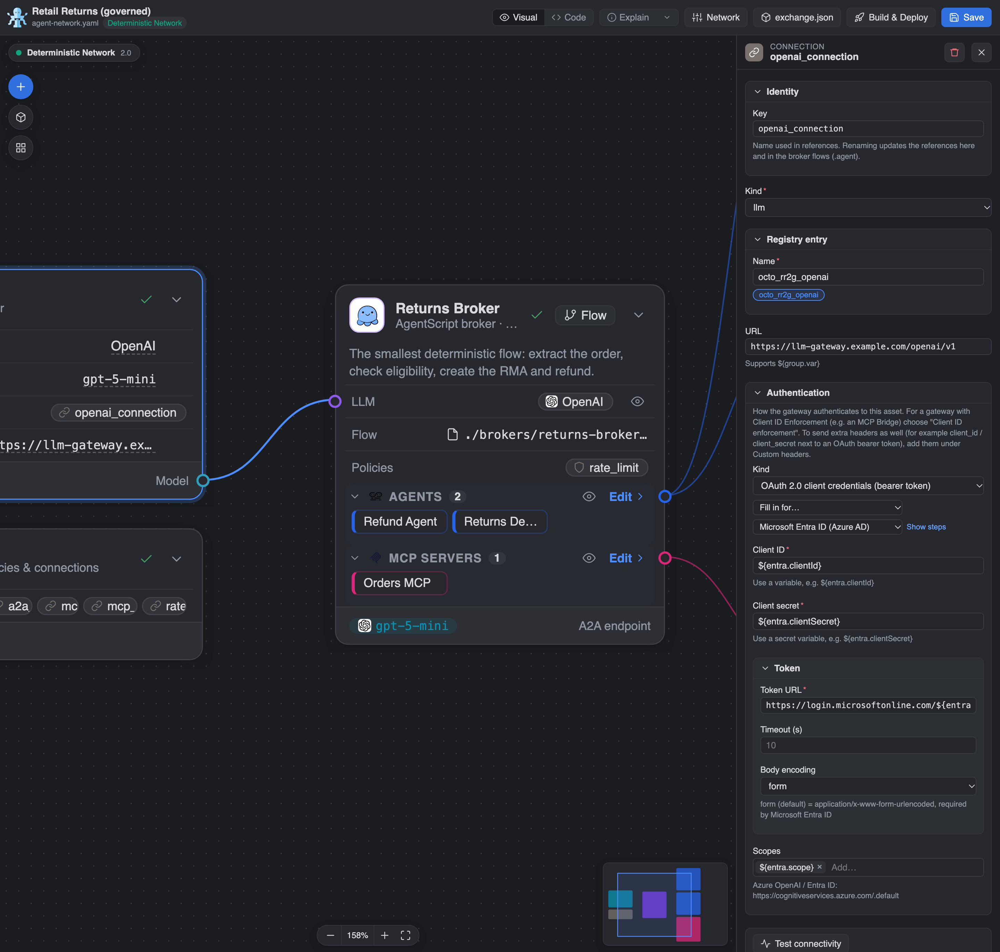
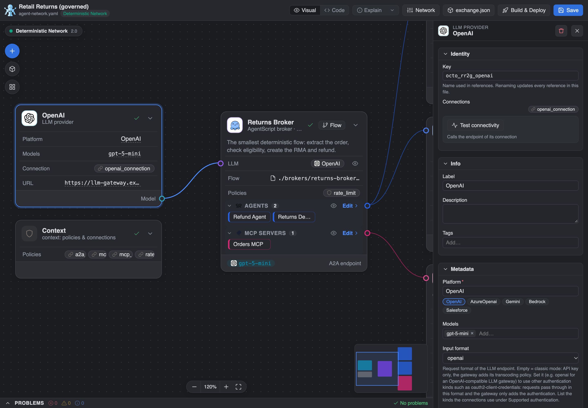

# LLM authentication: API key or OAuth 2.0 (JWT)

By default an LLM connection uses an **API key** and the gateway adds its transcoding policy. For an LLM behind your own gateway that expects a **JWT**, choose *OAuth 2.0 client credentials* on the connection: the egress gateway fetches the token from your identity provider, caches it and sends `Authorization: Bearer <token>` with every LLM call.

- **Fill in for…** writes the authentication block and the `exchange.json` variables for Microsoft Entra ID, Okta, Auth0, Keycloak, Salesforce, Amazon Cognito, PingOne, Anypoint connected apps or any other provider. **Show steps** lists the setup at the provider.
- The LLM must declare an **Input format** (`openai`, `anthropic` or `gemini`) and the kind under *Supported authentication*, otherwise the CLI only accepts an API key (build error 3060). Octoloom flags this in Problems and adds both before a build when the platform is clear. API key setups are not changed.

## Buttons and components

The same text as the in-app **Explain** button (click the floating info button, then the item).

### LLM provider

The model provider and models brokers may use. The key comes from a connection secret at deploy time. A dashed icon tile means the LLM is referenced from Exchange (an exchange.json dependency, classifier llm-metadata), not declared in this project; its Platform and Models are read-only on the card.

**When to use it:** Every network that has a 1.0 broker or AgentScript LLM nodes.

**Examples:**

- OpenAI gpt-5-mini
- Azure OpenAI deployment
- Dashed tile: MuleSoft openai from Exchange, shared by every project that references it

### Connection

Where and how the gateway reaches an agent, MCP server or LLM: URL, authentication and policies.

**When to use it:** One per upstream. Change URLs per environment with variables.

**Examples:**

- ${refundAgent.url} with PII detection inbound
- openai_connection with apiKey ${openai.apiKey}
- MCP connection URL = server base without /mcp; Test connection calls exactly what the runtime calls
