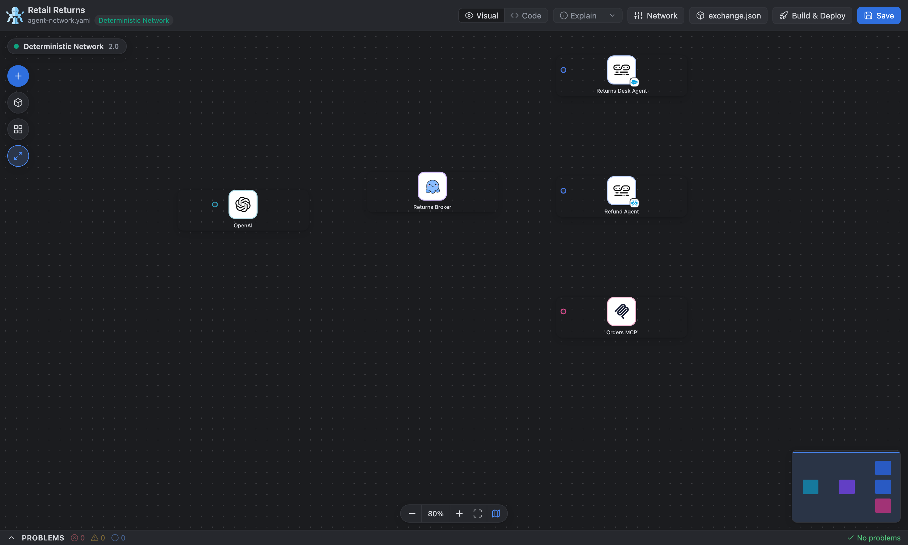
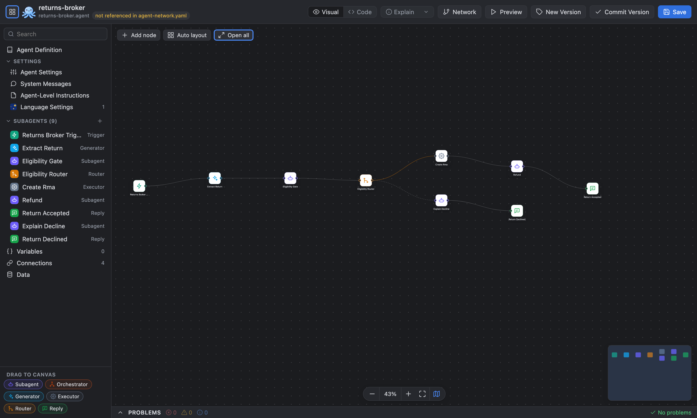

# Minimize to icons

**Toolbars stay on one row.** When an editor is too narrow for the top bar (Visual / Code, Network, Build & Deploy, Save…), the button labels hide and only the icons stay, with their names as tooltips. The labels come back when there is room again. This works on the network canvas, the broker flow and `exchange.json`.

The **Minimize all** button (network canvas: left toolbar; broker flow: canvas toolbar) shrinks every card to its icon and name, and auto layout packs them; connections stay drawn. Click an icon to open or minimize a single card. Cards can be dragged in every state (open, collapsed, minimized), also by the icon tile. The choice is saved with the canvas layout, not in your YAML or `.agent` file.

## Buttons and components

The same text as the in-app **Explain** button (click the floating info button, then the item).

### Minimize to icons

Shrinks a card to just its icon tile and name, so large networks and flows show what is orchestrated without the details. Connections stay drawn between the icons. The choice is saved with the canvas layout (not in your YAML or .agent file).

**When to use it:** Reviewing or presenting a network with many brokers, agents and MCP servers, or a long AgentScript flow.

**Examples:**

- Minimize all (canvas button): every card becomes an icon; press it again (Open all) to restore every card
- Click the icon tile in a card header to minimize only that card
- Click a minimized icon to open that card again; double-click still opens or edits it as before
- Auto layout packs minimized icons tightly
- Drag any card to move it, in every state: open, collapsed or minimized, also by its icon tile or chevron. A drag moves the card; only a click minimizes, opens or collapses it
