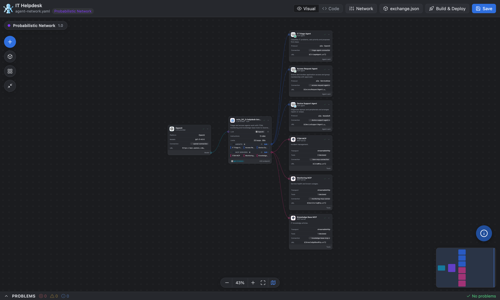

# Network canvas (`agent-network.yaml`)

- Cards for **brokers, agents, MCP servers and LLMs**, with edges for the references between them. Ports sit on the exact row an edge refers to. On a v2 canvas the **Context** card (the `context.policies` and connections without an owner) sits left of the brokers, and an orange edge connects it to each broker's **Context** row.
- **Dashed icon tile** = an **external asset**: an agent, MCP server or LLM referenced from Exchange (an `exchange.json` dependency) instead of declared in this project, for example MuleSoft's `openai` LLM in the v2 templates. The dashes take the card's colour (cyan for LLMs, blue for agents, pink for MCP servers), and its Exchange settings are read-only on the card.
- **Add menu with templates** (the *+* button): each component offers *Empty* or a ready-made entry: LLM providers (OpenAI, Azure OpenAI, Gemini, LLM through a gateway, Bedrock on v2), connections with a chosen authentication, reusable v2 policies, A2A 1.0 / 0.3.0 agents and HTTP / SSE MCP servers. Variables go into `exchange.json`; secrets have no default and are asked for at deploy time.
- **Tool stack** on the left of the canvas: **+** Add, **Asset Palette**, **Auto layout** and **Minimize all**. Hover a button to see its name.
- **Inspector** panel: identity, connections, interfaces (A2A card, skills), MCP tools, framework, tags, description, **policies** and a **connectivity test**. Drag its left edge to resize it.
- **Inline editing**: click a value with a dashed underline, or the pencil on a row, to edit it on the card. Examples: allowed MCP tools (multi-select read from Exchange or the live server), connection URL, LLM platform, broker loops and timeout.
- **Allowed tools** (v1): choose any number of tools of an MCP server with checkboxes. No selection means all tools are allowed.
- **Deterministic brokers** (v2) show the agents and MCP servers they use, grouped by section. *Link* adds the matching actions to the broker's `.agent` flow (`a2a://…` / `mcp://…`), and the trash icon removes them. An agent or MCP server that no broker uses shows a *Link to …* shortcut.
- **Delete** a component: select it and press <kbd>Delete</kbd>, or use the trash icon in the inspector. Its references, connection and `exchange.json` dependency are removed with it. A flow's start and *Done* nodes cannot be deleted.
- **Collapse** any card, **fold** a section, or **hide/show** connected cards with the eye button (for example, hide every MCP server of a broker, or its LLM). Positions and visibility are saved for each workspace.
- **Problems** panel with schema validation. Click a problem to jump to the card.
- **Auto layout**, zoom and fit, and a minimap you can collapse or show from the toolbar.
- Switch between **Visual** and **Code** at any time. Edits go to the YAML directly, and comments and formatting are kept. See [Code view](#code-view-yaml-agentscript-json).

## Buttons and components

The same text as the in-app **Explain** button (click the floating info button, then the item).

### Agent network canvas

The canvas of one agent network file: brokers, agents, MCP servers, LLMs, connections and policies as cards with edges between them. It edits the YAML, which stays the source of truth.

**When to use it:** Designing or reviewing a network.

**Examples:**

- Drag from a port to another card to connect them
- Select a card to edit it in the inspector
- Use the zoom bar, minimap and Minimize all to find your way in a large network
- Hover a button of the tool stack on the left (+ Add, Asset Palette, Auto layout, Minimize all) to see its name
- A dashed icon tile (in the card's colour) marks an external asset: an agent, MCP server or LLM referenced from Exchange (exchange.json dependency) and not declared in this project

### Broker

The agent your users call. In 1.0 it is an LLM with instructions, linked agents and MCP tools. In 2.0 it is an AgentScript flow with an A2A interface.

**When to use it:** One per entry point. Split brokers by audience or domain.

**Examples:**

- Customer service front door
- Returns flow with eligibility gate
- IT helpdesk triage
- Kind and Implementation (.agent) of a 2.0 broker are in Protected broker settings, locked like the protected exchange.json defaults: click the lock icon to change them; the YAML always edits everything
- Removing a 2.0 broker asks whether to delete its .agent flow file too (it goes to the Trash; a file another broker uses is never offered)
- A 2.0 flow needs at least a trigger, one agent node (generator, subagent or orchestrator) and a reply (echo): delete anything else and the build still passes

### Agent

A remote A2A agent described by its agent card (skills, URL, protocol version). Brokers call it through a connection.

**When to use it:** A capability already exists as an agent (Agentforce, A2D mock, custom).

**Examples:**

- Refund agent (A2A 1.0)
- Order status agent (A2A 0.3.0)

### MCP server

A Model Context Protocol server with tools. Brokers may call only the tools you allow. Its connection URL is the server base: the runtime adds metadata.transport.path (for example /mcp).

**When to use it:** Deterministic system access: look up, create, update records.

**Examples:**

- orders_mcp: check_return_eligibility, create_rma
- crm_mcp: find_customer
- URL https://host/product-mcp/ + path /mcp → the runtime calls https://host/product-mcp/mcp (a URL ending with /mcp would call /mcp/mcp)

### LLM provider

The model provider and models brokers may use. The key comes from a connection secret at deploy time. A dashed icon tile means the LLM is referenced from Exchange (an exchange.json dependency, classifier llm-metadata), not declared in this project; its Platform and Models are read-only on the card.

**When to use it:** Every network that has a 1.0 broker or AgentScript LLM nodes.

**Examples:**

- OpenAI gpt-5-mini
- Azure OpenAI deployment
- Dashed tile: MuleSoft openai from Exchange, shared by every project that references it

### Connection

Where and how the gateway reaches an agent, MCP server or LLM: URL, authentication and policies.

**When to use it:** One per upstream. Change URLs per environment with variables.

**Examples:**

- ${refundAgent.url} with PII detection inbound
- openai_connection with apiKey ${openai.apiKey}
- MCP connection URL = server base without /mcp; Test connection calls exactly what the runtime calls

### Inspector

The properties of the selected card or node. Edits go straight into the file.

**When to use it:** After selecting something on the canvas.

**Examples:**

- Drag its left edge to resize it; the width is kept
- Close it to give the canvas more room

### Canvas tools

The zoom bar, minimap and floating buttons of a canvas: zoom, fit, auto layout, Minimize all / Open all and the map of the whole canvas.

**When to use it:** Finding your way in a large canvas.

**Examples:**

- Fit shows every card
- Click the minimap to jump there
- Minimize all turns every card into its icon

### Problems

The validation findings of this file and the project checks across agent-network.yaml, exchange.json and the broker .agent files: errors, warnings and hints with the object they are about. A finding with a fix has a button that applies it as one edit: one Undo reverts every file it changed, and nothing is saved until you save. The same findings are in the VS Code Problems panel with a light bulb quick fix. When you save agent-network.yaml or a .agent file, variables it uses that exchange.json does not declare are added there (unsaved; setting agentNetwork.syncVariablesOnSave turns this off).

**When to use it:** Before a build or deploy; errors stop the build.

**Examples:**

- Click a problem to select the card it is about; in a broker flow it also opens the field the problem is about (for example Go to or Prompt)
- Collapse the bar with its chevron
- Two brokers share brokers/sales.agent: click Copy the flow to brokers/support.agent
- Variable ${crm.url} is not declared: click Add to exchange.json
- Renaming a broker offers to rename its .agent file too
- A flow path ends without a final reply: click Go to the final reply (done) to wire it (setting agentNetwork.flowCoach turns this suggestion off)
- The broker flow checks what Agent Fabric rejects at build or deploy: one trigger per interface, no transition back to the trigger, every path ending in a completed, failed, canceled or rejected reply, empty prompts, unknown LLM settings and out-of-range temperature or top_p
- Network checks: a broker card needs a description and unique skill ids; amazonSigv4 is for LLM connections only; a TLS context needs both name and group; OBJECT_STORE_DEFAULT_TTL_MS is at most 30 days
- Deleting an agent or MCP server also removes the flow actions that called it and the variables only it used, in one Undo; a message says what went with it
