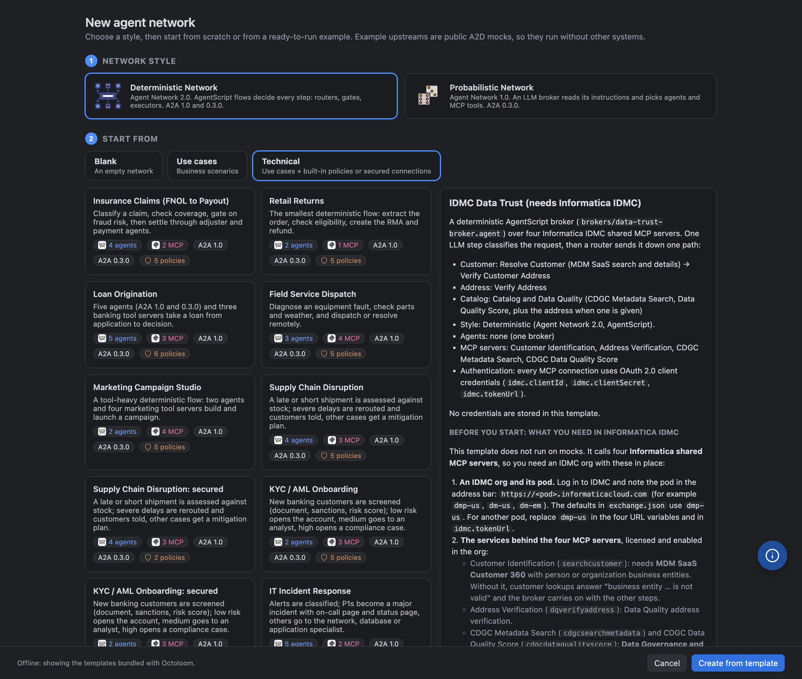
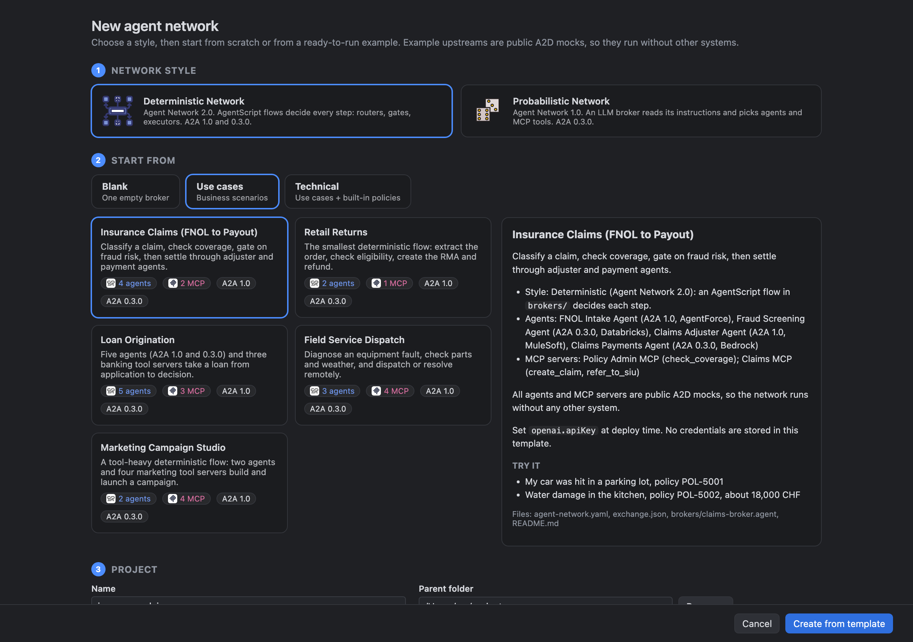
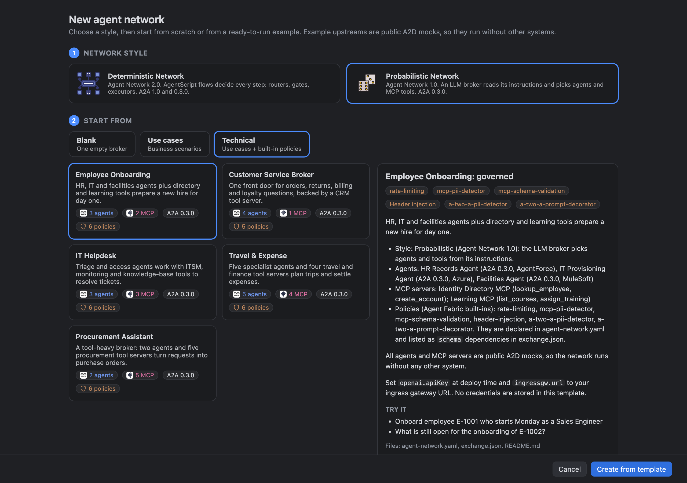
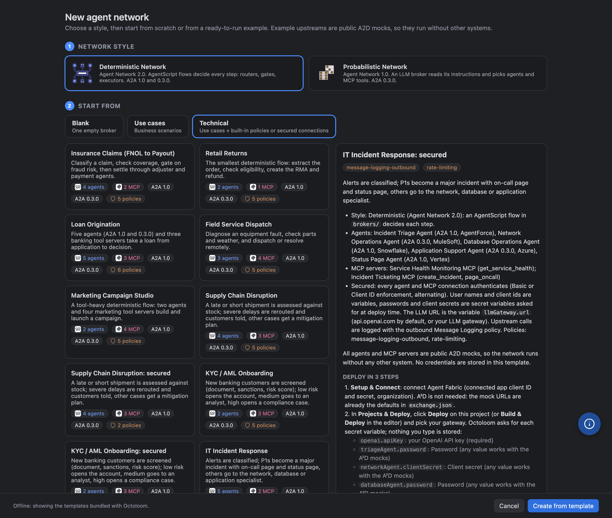
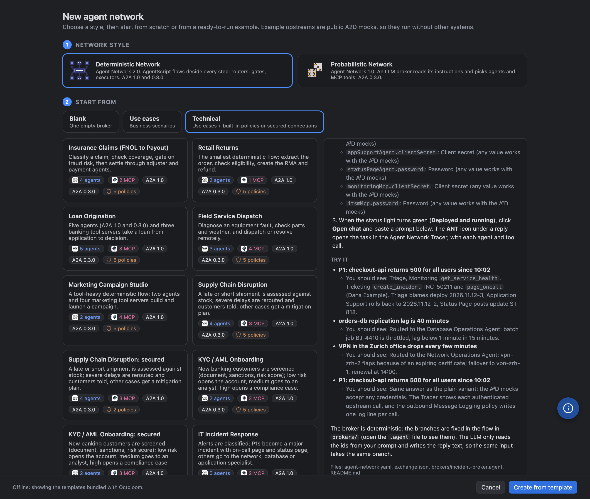

# New project: from templates

**New Project** opens a dialog with **37 ready-made examples**: 15 business use cases, each as a plain network and as a **governed** variant with built-in Agent Fabric policies (rate limiting, PII detection, schema validation, header injection, prompt decoration). Five of them also come as a **secured** variant: every agent and MCP connection authenticates (Basic or Client ID enforcement) with `exchange.json` variables (passwords and client secrets are secret variables, asked at deploy time), the LLM URL is a variable (`llmGateway.url`, your LLM gateway or api.openai.com), the broker is rate limited and v2 upstream calls are logged with the outbound Message Logging policy.

| | Use cases | Technical (governed / secured) |
|---|---|---|
| **Deterministic (v2, AgentScript)** | insurance claims, retail returns, loan origination, field service, campaign studio, supply chain disruption, KYC / AML onboarding, IT incident response | the same 8 with policies; supply chain, KYC and incident response also secured |
| **Probabilistic (v1, LLM routing)** | customer service, employee onboarding, IT helpdesk, procurement, travel & expense, HR leave, patient intake (demo data) | the same 7 with policies; HR leave and patient intake also secured |

**Informatica IDMC (technical, both styles):** *IDMC Customer Data Steward* (v1) and *IDMC Data Trust* (v2, AgentScript) call four Informatica shared MCP servers (Customer Identification, Address Verification, CDGC Metadata Search, CDGC Data Quality Score) with OAuth 2.0 client credentials. They need an IDMC org with these services and an IDMC MCP client; their README lists the IDMC setup step by step, then how to deploy.

Pick the network style, then start **Blank**, from a **Use case** or from a **Technical** example. Each card shows the number of agents and MCP servers, the A2A versions and the policies; the right side shows the example's README: **Deploy in 3 steps** (what to connect, which variables to fill in and which secrets you are asked for at deploy) and **Try it**, 3 to 6 prompts to paste into the chat (the main path, the other branches, and for governed and secured variants a prompt that shows the policies) each with **You should see**: the agents, tools and mock ids to expect in the reply and the Agent Network Tracer. All upstreams are public A²D mocks, so a new project builds and runs without other systems; set `openai.apiKey` at deploy time. The fully mocked use cases (*Hotel Concierge*, *Library Services*, *Fleet Maintenance*, *Event Ticketing*, *Warranty Repair*, *Utility Outage*) need no OpenAI key: their scripted A²D LLM mock answers the Try it prompts the same way every time.

## Buttons and components

The same text as the in-app **Explain** button (click the floating info button, then the item).

### New project

Creates an agent network project: pick the style (Probabilistic or Deterministic), a template and a name, and Octoloom writes the files. An empty network has no broker and no variables; turn on Add a starter broker for one broker to start from. Initialise a Git repository runs git init and a first commit, so every later change can be reviewed and undone with Git.

**When to use it:** Starting a network from scratch or from a template.

**Examples:**

- An empty network, then add brokers from the palette
- Add a starter broker: the old blank project with one broker
- Filter the templates by kind: use case, technical, governed, secured
- The preview shows the network the template creates
- Each template README has Deploy in 3 steps (the variables to set and the secrets you are asked for) and Try it: prompts to paste into the chat, with what you should see
- Two technical templates need Informatica IDMC (IDMC Customer Data Steward, IDMC Data Trust): their README lists the IDMC setup step by step (pod, MCP servers, MCP client) before the deploy steps
- Six use cases are fully mocked (Hotel Concierge, Library Services, Fleet Maintenance, Event Ticketing, Warranty Repair, Utility Outage): their LLM is an A²D LLM mock too, so they deploy and answer without an OpenAI key, the same way every time
