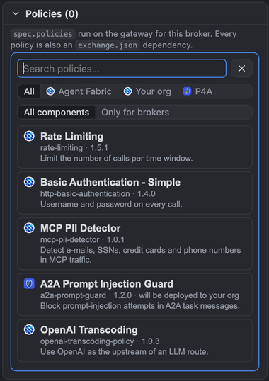

Connect and secure

# Policies and P4A

<strong>Agent Fabric gateway policies on a broker or a connection (rate limiting, JWT validation, PII detection, schema validation, …), including the P4A policies.</strong> Security and traffic rules travel with the network and are applied at deploy.

!!! info "Where to find it"
    Broker / connection inspector → **Policies**

<figure markdown>
{ loading=lazy }
{ loading=lazy }
<figcaption>The policy picker</figcaption>
</figure>

## How to use it

1. Select a broker or a connection, open **Policies** and click **Add policy**.
2. Pick a policy in the picker (Agent Fabric, P4A, your organization) and fill in its settings.
3. Fold a policy to its title to keep the inspector short.

## More screenshots

<figure markdown>
{ loading=lazy }
{ loading=lazy }
<figcaption>A broker with three policies, two folded</figcaption>
</figure>

<figure markdown>
{ loading=lazy }
{ loading=lazy }
<figcaption>Protected broker settings</figcaption>
</figure>

## In detail

Select a broker or a connection (or an agent, MCP server or LLM, which uses its connection), then click **Add policy** under *Policies*:

- **Agent Fabric**: the MuleSoft-provided gateway policies that Anypoint offers on an Agent Fabric instance (about 120), for example *Basic Authentication - Simple* and *LDAP*, *Client ID Enforcement*, *JWT Validation*, *IP Allowlist / Blocklist*, *CORS*, *Spike Control*, *Rate Limiting*, *Header Injection*, *Credential Injection*, the A2A, MCP and LLM policies and *OpenAI Transcoding*. The list is bundled so it works offline; when you are connected, newer MuleSoft policies from Exchange are added. Mule 4-only templates and the policies the CLI adds to every connection by itself (*MCP Support*, *Tracing*, *A2A Agent Card*, …) are not listed.
- **Your org**: policies published to Exchange in your Agent Fabric organization.
- **P4A**: the [P4A](https://www.p4a.ai) policy catalog. If the policy is not in your org yet, Octoloom asks before deploying it through the P4A MCP server, using your P4A connection and workspace, and then waits for the release.

The picker lists **every policy for every component** (broker, agent, MCP server or LLM). Policies from Exchange and P4A do not say reliably where they apply, so nothing is hidden. To narrow the list, switch **All components** to **Only for brokers** (or *A2A agents*, *MCP servers*, *LLMs*).

Each applied policy has a **chevron** to collapse it to its title row: the binding name, direction, policy asset and number of settings. With two or more policies they start collapsed, and **Collapse all** / **Expand all** sits in the *Policies* header. Octoloom remembers your choice per policy.

Octoloom writes the policy into the YAML (v1 `spec.policies`; v2 `policies.inbound|outbound` on a connection or `interfaces.a2a.policies` on a broker) and adds its `exchange.json` dependency (classifier `schema`). For **custom headers next to OAuth**, such as a `client_id` header that client ID enforcement requires, add *Header Injection* to the connection and edit the headers in place.

 

## Buttons and components

The same text as the in-app **Explain** button (click the floating **i**, then the item).

### Policy

{ loading=lazy }
{ loading=lazy }

An Agent Fabric gateway policy applied to a connection or broker interface: every MuleSoft-provided policy Anypoint offers on an Agent Fabric instance (Basic Authentication, Client ID Enforcement, JWT Validation, IP Allowlist, CORS, rate limiting, PII detection, header injection, schema validation, prompt decoration, …), your organization's own policies and P4A policies.

**When to use it:** Governance: protect upstreams, mask personal data, add headers, enforce limits. Add policy lists every policy for every component; switch to "Only for brokers" (or A2A agents, MCP servers, LLMs) to narrow it. Each applied policy collapses to its title with its chevron; with two or more they start collapsed, and Collapse all / Expand all is in the Policies header.

**Examples and details:**

- On a v2 canvas the Context card (context.policies and connections without an owner) sits left of the brokers; its orange Context port connects to each broker's Context row
- http-basic-authentication (Basic Authentication - Simple) on the broker
- rate-limiting 30 requests/min on the broker
- mcp-pii-detector "Log and mask" on an MCP connection
- a-two-a-prompt-decorator to add answer rules
