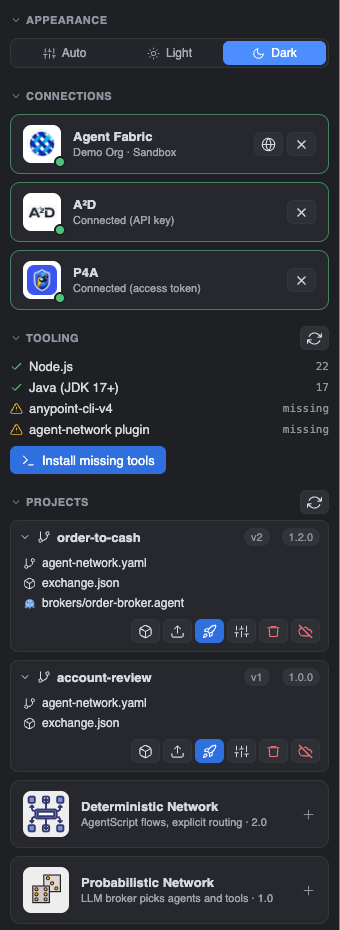

Deploy and run

# Projects & Deploy

<strong>Every agent network project of the workspace with its status, and the buttons to validate, build, publish, deploy, run locally and undeploy.</strong> One place for the whole lifecycle, with status lights for each deployment.

!!! info "Where to find it"
    Side bar → **Projects & Deploy**

<figure markdown>
{ loading=lazy }
{ loading=lazy }
<figcaption>Projects & Deploy with a 1.0 and a 2.0 project</figcaption>
</figure>

| # | Control | What it does |
|---|---|---|
| 1 | **New project** | Create a project from a template |
| 2 | **Download an agent network from Exchange** | Download an agent network from Exchange into this workspace |
| 3 | **Check deployment status** | Ask Agent Fabric for the deployment status |
| 4 | **Governance report** | Governance report: validate every project in the workspace against rulesets |
| 5 | **Refresh** | Read the data again |
| 6 | **All 2** | All projects in the workspace |
| 7 | **Draft 2** | Neither deployed nor running locally |
| 8 | **Not deployed** | Show only the projects that are not deployed |
| 9 | **Governance** | Governance: validate against Agent Fabric, P4A and organization rulesets |
| 10 | **Validate** | Validate: dry run of build, publish and deploy (changes nothing) |
| 11 | **Build** | Build: repair and package locally |
| 12 | **Publish to Exchange** | Publish the assets to Exchange |
| 13 | **Deploy** | Deploy the network to Agent Fabric |
| 14 | **Setup gateways** | Pick the Flex gateways to deploy to |
| 15 | **Undeploy** | Stop the deployment (asks first) |
| 16 | **Unpublish from Exchange** | Remove this version from Exchange |
| 17 | **Remove from workspace** | Remove from workspace (files stay on disk and in Git) |
| 18 | **Run locally** | Run locally (Docker, nothing changes in Anypoint) |

## How to use it

1. Click **Validate** for a dry run of build, publish and deploy.

    <figure markdown>
    { loading=lazy }
    { loading=lazy }
    <figcaption>Explain on a project button</figcaption>
    </figure>

2. Click **Deploy**: choose the gateway(s), target space and switches, then **Deploy**.

    <figure markdown>
    { loading=lazy }
    { loading=lazy }
    <figcaption>The Deploy form: gateways, target space and switches</figcaption>
    </figure>

3. Watch the deployment box: green *running*, blue *needs credentials*.

    <figure markdown>
    { loading=lazy }
    { loading=lazy }
    <figcaption>Deployment boxes: needs credentials, running</figcaption>
    </figure>

4. Use **Run locally** to try the network in Docker without Anypoint.

    <figure markdown>
    { loading=lazy }
    { loading=lazy }
    <figcaption>Run locally: variables</figcaption>
    </figure>

## In detail

- Lists the agent network projects in the workspace (folders under `.deployment/` are ignored). **Filter chips** show all, deployed, local or draft projects; **+** creates a new project.
- **Validate / Build / Publish / Deploy / Run locally / Set Up Gateways / Undeploy / Unpublish / Remove** as compact icons on each project (hover for the name). The **Governance** shield sits in the project's header, right after its version.
- **One CLI run per project at a time**: while a build, publish, deploy or local run is busy, its icon shows a spinner and the project's other action icons are disabled; a second run of the same project is refused with a message.
- **Remove from workspace** (minus icon): takes the project off the list (or closes its workspace folder). Its open tabs close without a save prompt (unsaved changes are discarded). The files stay on disk and in Git. A removed project is left out of Governance too. *Octoloom: Show Removed Projects* brings it back, and so does downloading it from Exchange, creating it again or adding its folder to the workspace again. There is no *Forget deployment* any more: the status refresh shows the real state of every deployment.
- **(i)** in the *Projects & Deploy* title bar, next to **+** and Home: turns on Explain mode for this side bar, so every project button and box explains itself on click.
- **Deploy form**: pick the gateway from the gateways of the connected environment (chips with a status dot; typing a name still works), enter the secrets (passed as `--property`, never stored) and set the options with on/off switches: **Tracing**, **Wait until the network is ready** and **Publish before deploy** (on by default; off passes `--disable-tracing`, `--dont-wait-for-agent-network`, `--disable-autopublish`). **Target space** offers the organization's **private spaces** (marked *private*) and the CloudHub shared spaces as chips, and each gateway chip says which space it runs in (with a single gateway the brokers deploy to the gateway's space). **Deploy…** on the canvas, in the command palette, in the editor title and on `agent-network.yaml` in the Explorer opens this same form for the project, with the same saved values. Run locally has a **Watch files** switch.

  - **Pre-deploy checks** before build and deploy, with a fix for each finding in the *Agent Network CLI* output: a broker `implementation` file that doesn't exist; an `exchange.json` dependency the connected org can't read; a v2 registry key that is already an Exchange asset of another project (*"Asset 'X' belongs to another project"*); a v2 connection key that is already an API instance in the environment (409). Your own earlier deploys of the same project are not flagged. Org lookups are best effort and never block a deploy.
  Also flagged: a connection key longer than 51 characters. The local gateway of *Run locally* rejects the derived name `<key>-api-context` (63 characters at most), so Run locally stops and offers **Rename and run** (key and references). Deploys to a managed gateway accept the key: Build, Publish and Deploy only write a warning to the output. New Project keeps its id prefix short enough.
- **Status light** per project: grey = not deployed, green = deployed and running (the broker serves its agent card), **blue = deployed, needs credentials** (the gateway answers 401/403 because of an auth policy such as Client ID Enforcement, and no working credentials are saved), red = stopped or the last deploy failed. The pulse icon checks again.
- **Credentials chip** on each protected broker row: **saved** (green, with the method, e.g. Client ID) when the credentials you saved with the chat's shield button work, or **needed** / **refused** / **sign in** (blue). Click it to open the chat. Saving or clearing credentials in the chat checks again at once, so the light turns green.
- **Exchange icon** (key) on each broker row, and in the chat's *Authentication* header: opens the broker's page in Exchange, where **Request access** gives you the client ID and secret to paste into the chat. No searching in Exchange.

  - **Deployment details** stay with the project after VS Code restarts: environment, gateway, version and every broker URL (click to copy).
- **Chat** icon: opens the broker chat (see below).
- **Share** (the share icon in the broker chat header, after *New conversation*; it opens the Share dialog on its **A²D sessions** tab, not this view). Its **Local portal** tab is a web chat for a broker that runs without VS Code, for colleagues who should just chat with it.
  - Pick the **broker** and its **Broker URL**: the Anypoint deployment, the **local run** (reachable only while the portal runs on this machine), or **Other URL…** for any broker address. Then a **portal title** and the **folder**. By default it goes next to the project as `<project>-chatportal-1` (the next portal gets `-2`, and so on), never inside it, so it is not built or published with the network.
  - A project can have **several portals**, for example one on Anypoint for colleagues and one on the local run for your tests. Each has its own folder, passcode and local port (3000, 3001, …) and its own row in the dialog with a settings icon to change it.
  - **Forget** (×) takes a portal off the list and keeps its folder. **Delete** (trash) asks first, then moves the portal folder to the Trash, `.env` included, so you can still restore it. It only deletes folders Octoloom generated, never the project, and says which files in it Octoloom did not write. A copy deployed to a hosting service keeps running: delete it there.
  - **Generate portal** writes a small project: `server.mjs` (Node 18+, no dependencies), the chat page in `public/`, `.env.example`, `.gitignore`, a `Dockerfile` and a README with deploy steps for Docker, Render, Fly.io, Cloud Run and Azure App Service.
  - Visitors sign in with a **shared passcode**. Octoloom shows it **once**: save it and share it with the people who may chat. Only its scrypt hash goes into the portal's `.env`. Generating again keeps it, unless you turn on **New passcode**.
  - The server calls the broker over A2A with the credentials method saved in the chat (shield button). The secret lives in the server's environment and never reaches the browser. For a quick local run, **Write the saved secret into .env** puts it in the gitignored `.env`.
  - A portal row in the dialog shows the folder and what is still missing (for example *Set BROKER_CLIENT_SECRET*), with **Run locally** (terminal + browser), the README and the folder.
  - **Self-diagnosis.** `node server.mjs --check` (and the same checks at startup) tests the settings, the broker, its agent card, the token and the credentials, and prints a fix for each problem. The page has a **Status** panel with the checks, the versions and recent events (never messages), and *Copy report* for support. A failed reply says what went wrong, with a reference that is also in the server log.
  - **Version stamp.** Each portal records the Octoloom version that generated it. When Octoloom is newer, the portal row offers **Update** (same broker, title, passcode and `.env`).
  - **A²D sessions** (the tab the dialog opens on). Instead of a folder, it shares the deployed broker as an A²D exploratory session of the **Octoloom chat** type:
    - The people you invite by email verify themselves with a code on an Octoloom-styled page with the mascot, then chat with the broker in the Octoloom chat window hosted by A²D. Follow-up questions keep the conversation, as in this chat.
    - The session always expires, after 1 to 90 days, with no "never". Its row opens or copies the link, invites more people, extends, ends it, or removes it from A²D (session, environment and card copy), with small icons and inline fields.
    - **Results.** Open a row to see what A²D stored, refreshed every minute: invited, verified and submitted people, every **Passed** / **Failed** / **In progress** mark with its comment (new ones are marked *new*), each visitor's submit, and every conversation with its turns. **Continue in the chat** loads a visitor's conversation into this chat window, with the same context, so you can carry it on.
    - An older A²D without the Octoloom chat type falls back to its exploratory tester (the row says *A²D tester*). The marks and comments testers set there show the same way once A²D returns them; until then only the invite status.
    - Needs the A²D connection (Setup & Connect) and a deployed broker that A²D's cloud can reach. Use a dedicated test client app for the broker credentials. Supported: no credentials, bearer token, Basic, and Client ID; with the Octoloom chat type also client_id / client_secret headers, a custom header and OAuth 2.0 client credentials (an older A²D sends Client ID as a Basic header).
    - **Create** opens a review step inside the dialog (session, broker, invited people, expiry, credentials) before anything is sent to A²D; **End** and **Remove** ask in a strip on the row.

    - **Run locally** (v2, play icon): runs the network on your machine in Docker with the CLI's `run-local`. Two Flex gateways, a local Exchange and the agent graph start in containers; nothing changes in your Anypoint org. Brokers answer on `http://localhost:<port>/<broker>/`. A square status light and a local box show the progress and the URLs. The stop icon ends the run (Ctrl+C in the terminal). Needs Docker Desktop. `.deployment/` is added to `.gitignore`, because it holds the local gateway certificates. Brokers that call an LLM do not work locally yet with CLI plugin 1.5.0; see [Known limitations](#known-limitations).
  The local form has **Variables** for the non-secret `exchange.json` variables, preloaded with their `exchange.json` values so you only change what differs on this machine. Changed values are passed as `--property` for this machine only; `exchange.json` is not changed. A default URL with an internal host name (no dot, for example a gateway service name) is marked *internal host*, and Run locally asks before it starts.

 

## Buttons and components

The same text as the in-app **Explain** button (click the floating **i**, then the item).

### Projects & Deploy

The side bar of the agent network projects in this workspace: open a project, build, publish and deploy it, and see the status of each deployment.

**When to use it:** To find a project, start a new one or ship one to Agent Fabric.

<figure markdown>
{ loading=lazy }
{ loading=lazy }
<figcaption>Projects & Deploy with a 1.0 and a 2.0 project</figcaption>
</figure>

**Examples and details:**

- New project opens the New Project dialog
- Filter the list with the tabs above it
- A green light means the last deployment is running
- A blue light means it is deployed behind authentication (HTTP 401/403) and needs credentials: set them in the chat with the shield button, and the light turns green
- The shield chip on a broker row says saved (green) or needed (blue); click it to open the chat
- The key icon on a broker row opens the broker in Exchange: Request access there to get its client ID and secret
- Unpublish refused (error 2007): Anypoint does not unpublish an asset that still has deployed resources. Undeploy the network (and anything deployed from this asset) first
- Hard delete is only allowed about 7 days after the version was published; before that, use Unpublish
- Remove from workspace (minus icon) takes a project off the list and deletes nothing: a workspace folder leaves the workspace, the only open folder is closed, a subfolder is hidden from Projects & Deploy and Governance until "Octoloom: Show Removed Projects", or until you download it from Exchange, create it or add its folder to the workspace again. Its open tabs close without a save prompt (unsaved changes are discarded). Files stay on disk and in Git; a deployment keeps running, so Undeploy first if you want it stopped
- The deployment box has no Forget button any more: Check now and the 5-minute refresh keep the status right, and Undeploy stops a running network

### Build

Repairs what the CLI would reject (missing defaults, long connection names after asking) and packages the project on this machine with the Anypoint CLI. Nothing goes to Exchange or a gateway.

**When to use it:** After a change, to see that the CLI accepts the project.

<figure markdown>
{ loading=lazy }
{ loading=lazy }
<figcaption>Build, in the project box of Projects & Deploy</figcaption>
</figure>

**Examples and details:**

- Output in "Agent Network CLI"
- Build errors land in Problems on the canvas

### Publish to Exchange

Publishes the project to Exchange with the version in exchange.json, as it is: Publish never bumps it.

**When to use it:** Once per new version. A version already in Exchange can't be published again: bump it first (New Version or Commit Version in the flow editor, Bump patch in exchange.json).

<figure markdown>
{ loading=lazy }
{ loading=lazy }
<figcaption>Publish to Exchange, in the project box of Projects & Deploy</figcaption>
</figure>

**Examples and details:**

- Deploy with "Publish before deploy" does the same publish for you
- To redeploy a version already in Exchange, turn Publish before deploy off

### Run locally

Runs a 2.0 network on this machine in Docker (Flex gateways, a local Exchange and the agent graph). Nothing changes in your Anypoint org. The form takes the port, secrets and non-secret variables for this run; the variables are preloaded with their exchange.json values, so you only change what differs on this machine.

**When to use it:** To try a change without a deploy.

<figure markdown>
{ loading=lazy }
{ loading=lazy }
<figcaption>Run locally: variables</figcaption>
</figure>

**Examples and details:**

- Stop it with the same button (it turns into a stop button) or Ctrl+C in the terminal
- An internal gateway host such as omni-ai-gateway needs its external address under Variables

### Setup gateways

Asks for a gateway name and runs the CLI step agent-network:setup:gateways for it (single-gateway mode), in a terminal.

**When to use it:** Before the first deploy to a gateway, or when the deploy asks for it.

<figure markdown>
{ loading=lazy }
{ loading=lazy }
<figcaption>Setup gateways, in Projects & Deploy</figcaption>
</figure>

**Examples and details:**

- The terminal shows what the CLI does

### Undeploy

Stops and removes the deployment of this project from its gateway, after asking. The Exchange asset stays.

**When to use it:** When the network should no longer run. It is the only way Octoloom stops a deployment.

<figure markdown>
{ loading=lazy }
{ loading=lazy }
<figcaption>Undeploy, on a deployment box in Projects & Deploy</figcaption>
</figure>

**Examples and details:**

- Undeploy before Unpublish: Anypoint refuses to unpublish an asset that is still deployed (error 2007)

### Unpublish from Exchange

Removes the published version of this project from Exchange, after asking. Your files are not changed.

**When to use it:** To withdraw a version. Undeploy first.

<figure markdown>
{ loading=lazy }
{ loading=lazy }
<figcaption>Unpublish from Exchange, in the project box of Projects & Deploy</figcaption>
</figure>

**Examples and details:**

- Hard delete is only allowed about 7 days after the version was published

### Remove from workspace

Takes the project off this list and deletes nothing: a workspace folder leaves the workspace, the only open folder is closed, and a subfolder is hidden from Projects & Deploy and Governance until "Octoloom: Show Removed Projects", or until you download it from Exchange, create it or add its folder to the workspace again. Its open tabs close, and unsaved changes in them are discarded without a save prompt. Files stay on disk and in Git, and Exchange is not changed.

**When to use it:** When you no longer work on a project in this workspace.

<figure markdown>
{ loading=lazy }
{ loading=lazy }
<figcaption>Remove from workspace, in the project box of Projects & Deploy</figcaption>
</figure>

**Examples and details:**

- A deployment keeps running: Undeploy first if it should stop

### Validate Project

A dry run of build, publish and deploy that changes nothing. Octoloom copies the project (unsaved edits included) to a scratch folder, applies the repairs a Build would make to the copy only, then checks agent-network.yaml and the .agent flows, runs the pre-deploy checks (with the org lookups when Agent Fabric is connected), runs the CLI build on the copy and lists deploy variables without a value. The report goes to the "Agent Network CLI" output in five steps; the copy is deleted afterwards. Your files, Exchange and the gateways are never touched, and Build, Publish and Deploy work as before.

**When to use it:** Before you publish or deploy, or after changing the project, to see whether publish and deploy are expected to work. The check icon on a project in Projects & Deploy, Validate in the canvas Build & Deploy menu, Validate Project in the command palette or on agent-network.yaml in the Explorer.

<figure markdown>
{ loading=lazy }
{ loading=lazy }
<figcaption>Validate Project, in the project box of Projects & Deploy</figcaption>
</figure>

**Examples and details:**

- Validation passed: build, publish and deploy are expected to work
- Repairs a Build makes: exchange.json groupId set to the connected organization (Validate only lists it)
- MCP platform "Informatica" must be lower case: Exchange rejects it on publish
- Connection key already an API instance in the environment: Deploy offers Fix and deploy
- Not connected: only the local checks and the CLI build run; connect to Agent Fabric for the org checks

### Pre-deploy checks

Before build and deploy, Octoloom checks what the agent-network CLI only reports after a full publish and deploy: a broker implementation file that does not exist, a connection key longer than 51 characters (the local gateway of Run locally names its context <key>-api-context, 63 characters at most; deploys to a managed gateway accept the key, so for Build, Publish and Deploy it is only a warning), and, when Agent Fabric is connected, an exchange.json dependency the org cannot read, a registry key that is already an Exchange asset of another project, a connection key that is already an API instance in the environment, and (v1) a connection key another project already uses for the same Exchange asset in the environment (Duplicated connection name). Findings go to the "Agent Network CLI" output with a fix. The project checks (main file, classifier, unused dependencies, undeclared variables, two brokers on one .agent file) are listed there too, as warnings that never stop the build.

**When to use it:** Every Build and Deploy. A missing implementation file stops the build; a connection key over 51 characters stops only Run locally, where Rename and run shortens the key with its references (Build, Publish and Deploy write a warning to the output and go on); New Project keeps the project prefix short enough for every template key; org findings ask before deploying (Fix and deploy, Deploy anyway or Cancel). Fix and deploy renames a connection key that is already an API instance in the environment (v1: prefixed with the project name), or a registry key owned by another project, with every reference and .agent target; An exchange.json groupId or organizationId still at ${organizationId} (the CLI does not resolve it) is set to the connected organization or business group automatically before every build, publish, deploy and run locally; a real group ID is never changed. It saves, then builds and checks again. A failed org lookup never blocks the deploy.

<figure markdown>
{ loading=lazy }
{ loading=lazy }
<figcaption>Deployment boxes: needs credentials, running</figcaption>
</figure>

**Examples and details:**

- implementation: ./brokers/sales.agent but sales.agent is in the project root: move it or change the path
- A Salesforce agent dependency from another business group: publish it to your org or declare it inline
- "Asset sales_agent belongs to another project": rename the registry key
- Connection openai_connection already exists in the environment (409): rename the connection key and its llm:// target
- customer_onboarding_platform_northwind_orders_mcp_connection (60 characters): deploys go on with a warning; Run locally stops and Rename and run shortens it to 51
- Duplicated connection name demo-llm-connection (another project uses the same Exchange LLM): Fix and deploy renames it to <project>-demo-llm-connection

### Deploy form

Deploys the project with the Anypoint CLI. Pick a gateway from the chips (the gateways of the connected environment, green = running) or type its name; secrets are passed as --property and never stored. The switches are on by default: Tracing, Wait until the network is ready, Publish before deploy. Turn one off to pass --disable-tracing, --dont-wait-for-agent-network or --disable-autopublish. The gateway chips say which space a gateway runs in; with one gateway the brokers deploy to that space. Target space (-t) lists the private spaces of the organization (marked private) and the CloudHub shared spaces; in Ingress / egress mode it is needed unless your space is called agent-network-space. Deploy… on the canvas, in the command palette, in the editor title or on agent-network.yaml in the Explorer opens this same form for the project.

**When to use it:** Each deploy: the rocket icon on a project in Projects & Deploy, or Deploy… on the canvas.

<figure markdown>
{ loading=lazy }
{ loading=lazy }
<figcaption>The Deploy form: gateways, target space and switches</figcaption>
</figure>

**Examples and details:**

- Click the agentic chip to fill in the gateway
- Ingress / egress: click a private space chip under Target space
- Turn Publish before deploy off to redeploy a version that is already in Exchange
- Run locally has a Watch files switch (--watch)
- Run locally lists the non-secret variables of exchange.json, preloaded with their exchange.json values: change one to pass it as --property for this machine only (remembered per project, exchange.json is not changed); unchanged or empty keeps the exchange.json value
- Internal host (for example omni-ai-gateway, a host without a domain): it only resolves inside the managed gateway, so a local run warns and asks for the gateway's external address under Variables
- Deploy the MCP servers and agents a broker connects to first, on the same gateway and space: at deploy the broker checks that it can reach every connection
- Many 3025 errors after you changed the gateway or the space: the deployment target is fixed after the first deploy, and the real cause is one 400 above them. Delete the deployment in Runtime Manager, then deploy again
- "Error while trying to apply policies" (3025 on every broker): the CLI applies the policies to the API Manager instance of each connection, so one bad instance or policy fails them all. Fix that policy or instance
- A deploy that seems to hang has almost always created the app: open its log in Runtime Manager before you retry
- 403 on publish or deploy is a missing role or scope (for example Exchange Contributor or Runtime Manager deploy rights), not a project problem: ask your Anypoint admin
- "Converting circular structure to JSON" hides the real CLI error: a flag the installed agent-network plugin does not support. Update the plugin (anypoint-cli-v4 plugins:install) or turn the switch that adds the flag off
