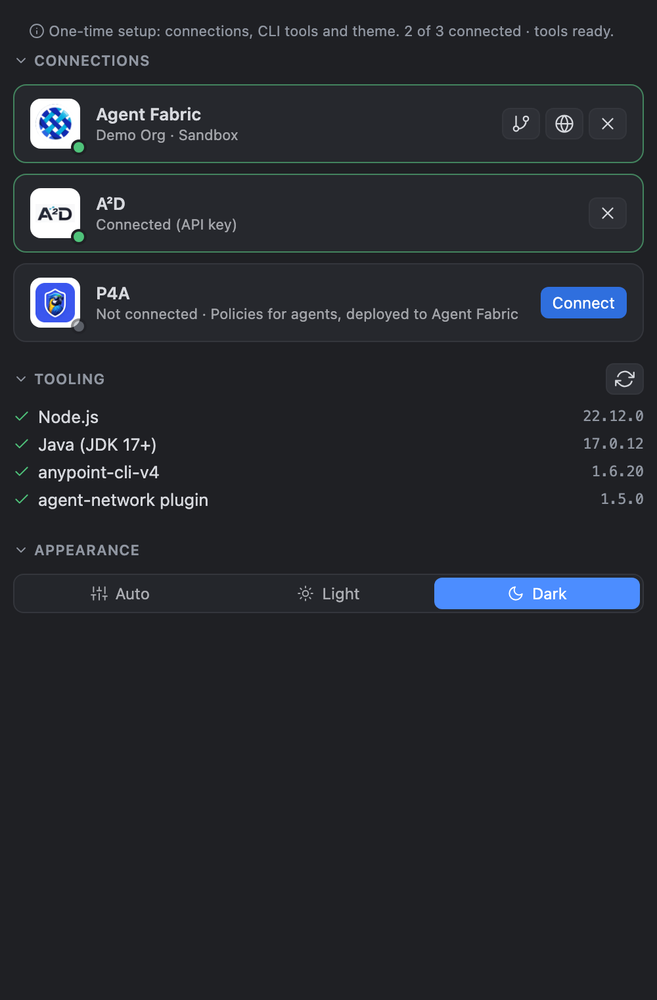

Start

# Setup & Connect

<strong>One-time setup: connections (Agent Fabric / Anypoint, A²D, P4A, Informatica IDMC), the CLI tools and the theme.</strong> Every other view needs these connections; the status line tells you what is missing.

!!! info "Where to find it"
    Side bar → **Setup & Connect**

<figure markdown>
{ loading=lazy }
{ loading=lazy }
<figcaption>Setup & Connect: connections, tooling and appearance</figcaption>
</figure>

| # | Control | What it does |
|---|---|---|
| 1 | **Select business group** | Select business group (publish and deploy into a sub org) |
| 2 | **Select environment** | Pick the Anypoint environment |
| 3 | **Disconnect from Agent Fabric** | Sign out of Anypoint |
| 4 | **Disconnect from A²D** | Remove the A²D API key |
| 5 | **Connect** | Connect with these settings |
| 6 | **Re-check** | Run the checks again |
| 7 | **Auto** | Follow the VS Code color theme |
| 8 | **Light** | Light mode for all Octoloom views |
| 9 | **Dark** | Dark mode for all Octoloom views |

## How to use it

1. Click **Connect** on each connection you need (Agent Fabric first).

    <figure markdown>
    { loading=lazy }
    { loading=lazy }
    <figcaption>Informatica IDMC connected</figcaption>
    </figure>

2. Check **Tooling**: Node.js, Java, anypoint-cli-v4 and the agent-network plugin; install or update from there.

    <figure markdown>
    { loading=lazy }
    { loading=lazy }
    <figcaption>A newer Octoloom on the Marketplace</figcaption>
    </figure>

3. Pick the theme under **Appearance**.

## In detail

The first view in the Octoloom side bar, above Projects & Deploy and Asset Palette. It holds one-time setup, most important first. The line on top shows what is left, for example *2 of 3 connected · tools ready*:
- **Connections**: Agent Fabric (business group and environment pickers), A²D and P4A. Connect or disconnect with one click.
- **Tooling**: Node.js, Java, anypoint-cli-v4 and the agent-network plugin, with one-click install or repair. Each row knows its minimum and tested version (see [Tooling versions](#tooling-versions)): below the minimum it warns, for example *needs 1.5.0 or newer*, and **Install tested versions** installs the pinned versions after a confirmation; newer than tested shows *untested*. Nothing is blocked. The Octoloom row shows the installed version and *<version> available* when the Marketplace has a newer one.
- **Appearance**: auto, light or dark for every Octoloom view.
  When the forced mode doesn't match VS Code (for example Octoloom dark in a light VS Code), a hint says so, with **Follow VS Code**.

It is collapsed by default. It opens by itself when the window has no folder or the workspace has no agent network project yet. VS Code remembers when you open or close it yourself.

 

## Buttons and components

The same text as the in-app **Explain** button (click the floating **i**, then the item).

### Setup & Connect

One-time setup in the Octoloom side bar, most important first: Connections to Agent Fabric (business group and environment), A²D, P4A and Headless IDMC (Informatica), Tooling (Node.js, Java, anypoint-cli-v4, the agent-network plugin and Octoloom itself with a new-version notice, with install or repair), and Appearance (auto, light or dark). The line on top says how many connections are set up and whether the tools are ready. Projects & Deploy below it is for daily project work.

**When to use it:** The first time you use Octoloom, when a connection expires, or when a build says a tool is missing. It is collapsed by default and opens by itself when the workspace has no folder or no agent network project yet.

<figure markdown>
{ loading=lazy }
{ loading=lazy }
<figcaption>Setup & Connect: connections, tooling and appearance</figcaption>
</figure>

**Examples and details:**

- Appearance: Auto follows the VS Code theme; Light or Dark forces Octoloom's own palette. When the forced mode doesn't match VS Code, a hint says so with Follow VS Code
- Connect Agent Fabric with the plug button on its card, then pick the environment with the globe button
- Publish and deploy into a sub business group: pick it with the branch button next to the globe (the connected app needs scopes in that group, otherwise only the root organization is listed)
- Connect A²D with an API key to drag designed agents and MCP servers from the Asset Palette
- Connect Headless IDMC: pick the pod of your org (for example North America, dm-us), then log in with your IDMC user. The IDMC tab of the Asset Palette lists the shared and composite Informatica MCP servers. Headless IDMC needs the AI Engineering license in your Informatica org and a pod that runs it (the hdm.<pod> host); without them the IDMC tab says so
- Install missing tools after a fresh machine setup; the refresh button checks again
- Switch all Octoloom views to light or dark, independent of the VS Code theme
