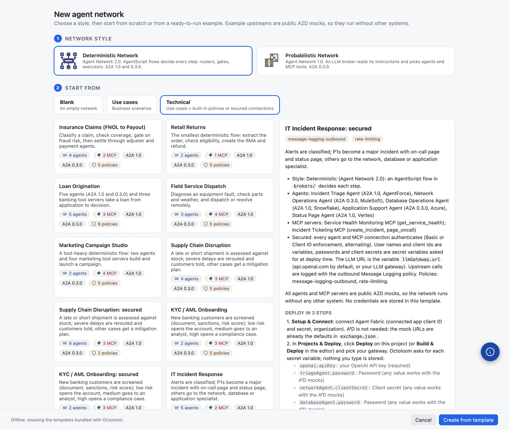
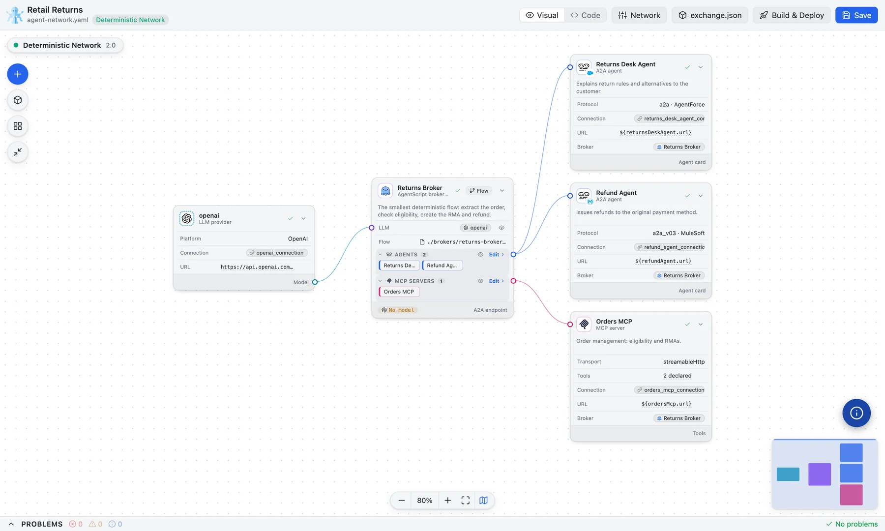
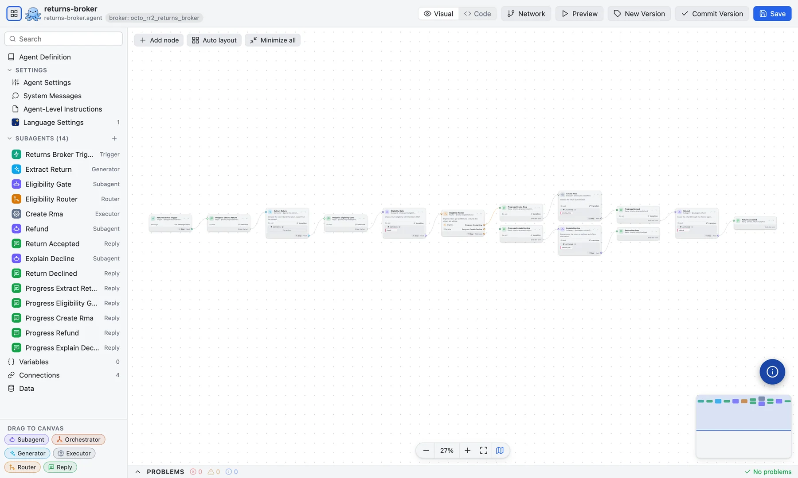
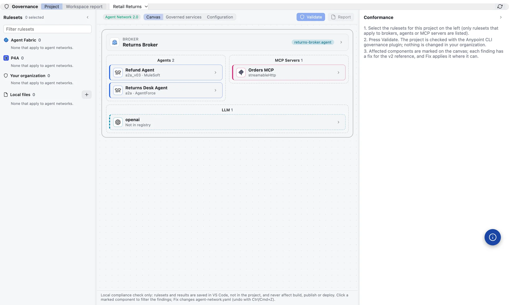
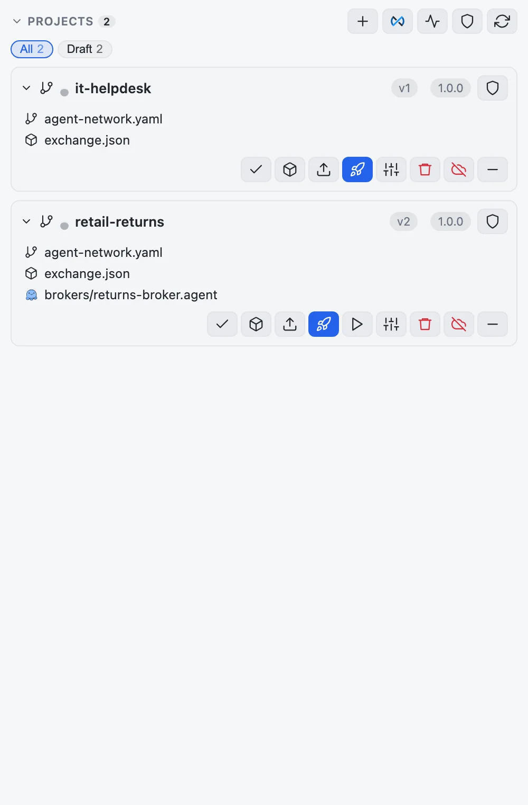
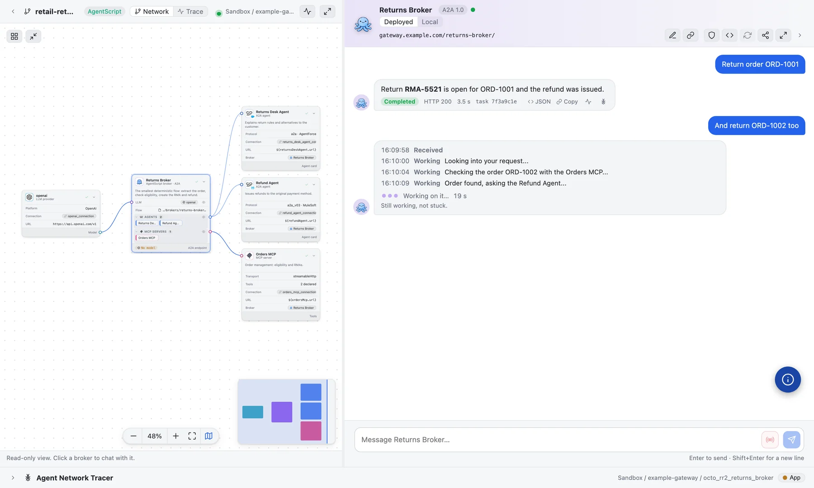
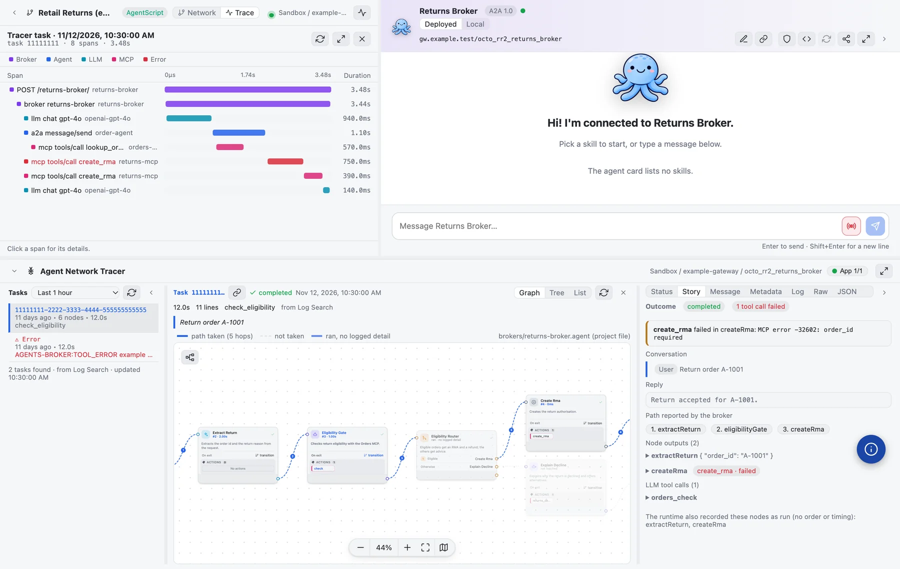
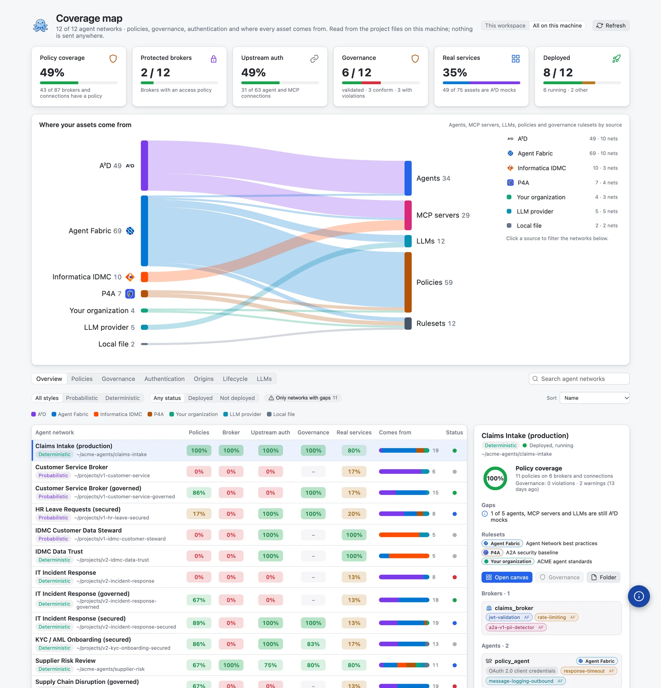
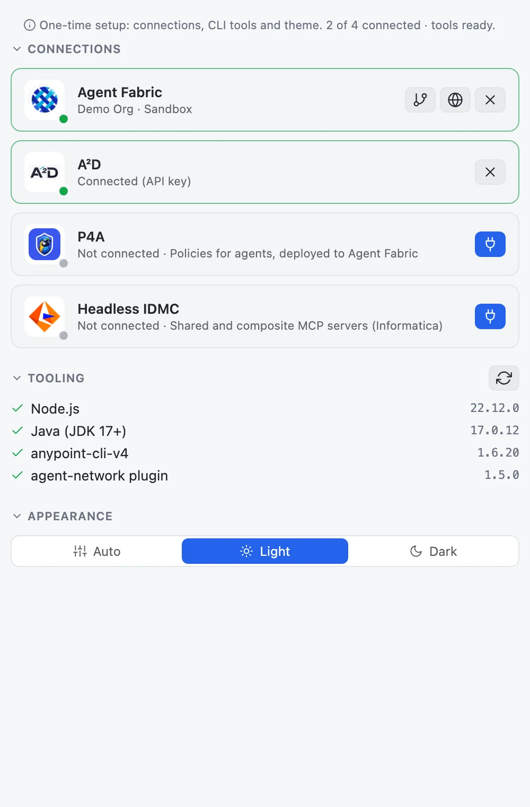

---
hide:
  - navigation
  - toc
---

{ .hero-logo }

VS Code extension for Agent Fabric

# Octoloom for Agent Fabric

<strong>Design, govern, deploy and observe agent networks, visually, in VS Code.</strong>
Octoloom turns <code>agent-network.yaml</code> and AgentScript <code>.agent</code> flows into canvases, checks them with governance rulesets on your machine,
deploys them with the Anypoint CLI and lets you chat with the deployed broker and trace every call. Meet Loomi, the octopus who weaves your agents together.

<a class="ol-stat" href="https://marketplace.visualstudio.com/items?itemName=octoloom.octoloom"><b class="ol-installs" data-fallback="134">134</b>Marketplace installs</a>
<a class="ol-stat" href="https://marketplace.visualstudio.com/items?itemName=octoloom.octoloom&ssr=false#review-details"><b>5.0 ★</b>3 ratings</a>

<b class="ol-version">0.9.28</b>Latest version

<a class="ol-stat" href="catalog/"><b>43</b>Templates (20 v1 · 23 v2)</a>
<a class="ol-stat" href="tutorials/"><b>43</b>Tutorials</a>

[Install from the Marketplace](https://marketplace.visualstudio.com/items?itemName=octoloom.octoloom){ .md-button .md-button--primary }
[Getting started](getting-started.md){ .md-button }
[Features](features/index.md){ .md-button }
[Templates](catalog/index.md){ .md-button }

## Tour of Octoloom

-   **[Start from a template](features/new-project-from-templates.md)**

    { loading=lazy }

    43 ready-to-run networks, every upstream mocked.

-   **[Design on the canvas](features/network-canvas-agent-network-yaml.md)**

    { loading=lazy }

    Brokers, agents, MCP servers and LLMs as cards; the YAML stays in sync.

-   **[Write broker flows](features/broker-flow-editor-brokers-agent.md)**

    { loading=lazy }

    AgentScript flows: steps, branches, replies and live progress.

-   **[Govern locally](features/governance-rulesets-for-brokers-agents-and-mcp-servers.md)**

    { loading=lazy }

    Rulesets from Agent Fabric, P4A and your org, with Fix all.

-   **[Build, publish, deploy](features/projects-deploy.md)**

    { loading=lazy }

    Validate, build, publish to Exchange and deploy to your gateways.

-   **[Chat and trace](features/broker-chat.md)**

    { loading=lazy }

    Talk to the broker over A2A and see every call it made.

-   **[Agent Network Tracer](features/agent-network-tracer.md)**

    { loading=lazy }

    The path each task took through the flow, from the logs.

-   **[Coverage map](features/coverage-map.md)**

    { loading=lazy }

    Policy, auth and governance coverage of every network.

-   **[Setup & Connect](features/setup-connect.md)**

    { loading=lazy }

    Connections, CLI tools and theme in one place.

## Where to start

-   :material-microsoft-visual-studio-code: **[Install from the VS Code Marketplace](https://marketplace.visualstudio.com/items?itemName=octoloom.octoloom)**

    ---

    Search **Octoloom** in the Extensions view, or open the Marketplace page. Version 0.9.28, 134 installs.

-   :material-rocket-launch: **[Getting started](getting-started.md)**

    ---

    A 20-minute tour: install, connect, create a project from a template, deploy and chat.

-   :material-school: **[Tutorials](tutorials/index.md)**

    ---

    One per template, each with three paths: *Just use it*, *Learn step by step* and *Build it from scratch*.

-   :material-view-grid: **[Templates](catalog/index.md)**

    ---

    Ready-to-run agent networks: use cases, governed, secured, fully mocked and Informatica IDMC.

-   :material-gesture-tap-button: **[UI reference](reference/index.md)**

    ---

    Every button, card, canvas and panel on a screenshot, with what it does. The same texts as the in-app **Explain** button.

-   :material-robot: **[Skills for your AI assistant](skills/index.md)**

    ---

    Skills that teach Claude Code, Cursor and others to build agent networks the way the templates are built.

## Highlights

-   **Two network canvases**

    ---

    *Probabilistic* (v1, LLM-routed brokers) and *Deterministic* (v2, AgentScript brokers). Octoloom detects the version from the file.
-   **Welcome page**

    ---

    When VS Code starts, Octoloom opens a Welcome page with five sections you can fold: Quick Actions to start a Probabilistic or Deterministic network, **Quick Start** with guided Beginner, Advanced and Expert onboarding tabs, Tutorials, and the 5 agent network projects built last on this machine. It also shows local statistics: workspaces, projects and the v1 / v2 ratio, brokers, agents, MCP servers, Exchange and A²D assets, policies, deployments, publishes and the top 3 LLM providers.
-   **Coverage map**

    ---

    One tab with every agent network on this machine: policy coverage by category, protected brokers, upstream authentication, governance results, real services vs A²D mocks and deploy status, plus a chart of where every agent, MCP server, LLM, policy and ruleset comes from (A²D, Agent Fabric, Informatica IDMC, P4A, your organization). Opens from Home → *Quick Actions* or *Your statistics* → **Coverage map**. Read-only and local.
-   **Project templates**

    ---

    **New Project** opens a dialog. Start blank or from 43 ready-to-run examples: business use cases, each with a governed variant that has built-in Agent Fabric policies, five secured variants, two Informatica IDMC networks and six **fully mocked** use cases (three v1, three v2) whose LLM is an A²D LLM mock too, so they run without an OpenAI key. All other upstreams are public A²D mocks.
-   **Tutorials**

    ---

    [Getting started](https://github.com/A2D-Agentic-Asset-Designer/octoloom-assets/blob/main/tutorials/getting-started.md): a 10-step tour of Octoloom. [All template tutorials](https://github.com/A2D-Agentic-Asset-Designer/octoloom-assets/blob/main/tutorials/README.md): one per template, with *Just use it*, *Learn step by step* and *Build it from scratch*, with screenshots. Also on the Welcome page.
-   **Broker flow editor**

    ---

    Edit `.agent` broker flows as a graph: triggers, routers, orchestrators, subagents, generators, executors and replies.
-   **Asset palette**

    ---

    Browse **Agent Fabric (Exchange)** assets and **A²D** prototypes side by side. Drag them onto the canvas to add them. The A²D tab also lists **LLM mocks**: drop one on a broker to deploy and chat without a real LLM key.
-   **Mocks → real services**

    ---

    Start with A²D hosted mocks and replace them with published Agent Fabric assets later. Every card shows where it comes from.
-   **Any agent framework**

    ---

    Shows the framework of each agent: Agentforce, MuleSoft, OpenAI, Anthropic, Google ADK / Vertex, Gemini, Bedrock, Azure AI Foundry, Microsoft, LangChain, Langflow, LlamaIndex, Databricks, Snowflake, ServiceNow, Atlassian.
-   **Protocols**

    ---

    A2A agents (v0.3 and current), MCP servers (streamable HTTP / SSE) and LLM providers.
-   **LLM providers**

    ---

    OpenAI, Gemini, Amazon Bedrock and Salesforce, with API key or OAuth 2.0 client credentials (JWT) for LLM gateways. The **Omni gateway** is recognised from the URL. You can change a broker's LLM provider and model on the canvas. **A²D LLM mocks** (OpenAI, Azure OpenAI, Bedrock OpenAI, Gemini) are added as a project LLM pointing at the mock, with a placeholder key.
-   **Policies**

    ---

    Apply gateway policies to brokers and connections (v1 `spec.policies`, v2 inbound / outbound). Pick from the built-in **Agent Fabric** policies, your **organization's** policies in Exchange, or the **P4A** catalog. A P4A policy that is not yet in your org is deployed there first. Cards show the policies that are applied.
-   **Connectivity test**

    ---

    Test any broker, agent, MCP server, LLM or connection from the inspector: MCP initialize and tools/list, the A2A agent card, LLM `/models`. Uses the auth of the connection and the `exchange.json` defaults. MCP servers are called at the connection URL + `transport.path`, exactly like the runtime.
-   **Inline editing**

    ---

    Change values directly on a card, for example the allowed MCP tools, the URL, the LLM platform or the broker limits. Click a card to open the full inspector.
-   **Deployment status**

    ---

    Each project shows a status light: grey not deployed, green deployed and running, blue deployed behind authentication (needs credentials), red stopped or failed. Octoloom remembers where a project is deployed (environment, gateway, broker URLs) across restarts, and finds projects that were deployed earlier in API Manager.
-   **Broker chat**

    ---

    Chat with a deployed broker: the **Agent Network View** on the left (the whole network read-only, or one reply as a sequence of calls), and a chat on the right with the skills from the agent card, the task state and the raw JSON-RPC request and response. The trace icon under a reply shows the trace of that message on the left as a waterfall. While the broker works, the chat says so in plain words and never looks stuck; v2 brokers stream their status updates live (the **Live** button next to Send turns it on or off). Works with A2A 0.3.0 (v1) and 1.0 (v2). Brokers behind authentication: bearer token, client credentials, OAuth 2.0 password grant, client ID, API key, Basic or user sign-in (OAuth 2.0 + PKCE).
-   **Agent Network Tracer**

    ---

    See what a deployed broker did for each task: the path it took through its `.agent` graph, the tools and LLMs it called, what failed and why. Read-only, from Anypoint logs, task state and traces. Export a whole task as JSON for Splunk or Datadog.
-   **Build, publish, deploy**

    ---

    Validate, publish to Exchange, deploy and undeploy through `anypoint-cli-v4`. Octoloom installs the CLI and its prerequisites if they are missing. **Pre-deploy checks** catch what the CLI only reports after a full deploy: a missing broker `implementation` file (stops the build), and, when Agent Fabric is connected, a dependency the org can't read, a registry key owned by another project and a connection key that is already an API instance in the environment (asks *Fix and deploy*, *Deploy anyway* or *Cancel*; *Fix and deploy* renames the taken key with every reference and `.agent` target). An `exchange.json` `groupId` still at `${organizationId}` is set to the connected organization or business group before every build. **Validate Project** (check icon) is a dry run of build, publish and deploy on a copy of the project: it lists the repairs a build would make, the project and pre-deploy findings, the CLI build result and the deploy variables without a value, and changes nothing in your files or the org.
-   **Share a broker**

    ---

    The **Share** icon in the broker chat header opens the Share dialog. **Local portal** generates a standalone web chat for a deployed broker: a Node server with no dependencies, a chat page, a Dockerfile and deploy steps. Run it here or host it anywhere; visitors sign in with a shared passcode (shown once, only its hash is stored) and the broker credentials stay on the server. **A²D sessions** invite people by email to chat with a deployed broker in the Octoloom chat hosted by A²D; their passed / failed / in-progress marks, comments and conversations come back into the dialog, and you can continue any conversation in your chat.
-   **Governance**

    ---

    Validate a project against **rulesets** from Agent Fabric (MuleSoft), **P4A** (community and your own), your **organization's** Exchange and local files, with `anypoint-cli-v4 governance api validate`. Only rulesets that apply to A2A Brokers, A2A agents or MCP servers are listed. Findings are marked on a read-only canvas and grouped by rule as in Anypoint API Governance, with a **Fix** button that applies the v1 / v2 reference change. A report covers one project or the whole workspace (overview, per-service rules and configuration). A local check only: never part of build, publish or deploy.
-   **Minimize to icons**

    ---

    Shrink every card on the network canvas or broker flow to its icon (or one card at a time) to see what is orchestrated at a glance.
-   **Explain anything**

    ---

    A floating info button on every Octoloom editor and panel. Click it, then click any card, panel, tool or canvas to see what it is, when to use it and examples. It also starts the guided tour of a canvas. Drag the button anywhere; every tab follows.
-   **Light, dark or auto**

    ---

    One switch sets the theme for every Octoloom view.

