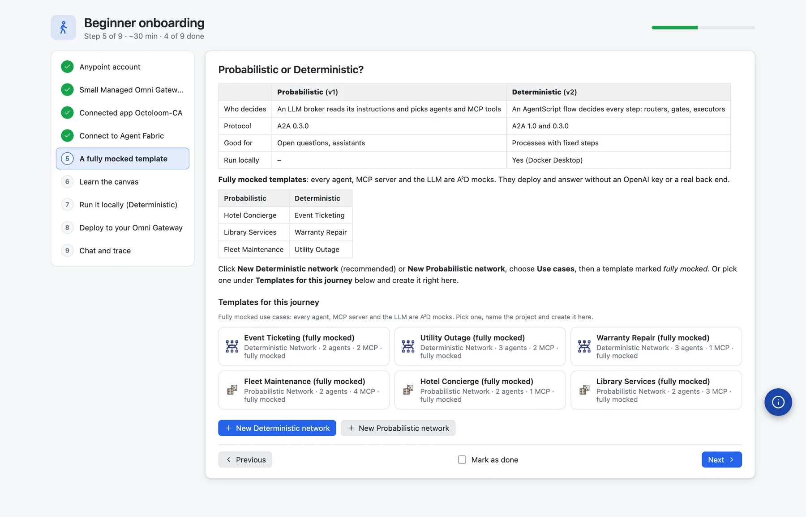
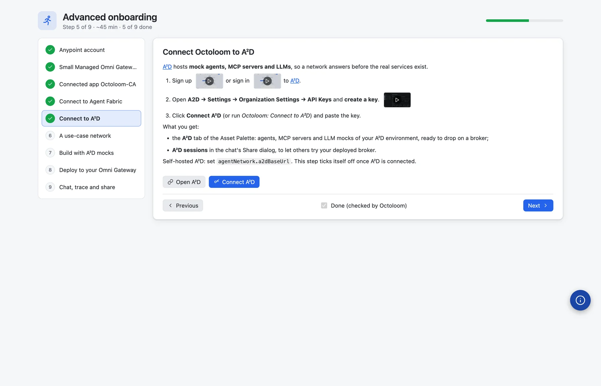

Get started

# Quick Starts

<strong>Three guided journeys, from your first network to governed production.</strong> The same journeys as the <b>Quick Start</b> cards on the Octoloom Home page: each opens as its own Octoloom tab with the steps on the left, the page of the step on the right, short videos and buttons that open the right view. Every journey starts with the four <a href="../start/index.md">prerequisites</a>.

<figure markdown>
{ loading=lazy }
{ loading=lazy }
<figcaption>Home → Quick Start: the Beginner, Advanced and Expert cards</figcaption>
</figure>

-   **[Beginner](beginner.md)** · ~30 min

    { loading=lazy }

    Pick a fully mocked template, learn the canvas, run a Deterministic network locally, then deploy it to your Omni Gateway and chat with it. No LLM key needed.

    <small>9 steps · needs Anypoint</small>

-   **[Advanced](advanced.md)** · ~45 min

    { loading=lazy }

    Connect A²D, build a use-case network from A²D mock agents and MCP servers, deploy it, then chat, trace and share it in an A²D session.

    <small>9 steps · needs Anypoint and A²D</small>

-   **[Expert](expert.md)** · ~60 min

    { loading=lazy }

    Connect A²D and P4A, start from a governed or secured technical template, add P4A and Agent Fabric policies, validate governance and check the Coverage map.

    <small>10 steps · needs Anypoint, A²D and P4A</small>

| Journey | Time | Needs | Steps | Templates |
|---|---|---|---|---|
| [Beginner](beginner.md) | ~30 min | Anypoint | 9 | 6 |
| [Advanced](advanced.md) | ~45 min | Anypoint and A²D | 9 | 21 |
| [Expert](expert.md) | ~60 min | Anypoint, A²D and P4A | 10 | 22 |

## How the Quick Start tab works

### Quick Start

Three guided journeys, each in its own Octoloom onboarding tab: the steps on the left, the page of the selected step on the right with short recorded videos as thumbnails next to the instruction they show, opened in a dialog (sign up and log in to Anypoint, the Omni Gateway, the connected app, connecting Agent Fabric, A²D and P4A; personal data blurred), buttons that open the right Octoloom view or site, and Previous / Next. Each journey shows only its own templates: Beginner the fully mocked ones, Advanced the other use cases, Expert the technical ones. Click a template card to create the project right in the tab: name, parent folder, after creating, Git, then Create from template; it is the same as the Project step of New Project and the project appears in Projects & Deploy. Every journey starts with the same prerequisites: an Anypoint account (sign up or log in), a Small Managed Omni Gateway (Edge 1.15.0 or later, Upstream Response and Connection Idle Timeout 60 s, Distributed Tracing on), a connected app Octoloom-CA with least-privilege scopes (client credentials) and the connection to Agent Fabric. Beginner then creates a fully mocked template, explains the canvas, runs a Deterministic network locally and deploys it. Advanced connects A²D (an API key from A2D → Settings → Organization Settings → API Keys) and builds a use-case network with A²D mock agents, MCP servers and LLMs. Expert connects A²D and P4A (a personal access token p4a_…, plus a P4A connection to your Anypoint org and a workspace to deploy P4A policies) and starts from a governed or secured technical template, with policies, governance and the Coverage map. The chips on each card show which connections are already in place. Steps Octoloom can see (connections, the gateway check, a project, a deployment) tick themselves off; tick the others with Mark as done.

**When to use it:** You are new to Octoloom or to Agent Fabric, or want a guided path to the next level. Click a card to open its onboarding tab; reopen it any time with Octoloom: Quick Start from the Command Palette.

**Examples and details:**

- Beginner: Event Ticketing (fully mocked, Deterministic) runs locally, then on the Omni Gateway, with no LLM key
- Check my gateway in the gateway step lists the Omni Gateways of the connected environment and their status
- Advanced: drop an A²D LLM mock on the broker, so the network answers without an OpenAI key
- Expert: add a P4A policy to a broker, then validate with the Agent Fabric and P4A rulesets
