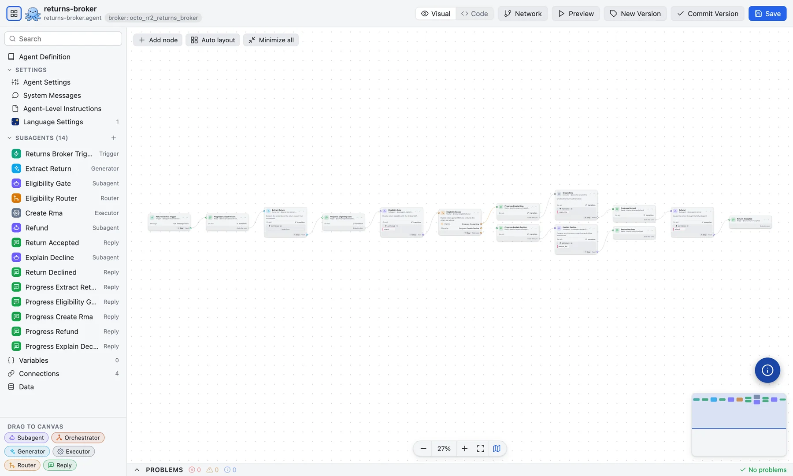
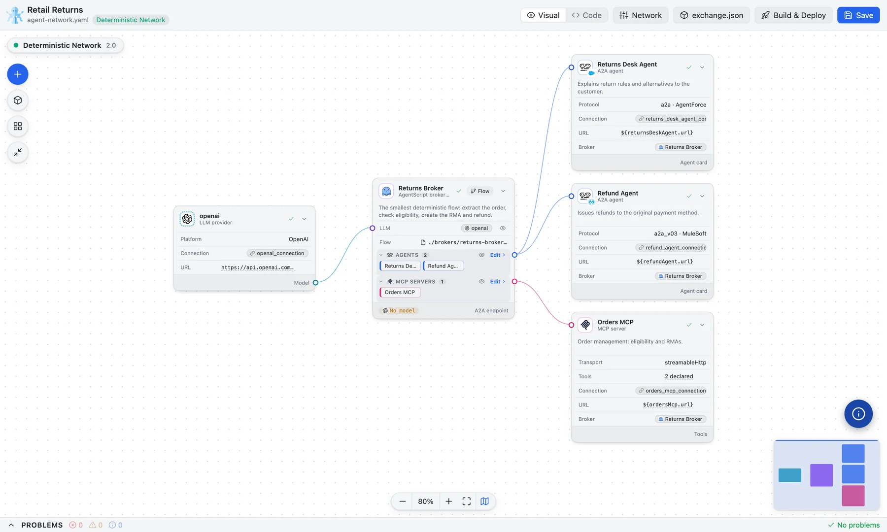
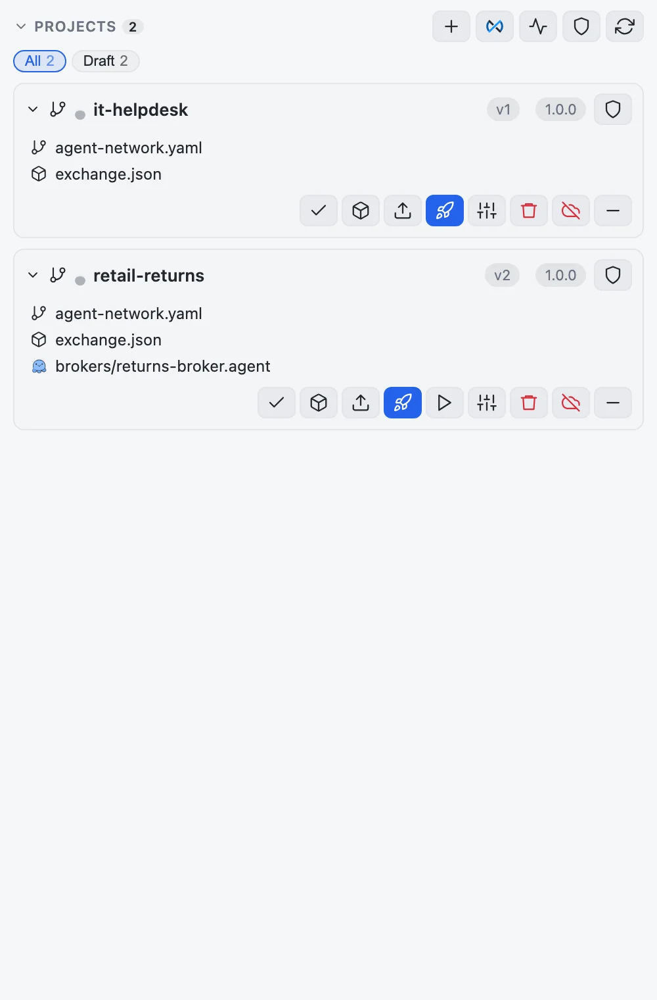
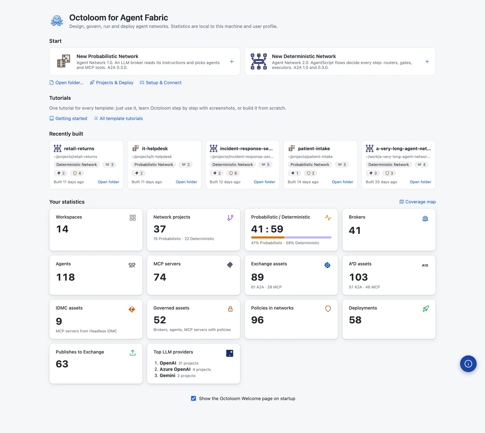
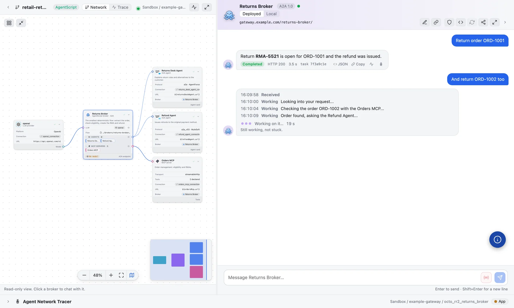
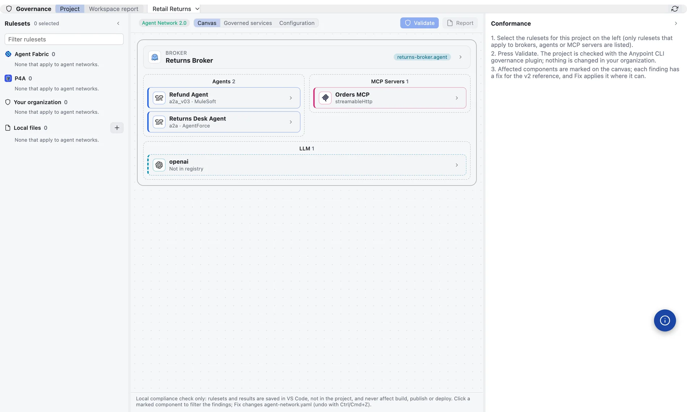
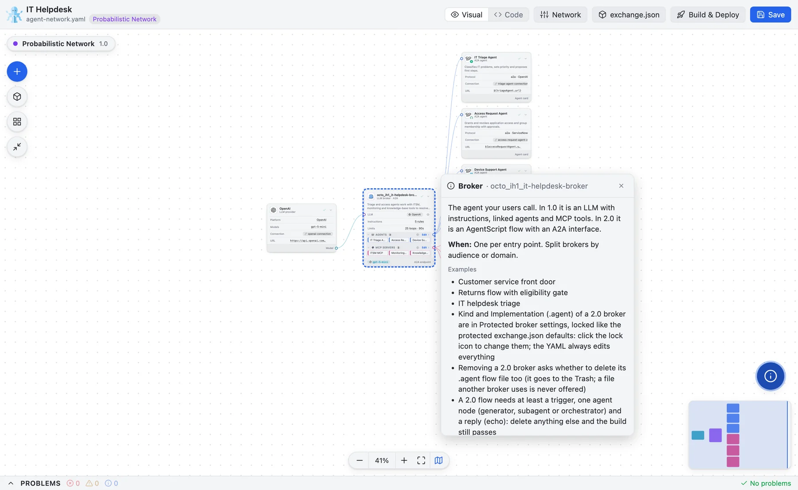

UI reference

# UI reference

<strong>Every button, card, canvas and panel of Octoloom, on a screenshot.</strong> What it is, when to use it and examples: the texts of the in-app <b>Explain</b> button. The file syntax is folded under <i>In the file</i>, for when you need it.

-   **[Broker flow nodes](flow-nodes.md)**

    { loading=lazy }

    Trigger, Generator, Router, Subagent, Orchestrator, Executor, Reply

-   **[Network components](network-components.md)**

    { loading=lazy }

    Broker, Agent, MCP server, LLM provider, Connection, Policy

-   **[Canvases and editors](canvases-editors.md)**

    { loading=lazy }

    Agent network canvas, AgentScript flow, Inspector, Canvas tools, Flow outline, Problems, Code view, exchange.json editor, Minimize to icons, Patterns, Toolbar

-   **[Toolbar buttons](toolbar-buttons.md)**

    { loading=lazy }

    Visual / Code, Explorer, Network, Network settings, Preview, New Version, Commit Version, Bump patch, exchange.json, Build & Deploy, Save

-   **[Projects & Deploy buttons](projects-deploy.md)**

    { loading=lazy }

    Projects & Deploy, Validate Project, Build, Publish to Exchange, Run locally, Setup gateways, Undeploy, Unpublish from Exchange, Remove from workspace, Pre-deploy checks, Deploy form

-   **[Side bar, Home and New project](side-bar-home.md)**

    { loading=lazy }

    Setup & Connect, Assets, LLMs from Exchange, Octoloom Welcome, Tutorials, Octoloom version, Coverage map, Coverage summary, Where your assets come from, Coverage table, Network details, New project, Agent network from Exchange

-   **[Chat, Share and Tracer](chat-tracer.md)**

    { loading=lazy }

    Broker chat, Agent Network View, Trace of a chat reply, Chat authentication, Share: A²D sessions and local portal, Why a call failed, Agent Network Tracer

-   **[Governance](governance.md)**

    { loading=lazy }

    Governance, Rulesets, Governance report

-   **[Help](help.md)**

    { loading=lazy }

    Explain anything

- **[More](more.md)**
- **[Guided tours](guided-tours.md)**: the first-time tour of each canvas
- **[Commands](commands.md)**: every command in the command palette
- **[Settings](settings.md)**: every `agentNetwork.*` setting
