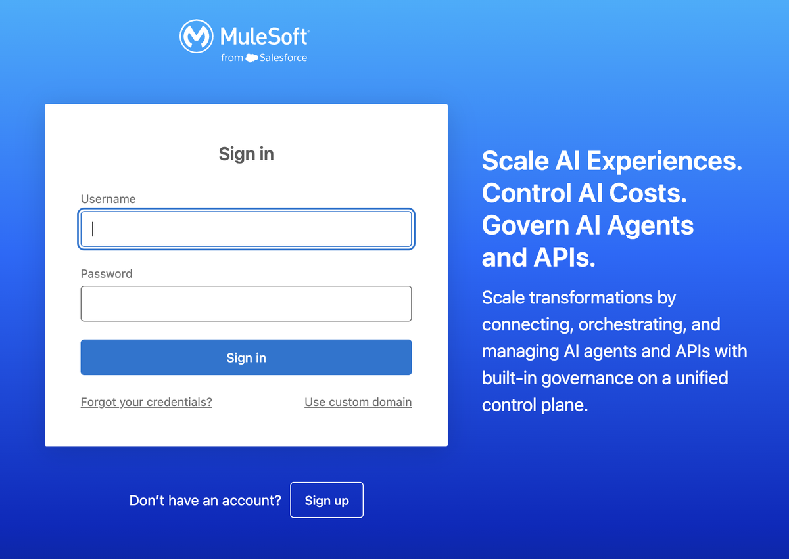

Before you start · 1 of 6

# Anypoint account

Octoloom deploys agent networks to **MuleSoft Agent Fabric** in your Anypoint organization. You need an Anypoint Platform account with access to Agent Fabric.

| You have | Do |
|---|---|
| No account | [Sign up](https://anypoint.mulesoft.com/login/signup) for a free trial |
| An account | [Log in](https://anypoint.mulesoft.com/login/) and check that **Runtime Manager → Omni Gateways** is in the menu |

> Use a trial or sandbox organization for the tutorials. Octoloom only **adds** assets, gateways and deployments; it never deletes what is already in your org.

Anypoint opens in your browser: its pages can't be shown inside VS Code.

---

**Next:** [Small Managed Omni Gateway](gateway.md)
