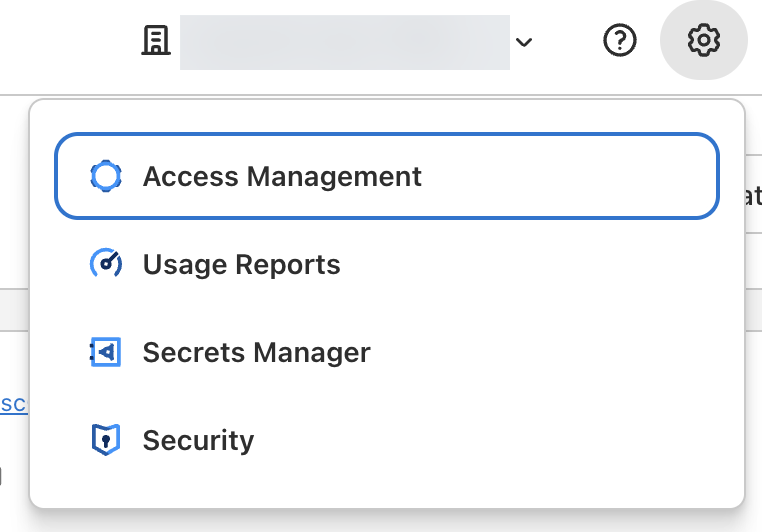
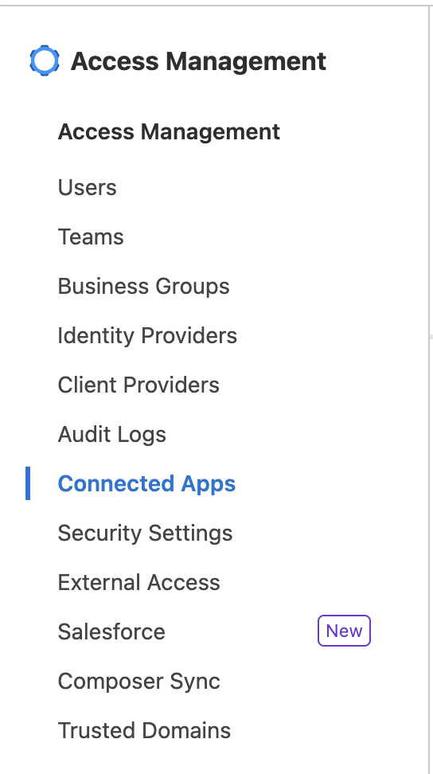
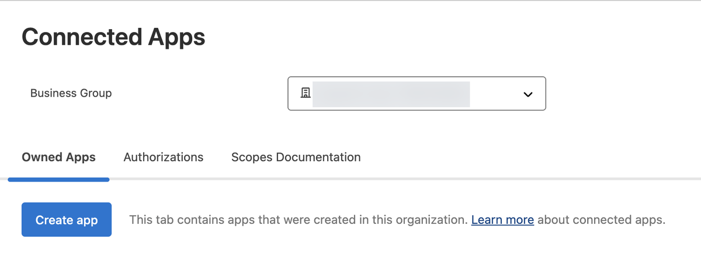
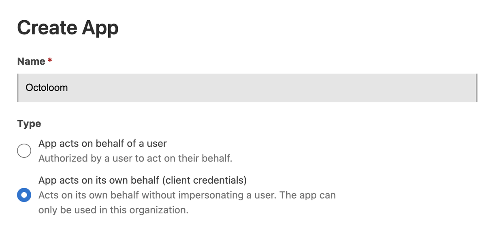
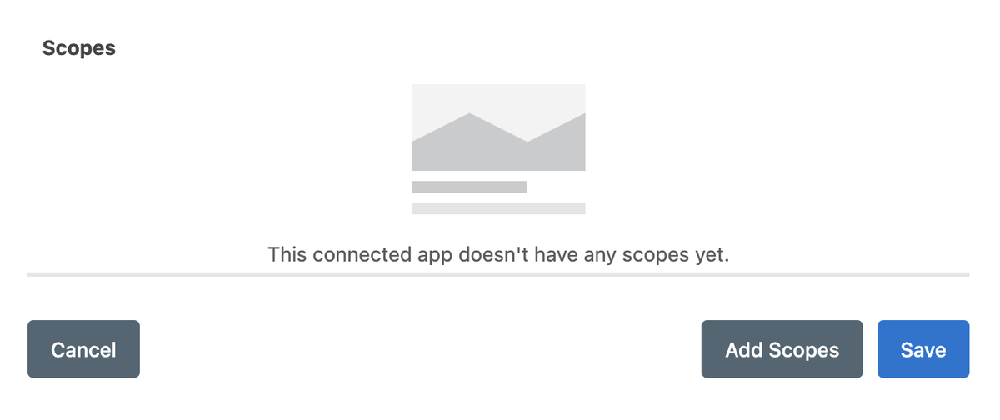
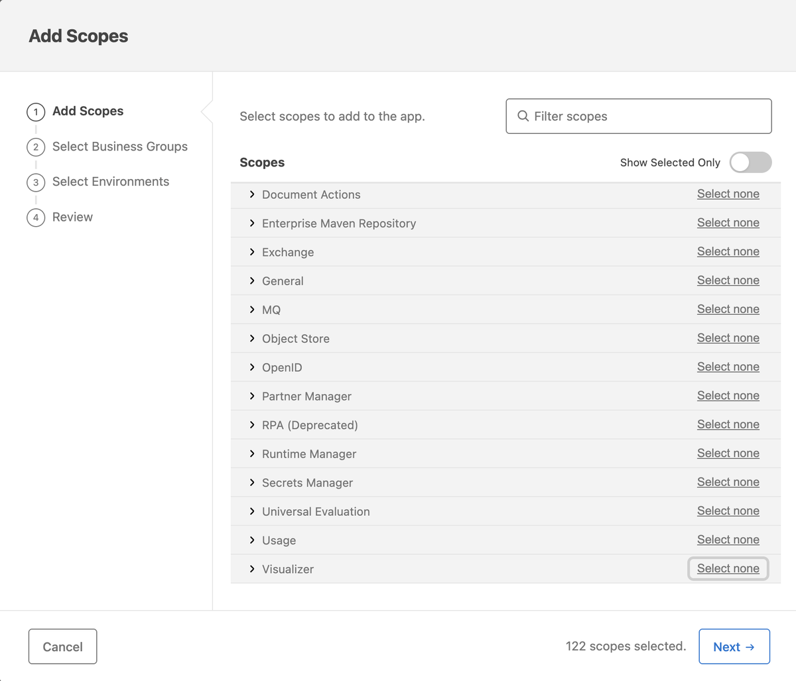
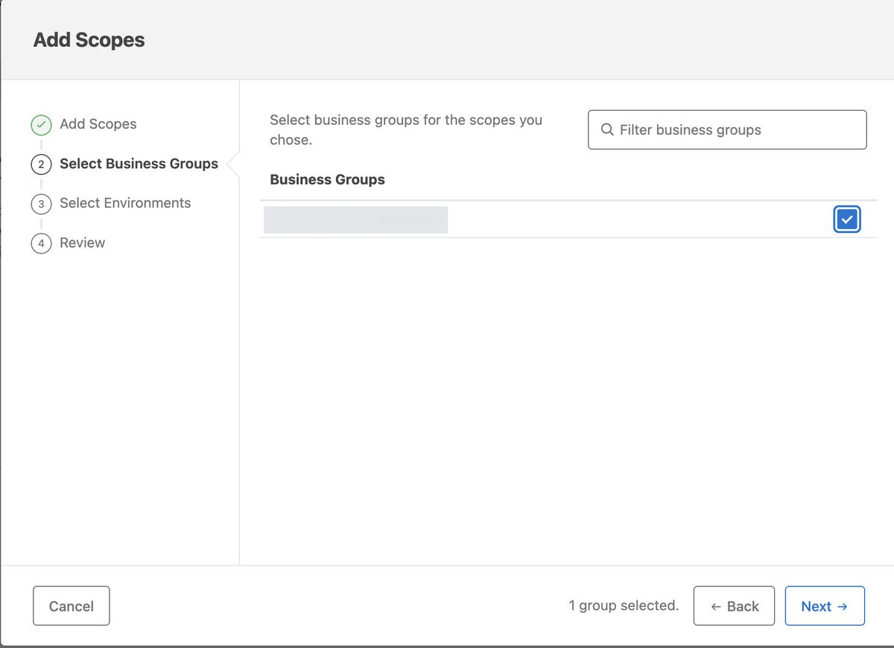
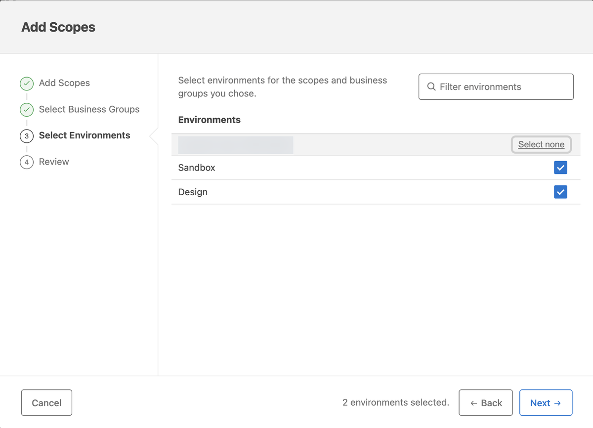
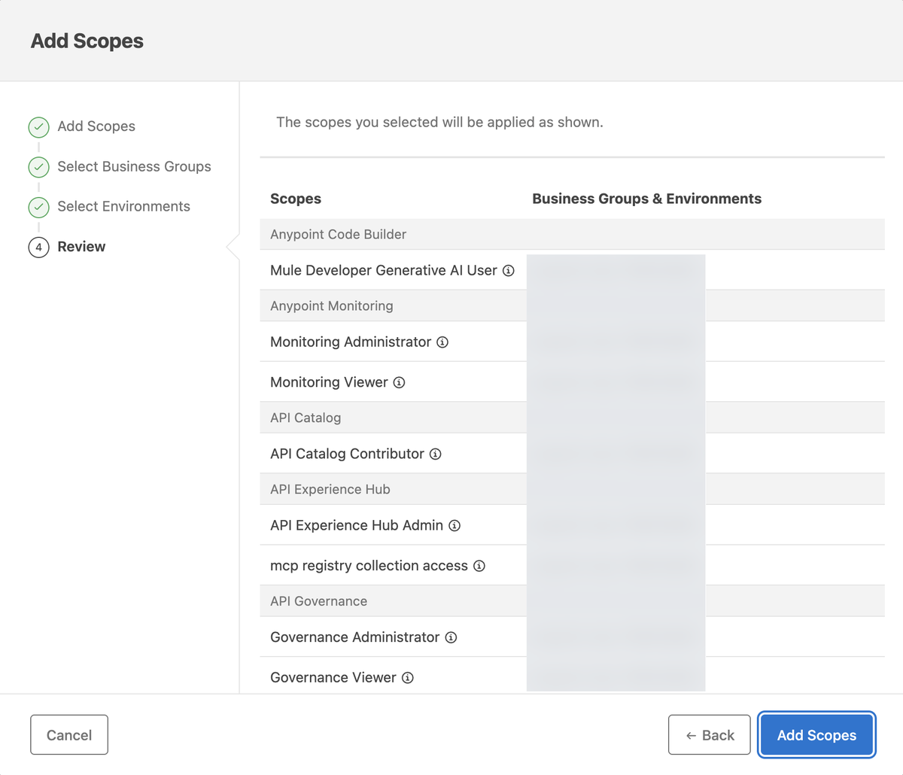
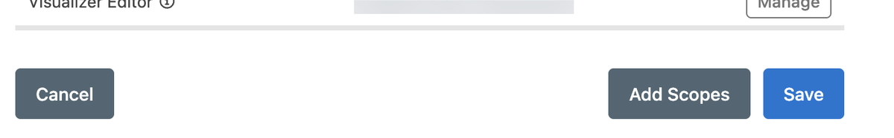

Before you start · 3 of 6

# Connected app Octoloom-CA

Octoloom acts as a **connected app** (client credentials), with only the scopes it needs.

1. In Anypoint, click the **settings** gear → **Access Management**, then **Connected Apps** → **Create app**.

   

   

   

2. **Name**: `Octoloom-CA`. **Type**: *App acts on its own behalf (client credentials)*.

   

   

3. **Add Scopes**, for your business group and the environment(s) you deploy to:

   | Area | Scope | Used for |
   |---|---|---|
   | General | View Organization, View Environment | business groups and environments |
   | Exchange | Exchange Viewer | the Asset Palette, governance rulesets |
   | Exchange | Exchange Contributor | Publish |
   | Runtime Manager | Read Applications, Create Applications | Deploy and the status lights |
   | Gateways | read access to the Omni Gateways | the gateway chips of the Deploy form |
   | API Manager | View APIs Configuration, Manage APIs Configuration, Manage Policies | broker instances and their policies |
   | Monitoring | Monitoring Viewer | Traces and the Tracer (optional) |

   Use **Filter scopes** to find each one; don't tick whole groups.

   

   Then pick your **business group** and the **environments** (for example Sandbox), and review.

   

   

   

4. **Add Scopes**, then **Save**, and copy the **Client ID** and **Client Secret**.

   

Least privilege: add only these. If a call is refused (HTTP 403), Octoloom names the permission that is missing; add just that one. Don't *Select all*.

Keep the secret out of files and chats: Octoloom stores it in the VS Code secret storage.

---

**Next:** [Connect Octoloom to Agent Fabric](connect-anypoint.md)
