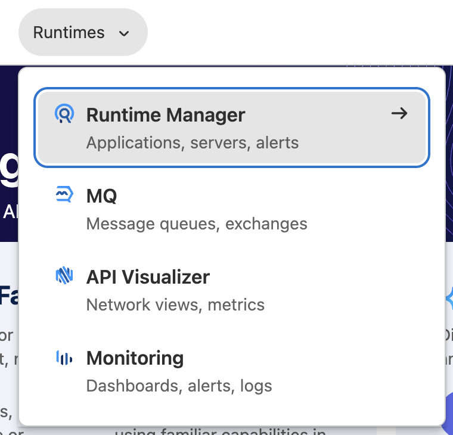
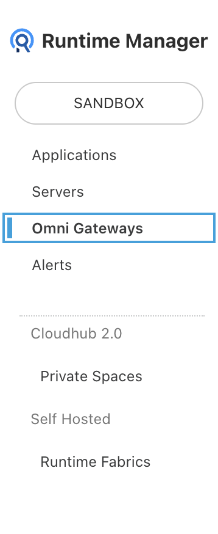
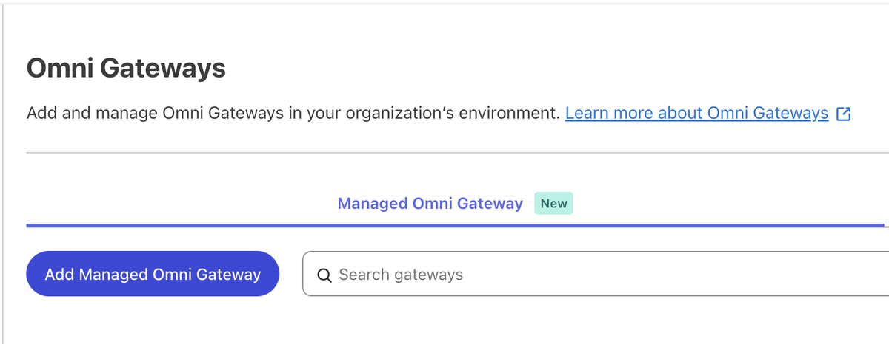
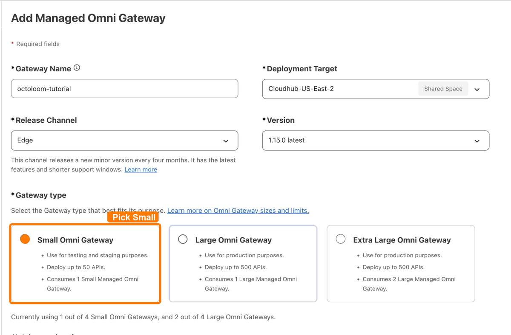
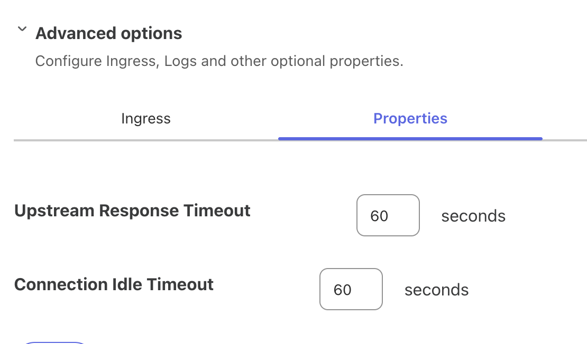
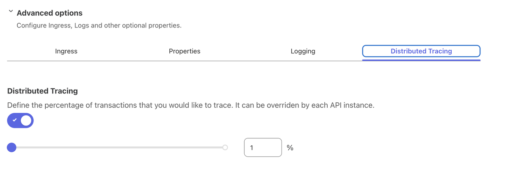
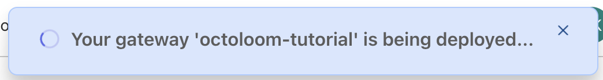

Before you start · 2 of 6

# Small Managed Omni Gateway

Brokers run on an **Omni Gateway**. One Small gateway is enough for every tutorial.

1. In Anypoint, open **Runtimes → Runtime Manager**, then **Omni Gateways** in the side bar, and click **Add Managed Omni Gateway**.

   

   

   

2. **Name**: `octoloom-tutorial`.
3. **Deployment target**: the shared space **Cloudhub-US-&lt;region&gt;** (or your private space).
4. **Size**: **Small**.
5. **Release channel**: **Edge**, version **1.15.0** or the latest.

   
6. **Advanced options → Properties**:

   | Property | Value |
   |---|---|
   | Upstream Response Timeout | **60** s |
   | Connection Idle Timeout | **60** s |
   | Distributed Tracing | **On** |

   

   

7. **Save & Deploy** and wait until the gateway is **Running** (a few minutes).

   

Why 60 s: an LLM broker can take longer than the 15 s default to answer, and the chat would time out. Distributed Tracing feeds the Traces bar and the Tracer of the chat.

When it runs, click **Check my gateway** below: Octoloom lists the gateways of the connected environment (after the next steps, once you are connected).

---

**Next:** [Connected app Octoloom-CA](connected-app.md)
