# Tutorial: Hotel Concierge (fully mocked)

[All tutorials](index.md) · [Getting started](../getting-started.md) · Probabilistic network (Agent Network 1.0, LLM broker) · Use case · fully mocked

> A concierge broker books the spa and room service for hotel guests after a reservation lookup. Fully mocked: the LLM is an A²D LLM mock too, so no OpenAI key is needed.

| Agents | MCP servers | A2A | Policies | Template id |
|---|---|---|---|---|
| 2 | 1 | 0.3.0 | 0 | `v1-hotel-concierge` |

There are three ways to use this template:

1. **[Just use it](#path-1-just-use-it)**: create the project, deploy it and chat with it in about 10 minutes.
2. **[Learn step by step](#path-2-learn-step-by-step)**: the same steps, with what each part of the network does and how Octoloom shows it.
3. **[Build it from scratch](#path-3-build-it-from-scratch)**: start from a blank project and build the same network yourself, no code, one screenshot per step.

## Before you start

- VS Code with **Octoloom for Agent Fabric** installed (Marketplace), version 0.9.27 or later.
- An Anypoint organization with Agent Fabric, a connected app (client ID and secret), an environment and a Flex gateway.
- No OpenAI key: the LLM is an A²D LLM mock as well (`a2dLlm.url`), with scripted answers for the Try it prompts.
- Nothing else: all agents, MCP servers and the LLM are public A²D mocks, so the network runs without any other system or key.

## Path 1: Just use it

1. **Home → Start → New Probabilistic Network.** In the dialog pick **Use cases**, then the card **Hotel Concierge (fully mocked)**. Choose a folder and click **Create**.
2. **Deploy.** In `exchange.json`, fill in `ingressgw.url` (ingress gateway base url). In **Projects & Deploy**, click **Deploy** on this project (or **Build & Deploy** in the editor) and pick your gateway. Octoloom asks for each secret variable; nothing you type is stored:
   - `a2dLlm.apiKey`: A2D LLM mock key (any value works)
3. **Chat.** When the status light is green, click **Open chat** and paste:
   - `Book a spa massage for room 412 tomorrow at 10:00`
   - `Room 415 wants breakfast in the room at 07:30`
   - `When is the checkout of room 412?`

Done. The rest of this page explains what you just ran.

## Path 2: Learn step by step

### Step 1. Connect Octoloom

Open **Setup & Connect** (Octoloom side bar) and connect **Agent Fabric**: the connected app client ID and secret and the organization. Pick the environment. A²D isn't needed: the mock URLs are already the defaults in `exchange.json`. The Tooling list shows Node.js, Java and anypoint-cli-v4 with its agent-network plugin. Use **Install** or **Repair** on any red row.

### Step 2. Create the project from the template

On **Home**, click **New Probabilistic Network**. In **2 Start from**, choose **Use cases** and click **Hotel Concierge (fully mocked)**. The right side shows the template README: what it contains, **Deploy in 3 steps** and **Try it**. Keep the suggested name `hotel-concierge` or type your own, pick the folder and click **Create**.

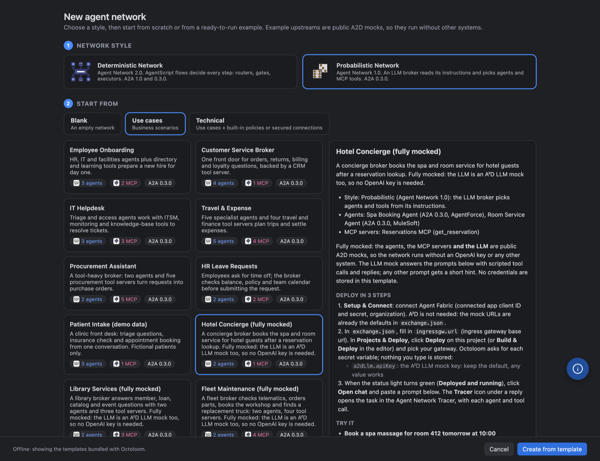

Octoloom writes `agent-network.yaml`, `exchange.json`, `README.md`, and opens the canvas. Every id gets the template prefix `octo_hc1_`, so several templates can be deployed into one org side by side.

### Step 3. Read the network on the canvas

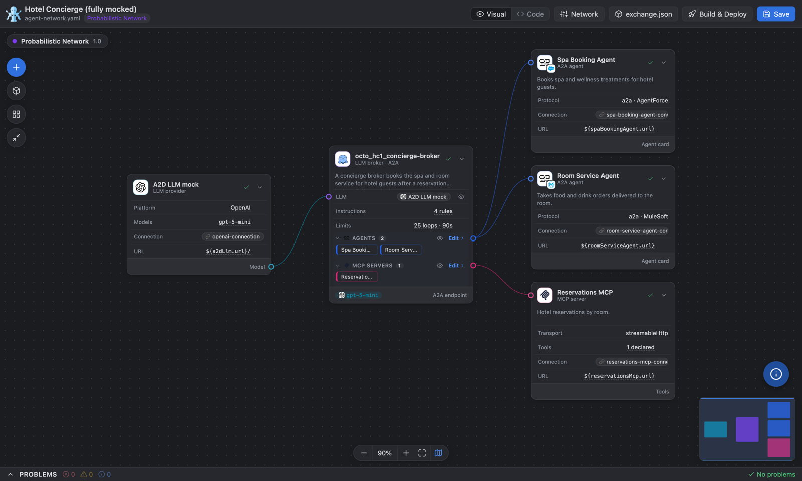

Each card is a part of `agent-network.yaml`. Click one to open it in the inspector on the right. Each change in the inspector is a change to the text, so the YAML stays the source of truth (**Code** view shows it).

- **Broker octo_hc1_concierge-broker** (`octo_hc1_concierge-broker`): the LLM decides which agent or tool to call from its instructions.
  - Instructions:
    - You are the concierge of a hotel.
    - Always look up the reservation for the room number in the request first (for example room 412).
    - Use the Spa Booking agent for spa and wellness requests and the Room Service agent for food and drinks in the room.
    - Answer with the booking or order reference and the time.
- **Agent Spa Booking Agent**: Books spa and wellness treatments for hotel guests.
- **Agent Room Service Agent**: Takes food and drink orders delivered to the room.
- **MCP server Reservations MCP**: Hotel reservations by room. Tools: `get_reservation`.

Try this on the canvas: use the zoom bar and the minimap, drag a card, or **Auto layout**. The layout is saved per file. **Minimize all** turns the cards into icon tiles. Click a connection line to see which broker uses which agent or tool.

### Step 4. Validate and build

In the canvas toolbar, open the CLI menu: **Validate** does a dry run of build, publish and deploy and lists problems in the Problems panel (click one to jump to the card). **Build** repairs and packages the project locally with anypoint-cli-v4.

The variables of this template (in `exchange.json`, open it for the no-code form):

| Variable | What | Default |
|---|---|---|
| `ingressgw.url` | Ingress gateway base URL (the broker is served under it) | (fill in) |
| `a2dLlm.url` | A2D LLM mock base URL (OpenAI-compatible) | `https://www.a2d-ai.com/api/platform/a16f9106-adbc-4adc-8326-9b137e2e816a/llm/v1` |
| `reservationsMcp.url` | Reservations MCP (A2D mock) base URL | `https://www.a2d-ai.com/api/platform/3c751b13-687b-4d48-8056-a1da3b243645/` |
| `spaBookingAgent.url` | Spa Booking Agent (A2D mock, A2A 0.3.0) URL | `https://www.a2d-ai.com/api/platform/da841beb-a82f-4e19-a3e3-1a0b2248e87b/a2a` |
| `roomServiceAgent.url` | Room Service Agent (A2D mock, A2A 0.3.0) URL | `https://www.a2d-ai.com/api/platform/078e025d-16f6-41f2-adfb-4d0a44d4d2ca/a2a` |

### Step 5. Deploy

Open **Projects & Deploy** and click **Deploy** on the project (or **Deploy…** on the canvas). Pick your gateway (the chips show its status and space), keep **Tracing**, **Wait until the network is ready** and **Publish before deploy** on, then enter the secrets. Nothing you type is stored:

- `a2dLlm.apiKey`: A2D LLM mock key (any value works)

For a probabilistic network, also fill `ingressgw.url` in `exchange.json` (your ingress gateway base URL) before you deploy.

The square status light goes from blue (deploying) to green (**Deployed and running**). The deployment box lists every broker URL; click one to copy it.

### Step 6. Chat with the broker

Click **Open chat** on the deployment box. On the left is the network (the cards light up as they are called), and on the right is the conversation with its task states. Paste the prompts one at a time:

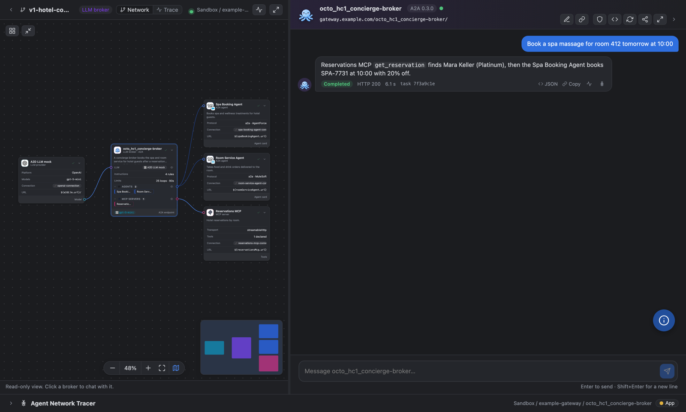

*The LLM is a scripted A²D LLM mock, so the broker gives the same answer every time; the ids in the table are checked by a live deploy.*

| Prompt | You should see |
|---|---|
| `Book a spa massage for room 412 tomorrow at 10:00` | Reservations MCP `get_reservation` finds Mara Keller (Platinum), then the Spa Booking Agent books SPA-7731 at 10:00 with 20% off. |
| `Room 415 wants breakfast in the room at 07:30` | `get_reservation` finds Tom Berg, then the Room Service Agent places order RS-2208 for 07:30. |
| `When is the checkout of room 412?` | `get_reservation`: Mara Keller checks out on 2026-11-24. |

### Step 7. Trace a reply

Under each reply, the **Tracer** icon opens the task in the **Agent Network Tracer**: a waterfall of every call the broker made (gateway, broker, LLM, A2A agents, MCP tools) on one time axis, coloured like the cards. Errors are red. Click a span to see its request and response. The **Network** view shows the same reply as a sequence of calls.

### Step 8. Share it (optional)

The **Share** icon in the chat header opens the Share dialog. **A²D sessions** invites people by email to chat with this deployed broker and brings their passed / failed marks and comments back. **Local portal** generates a small web chat you can run or host anywhere.

## Path 3: Build it from scratch

Here you build the same network yourself, starting from a blank project. Every step uses a form, a menu or a button. You never import the template, and you never type YAML. The names below are the template's names without the `octo_hc1_` prefix. You can use your own names, but keep them consistent.

> The text fields take plain values. Where a value looks like `${group.name}`, type it as shown: it is a **variable** that `exchange.json` declares and that deploy fills in.

### Step 3.1. Create a blank project with a starter broker

Connect Octoloom first, as in [Path 2, Step 1](#step-1-connect-octoloom). Then, on **Home**, click **New Probabilistic Network**. In **2 Start from**, choose **Blank** and turn on **Add a starter broker**.

- **Broker name**: `concierge-broker`
- **Name**: `hotel-concierge-scratch` (the Exchange asset id; a different name from the template, so both can live in one org)
- **Parent folder**: pick a folder, then click **Create blank project**.

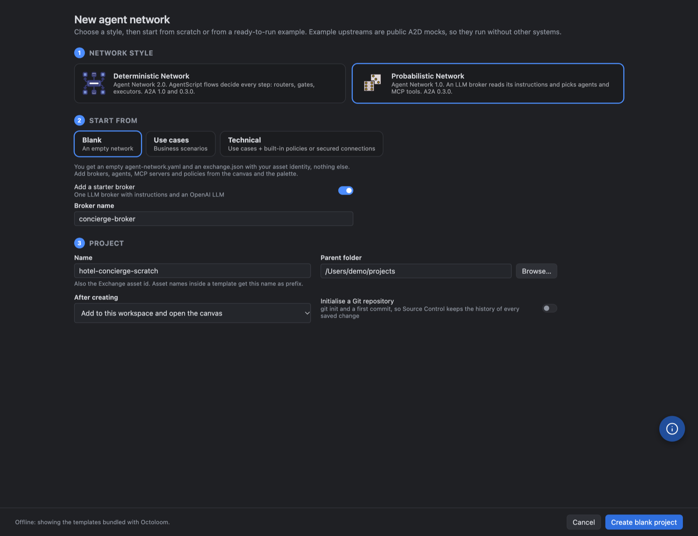

The starter broker is an LLM broker with an OpenAI LLM (`openai` provider, `openai-connection`) and default instructions. This template doesn't use OpenAI: the next step replaces that LLM with the A²D LLM mock.

### Step 3.2. Switch the LLM to the A²D LLM mock

This template needs no OpenAI key: its LLM is an **A²D LLM mock** with scripted answers. Open the **Asset Palette** (Octoloom side bar), pick the **A²D** tab and the **LLMs** filter, then drag **Octoloom Hotel Concierge LLM** onto the broker card. The drop writes everything the LLM needs:

- the project LLM `a2d-octoloom-hotel-concierge-llm` (`llmProviders`) and its connection `a2d-octoloom-hotel-concierge-llm-connection` to the mock URL (no Exchange dependency);
- the variables `a2dOctoloomHotelConciergeLlm.url` (the mock URL) and `a2dOctoloomHotelConciergeLlm.apiKey` (the placeholder key `a2d-mock-key`, any value works) in `exchange.json`;
- the broker LLM: the broker now uses the mock with its model `gpt-5-mini`.

Keep these names: the rest of this tutorial uses them. Then remove the starter OpenAI LLM: select its card (**OpenAI**, below the broker) and click **Remove from network** (trash icon) in the inspector. It removes the OpenAI connection. The Problems bar then shows **Variable openai.apiKey is declared in exchange.json but not used**: click **Remove it**.

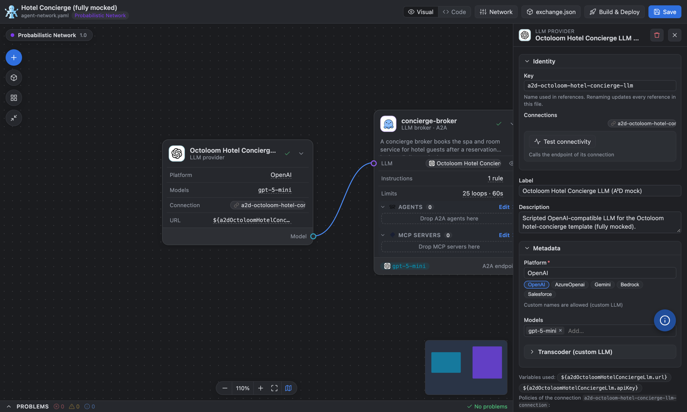

### Step 3.3. Add the agents

On the canvas, click **+** (Add to the network) → **Agent** → **Empty**. The new agent opens in the inspector on the right. Fill it in, then repeat for each agent:

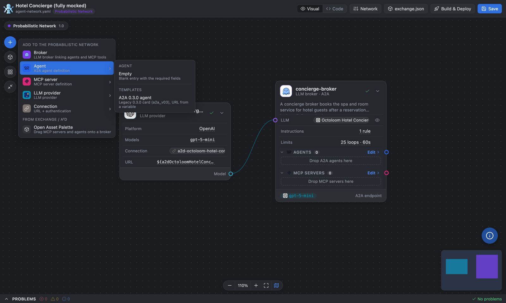

- **Spa Booking Agent**
  - **Identity → Key**: `spa-booking-agent`
  - **Label**: Spa Booking Agent · **Description**: Books spa and wellness treatments for hotel guests.
  - **Metadata → Platform**: `AgentForce` (or click its icon under **Agent framework**)
  - **Agent card**: **Name** Spa Booking Agent, **Description** as above, **URL** `${spaBookingAgent.url}`, **Protocol version** `0.3.0`
- **Room Service Agent**
  - **Identity → Key**: `room-service-agent`
  - **Label**: Room Service Agent · **Description**: Takes food and drink orders delivered to the room.
  - **Metadata → Platform**: `MuleSoft` (or click its icon under **Agent framework**)
  - **Agent card**: **Name** Room Service Agent, **Description** as above, **URL** `${roomServiceAgent.url}`, **Protocol version** `0.3.0`

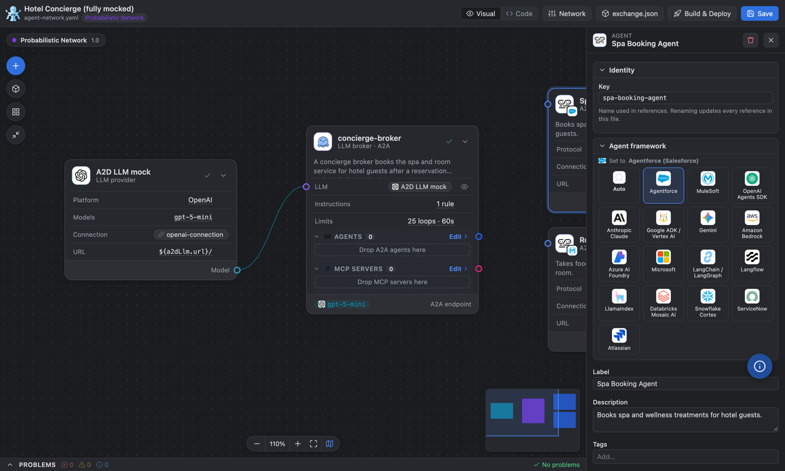

The card skills are optional. Once the agent has a connection (two steps on), the inspector offers **Read skills from the live agent**, which fills them from the running agent.

### Step 3.4. Add the MCP servers

Click **+** → **MCP server** → **Empty**, then fill in:

- **Reservations MCP**: **Key** `reservations-mcp`, **Label** Reservations MCP, **Description** Hotel reservations by room. The transport is already Streamable HTTP on `/mcp`.

### Step 3.5. Add the connections

A connection is the URL (and authentication) Agent Fabric uses to reach an agent or an MCP server. Click **+** → **Connection** → **Empty** once per agent and MCP server, and fill in:

| Key | Kind | Target → Name | URL |
|---|---|---|---|
| `reservations-mcp-connection` | `mcp` | `reservations-mcp` | `${reservationsMcp.url}` |
| `spa-booking-agent-connection` | `agent` | `spa-booking-agent` | `${spaBookingAgent.url}` |
| `room-service-agent-connection` | `agent` | `room-service-agent` | `${roomServiceAgent.url}` |

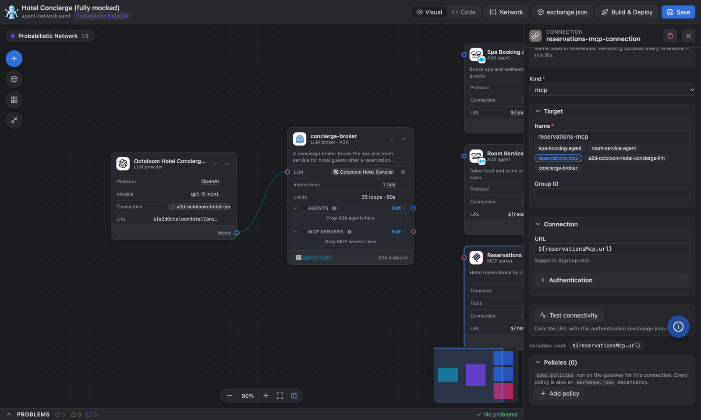

### Step 3.6. Declare the variables

The Problems bar now shows **Variable ${…} is not declared in exchange.json** for each new variable. Click **Add to exchange.json** on each one.

Then open `exchange.json` (it opens as a form) and, under **Variables**, set the defaults:

| Variable | Default |
|---|---|
| `ingressgw.url` | (your ingress gateway URL) |
| `reservationsMcp.url` | `https://www.a2d-ai.com/api/platform/3c751b13-687b-4d48-8056-a1da3b243645/` |
| `spaBookingAgent.url` | `https://www.a2d-ai.com/api/platform/da841beb-a82f-4e19-a3e3-1a0b2248e87b/a2a` |
| `roomServiceAgent.url` | `https://www.a2d-ai.com/api/platform/078e025d-16f6-41f2-adfb-4d0a44d4d2ca/a2a` |
| `a2dOctoloomHotelConciergeLlm.url` | `https://www.a2d-ai.com/api/platform/a16f9106-adbc-4adc-8326-9b137e2e816a/llm/v1` |

`a2dOctoloomHotelConciergeLlm.apiKey` keeps its default `a2d-mock-key` from the drop: the mock accepts any key, so deploy needs no real one.

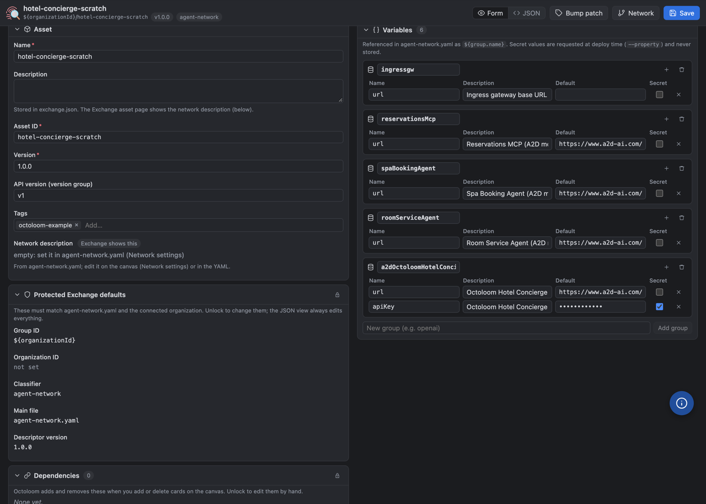

### Step 3.7. Declare the MCP tools

On each MCP server card, click the **Tools** row (or its pencil). Octoloom reads the tool list from the running server: tick the tools below. You can also type a name in **Add a tool by name…**.

- **Reservations MCP**: `get_reservation`

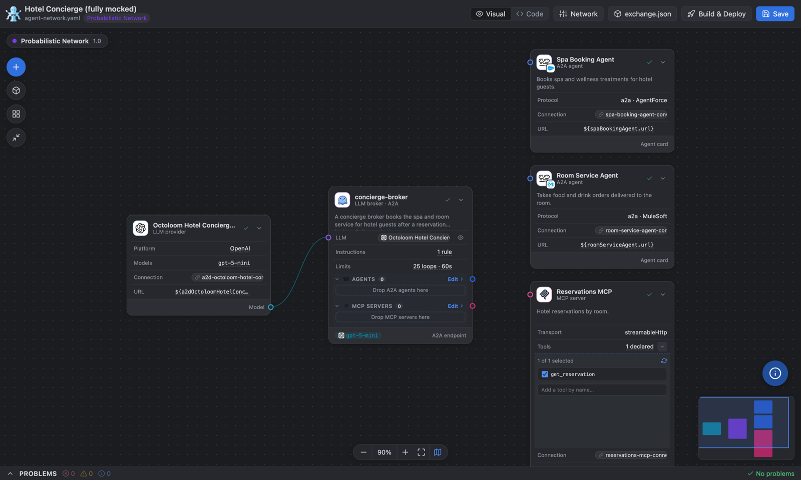

### Step 3.8. Give the broker its agents and tools

Select the broker `concierge-broker`. In the inspector:

1. Click **Agents (0)**. In **Add existing agent…**, pick each agent and click **Add**: `spa-booking-agent`, `room-service-agent`.
2. Click **MCP servers (0)**. Add each server with **Add existing MCP server…**, then tick its **Allowed tools**:
   - `reservations-mcp`: `get_reservation`

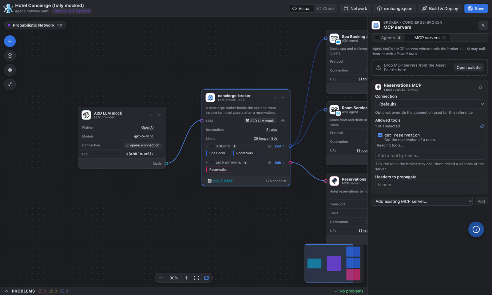

### Step 3.9. Write the broker instructions

Back in the broker inspector, open **Instructions and limits**. Replace the default instruction with these entries, one per line:

- You are the concierge of a hotel.
- Always look up the reservation for the room number in the request first (for example room 412).
- Use the Spa Booking agent for spa and wellness requests and the Room Service agent for food and drinks in the room.
- Answer with the booking or order reference and the time.

Set **Max number of loops** `25`, **Max consecutive errors** `3` and **Task timeout (s)** `90`.

Optionally, fill the broker's **Agent card (A2A 0.3.0)** description: *A concierge broker books the spa and room service for hotel guests after a reservation lookup. Fully mocked: the LLM is an A²D LLM mock too, so no OpenAI key is needed.*

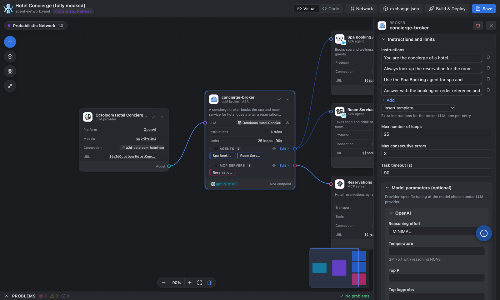

### Step 3.10. Validate, deploy and chat

Run **Validate** from the canvas CLI menu and fix anything in the Problems bar. Then follow Path 2 from [Validate and build](#step-4-validate-and-build) onwards: deploy (enter the secrets), wait for the green light, open the chat and send the same prompts. Your network answers like the template, because it is the same network, built by hand.

## What you learned

- How a probabilistic network is built: an LLM broker with instructions picks agents and MCP tools.
- How the canvas, the inspector and the code view edit the same YAML.
- How to build the same network from a blank project with forms and menus only (Path 3).
- How to validate, build, deploy, chat and trace with Octoloom.

## Next

- Previous: [Fleet Maintenance (fully mocked)](v1-fleet-maintenance.md)
- Next: [Library Services (fully mocked)](v1-library-services.md)
- [All tutorials](index.md)

---
Generated from the `v1-hotel-concierge` template (Octoloom `media/templates/v1-hotel-concierge`). Screenshots use fake data.
