# Tutorial: IT Helpdesk: governed

[All tutorials](index.md) · [Getting started](../getting-started.md) · Probabilistic network (Agent Network 1.0, LLM broker) · Technical · governed

> Triage and access agents work with ITSM, monitoring and knowledge-base tools to resolve tickets. Adds built-in policies: rate-limiting, mcp-pii-detector, mcp-schema-validation, header-injection, a-two-a-pii-detector, a-two-a-prompt-decorator.

| Agents | MCP servers | A2A | Policies | Template id |
|---|---|---|---|---|
| 3 | 3 | 0.3.0 | 6 | `v1-it-helpdesk-governed` |

There are three ways to use this template:

1. **[Just use it](#path-1-just-use-it)**: create the project, deploy it and chat with it in about 10 minutes.
2. **[Learn step by step](#path-2-learn-step-by-step)**: the same steps, with what each part of the network does and how Octoloom shows it.
3. **[Build it from scratch](#path-3-build-it-from-scratch)**: start from a blank project and build the same network yourself, no code, one screenshot per step.

## Before you start

- VS Code with **Octoloom for Agent Fabric** installed (Marketplace), version 0.9.25 or later.
- An Anypoint organization with Agent Fabric, an environment, a [Small Managed Omni Gateway](../start/gateway.md) and a [connected app](../start/connected-app.md) (client ID and secret). New to Anypoint? **[Before you start](../start/index.md)** shows the trial account, the gateway, the connected app and connecting Octoloom, step by step with videos.
- An OpenAI API key (or an OpenAI-compatible LLM gateway).
- Nothing else: all agents and MCP servers are public A²D mocks, so the network runs without any other system.

## Path 1: Just use it

1. **Home → Start → New Probabilistic Network.** In the dialog pick **Technical**, then the card **IT Helpdesk** (the one with the policies chip). Choose a folder and click **Create**.
2. **Deploy.** In `exchange.json`, fill in `ingressgw.url` (ingress gateway base url). In **Projects & Deploy**, click **Deploy** on this project (or **Build & Deploy** in the editor) and pick your gateway. Octoloom asks for each secret variable; nothing you type is stored:
   - `openai.apiKey`: OpenAI API key (secret, injected at deploy time)
3. **Chat.** When the status light is green, click **Open chat** and paste:
   - `VPN is not connecting since this morning`
   - `I need access to the finance SharePoint`
   - `My laptop screen flickers`
   - `P1: nobody can log in to email. Open an incident`
   - `What is the status of INC-90017?`
   - `My email is jane.doe@example.com and my phone is +41 79 123 45 67. VPN is not connecting since this morning`
   - `Send the first prompt more than 30 times within a minute`

Done. The rest of this page explains what you just ran.

## Path 2: Learn step by step

### Step 1. Connect Octoloom

Open **Setup & Connect** (Octoloom side bar) and connect **Agent Fabric**: the connected app client ID and secret and the organization. Pick the environment. A²D isn't needed: the mock URLs are already the defaults in `exchange.json`. The Tooling list shows Node.js, Java and anypoint-cli-v4 with its agent-network plugin. Use **Install** or **Repair** on any red row.

### Step 2. Create the project from the template

On **Home**, click **New Probabilistic Network**. In **2 Start from**, choose **Technical** and click **IT Helpdesk**. The right side shows the template README: what it contains, **Deploy in 3 steps** and **Try it**. Keep the suggested name `it-helpdesk-governed` or type your own, pick the folder and click **Create**.

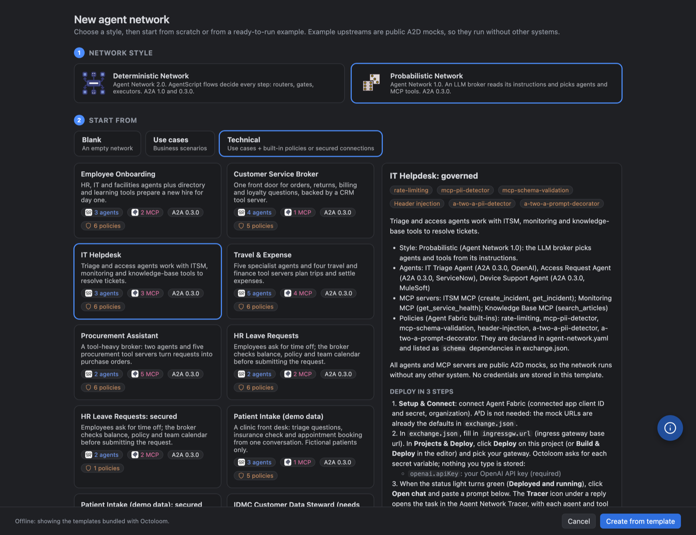

Octoloom writes `agent-network.yaml`, `exchange.json`, `README.md`, and opens the canvas. Every id gets the template prefix `octo_ih1g_`, so several templates can be deployed into one org side by side.

### Step 3. Read the network on the canvas

Each card is a part of `agent-network.yaml`. Click one to open it in the inspector on the right. Each change in the inspector is a change to the text, so the YAML stays the source of truth (**Code** view shows it).

- **Broker octo_ih1g_it-helpdesk-broker** (`octo_ih1g_it-helpdesk-broker`): the LLM decides which agent or tool to call from its instructions.
  - Instructions:
    - You are the IT helpdesk for employees.
    - Before opening an incident, check service health with get_service_health and search the knowledge base with search_articles.
    - Use the Triage agent to classify and prioritise problems, the Access Request agent for permissions and group membership, and the Device Support agent for hardware.
    - Open an incident with create_incident only when no article or known outage explains the problem.
    - Always return the incident or article id to the user.
- **Agent IT Triage Agent**: Classifies IT problems, sets priority and proposes first steps.
- **Agent Access Request Agent**: Grants and revokes application access and group membership with approvals.
- **Agent Device Support Agent**: Diagnoses laptops and peripherals and arranges repairs or swaps.
- **MCP server ITSM MCP**: Incident management. Tools: `create_incident`, `get_incident`.
- **MCP server Monitoring MCP**: Service health and known outages. Tools: `get_service_health`.
- **MCP server Knowledge Base MCP**: IT knowledge articles. Tools: `search_articles`.

Try this on the canvas: use the zoom bar and the minimap, drag a card, or **Auto layout**. The layout is saved per file. **Minimize all** turns the cards into icon tiles. Click a connection line to see which broker uses which agent or tool.

### Step 4. See the policies

This variant adds Agent Fabric policies. Open a broker or connection and look at its **Policies** section. Each policy folds open to show its configuration:
- `rate-limiting`
- `mcp-pii-detector`
- `mcp-schema-validation`
- `header-injection`
- `a-two-a-pii-detector`
- `a-two-a-prompt-decorator`

Run **Governance** (shield icon in the canvas toolbar) to check the project against the Agent Fabric rulesets. It runs locally, and findings show on the cards with **Fix** where one exists.

### Step 5. Validate and build

In the canvas toolbar, open the CLI menu: **Validate** does a dry run of build, publish and deploy and lists problems in the Problems panel (click one to jump to the card). **Build** repairs and packages the project locally with anypoint-cli-v4.

The variables of this template (in `exchange.json`, open it for the no-code form):

| Variable | What | Default |
|---|---|---|
| `ingressgw.url` | Ingress gateway base URL (the broker is served under it) | (fill in) |
| `itsmMcp.url` | ITSM MCP (A2D mock) base URL | `https://www.a2d-ai.com/api/platform/f5f65633-e17d-47c0-b614-d7938491a0d4/` |
| `monitoringMcp.url` | Monitoring MCP (A2D mock) base URL | `https://www.a2d-ai.com/api/platform/9561493a-b2ee-43ba-8886-a66c16c16c60/` |
| `knowledgeBaseMcp.url` | Knowledge Base MCP (A2D mock) base URL | `https://www.a2d-ai.com/api/platform/24391eb8-75c8-4a2e-b3b1-1381c9cf4447/` |
| `triageAgent.url` | IT Triage Agent (A2D mock, A2A 0.3.0) URL | `https://www.a2d-ai.com/api/platform/db876bb1-f86f-4835-b40f-97c66079debc/a2a` |
| `accessRequestAgent.url` | Access Request Agent (A2D mock, A2A 0.3.0) URL | `https://www.a2d-ai.com/api/platform/d1d495b2-e51a-447e-bdb1-4ac7d36c2fe1/a2a` |
| `deviceSupportAgent.url` | Device Support Agent (A2D mock, A2A 0.3.0) URL | `https://www.a2d-ai.com/api/platform/ba36ab0b-df70-4dd9-bc15-6a17008798cc/a2a` |

### Step 6. Deploy

Open **Projects & Deploy** and click **Deploy** on the project (or **Deploy…** on the canvas). Pick your gateway (the chips show its status and space), keep **Tracing**, **Wait until the network is ready** and **Publish before deploy** on, then enter the secrets. Nothing you type is stored:

- `openai.apiKey`: OpenAI API key (secret, injected at deploy time)

For a probabilistic network, also fill `ingressgw.url` in `exchange.json` (your ingress gateway base URL) before you deploy.

The square status light goes from blue (deploying) to green (**Deployed and running**). The deployment box lists every broker URL; click one to copy it.

### Step 7. Chat with the broker

Click **Open chat** on the deployment box. On the left is the network (the cards light up as they are called), and on the right is the conversation with its task states. Paste the prompts one at a time:

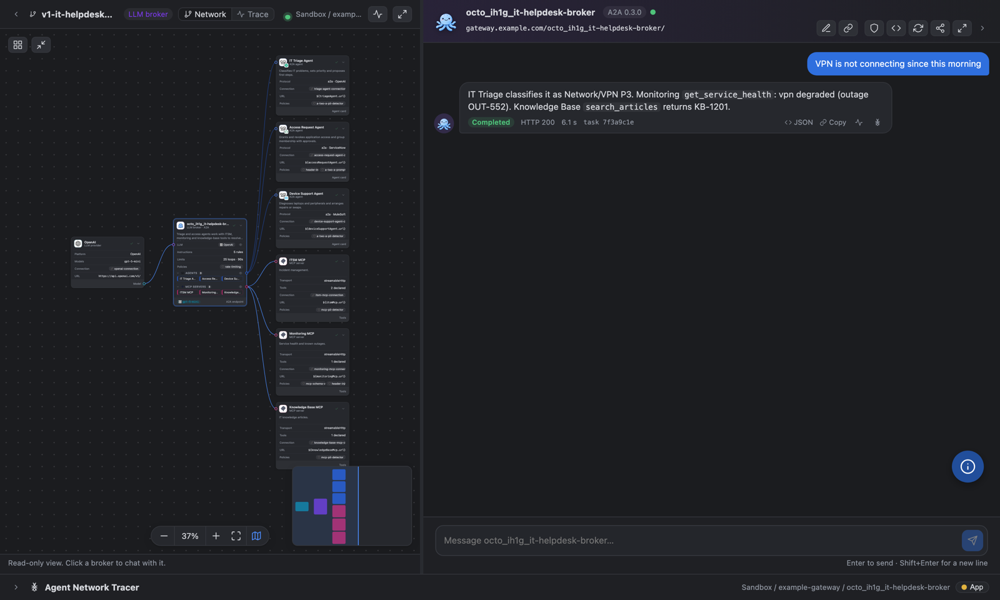

*The reply in the screenshot is an illustration: it shows what the broker answers. The real wording changes from run to run.*

| Prompt | You should see |
|---|---|
| `VPN is not connecting since this morning` | IT Triage classifies it as Network/VPN P3. Monitoring `get_service_health`: vpn degraded (outage OUT-552). Knowledge Base `search_articles` returns KB-1201. |
| `I need access to the finance SharePoint` | Access Request Agent opens access request AR-7781. |
| `My laptop screen flickers` | Knowledge Base returns KB-2210. Device Support pushes a display driver update and books swap SW-3310 for tomorrow 10:00 if it still flickers. |
| `P1: nobody can log in to email. Open an incident` | ITSM `create_incident` creates INC-90001. |
| `What is the status of INC-90017?` | ITSM `get_incident`: in progress, assigned to Alex Kim. |
| `My email is jane.doe@example.com and my phone is +41 79 123 45 67. VPN is not connecting since this morning` | Same answer as the first prompt. The PII detector policies log the email and phone number; on the MCP connections with the MCP PII detector they are masked before the tool sees them. Check the policy logs in Anypoint Monitoring. |
| `Send the first prompt more than 30 times within a minute` | The broker answers HTTP 429 (Too Many Requests) once the rate limit of 60 requests per minute is reached. |

The broker is probabilistic: the LLM picks the agents and tools, so the wording and the order of the calls can change between runs. The ids and numbers come from the mocks and stay the same.

### Step 8. Trace a reply

Under each reply, the **Tracer** icon opens the task in the **Agent Network Tracer**: a waterfall of every call the broker made (gateway, broker, LLM, A2A agents, MCP tools) on one time axis, coloured like the cards. Errors are red. Click a span to see its request and response. The **Network** view shows the same reply as a sequence of calls.

### Step 9. Share it (optional)

The **Share** icon in the chat header opens the Share dialog. **A²D sessions** invites people by email to chat with this deployed broker and brings their passed / failed marks and comments back. **Local portal** generates a small web chat you can run or host anywhere.

## Path 3: Build it from scratch

Here you build the same network yourself, starting from a blank project. Every step uses a form, a menu or a button. You never import the template, and you never type YAML. The names below are the template's names without the `octo_ih1g_` prefix. You can use your own names, but keep them consistent.

> The text fields take plain values. Where a value looks like `${group.name}`, type it as shown: it is a **variable** that `exchange.json` declares and that deploy fills in.

### Step 3.1. Create a blank project with a starter broker

Connect Octoloom first, as in [Path 2, Step 1](#step-1-connect-octoloom). Then, on **Home**, click **New Probabilistic Network**. In **2 Start from**, choose **Blank** and turn on **Add a starter broker**.

- **Broker name**: `it-helpdesk-broker`
- **Name**: `it-helpdesk-governed-scratch` (the Exchange asset id; a different name from the template, so both can live in one org)
- **Parent folder**: pick a folder, then click **Create blank project**.

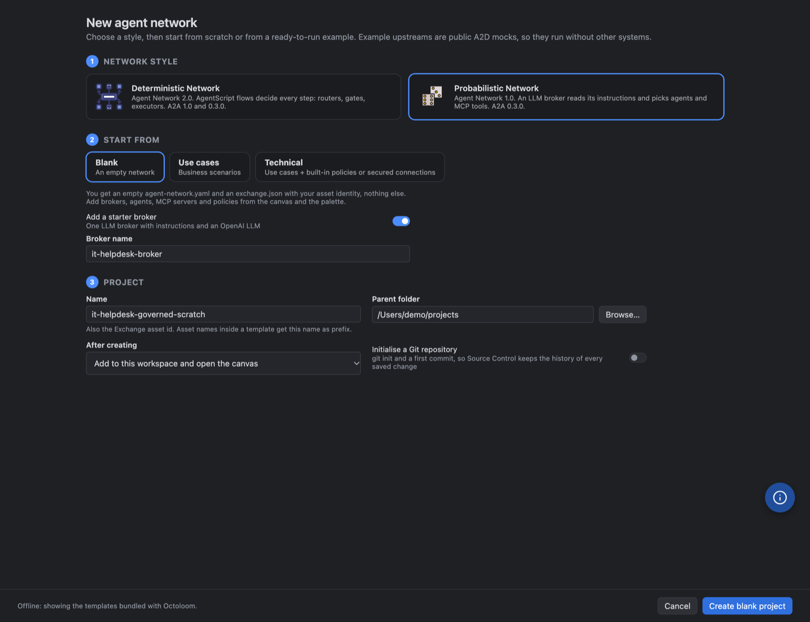

The starter broker is an LLM broker with an OpenAI LLM (`openai` provider, `openai-connection`) and default instructions. The LLM is already done.

### Step 3.2. Add the agents

On the canvas, click **+** (Add to the network) → **Agent** → **Empty**. The new agent opens in the inspector on the right. Fill it in, then repeat for each agent:

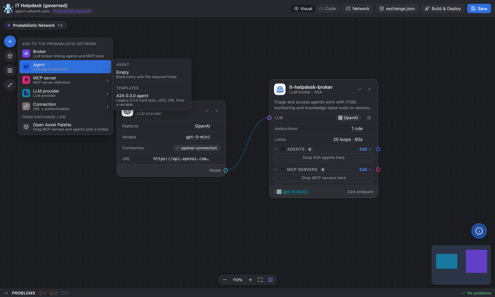

- **IT Triage Agent**
  - **Identity → Key**: `triage-agent`
  - **Label**: IT Triage Agent · **Description**: Classifies IT problems, sets priority and proposes first steps.
  - **Metadata → Platform**: `OpenAI` (or click its icon under **Agent framework**)
  - **Agent card**: **Name** IT Triage Agent, **Description** as above, **URL** `${triageAgent.url}`, **Protocol version** `0.3.0`
- **Access Request Agent**
  - **Identity → Key**: `access-request-agent`
  - **Label**: Access Request Agent · **Description**: Grants and revokes application access and group membership with approvals.
  - **Metadata → Platform**: `ServiceNow` (or click its icon under **Agent framework**)
  - **Agent card**: **Name** Access Request Agent, **Description** as above, **URL** `${accessRequestAgent.url}`, **Protocol version** `0.3.0`
- **Device Support Agent**
  - **Identity → Key**: `device-support-agent`
  - **Label**: Device Support Agent · **Description**: Diagnoses laptops and peripherals and arranges repairs or swaps.
  - **Metadata → Platform**: `MuleSoft` (or click its icon under **Agent framework**)
  - **Agent card**: **Name** Device Support Agent, **Description** as above, **URL** `${deviceSupportAgent.url}`, **Protocol version** `0.3.0`

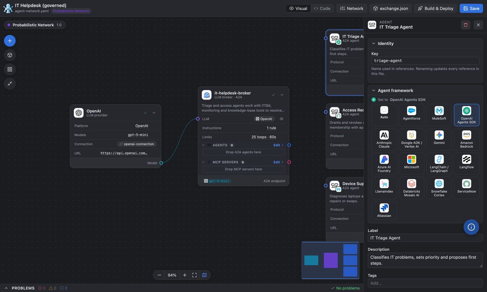

The card skills are optional. Once the agent has a connection (two steps on), the inspector offers **Read skills from the live agent**, which fills them from the running agent.

### Step 3.3. Add the MCP servers

Click **+** → **MCP server** → **Empty**, then fill in:

- **ITSM MCP**: **Key** `itsm-mcp`, **Label** ITSM MCP, **Description** Incident management. The transport is already Streamable HTTP on `/mcp`.
- **Monitoring MCP**: **Key** `monitoring-mcp`, **Label** Monitoring MCP, **Description** Service health and known outages. The transport is already Streamable HTTP on `/mcp`.
- **Knowledge Base MCP**: **Key** `knowledge-base-mcp`, **Label** Knowledge Base MCP, **Description** IT knowledge articles. The transport is already Streamable HTTP on `/mcp`.

### Step 3.4. Add the connections

A connection is the URL (and authentication) Agent Fabric uses to reach an agent or an MCP server. Click **+** → **Connection** → **Empty** once per agent and MCP server, and fill in:

| Key | Kind | Target → Name | URL |
|---|---|---|---|
| `itsm-mcp-connection` | `mcp` | `itsm-mcp` | `${itsmMcp.url}` |
| `monitoring-mcp-connection` | `mcp` | `monitoring-mcp` | `${monitoringMcp.url}` |
| `knowledge-base-mcp-connection` | `mcp` | `knowledge-base-mcp` | `${knowledgeBaseMcp.url}` |
| `triage-agent-connection` | `agent` | `triage-agent` | `${triageAgent.url}` |
| `access-request-agent-connection` | `agent` | `access-request-agent` | `${accessRequestAgent.url}` |
| `device-support-agent-connection` | `agent` | `device-support-agent` | `${deviceSupportAgent.url}` |

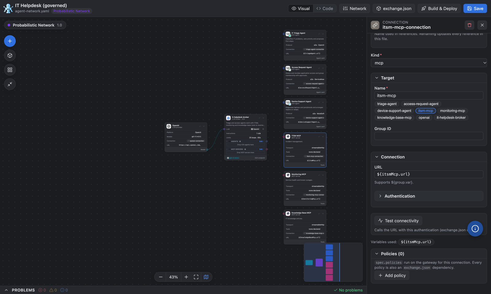

### Step 3.5. Declare the variables

The Problems bar now shows **Variable ${…} is not declared in exchange.json** for each new variable. Click **Add to exchange.json** on each one.

Then open `exchange.json` (it opens as a form) and, under **Variables**, set the defaults:

| Variable | Default |
|---|---|
| `ingressgw.url` | (your ingress gateway URL) |
| `itsmMcp.url` | `https://www.a2d-ai.com/api/platform/f5f65633-e17d-47c0-b614-d7938491a0d4/` |
| `monitoringMcp.url` | `https://www.a2d-ai.com/api/platform/9561493a-b2ee-43ba-8886-a66c16c16c60/` |
| `knowledgeBaseMcp.url` | `https://www.a2d-ai.com/api/platform/24391eb8-75c8-4a2e-b3b1-1381c9cf4447/` |
| `triageAgent.url` | `https://www.a2d-ai.com/api/platform/db876bb1-f86f-4835-b40f-97c66079debc/a2a` |
| `accessRequestAgent.url` | `https://www.a2d-ai.com/api/platform/d1d495b2-e51a-447e-bdb1-4ac7d36c2fe1/a2a` |
| `deviceSupportAgent.url` | `https://www.a2d-ai.com/api/platform/ba36ab0b-df70-4dd9-bc15-6a17008798cc/a2a` |

Leave the secret variables (`openai.apiKey`) empty: deploy asks for them and never stores them.

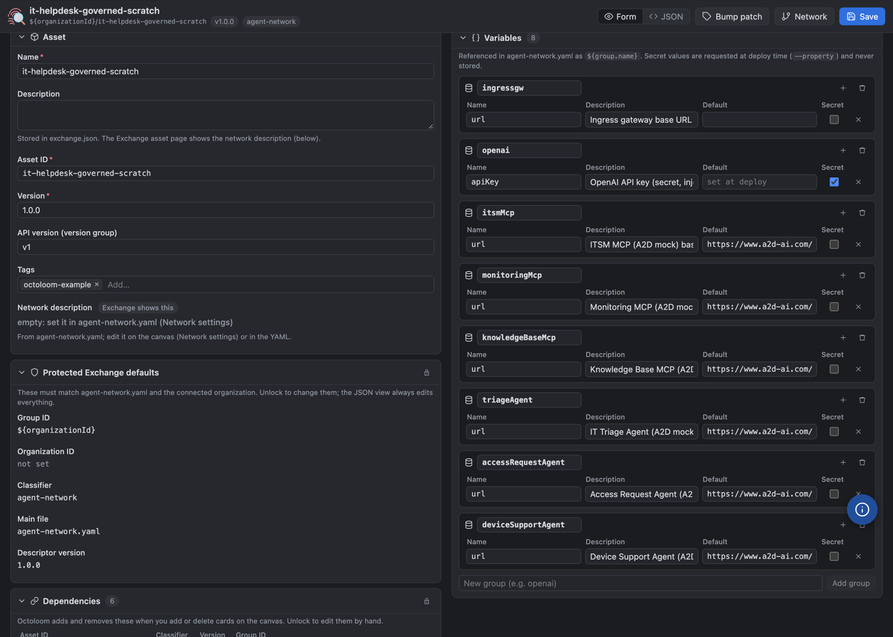

### Step 3.6. Declare the MCP tools

On each MCP server card, click the **Tools** row (or its pencil). Octoloom reads the tool list from the running server: tick the tools below. You can also type a name in **Add a tool by name…**.

- **ITSM MCP**: `create_incident`, `get_incident`
- **Monitoring MCP**: `get_service_health`
- **Knowledge Base MCP**: `search_articles`

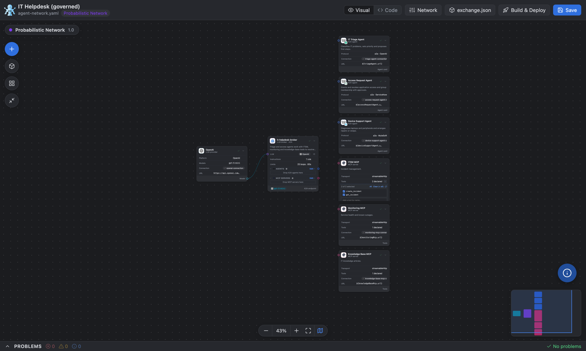

### Step 3.7. Give the broker its agents and tools

Select the broker `it-helpdesk-broker`. In the inspector:

1. Click **Agents (0)**. In **Add existing agent…**, pick each agent and click **Add**: `triage-agent`, `access-request-agent`, `device-support-agent`.
2. Click **MCP servers (0)**. Add each server with **Add existing MCP server…**, then tick its **Allowed tools**:
   - `itsm-mcp`: `create_incident`, `get_incident`
   - `monitoring-mcp`: `get_service_health`
   - `knowledge-base-mcp`: `search_articles`

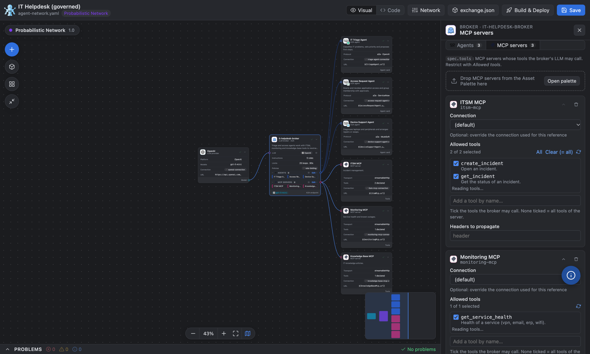

### Step 3.8. Write the broker instructions

Back in the broker inspector, open **Instructions and limits**. Replace the default instruction with these entries, one per line:

- You are the IT helpdesk for employees.
- Before opening an incident, check service health with get_service_health and search the knowledge base with search_articles.
- Use the Triage agent to classify and prioritise problems, the Access Request agent for permissions and group membership, and the Device Support agent for hardware.
- Open an incident with create_incident only when no article or known outage explains the problem.
- Always return the incident or article id to the user.

Set **Max number of loops** `25`, **Max consecutive errors** `3` and **Task timeout (s)** `90`.
Under **Model parameters → OpenAI**, set **Reasoning effort** to `MINIMAL`. The broker then answers within the gateway timeout.

Optionally, fill the broker's **Agent card (A2A 0.3.0)** description: *Triage and access agents work with ITSM, monitoring and knowledge-base tools to resolve tickets.*

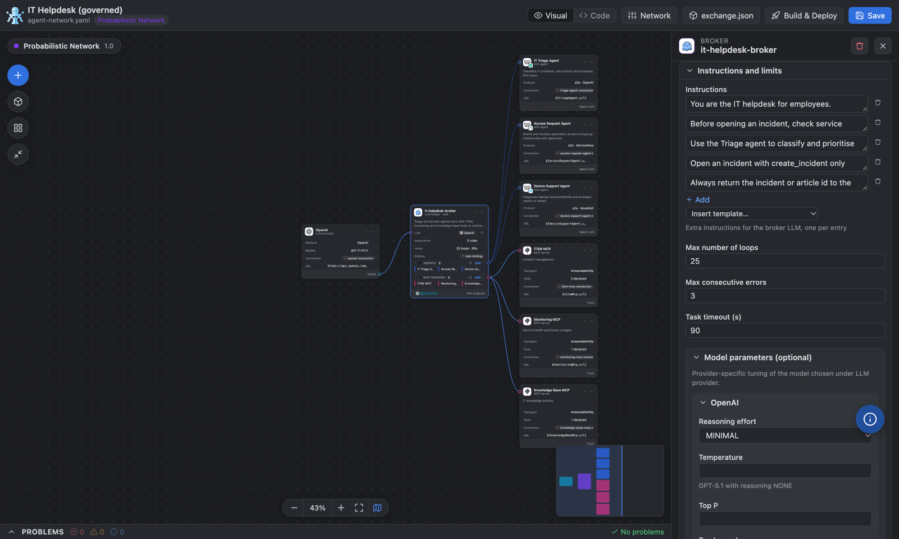

### Step 3.9. Add the policies

Select the broker or connection, scroll to **Policies** and click **Add policy**. Pick the policy (search by name) and set its **Configuration** fields. **Header Injection** has its own header list. Octoloom also adds each policy as an `exchange.json` dependency.

- Broker `it-helpdesk-broker`: **Rate Limiting**
  - **rateLimits** (one entry each, **+**): maximumRequests `60`, timePeriodInMilliseconds `60000`
  - **exposeHeaders**: on
- Connection `itsm-mcp-connection`: **MCP PII Detector**
  - **entities**: `Email`, `US SSN`, `Credit Card`, `Phone Number`
  - **action**: `Log and mask`
- Connection `monitoring-mcp-connection`: **MCP Schema Validation**
  - **validateToolSchema**: on
- Connection `monitoring-mcp-connection`: **Header Injection**
  - **inboundHeaders** (one entry each, **+**): `x-octoloom-source` = `it-helpdesk-governed-v1`
- Connection `knowledge-base-mcp-connection`: **MCP PII Detector**
  - **entities**: `Email`, `US SSN`, `Credit Card`, `Phone Number`
  - **action**: `Log and mask`
- Connection `triage-agent-connection`: **A2A PII Detector**
  - **entities**: `Email`, `US SSN`, `Credit Card`
  - **action**: `Log`
- Connection `access-request-agent-connection`: **Header Injection**
  - **inboundHeaders** (one entry each, **+**): `x-correlation-source` = `it-helpdesk-broker`
- Connection `access-request-agent-connection`: **A2A Prompt Decorator**
  - **textDecorators** (one entry each, **+**): text `#['Answer concisely and never include personal data.']`
- Connection `device-support-agent-connection`: **A2A PII Detector**
  - **entities**: `Email`, `US SSN`, `Credit Card`
  - **action**: `Log`

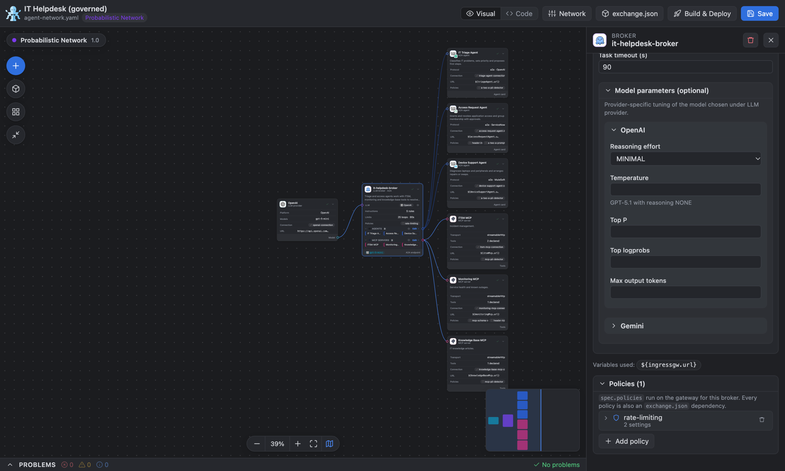

### Step 3.10. Validate, deploy and chat

Run **Validate** from the canvas CLI menu and fix anything in the Problems bar. Then follow Path 2 from [Validate and build](#step-4-validate-and-build) onwards: deploy (enter the secrets), wait for the green light, open the chat and send the same prompts. Your network answers like the template, because it is the same network, built by hand.

## What you learned

- How a probabilistic network is built: an LLM broker with instructions picks agents and MCP tools.
- How the canvas, the inspector and the code view edit the same YAML.
- How to build the same network from a blank project with forms and menus only (Path 3).
- How policies are attached and checked with Governance.
- How to validate, build, deploy, chat and trace with Octoloom.

## Next

- Previous: [HR Leave Requests: governed](v1-hr-leave-governed.md)
- Next: [Patient Intake (demo data): governed](v1-patient-intake-governed.md)
- Same use case, plain variant: [IT Helpdesk](v1-it-helpdesk.md)
- [All tutorials](index.md)

---
Generated from the `v1-it-helpdesk-governed` template (Octoloom `media/templates/v1-it-helpdesk-governed`). Screenshots use fake data.
