# Tutorial: Patient Intake (demo data)

[All tutorials](index.md) · [Getting started](../getting-started.md) · Probabilistic network (Agent Network 1.0, LLM broker) · Use case

> A clinic front desk: triage questions, insurance check and appointment booking from one conversation. Fictional patients only.

| Agents | MCP servers | A2A | Policies | Template id |
|---|---|---|---|---|
| 3 | 1 | 0.3.0 | 0 | `v1-patient-intake` |

There are three ways to use this template:

1. **[Just use it](#path-1-just-use-it)**: create the project, deploy it and chat with it in about 10 minutes.
2. **[Learn step by step](#path-2-learn-step-by-step)**: the same steps, with what each part of the network does and how Octoloom shows it.
3. **[Build it from scratch](#path-3-build-it-from-scratch)**: start from a blank project and build the same network yourself, no code, one screenshot per step.

## Before you start

- VS Code with **Octoloom for Agent Fabric** installed (Marketplace), version 0.9.25 or later.
- An Anypoint organization with Agent Fabric, a connected app (client ID and secret), an environment and a Flex gateway.
- An OpenAI API key (or an OpenAI-compatible LLM gateway).
- Nothing else: all agents and MCP servers are public A²D mocks, so the network runs without any other system.
- **Not set up yet?** The Quick Start prerequisites, step by step with pictures: [Anypoint account](../start/account.md) · [Small Managed Omni Gateway](../start/gateway.md) · [Connected app Octoloom-CA](../start/connected-app.md) · [Connect Octoloom to Agent Fabric](../start/connect-anypoint.md).

## Path 1: Just use it

1. **Home → Start → New Probabilistic Network.** In the dialog pick **Use cases**, then the card **Patient Intake (demo data)**. Choose a folder and click **Create**.
2. **Deploy.** In `exchange.json`, fill in `ingressgw.url` (ingress gateway base url). In **Projects & Deploy**, click **Deploy** on this project (or **Build & Deploy** in the editor) and pick your gateway. Octoloom asks for each secret variable; nothing you type is stored:
   - `openai.apiKey`: OpenAI API key (secret, injected at deploy time)
3. **Chat.** When the status light is green, click **Open chat** and paste:
   - `P-5001 has had a sore throat and fever for 3 days`
   - `Book a check-up for P-5002, insurance HealthPlus`
   - `P-5001 has chest pain right now`

Done. The rest of this page explains what you just ran.

## Path 2: Learn step by step

### Step 1. Connect Octoloom

Open **Setup & Connect** (Octoloom side bar) and connect **Agent Fabric**: the connected app client ID and secret and the organization. Pick the environment. A²D isn't needed: the mock URLs are already the defaults in `exchange.json`. The Tooling list shows Node.js, Java and anypoint-cli-v4 with its agent-network plugin. Use **Install** or **Repair** on any red row.

### Step 2. Create the project from the template

On **Home**, click **New Probabilistic Network**. In **2 Start from**, choose **Use cases** and click **Patient Intake (demo data)**. The right side shows the template README: what it contains, **Deploy in 3 steps** and **Try it**. Keep the suggested name `patient-intake` or type your own, pick the folder and click **Create**.

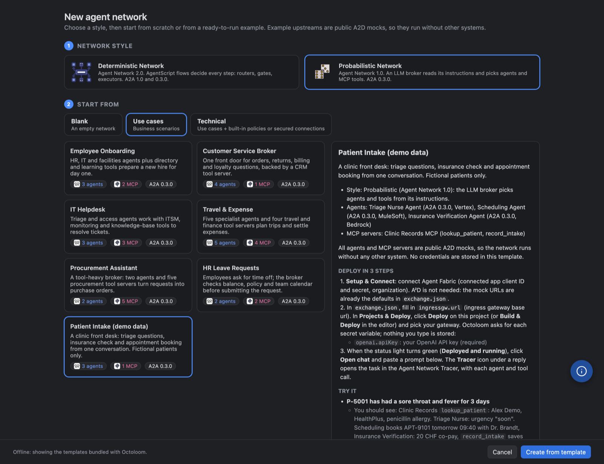

Octoloom writes `agent-network.yaml`, `exchange.json`, `README.md`, and opens the canvas. Every id gets the template prefix `octo_pi1_`, so several templates can be deployed into one org side by side.

### Step 3. Read the network on the canvas

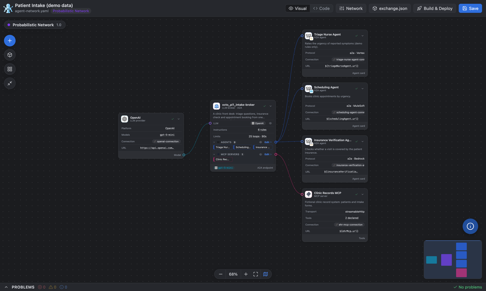

Each card is a part of `agent-network.yaml`. Click one to open it in the inspector on the right. Each change in the inspector is a change to the text, so the YAML stays the source of truth (**Code** view shows it).

- **Broker octo_pi1_intake-broker** (`octo_pi1_intake-broker`): the LLM decides which agent or tool to call from its instructions.
  - Instructions:
    - You are the front desk of a fictional outpatient clinic. All data is demo data; never give medical advice.
    - Find the patient record with lookup_patient using the patient id from the request (for example P-5001).
    - Ask the Triage Nurse agent for the urgency of the symptoms. If the urgency is emergency, tell the user to call the emergency number and stop.
    - Ask the Insurance Verification agent whether the visit is covered.
    - Ask the Scheduling agent for the first slot that matches the urgency, then save the intake with record_intake.
    - Finish with the appointment, the coverage and what the patient should bring.
- **Agent Triage Nurse Agent**: Rates the urgency of reported symptoms (demo rules only).
- **Agent Scheduling Agent**: Books clinic appointments by urgency.
- **Agent Insurance Verification Agent**: Checks whether a visit is covered by the patient insurance.
- **MCP server Clinic Records MCP**: Fictional clinic record system: patients and intake forms. Tools: `lookup_patient`, `record_intake`.

Try this on the canvas: use the zoom bar and the minimap, drag a card, or **Auto layout**. The layout is saved per file. **Minimize all** turns the cards into icon tiles. Click a connection line to see which broker uses which agent or tool.

### Step 4. Validate and build

In the canvas toolbar, open the CLI menu: **Validate** does a dry run of build, publish and deploy and lists problems in the Problems panel (click one to jump to the card). **Build** repairs and packages the project locally with anypoint-cli-v4.

The variables of this template (in `exchange.json`, open it for the no-code form):

| Variable | What | Default |
|---|---|---|
| `ingressgw.url` | Ingress gateway base URL (the broker is served under it) | (fill in) |
| `ehrMcp.url` | Clinic Records MCP (A2D mock) base URL | `https://www.a2d-ai.com/api/platform/94c4f7d4-3a72-4b29-a043-284640c540e0/` |
| `triageNurseAgent.url` | Triage Nurse Agent (A2D mock, A2A 0.3.0) URL | `https://www.a2d-ai.com/api/platform/6334f04d-8eec-4132-8f03-18ff35cac474/a2a` |
| `schedulingAgent.url` | Scheduling Agent (A2D mock, A2A 0.3.0) URL | `https://www.a2d-ai.com/api/platform/fd68731a-35b6-460c-817b-19a000773bdf/a2a` |
| `insuranceVerificationAgent.url` | Insurance Verification Agent (A2D mock, A2A 0.3.0) URL | `https://www.a2d-ai.com/api/platform/be8502c1-78b2-4b69-8a27-0b6a13ed4b8b/a2a` |

### Step 5. Deploy

Open **Projects & Deploy** and click **Deploy** on the project (or **Deploy…** on the canvas). Pick your gateway (the chips show its status and space), keep **Tracing**, **Wait until the network is ready** and **Publish before deploy** on, then enter the secrets. Nothing you type is stored:

- `openai.apiKey`: OpenAI API key (secret, injected at deploy time)

For a probabilistic network, also fill `ingressgw.url` in `exchange.json` (your ingress gateway base URL) before you deploy.

The square status light goes from blue (deploying) to green (**Deployed and running**). The deployment box lists every broker URL; click one to copy it.

### Step 6. Chat with the broker

Click **Open chat** on the deployment box. On the left is the network (the cards light up as they are called), and on the right is the conversation with its task states. Paste the prompts one at a time:

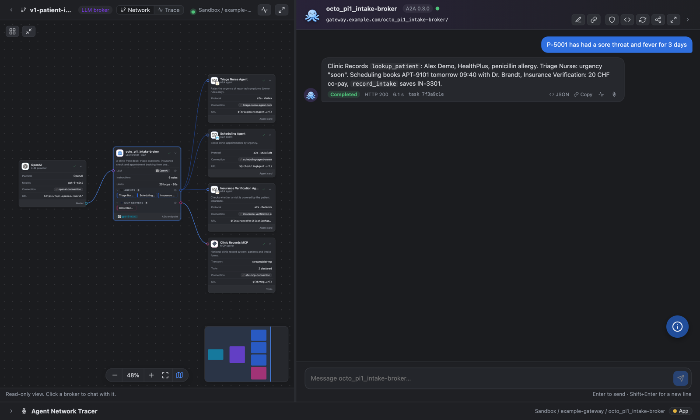

*The reply in the screenshot is an illustration: it shows what the broker answers. The real wording changes from run to run.*

| Prompt | You should see |
|---|---|
| `P-5001 has had a sore throat and fever for 3 days` | Clinic Records `lookup_patient`: Alex Demo, HealthPlus, penicillin allergy. Triage Nurse: urgency "soon". Scheduling books APT-9101 tomorrow 09:40 with Dr. Brandt, Insurance Verification: 20 CHF co-pay, `record_intake` saves IN-3301. |
| `Book a check-up for P-5002, insurance HealthPlus` | Triage "routine", Scheduling books APT-9102 on 2026-11-27 14:00 with Dr. Okafor. The record says Sam Example is insured with CareOne (no co-pay), so the broker may point out the mismatch. |
| `P-5001 has chest pain right now` | Triage Nurse: "emergency". The broker stops and tells the patient to call emergency services; no appointment is booked. |

The broker is probabilistic: the LLM picks the agents and tools, so the wording and the order of the calls can change between runs. The ids and numbers come from the mocks and stay the same.

### Step 7. Trace a reply

Under each reply, the **Tracer** icon opens the task in the **Agent Network Tracer**: a waterfall of every call the broker made (gateway, broker, LLM, A2A agents, MCP tools) on one time axis, coloured like the cards. Errors are red. Click a span to see its request and response. The **Network** view shows the same reply as a sequence of calls.

### Step 8. Share it (optional)

The **Share** icon in the chat header opens the Share dialog. **A²D sessions** invites people by email to chat with this deployed broker and brings their passed / failed marks and comments back. **Local portal** generates a small web chat you can run or host anywhere.

## Path 3: Build it from scratch

Here you build the same network yourself, starting from a blank project. Every step uses a form, a menu or a button. You never import the template, and you never type YAML. The names below are the template's names without the `octo_pi1_` prefix. You can use your own names, but keep them consistent.

> The text fields take plain values. Where a value looks like `${group.name}`, type it as shown: it is a **variable** that `exchange.json` declares and that deploy fills in.

### Step 3.1. Create a blank project with a starter broker

Connect Octoloom first, as in [Path 2, Step 1](#step-1-connect-octoloom). Then, on **Home**, click **New Probabilistic Network**. In **2 Start from**, choose **Blank** and turn on **Add a starter broker**.

- **Broker name**: `intake-broker`
- **Name**: `patient-intake-scratch` (the Exchange asset id; a different name from the template, so both can live in one org)
- **Parent folder**: pick a folder, then click **Create blank project**.

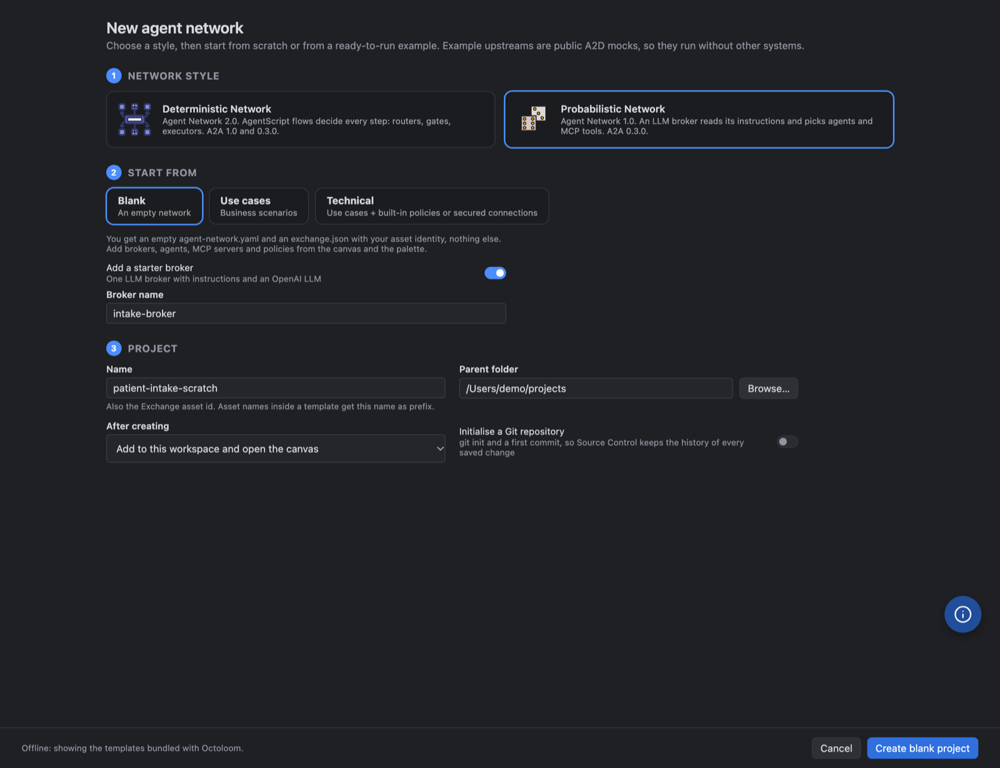

The starter broker is an LLM broker with an OpenAI LLM (`openai` provider, `openai-connection`) and default instructions. The LLM is already done.

### Step 3.2. Add the agents

On the canvas, click **+** (Add to the network) → **Agent** → **Empty**. The new agent opens in the inspector on the right. Fill it in, then repeat for each agent:

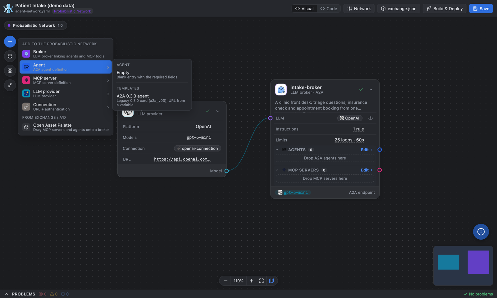

- **Triage Nurse Agent**
  - **Identity → Key**: `triage-nurse-agent`
  - **Label**: Triage Nurse Agent · **Description**: Rates the urgency of reported symptoms (demo rules only).
  - **Metadata → Platform**: `Vertex` (or click its icon under **Agent framework**)
  - **Agent card**: **Name** Triage Nurse Agent, **Description** as above, **URL** `${triageNurseAgent.url}`, **Protocol version** `0.3.0`
- **Scheduling Agent**
  - **Identity → Key**: `scheduling-agent`
  - **Label**: Scheduling Agent · **Description**: Books clinic appointments by urgency.
  - **Metadata → Platform**: `MuleSoft` (or click its icon under **Agent framework**)
  - **Agent card**: **Name** Scheduling Agent, **Description** as above, **URL** `${schedulingAgent.url}`, **Protocol version** `0.3.0`
- **Insurance Verification Agent**
  - **Identity → Key**: `insurance-verification-agent`
  - **Label**: Insurance Verification Agent · **Description**: Checks whether a visit is covered by the patient insurance.
  - **Metadata → Platform**: `Bedrock` (or click its icon under **Agent framework**)
  - **Agent card**: **Name** Insurance Verification Agent, **Description** as above, **URL** `${insuranceVerificationAgent.url}`, **Protocol version** `0.3.0`

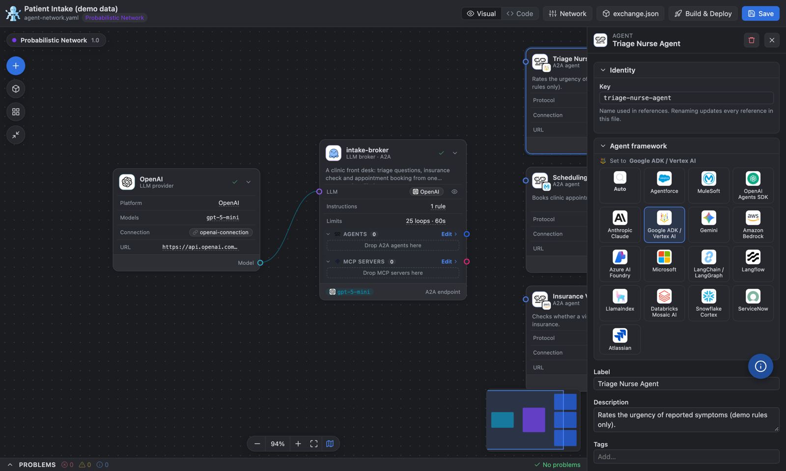

The card skills are optional. Once the agent has a connection (two steps on), the inspector offers **Read skills from the live agent**, which fills them from the running agent.

### Step 3.3. Add the MCP servers

Click **+** → **MCP server** → **Empty**, then fill in:

- **Clinic Records MCP**: **Key** `ehr-mcp`, **Label** Clinic Records MCP, **Description** Fictional clinic record system: patients and intake forms. The transport is already Streamable HTTP on `/mcp`.

### Step 3.4. Add the connections

A connection is the URL (and authentication) Agent Fabric uses to reach an agent or an MCP server. Click **+** → **Connection** → **Empty** once per agent and MCP server, and fill in:

| Key | Kind | Target → Name | URL |
|---|---|---|---|
| `ehr-mcp-connection` | `mcp` | `ehr-mcp` | `${ehrMcp.url}` |
| `triage-nurse-agent-connection` | `agent` | `triage-nurse-agent` | `${triageNurseAgent.url}` |
| `scheduling-agent-connection` | `agent` | `scheduling-agent` | `${schedulingAgent.url}` |
| `insurance-verification-agent-connection` | `agent` | `insurance-verification-agent` | `${insuranceVerificationAgent.url}` |

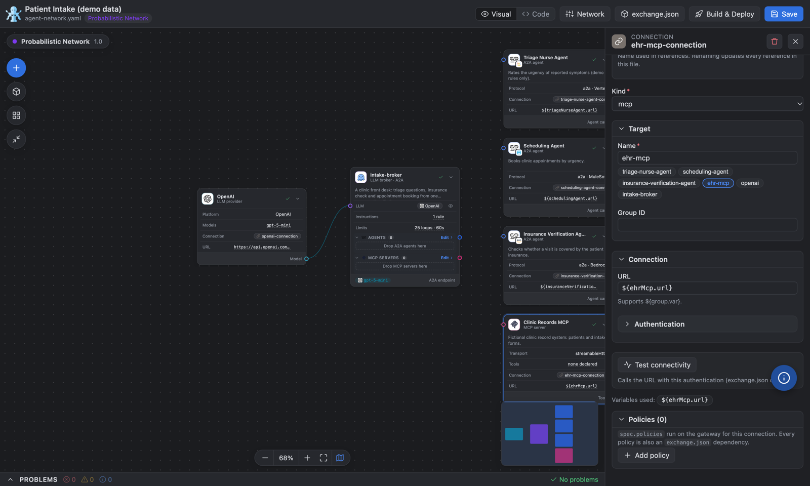

### Step 3.5. Declare the variables

The Problems bar now shows **Variable ${…} is not declared in exchange.json** for each new variable. Click **Add to exchange.json** on each one.

Then open `exchange.json` (it opens as a form) and, under **Variables**, set the defaults:

| Variable | Default |
|---|---|
| `ingressgw.url` | (your ingress gateway URL) |
| `ehrMcp.url` | `https://www.a2d-ai.com/api/platform/94c4f7d4-3a72-4b29-a043-284640c540e0/` |
| `triageNurseAgent.url` | `https://www.a2d-ai.com/api/platform/6334f04d-8eec-4132-8f03-18ff35cac474/a2a` |
| `schedulingAgent.url` | `https://www.a2d-ai.com/api/platform/fd68731a-35b6-460c-817b-19a000773bdf/a2a` |
| `insuranceVerificationAgent.url` | `https://www.a2d-ai.com/api/platform/be8502c1-78b2-4b69-8a27-0b6a13ed4b8b/a2a` |

Leave the secret variables (`openai.apiKey`) empty: deploy asks for them and never stores them.

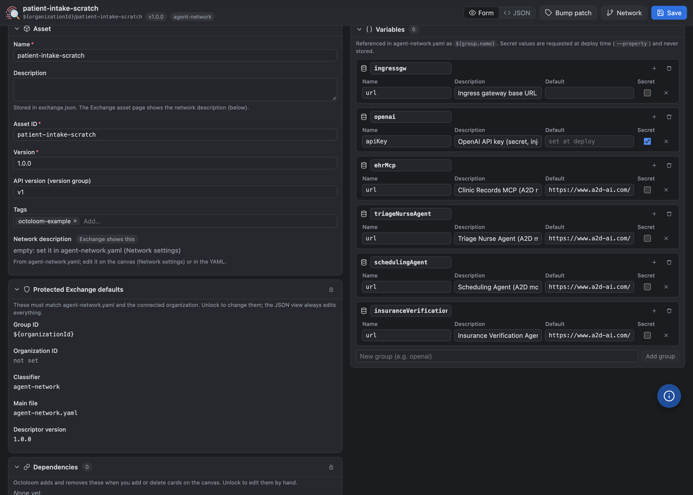

### Step 3.6. Declare the MCP tools

On each MCP server card, click the **Tools** row (or its pencil). Octoloom reads the tool list from the running server: tick the tools below. You can also type a name in **Add a tool by name…**.

- **Clinic Records MCP**: `lookup_patient`, `record_intake`

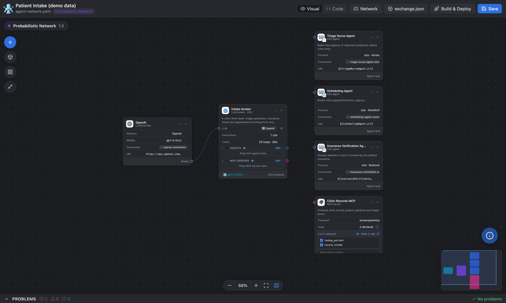

### Step 3.7. Give the broker its agents and tools

Select the broker `intake-broker`. In the inspector:

1. Click **Agents (0)**. In **Add existing agent…**, pick each agent and click **Add**: `triage-nurse-agent`, `scheduling-agent`, `insurance-verification-agent`.
2. Click **MCP servers (0)**. Add each server with **Add existing MCP server…**, then tick its **Allowed tools**:
   - `ehr-mcp`: `lookup_patient`, `record_intake`

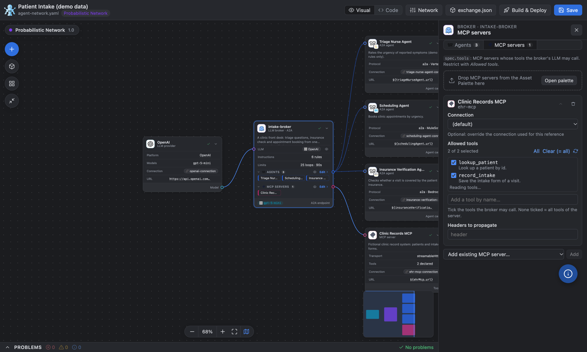

### Step 3.8. Write the broker instructions

Back in the broker inspector, open **Instructions and limits**. Replace the default instruction with these entries, one per line:

- You are the front desk of a fictional outpatient clinic. All data is demo data; never give medical advice.
- Find the patient record with lookup_patient using the patient id from the request (for example P-5001).
- Ask the Triage Nurse agent for the urgency of the symptoms. If the urgency is emergency, tell the user to call the emergency number and stop.
- Ask the Insurance Verification agent whether the visit is covered.
- Ask the Scheduling agent for the first slot that matches the urgency, then save the intake with record_intake.
- Finish with the appointment, the coverage and what the patient should bring.

Set **Max number of loops** `25`, **Max consecutive errors** `3` and **Task timeout (s)** `90`.
Under **Model parameters → OpenAI**, set **Reasoning effort** to `MINIMAL`. The broker then answers within the gateway timeout.

Optionally, fill the broker's **Agent card (A2A 0.3.0)** description: *A clinic front desk: triage questions, insurance check and appointment booking from one conversation. Fictional patients only.*

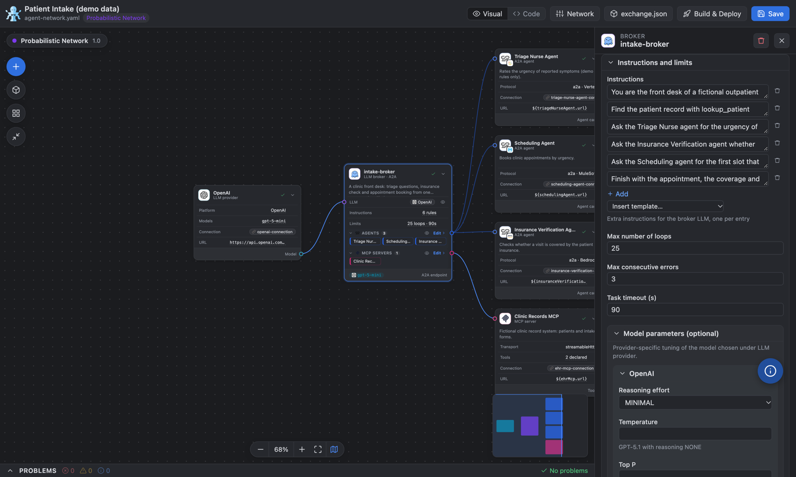

### Step 3.9. Validate, deploy and chat

Run **Validate** from the canvas CLI menu and fix anything in the Problems bar. Then follow Path 2 from [Validate and build](#step-4-validate-and-build) onwards: deploy (enter the secrets), wait for the green light, open the chat and send the same prompts. Your network answers like the template, because it is the same network, built by hand.

## What you learned

- How a probabilistic network is built: an LLM broker with instructions picks agents and MCP tools.
- How the canvas, the inspector and the code view edit the same YAML.
- How to build the same network from a blank project with forms and menus only (Path 3).
- How to validate, build, deploy, chat and trace with Octoloom.

## Next

- Previous: [IT Helpdesk](v1-it-helpdesk.md)
- Next: [Procurement Assistant](v1-procurement.md)
- Same use case, governed variant: [Patient Intake (demo data): governed](v1-patient-intake-governed.md)
- Same use case, secured variant: [Patient Intake (demo data): secured](v1-patient-intake-secured.md)
- [All tutorials](index.md)

---
Generated from the `v1-patient-intake` template (Octoloom `media/templates/v1-patient-intake`). Screenshots use fake data.
