# Tutorial: Field Service Dispatch

[All tutorials](index.md) · [Getting started](../getting-started.md) · Deterministic network (Agent Network 2.0, AgentScript) · Use case

> Diagnose an equipment fault, check parts and weather, and dispatch or resolve remotely.

| Agents | MCP servers | A2A | Policies | Template id |
|---|---|---|---|---|
| 3 | 4 | 1.0, 0.3.0 | 0 | `v2-field-service` |

There are three ways to use this template:

1. **[Just use it](#path-1-just-use-it)**: create the project, deploy it and chat with it in about 10 minutes.
2. **[Learn step by step](#path-2-learn-step-by-step)**: the same steps, with what each part of the network does and how Octoloom shows it.
3. **[Build it from scratch](#path-3-build-it-from-scratch)**: start from a blank project and build the same network yourself, no code, one screenshot per step.

## Before you start

- VS Code with **Octoloom for Agent Fabric** installed (Marketplace), version 0.9.25 or later.
- An Anypoint organization with Agent Fabric, an environment, a [Small Managed Omni Gateway](../start/gateway.md) and a [connected app](../start/connected-app.md) (client ID and secret). New to Anypoint? **[Before you start](../start/index.md)** shows the trial account, the gateway, the connected app and connecting Octoloom, step by step with videos.
- An OpenAI API key (or an OpenAI-compatible LLM gateway).
- Nothing else: all agents and MCP servers are public A²D mocks, so the network runs without any other system.

## Path 1: Just use it

1. **Home → Start → New Deterministic Network.** In the dialog pick **Use cases**, then the card **Field Service Dispatch**. Choose a folder and click **Create**.
2. **Deploy.** In **Projects & Deploy**, click **Deploy** on this project (or **Build & Deploy** in the editor) and pick your gateway. Octoloom asks for each secret variable; nothing you type is stored:
   - `openai.apiKey`: OpenAI API key (secret, injected at deploy time)
3. **Chat.** When the status light is green, click **Open chat** and paste:
   - `Heat pump HP-301 shows error E42`
   - `Solar inverter INV-77 is offline`

Done. The rest of this page explains what you just ran.

## Path 2: Learn step by step

### Step 1. Connect Octoloom

Open **Setup & Connect** (Octoloom side bar) and connect **Agent Fabric**: the connected app client ID and secret and the organization. Pick the environment. A²D isn't needed: the mock URLs are already the defaults in `exchange.json`. The Tooling list shows Node.js, Java and anypoint-cli-v4 with its agent-network plugin. Use **Install** or **Repair** on any red row.

### Step 2. Create the project from the template

On **Home**, click **New Deterministic Network**. In **2 Start from**, choose **Use cases** and click **Field Service Dispatch**. The right side shows the template README: what it contains, **Deploy in 3 steps** and **Try it**. Keep the suggested name `field-service` or type your own, pick the folder and click **Create**.

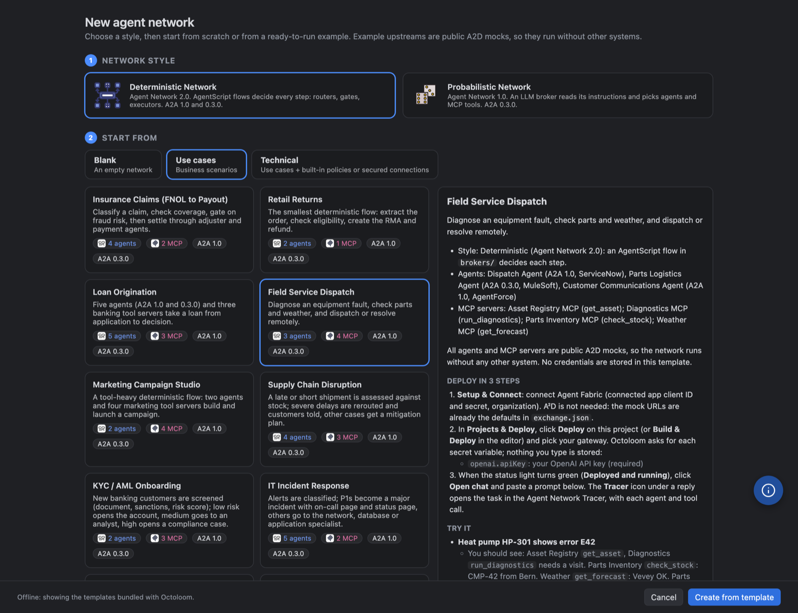

Octoloom writes `agent-network.yaml`, `exchange.json`, `README.md` and the broker flow in `brokers/`, and opens the canvas. Every id gets the template prefix `octo_fs2_`, so several templates can be deployed into one org side by side.

### Step 3. Read the network on the canvas

Each card is a part of `agent-network.yaml`. Click one to open it in the inspector on the right. Each change in the inspector is a change to the text, so the YAML stays the source of truth (**Code** view shows it).

- **Broker Field Service Broker** (`octo_fs2_field_service_broker`): its AgentScript flow decides every step.
- **Agent Dispatch Agent**: Books technicians for on-site visits.
- **Agent Parts Logistics Agent**: Reserves and ships spare parts.
- **Agent Customer Communications Agent**: Keeps the customer informed.
- **MCP server Asset Registry MCP**: Installed equipment. Tools: `get_asset`.
- **MCP server Diagnostics MCP**: Remote diagnostics. Tools: `run_diagnostics`.
- **MCP server Parts Inventory MCP**: Spare parts stock. Tools: `check_stock`.
- **MCP server Weather MCP**: Weather for safe outdoor work. Tools: `get_forecast`.

Try this on the canvas: use the zoom bar and the minimap, drag a card, or **Auto layout**. The layout is saved per file. **Minimize all** turns the cards into icon tiles. Click a connection line to see which broker uses which agent or tool.

### Step 4. Follow the broker flow (AgentScript)

Double-click the broker card (or open `brokers/field-service-broker.agent`). The flow editor shows the AgentScript program that decides every step. The LLM only extracts fields and writes text, so the same input always takes the same branch.

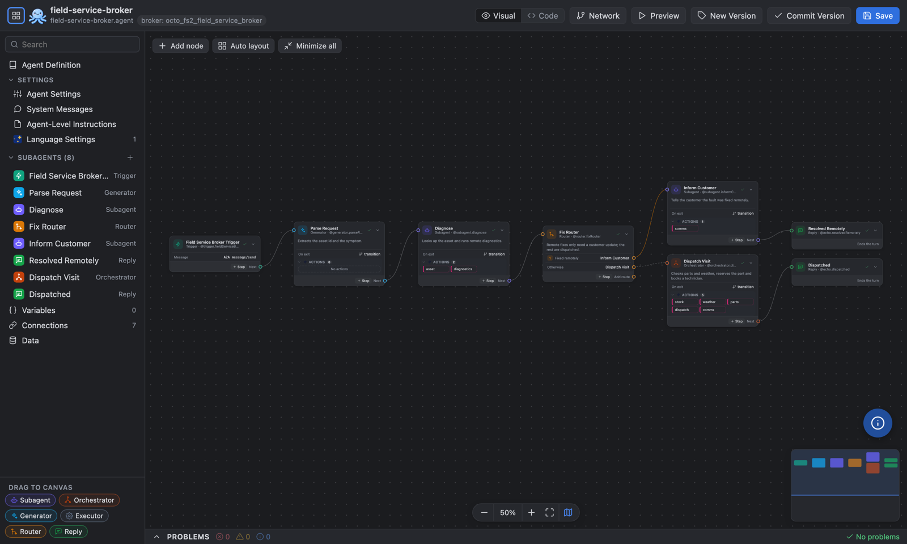

| Step | Kind | What it does |
|---|---|---|
| `fieldServiceBrokerTrigger` | Trigger | Starts the flow when an A2A message arrives at the broker. |
| `parseRequest` | Generator | Extracts the asset id and the symptom. |
| `diagnose` | Subagent | Looks up the asset and runs remote diagnostics. |
| `fixRouter` | Router | Remote fixes only need a customer update; the rest are dispatched. |
| `informCustomer` | Subagent | Tells the customer the fault was fixed remotely. |
| `resolvedRemotely` | Echo | Ends the flow with the `resolvedRemotely` reply. |
| `dispatchVisit` | Orchestrator | Checks parts and weather, reserves the part and books a technician. |
| `dispatched` | Echo | Ends the flow with the `dispatched` reply. |
| `progressParseRequest` | Echo | Progress update (`TASK_STATE_WORKING`): tells the caller what comes next, then goes on to that step. With **Live** on, the chat shows it while the broker works. |
| `progressDiagnose` | Echo | Progress update (`TASK_STATE_WORKING`): tells the caller what comes next, then goes on to that step. With **Live** on, the chat shows it while the broker works. |
| `progressInformCustomer` | Echo | Progress update (`TASK_STATE_WORKING`): tells the caller what comes next, then goes on to that step. With **Live** on, the chat shows it while the broker works. |
| `progressDispatchVisit` | Echo | Progress update (`TASK_STATE_WORKING`): tells the caller what comes next, then goes on to that step. With **Live** on, the chat shows it while the broker works. |

Click a step to edit it in the inspector. **+ Step** adds a node, and **+ Step → Patterns** inserts whole shapes such as retry, human in the loop or a guardrail check. **Code** shows the `.agent` text with completion.

### Step 5. Validate and build

In the canvas toolbar, open the CLI menu: **Validate** does a dry run of build, publish and deploy and lists problems in the Problems panel (click one to jump to the card). **Build** repairs and packages the project locally with anypoint-cli-v4.

The variables of this template (in `exchange.json`, open it for the no-code form):

| Variable | What | Default |
|---|---|---|
| `dispatchAgent.url` | Dispatch Agent (A2D mock, A2A 1.0) URL | `https://www.a2d-ai.com/api/platform/69ebd12e-296f-4eed-949f-26296e3c7fe9/a2a` |
| `partsAgent.url` | Parts Logistics Agent (A2D mock, A2A 0.3.0) URL | `https://www.a2d-ai.com/api/platform/1f49d5bd-b631-498b-b2a6-84de58a41521/a2a` |
| `customerCommsAgent.url` | Customer Communications Agent (A2D mock, A2A 1.0) URL | `https://www.a2d-ai.com/api/platform/f3d6ebd7-0b13-43c2-b2ef-f55ac045c18a/a2a` |
| `assetRegistryMcp.url` | Asset Registry MCP (A2D mock) base URL | `https://www.a2d-ai.com/api/platform/e63366bc-fc42-4a5f-82c6-960245f373d8/` |
| `diagnosticsMcp.url` | Diagnostics MCP (A2D mock) base URL | `https://www.a2d-ai.com/api/platform/9c1cb10f-5950-428c-88aa-d2b0f52f508e/` |
| `inventoryMcp.url` | Parts Inventory MCP (A2D mock) base URL | `https://www.a2d-ai.com/api/platform/646e87d9-595d-4194-8ffd-4eeb958fc2f5/` |
| `weatherMcp.url` | Weather MCP (A2D mock) base URL | `https://www.a2d-ai.com/api/platform/1839bfc8-fb85-4256-9195-26c193243b7d/` |

### Step 6. Deploy

Open **Projects & Deploy** and click **Deploy** on the project (or **Deploy…** on the canvas). Pick your gateway (the chips show its status and space), keep **Tracing**, **Wait until the network is ready** and **Publish before deploy** on, then enter the secrets. Nothing you type is stored:

- `openai.apiKey`: OpenAI API key (secret, injected at deploy time)

The square status light goes from blue (deploying) to green (**Deployed and running**). The deployment box lists every broker URL; click one to copy it.

### Step 7. Chat with the broker

Click **Open chat** on the deployment box. On the left is the network (the cards light up as they are called), and on the right is the conversation with its task states. **Live progress** (the antenna button next to Send) is on by default: while the broker works, the chat lists its progress updates (*Extracting the asset id and the symptom...*, *Looking up the asset and running remote diagnostics...*) and keeps them above the answer. Paste the prompts one at a time:

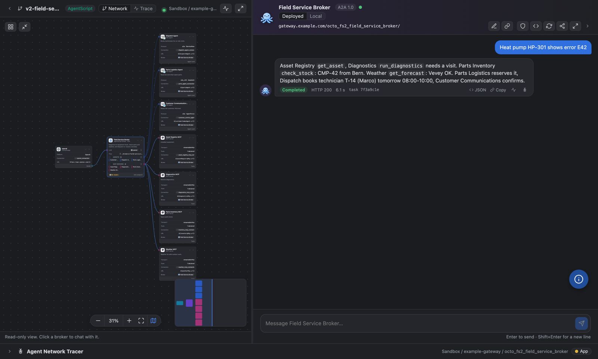

*The reply in the screenshot is an illustration: it shows what the broker answers. The real wording changes from run to run.*

| Prompt | You should see |
|---|---|
| `Heat pump HP-301 shows error E42` | Asset Registry `get_asset`, Diagnostics `run_diagnostics` needs a visit. Parts Inventory `check_stock`: CMP-42 from Bern. Weather `get_forecast`: Vevey OK. Parts Logistics reserves it, Dispatch books technician T-14 (Marco) tomorrow 08:00-10:00, Customer Communications confirms. |
| `Solar inverter INV-77 is offline` | Diagnostics `run_diagnostics`: lost connectivity, fixed with a remote reboot. Customer Communications informs the customer; no visit. |

The broker is deterministic: the branches are fixed in the flow in `brokers/` (open the `.agent` file to see them). The LLM only reads the ids from your prompt and writes the reply text, so the same input takes the same branch.

### Step 8. Trace a reply

Under each reply, the **Tracer** icon opens the task in the **Agent Network Tracer**: a waterfall of every call the broker made (gateway, broker, LLM, A2A agents, MCP tools) on one time axis, coloured like the cards. Errors are red. Click a span to see its request and response. The **Network** view shows the same reply as a sequence of calls.

### Step 9. Share it (optional)

The **Share** icon in the chat header opens the Share dialog. **A²D sessions** invites people by email to chat with this deployed broker and brings their passed / failed marks and comments back. **Local portal** generates a small web chat you can run or host anywhere.

## Path 3: Build it from scratch

Here you build the same network yourself, starting from a blank project. Every step uses a form, a menu or a button. You never import the template, and you never type YAML or AgentScript. The names below are the template's names without the `octo_fs2_` prefix. You can use your own names, but keep them consistent.

> The text fields take plain values. Where a value looks like `${group.name}`, type it as shown: it is a **variable** that `exchange.json` declares and that deploy fills in.

### Step 3.1. Create a blank project with a starter broker

Connect Octoloom first, as in [Path 2, Step 1](#step-1-connect-octoloom). Then, on **Home**, click **New Deterministic Network**. In **2 Start from**, choose **Blank** and turn on **Add a starter broker**.

- **Broker name**: `Field Service Broker`
- **Name**: `field-service-scratch` (the Exchange asset id; a different name from the template, so both can live in one org)
- **Parent folder**: pick a folder, then click **Create blank project**.

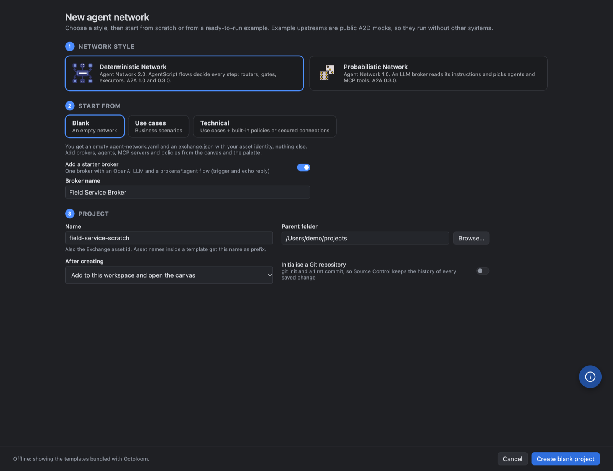

The starter broker `field_service_broker` has an OpenAI LLM connection (`openai_connection`, MuleSoft's published OpenAI LLM) and a flow `brokers/field-service-broker.agent` with a trigger, one subagent and the built-in `done` reply. The LLM is already done.

### Step 3.2. Add the agents

On the canvas, click **+** (Add to the network) → **Agent** → **Empty**. The new agent opens in the inspector on the right. Fill it in, then repeat for each agent:

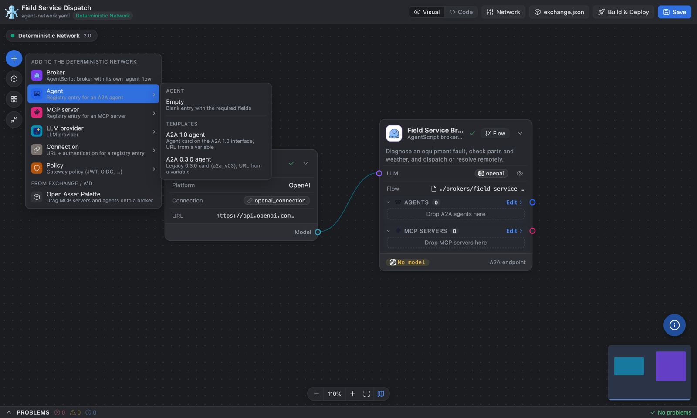

- **Dispatch Agent**
  - **Identity → Key**: `dispatch_agent`
  - **Info → Label**: Dispatch Agent · **Description**: Books technicians for on-site visits.
  - **Metadata → Platform**: `ServiceNow` (or click its icon under **Agent framework**)
  - **Interface**: click `a2a` (A2A 1.0). **Agent card (A2A 1.x)**: **Name** Dispatch Agent, **Description** as above, **Supported interfaces → URL** `https://www.a2d-ai.com/api/platform/69ebd12e-296f-4eed-949f-26296e3c7fe9/a2a`, Binding `JSONRPC`, Protocol version `1.0`
- **Parts Logistics Agent**
  - **Identity → Key**: `parts_agent`
  - **Info → Label**: Parts Logistics Agent · **Description**: Reserves and ships spare parts.
  - **Metadata → Platform**: `MuleSoft` (or click its icon under **Agent framework**)
  - **Interface**: keep `a2a_v03` (A2A 0.3.0). **Agent card (A2A 0.3)**: **Name** Parts Logistics Agent, **Description** as above, **URL** `https://www.a2d-ai.com/api/platform/1f49d5bd-b631-498b-b2a6-84de58a41521/a2a`
- **Customer Communications Agent**
  - **Identity → Key**: `customer_comms_agent`
  - **Info → Label**: Customer Communications Agent · **Description**: Keeps the customer informed.
  - **Metadata → Platform**: `AgentForce` (or click its icon under **Agent framework**)
  - **Interface**: click `a2a` (A2A 1.0). **Agent card (A2A 1.x)**: **Name** Customer Communications Agent, **Description** as above, **Supported interfaces → URL** `https://www.a2d-ai.com/api/platform/f3d6ebd7-0b13-43c2-b2ef-f55ac045c18a/a2a`, Binding `JSONRPC`, Protocol version `1.0`

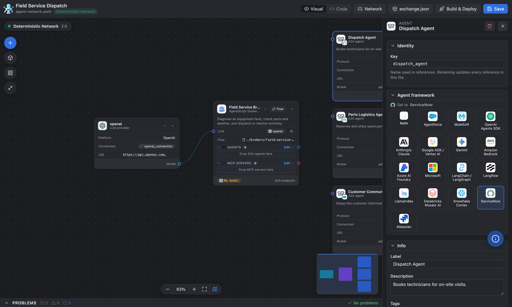

The card skills are optional. Once the agent has a connection (two steps on), the inspector offers **Read skills from the live agent**, which fills them from the running agent.

### Step 3.3. Add the MCP servers

Click **+** → **MCP server** → **Empty**, then fill in:

- **Asset Registry MCP**: **Key** `asset_registry_mcp`, **Label** Asset Registry MCP, **Description** Installed equipment · **Protocol version** `2025-06-18`. The transport is already Streamable HTTP on `/mcp`.
- **Diagnostics MCP**: **Key** `diagnostics_mcp`, **Label** Diagnostics MCP, **Description** Remote diagnostics · **Protocol version** `2025-06-18`. The transport is already Streamable HTTP on `/mcp`.
- **Parts Inventory MCP**: **Key** `inventory_mcp`, **Label** Parts Inventory MCP, **Description** Spare parts stock · **Protocol version** `2025-06-18`. The transport is already Streamable HTTP on `/mcp`.
- **Weather MCP**: **Key** `weather_mcp`, **Label** Weather MCP, **Description** Weather for safe outdoor work · **Protocol version** `2025-06-18`. The transport is already Streamable HTTP on `/mcp`.

### Step 3.4. Add the connections

A connection is the URL (and authentication) Agent Fabric uses to reach an agent or an MCP server. Click **+** → **Connection** → **Empty** once per agent and MCP server, and fill in:

| Key | Kind | Registry entry → Name | URL |
|---|---|---|---|
| `dispatch_agent_connection` | `a2a` | `dispatch_agent` | `${dispatchAgent.url}` |
| `parts_agent_connection` | `a2a` | `parts_agent` | `${partsAgent.url}` |
| `customer_comms_agent_connection` | `a2a` | `customer_comms_agent` | `${customerCommsAgent.url}` |
| `asset_registry_mcp_connection` | `mcp` | `asset_registry_mcp` | `${assetRegistryMcp.url}` |
| `diagnostics_mcp_connection` | `mcp` | `diagnostics_mcp` | `${diagnosticsMcp.url}` |
| `inventory_mcp_connection` | `mcp` | `inventory_mcp` | `${inventoryMcp.url}` |
| `weather_mcp_connection` | `mcp` | `weather_mcp` | `${weatherMcp.url}` |

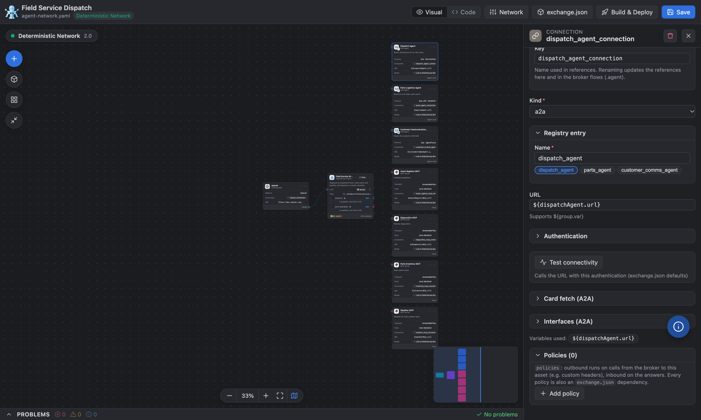

### Step 3.5. Declare the variables

The Problems bar now shows **Variable ${…} is not declared in exchange.json** for each new variable. Click **Add to exchange.json** on each one.

Then open `exchange.json` (it opens as a form) and, under **Variables**, set the defaults:

| Variable | Default |
|---|---|
| `dispatchAgent.url` | `https://www.a2d-ai.com/api/platform/69ebd12e-296f-4eed-949f-26296e3c7fe9/a2a` |
| `partsAgent.url` | `https://www.a2d-ai.com/api/platform/1f49d5bd-b631-498b-b2a6-84de58a41521/a2a` |
| `customerCommsAgent.url` | `https://www.a2d-ai.com/api/platform/f3d6ebd7-0b13-43c2-b2ef-f55ac045c18a/a2a` |
| `assetRegistryMcp.url` | `https://www.a2d-ai.com/api/platform/e63366bc-fc42-4a5f-82c6-960245f373d8/` |
| `diagnosticsMcp.url` | `https://www.a2d-ai.com/api/platform/9c1cb10f-5950-428c-88aa-d2b0f52f508e/` |
| `inventoryMcp.url` | `https://www.a2d-ai.com/api/platform/646e87d9-595d-4194-8ffd-4eeb958fc2f5/` |
| `weatherMcp.url` | `https://www.a2d-ai.com/api/platform/1839bfc8-fb85-4256-9195-26c193243b7d/` |

Leave the secret variables (`openai.apiKey`) empty: deploy asks for them and never stores them.

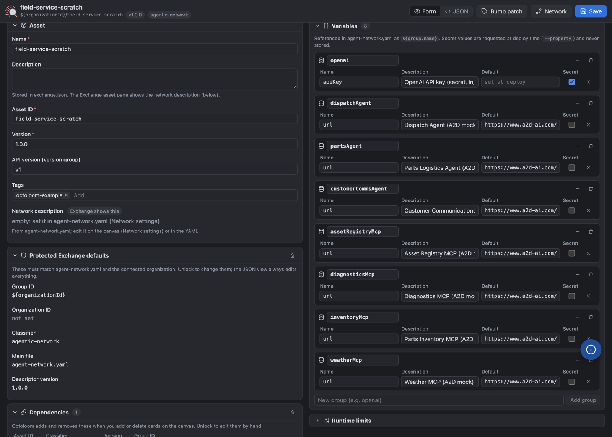

Also click **Remove it** on any **declared but not used** variable that the Problems bar shows.

### Step 3.6. Declare the MCP tools

On each MCP server card, click the **Tools** row (or its pencil). Octoloom reads the tool list from the running server: tick the tools below. You can also type a name in **Add a tool by name…**.

- **Asset Registry MCP**: `get_asset`
- **Diagnostics MCP**: `run_diagnostics`
- **Parts Inventory MCP**: `check_stock`
- **Weather MCP**: `get_forecast`

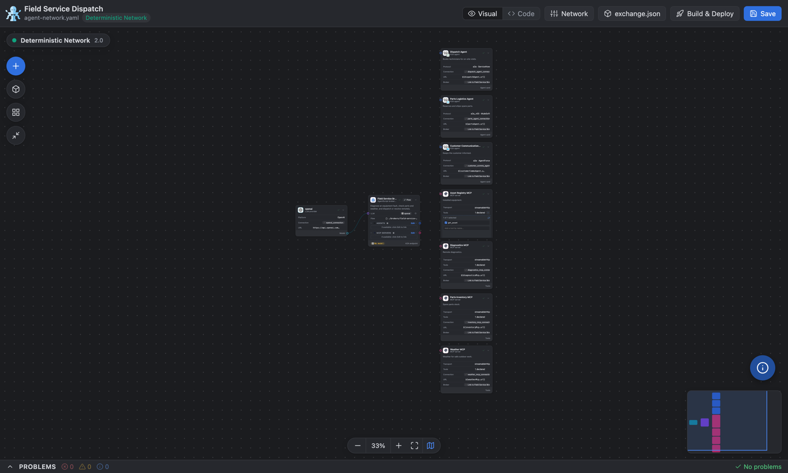

### Step 3.7. Link the agents and MCP servers to the broker

Every agent and MCP card now has a **Broker** row with **Link to Field Service Broker**. Click it on each card. Octoloom adds the matching actions to the broker flow: one per agent and one per declared MCP tool.

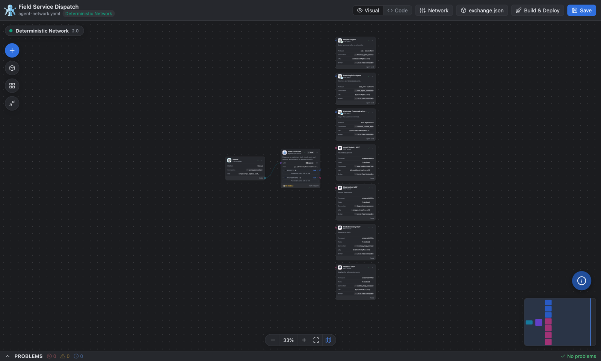

### Step 3.8. Build the broker flow

On the broker card (or in its inspector), click **Open broker flow**. Then set up the flow:

1. **Settings → Language Settings**: on the `default` model, set **Reasoning effort (OpenAI)** to `MINIMAL`.
2. **Settings → System Messages**: set the instructions to: *You run field service for heating and solar equipment. Fix remotely when possible; dispatch only when needed and safe.*
3. Select the `assistant` subagent and delete it (trash icon). The trigger and the built-in `done` reply stay.
4. Add the steps below in order. Select the step that comes before, click **Add node**, pick the kind and choose **Empty**, then set its **API name** in **General**. Octoloom wires each new step after the selected one, and you set the exact next step in the inspector.

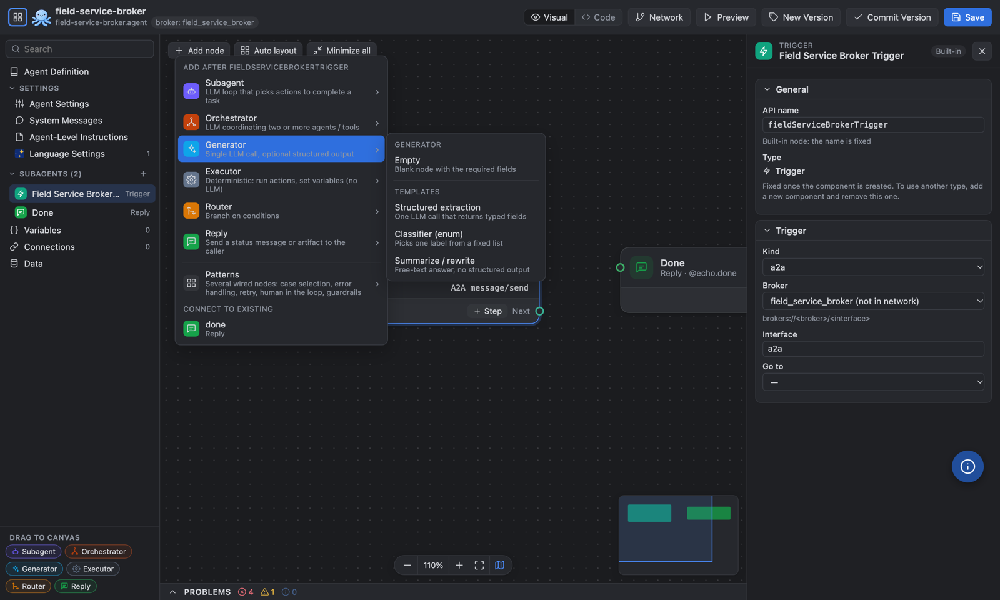

Select the trigger and, under **Go to**, pick `progressParseRequest` once that step exists.

#### Generator `parseRequest`

- **Label** Parse Request · **Description** Extracts the asset id and the symptom.
- **Prompt**:

  > Extract the asset id (for example HP-301 or INV-77) and the symptom from: {!@request.payload.message.parts[0].text}

- **Structured output** (**Add field** for each):
  - `asset_id` (string): Asset id
  - `symptom` (string): Reported symptom
- **Next step (on exit) → Go to**: `progressDiagnose`

#### Subagent `diagnose`

- **Label** Diagnose · **Description** Looks up the asset and runs remote diagnostics.
- **System instructions**:

  > Look up the asset and run remote diagnostics.
  > Set remote_fix to "yes" when diagnostics fixed the fault remotely, otherwise "no".
  > Return the part id when a part is needed and the town of the site.

- **Reasoning instructions**:

  > Asset {!@generator.parseRequest.output.asset_id}: {!@generator.parseRequest.output.symptom}

- **Actions** (**+ Add action…**): `get_asset`, `run_diagnostics`
- **Limits → Max loops**: `4`
- **Structured output** (**Add field** for each):
  - `remote_fix` (string): Fixed remotely · **Allowed values** `yes`, `no`
  - `part_id` (string): Needed part id or NONE
  - `town` (string): Town of the site
  - `detail` (string): Diagnosis detail
- **Next step (on exit) → Go to**: `fixRouter`

#### Router `fixRouter`

- **Description** Remote fixes only need a customer update; the rest are dispatched.
- **Routes** (**+**): **Label** Fixed remotely · **When** `@subagent.diagnose.output.remote_fix == "yes"` · **Go to** `progressInformCustomer`
- **Otherwise → Go to**: `progressDispatchVisit`

#### Subagent `informCustomer`

- **Label** Inform Customer · **Description** Tells the customer the fault was fixed remotely.
- **Reasoning instructions**:

  > Tell the customer the fault on {!@generator.parseRequest.output.asset_id} was fixed remotely: {!@subagent.diagnose.output.detail}

- **Actions** (**+ Add action…**): `customer_comms_agent`
- **Next step (on exit) → Go to**: `resolvedRemotely`

#### Reply `resolvedRemotely`

- **Use expression**, then **Message (expression)**: `"Resolved remotely: " + @subagent.diagnose.output.detail`
- **Task state**: `TASK_STATE_COMPLETED`

#### Orchestrator `dispatchVisit`

- **Label** Dispatch Visit · **Description** Checks parts and weather, reserves the part and books a technician.
- **System instructions**:

  > Check stock for the part and the weather for the town. Reserve the part with the parts agent,
  > book a technician with the dispatch agent and inform the customer of the visit window.
  > If the forecast is unsafe for outdoor work, book the next safe day instead.

- **Reasoning instructions**:

  > Asset {!@generator.parseRequest.output.asset_id} in {!@subagent.diagnose.output.town} needs part {!@subagent.diagnose.output.part_id}: {!@subagent.diagnose.output.detail}

- **Actions** (**+ Add action…**): `check_stock`, `get_forecast`, `parts_agent`, `dispatch_agent`, `customer_comms_agent`
- **Limits → Max loops**: `8`
- **Next step (on exit) → Go to**: `dispatched`

#### Reply `dispatched`

- **Use expression**, then **Message (expression)**: `@orchestrator.dispatchVisit.output`
- **Task state**: `TASK_STATE_COMPLETED`

#### Reply `progressParseRequest`

- **Message text**: Extracting the asset id and the symptom...
- **Task state**: `TASK_STATE_WORKING` (a progress update: the chat shows it while the broker works, then the flow goes on)
- **Next step (on exit) → Go to**: `parseRequest`

#### Reply `progressDiagnose`

- **Message text**: Looking up the asset and running remote diagnostics...
- **Task state**: `TASK_STATE_WORKING` (a progress update: the chat shows it while the broker works, then the flow goes on)
- **Next step (on exit) → Go to**: `diagnose`

#### Reply `progressInformCustomer`

- **Message text**: Telling the customer the fault was fixed remotely...
- **Task state**: `TASK_STATE_WORKING` (a progress update: the chat shows it while the broker works, then the flow goes on)
- **Next step (on exit) → Go to**: `informCustomer`

#### Reply `progressDispatchVisit`

- **Message text**: Checking parts and weather, reserving the part and booking a technician...
- **Task state**: `TASK_STATE_WORKING` (a progress update: the chat shows it while the broker works, then the flow goes on)
- **Next step (on exit) → Go to**: `dispatchVisit`

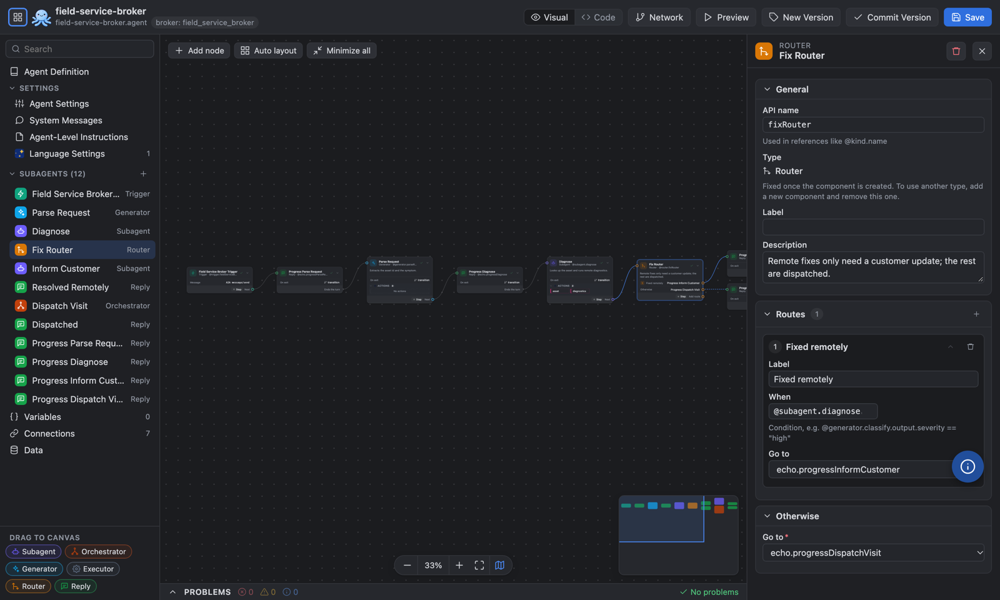

When you are done, the flow matches the template's flow ([Path 2, Step 4](#step-4-follow-the-broker-flow-agentscript)). The built-in `done` reply isn't used by this use case. The Problems bar shows **echo done is not reachable from the trigger** as a warning, and you can leave it.

### Step 3.9. Validate, deploy and chat

Run **Validate** from the canvas CLI menu and fix anything in the Problems bar. Then follow Path 2 from [Validate and build](#step-5-validate-and-build) onwards: deploy (enter the secrets), wait for the green light, open the chat and send the same prompts. Your network answers like the template, because it is the same network, built by hand.

## What you learned

- How a deterministic network is built: an AgentScript flow decides every step; the LLM extracts and writes text.
- How the canvas, the inspector and the code view edit the same YAML.
- How to build the same network from a blank project with forms and menus only (Path 3).
- How to validate, build, deploy, chat and trace with Octoloom.

## Next

- Next: [IT Incident Response](v2-incident-response.md)
- Same use case, governed variant: [Field Service Dispatch: governed](v2-field-service-governed.md)
- [All tutorials](index.md)

---
Generated from the `v2-field-service` template (Octoloom `media/templates/v2-field-service`). Screenshots use fake data.
