# Tutorial: IT Incident Response: secured

[All tutorials](index.md) · [Getting started](../getting-started.md) · Deterministic network (Agent Network 2.0, AgentScript) · Technical · secured

> Alerts are classified; P1s become a major incident with on-call page and status page, others go to the network, database or application specialist. Secured: authenticated connections (Basic, Client ID enforcement) with secret variables, the LLM behind a gateway URL, outbound message logging.

| Agents | MCP servers | A2A | Policies | Template id |
|---|---|---|---|---|
| 5 | 2 | 1.0, 0.3.0 | 2 | `v2-incident-response-secured` |

There are three ways to use this template:

1. **[Just use it](#path-1-just-use-it)**: create the project, deploy it and chat with it in about 10 minutes.
2. **[Learn step by step](#path-2-learn-step-by-step)**: the same steps, with what each part of the network does and how Octoloom shows it.
3. **[Build it from scratch](#path-3-build-it-from-scratch)**: start from a blank project and build the same network yourself, no code, one screenshot per step.

## Before you start

- VS Code with **Octoloom for Agent Fabric** installed (Marketplace), version 0.9.25 or later.
- An Anypoint organization with Agent Fabric, a connected app (client ID and secret), an environment and a Flex gateway.
- An OpenAI API key (or an OpenAI-compatible LLM gateway).
- Nothing else: all agents and MCP servers are public A²D mocks, so the network runs without any other system.
- **Not set up yet?** The Quick Start prerequisites, step by step with pictures: [Anypoint account](../start/account.md) · [Small Managed Omni Gateway](../start/gateway.md) · [Connected app Octoloom-CA](../start/connected-app.md) · [Connect Octoloom to Agent Fabric](../start/connect-anypoint.md).

## Path 1: Just use it

1. **Home → Start → New Deterministic Network.** In the dialog pick **Technical**, then the card **IT Incident Response: secured**. Choose a folder and click **Create**.
2. **Deploy.** In **Projects & Deploy**, click **Deploy** on this project (or **Build & Deploy** in the editor) and pick your gateway. Octoloom asks for each secret variable; nothing you type is stored:
   - `openai.apiKey`: OpenAI API key (secret, injected at deploy time)
   - `triageAgent.password`: Password (secret, entered at deploy time)
   - `networkAgent.clientSecret`: Client secret (secret, entered at deploy time)
   - `databaseAgent.password`: Password (secret, entered at deploy time)
   - `appSupportAgent.clientSecret`: Client secret (secret, entered at deploy time)
   - `statusPageAgent.password`: Password (secret, entered at deploy time)
   - `monitoringMcp.clientSecret`: Client secret (secret, entered at deploy time)
   - `itsmMcp.password`: Password (secret, entered at deploy time)
3. **Chat.** When the status light is green, click **Open chat** and paste:
   - `P1: checkout-api returns 500 for all users since 10:02`
   - `orders-db replication lag is 40 minutes`
   - `VPN in the Zurich office drops every few minutes`
   - `P1: checkout-api returns 500 for all users since 10:02`

Done. The rest of this page explains what you just ran.

## Path 2: Learn step by step

### Step 1. Connect Octoloom

Open **Setup & Connect** (Octoloom side bar) and connect **Agent Fabric**: the connected app client ID and secret and the organization. Pick the environment. A²D isn't needed: the mock URLs are already the defaults in `exchange.json`. The Tooling list shows Node.js, Java and anypoint-cli-v4 with its agent-network plugin. Use **Install** or **Repair** on any red row.

### Step 2. Create the project from the template

On **Home**, click **New Deterministic Network**. In **2 Start from**, choose **Technical** and click **IT Incident Response: secured**. The right side shows the template README: what it contains, **Deploy in 3 steps** and **Try it**. Keep the suggested name `incident-response-secured` or type your own, pick the folder and click **Create**.

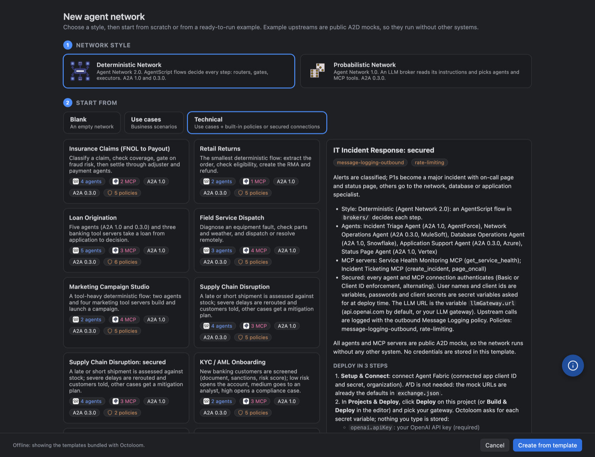

Octoloom writes `agent-network.yaml`, `exchange.json`, `README.md` and the broker flow in `brokers/`, and opens the canvas. Every id gets the template prefix `octo_ir2s_`, so several templates can be deployed into one org side by side.

### Step 3. Read the network on the canvas

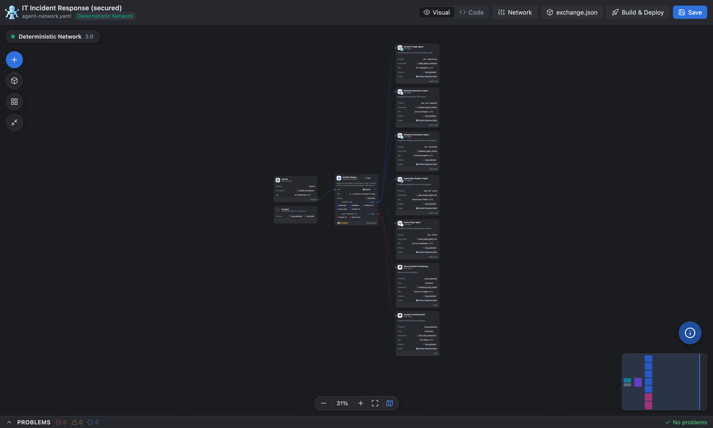

Each card is a part of `agent-network.yaml`. Click one to open it in the inspector on the right. Each change in the inspector is a change to the text, so the YAML stays the source of truth (**Code** view shows it).

- **Broker Incident Response Broker** (`octo_ir2s_incident_broker`): its AgentScript flow decides every step.
- **Agent Incident Triage Agent**: Correlates alerts and names the likely cause.
- **Agent Network Operations Agent**: Diagnoses network and VPN issues.
- **Agent Database Operations Agent**: Diagnoses database performance and replication.
- **Agent Application Support Agent**: Diagnoses application errors and rollbacks.
- **Agent Status Page Agent**: Publishes customer-facing status updates.
- **MCP server Service Health Monitoring MCP**: Alerts and service health. Tools: `get_service_health`.
- **MCP server Incident Ticketing MCP**: Incident tickets and on-call paging. Tools: `create_incident`, `page_oncall`.

Try this on the canvas: use the zoom bar and the minimap, drag a card, or **Auto layout**. The layout is saved per file. **Minimize all** turns the cards into icon tiles. Click a connection line to see which broker uses which agent or tool.

### Step 4. Follow the broker flow (AgentScript)

Double-click the broker card (or open `brokers/incident-broker.agent`). The flow editor shows the AgentScript program that decides every step. The LLM only extracts fields and writes text, so the same input always takes the same branch.

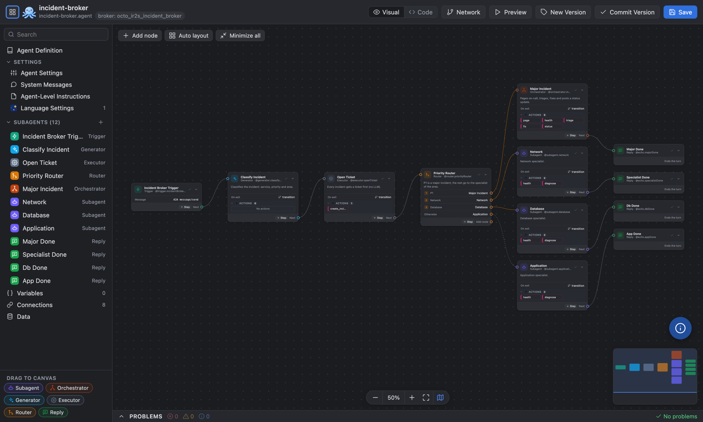

| Step | Kind | What it does |
|---|---|---|
| `incidentBrokerTrigger` | Trigger | Starts the flow when an A2A message arrives at the broker. |
| `classifyIncident` | Generator | Classifies the incident: service, priority and area. |
| `openTicket` | Executor | Every incident gets a ticket first (no LLM). |
| `priorityRouter` | Router | P1 is a major incident; the rest go to the specialist of the area. |
| `majorIncident` | Orchestrator | Pages on-call, triages, fixes and posts a status update. |
| `network` | Subagent | Network specialist. |
| `database` | Subagent | Database specialist. |
| `application` | Subagent | Application specialist. |
| `majorDone` | Echo | Ends the flow with the `majorDone` reply. |
| `specialistDone` | Echo | Ends the flow with the `specialistDone` reply. |
| `dbDone` | Echo | Ends the flow with the `dbDone` reply. |
| `appDone` | Echo | Ends the flow with the `appDone` reply. |
| `progressClassifyIncident` | Echo | Progress update (`TASK_STATE_WORKING`): tells the caller what comes next, then goes on to that step. With **Live** on, the chat shows it while the broker works. |
| `progressOpenTicket` | Echo | Progress update (`TASK_STATE_WORKING`): tells the caller what comes next, then goes on to that step. With **Live** on, the chat shows it while the broker works. |
| `progressMajorIncident` | Echo | Progress update (`TASK_STATE_WORKING`): tells the caller what comes next, then goes on to that step. With **Live** on, the chat shows it while the broker works. |
| `progressNetwork` | Echo | Progress update (`TASK_STATE_WORKING`): tells the caller what comes next, then goes on to that step. With **Live** on, the chat shows it while the broker works. |
| `progressDatabase` | Echo | Progress update (`TASK_STATE_WORKING`): tells the caller what comes next, then goes on to that step. With **Live** on, the chat shows it while the broker works. |
| `progressApplication` | Echo | Progress update (`TASK_STATE_WORKING`): tells the caller what comes next, then goes on to that step. With **Live** on, the chat shows it while the broker works. |

Click a step to edit it in the inspector. **+ Step** adds a node, and **+ Step → Patterns** inserts whole shapes such as retry, human in the loop or a guardrail check. **Code** shows the `.agent` text with completion.

### Step 5. See the secured connections

This variant adds Agent Fabric policies. Open a broker or connection and look at its **Policies** section. Each policy folds open to show its configuration:
- `message-logging-outbound`
- `rate-limiting`

Secured: every agent and MCP connection authenticates (Basic or Client ID enforcement, alternating). User names and client ids are variables, passwords and client secrets are secret variables asked for at deploy time. The LLM URL is the variable `llmGateway.url` (api.openai.com by default, or your LLM gateway). Upstream calls are logged with the outbound Message Logging policy. Policies: message-logging-outbound, rate-limiting.

Open a connection card. Its **Authentication** section shows the kind (Basic, Client ID enforcement and so on). Names and client IDs are normal variables; passwords and secrets are **secret variables** that Octoloom asks for at deploy time and never stores.

Run **Governance** (shield icon in the canvas toolbar) to check the project against the Agent Fabric rulesets. It runs locally, and findings show on the cards with **Fix** where one exists.

### Step 6. Validate and build

In the canvas toolbar, open the CLI menu: **Validate** does a dry run of build, publish and deploy and lists problems in the Problems panel (click one to jump to the card). **Build** repairs and packages the project locally with anypoint-cli-v4.

The variables of this template (in `exchange.json`, open it for the no-code form):

| Variable | What | Default |
|---|---|---|
| `llmGateway.url` | OpenAI-compatible LLM endpoint: api.openai.com or your LLM gateway in front of it | `https://api.openai.com/v1` |
| `triageAgent.url` | Incident Triage Agent (A2D mock, A2A 1.0) URL | `https://www.a2d-ai.com/api/platform/56c3a3a9-56e1-4cdc-b9cd-c8868fcc7008/a2a` |
| `triageAgent.username` | User name for Basic authentication | `octoloom-demo` |
| `networkAgent.url` | Network Operations Agent (A2D mock, A2A 0.3.0) URL | `https://www.a2d-ai.com/api/platform/4f5e984b-a170-47d7-a58e-23f6ed5cfa07/a2a` |
| `networkAgent.clientId` | Client ID for Client ID Enforcement | `octoloom-demo-client` |
| `databaseAgent.url` | Database Operations Agent (A2D mock, A2A 1.0) URL | `https://www.a2d-ai.com/api/platform/d26ed478-0c67-4c5b-8efd-636dcfd27db2/a2a` |
| `databaseAgent.username` | User name for Basic authentication | `octoloom-demo` |
| `appSupportAgent.url` | Application Support Agent (A2D mock, A2A 0.3.0) URL | `https://www.a2d-ai.com/api/platform/8272582f-f9b4-42e8-b5f3-cd27c8751e02/a2a` |
| `appSupportAgent.clientId` | Client ID for Client ID Enforcement | `octoloom-demo-client` |
| `statusPageAgent.url` | Status Page Agent (A2D mock, A2A 1.0) URL | `https://www.a2d-ai.com/api/platform/7ff8f6e8-6ee3-41e0-855c-efbdd7c7c5f2/a2a` |
| `statusPageAgent.username` | User name for Basic authentication | `octoloom-demo` |
| `monitoringMcp.url` | Service Health Monitoring MCP (A2D mock) base URL | `https://www.a2d-ai.com/api/platform/f76580a4-c9cf-4e67-a5f9-96a717075626/` |
| `monitoringMcp.clientId` | Client ID for Client ID Enforcement | `octoloom-demo-client` |
| `itsmMcp.url` | Incident Ticketing MCP (A2D mock) base URL | `https://www.a2d-ai.com/api/platform/3c7aac35-436f-4c5c-b436-7430d2d254d2/` |
| `itsmMcp.username` | User name for Basic authentication | `octoloom-demo` |

### Step 7. Deploy

Open **Projects & Deploy** and click **Deploy** on the project (or **Deploy…** on the canvas). Pick your gateway (the chips show its status and space), keep **Tracing**, **Wait until the network is ready** and **Publish before deploy** on, then enter the secrets. Nothing you type is stored:

- `openai.apiKey`: OpenAI API key (secret, injected at deploy time)
- `triageAgent.password`: Password (secret, entered at deploy time)
- `networkAgent.clientSecret`: Client secret (secret, entered at deploy time)
- `databaseAgent.password`: Password (secret, entered at deploy time)
- `appSupportAgent.clientSecret`: Client secret (secret, entered at deploy time)
- `statusPageAgent.password`: Password (secret, entered at deploy time)
- `monitoringMcp.clientSecret`: Client secret (secret, entered at deploy time)
- `itsmMcp.password`: Password (secret, entered at deploy time)

The square status light goes from blue (deploying) to green (**Deployed and running**). The deployment box lists every broker URL; click one to copy it.

### Step 8. Chat with the broker

Click **Open chat** on the deployment box. On the left is the network (the cards light up as they are called), and on the right is the conversation with its task states. **Live progress** (the antenna button next to Send) is on by default: while the broker works, the chat lists its progress updates (*Classifying the incident: service, priority and area...*, *Opening the incident ticket...*) and keeps them above the answer. Paste the prompts one at a time:

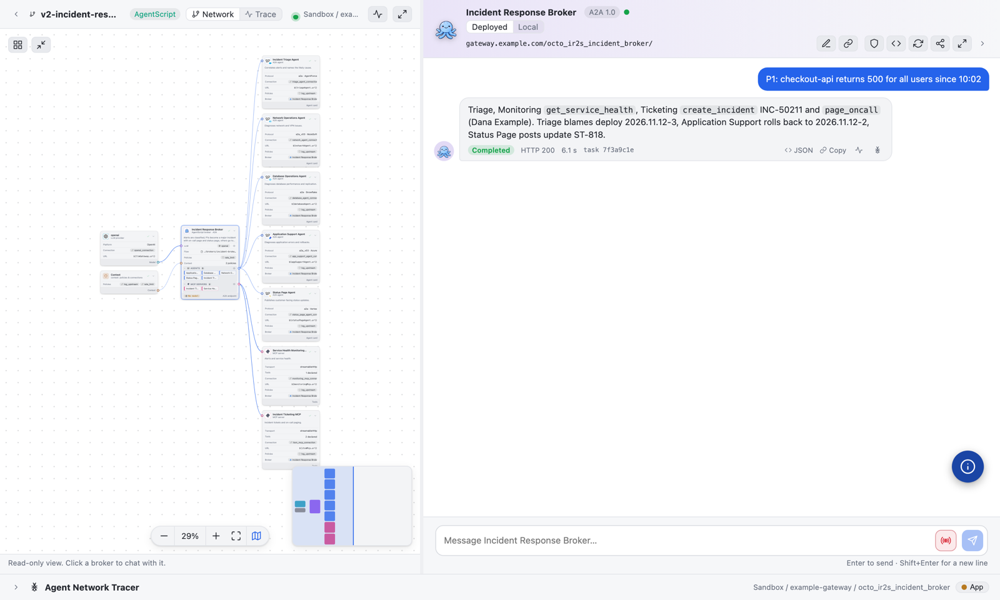

*The reply in the screenshot is an illustration: it shows what the broker answers. The real wording changes from run to run.*

| Prompt | You should see |
|---|---|
| `P1: checkout-api returns 500 for all users since 10:02` | Triage, Monitoring `get_service_health`, Ticketing `create_incident` INC-50211 and `page_oncall` (Dana Example). Triage blames deploy 2026.11.12-3, Application Support rolls back to 2026.11.12-2, Status Page posts update ST-818. |
| `orders-db replication lag is 40 minutes` | Routed to the Database Operations Agent: batch job BJ-4410 is throttled, lag below 1 minute in 15 minutes. |
| `VPN in the Zurich office drops every few minutes` | Routed to the Network Operations Agent: vpn-zrh-2 flaps because of an expiring certificate; failover to vpn-zrh-1, renewal at 14:00. |
| `P1: checkout-api returns 500 for all users since 10:02` | Same answer as the plain variant: the A²D mocks accept any credentials. The Tracer shows each authenticated upstream call, and the outbound Message Logging policy writes one log line per call. |

The broker is deterministic: the branches are fixed in the flow in `brokers/` (open the `.agent` file to see them). The LLM only reads the ids from your prompt and writes the reply text, so the same input takes the same branch.

### Step 9. Trace a reply

Under each reply, the **Tracer** icon opens the task in the **Agent Network Tracer**: a waterfall of every call the broker made (gateway, broker, LLM, A2A agents, MCP tools) on one time axis, coloured like the cards. Errors are red. Click a span to see its request and response. The **Network** view shows the same reply as a sequence of calls.

### Step 10. Share it (optional)

The **Share** icon in the chat header opens the Share dialog. **A²D sessions** invites people by email to chat with this deployed broker and brings their passed / failed marks and comments back. **Local portal** generates a small web chat you can run or host anywhere.

## Path 3: Build it from scratch

Here you build the same network yourself, starting from a blank project. Every step uses a form, a menu or a button. You never import the template, and you never type YAML or AgentScript. The names below are the template's names without the `octo_ir2s_` prefix. You can use your own names, but keep them consistent.

> The text fields take plain values. Where a value looks like `${group.name}`, type it as shown: it is a **variable** that `exchange.json` declares and that deploy fills in.

### Step 3.1. Create a blank project with a starter broker

Connect Octoloom first, as in [Path 2, Step 1](#step-1-connect-octoloom). Then, on **Home**, click **New Deterministic Network**. In **2 Start from**, choose **Blank** and turn on **Add a starter broker**.

- **Broker name**: `Incident Response Broker`
- **Name**: `incident-response-secured-scratch` (the Exchange asset id; a different name from the template, so both can live in one org)
- **Parent folder**: pick a folder, then click **Create blank project**.

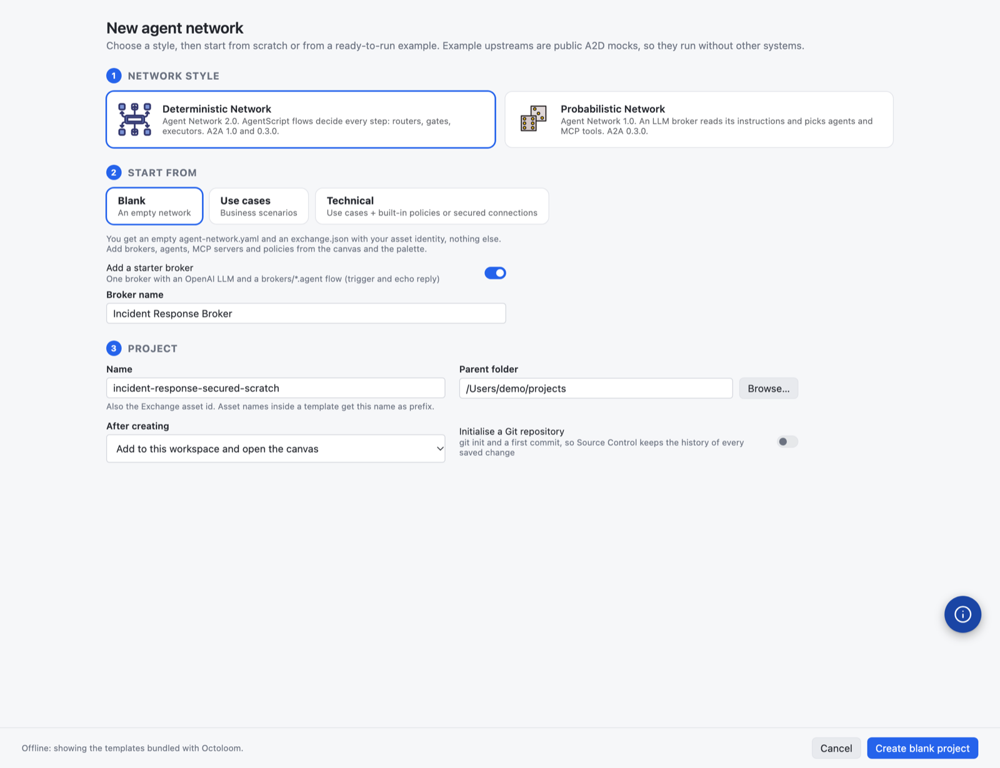

The starter broker `incident_response_broker` has an OpenAI LLM connection (`openai_connection`, MuleSoft's published OpenAI LLM) and a flow `brokers/incident-response-broker.agent` with a trigger, one subagent and the built-in `done` reply. The LLM is already done.

### Step 3.2. Add the agents

On the canvas, click **+** (Add to the network) → **Agent** → **Empty**. The new agent opens in the inspector on the right. Fill it in, then repeat for each agent:

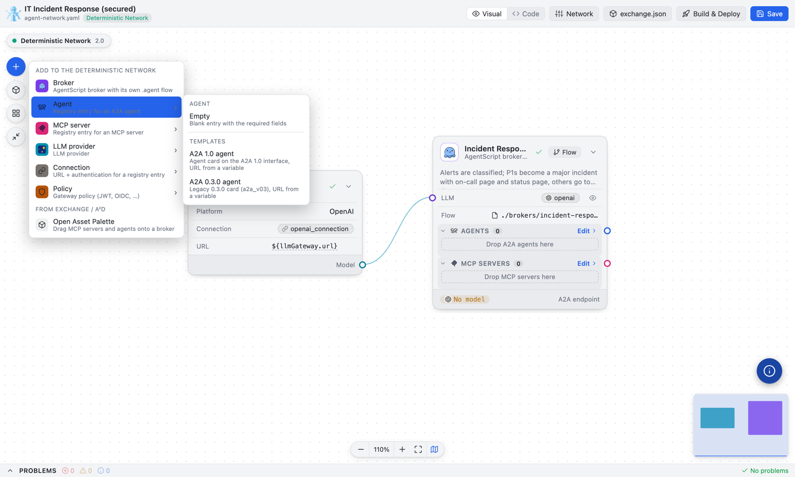

- **Incident Triage Agent**
  - **Identity → Key**: `triage_agent`
  - **Info → Label**: Incident Triage Agent · **Description**: Correlates alerts and names the likely cause.
  - **Metadata → Platform**: `AgentForce` (or click its icon under **Agent framework**)
  - **Interface**: click `a2a` (A2A 1.0). **Agent card (A2A 1.x)**: **Name** Incident Triage Agent, **Description** as above, **Supported interfaces → URL** `https://www.a2d-ai.com/api/platform/56c3a3a9-56e1-4cdc-b9cd-c8868fcc7008/a2a`, Binding `JSONRPC`, Protocol version `1.0`
- **Network Operations Agent**
  - **Identity → Key**: `network_agent`
  - **Info → Label**: Network Operations Agent · **Description**: Diagnoses network and VPN issues.
  - **Metadata → Platform**: `MuleSoft` (or click its icon under **Agent framework**)
  - **Interface**: keep `a2a_v03` (A2A 0.3.0). **Agent card (A2A 0.3)**: **Name** Network Operations Agent, **Description** as above, **URL** `https://www.a2d-ai.com/api/platform/4f5e984b-a170-47d7-a58e-23f6ed5cfa07/a2a`
- **Database Operations Agent**
  - **Identity → Key**: `database_agent`
  - **Info → Label**: Database Operations Agent · **Description**: Diagnoses database performance and replication.
  - **Metadata → Platform**: `Snowflake` (or click its icon under **Agent framework**)
  - **Interface**: click `a2a` (A2A 1.0). **Agent card (A2A 1.x)**: **Name** Database Operations Agent, **Description** as above, **Supported interfaces → URL** `https://www.a2d-ai.com/api/platform/d26ed478-0c67-4c5b-8efd-636dcfd27db2/a2a`, Binding `JSONRPC`, Protocol version `1.0`
- **Application Support Agent**
  - **Identity → Key**: `app_support_agent`
  - **Info → Label**: Application Support Agent · **Description**: Diagnoses application errors and rollbacks.
  - **Metadata → Platform**: `Azure` (or click its icon under **Agent framework**)
  - **Interface**: keep `a2a_v03` (A2A 0.3.0). **Agent card (A2A 0.3)**: **Name** Application Support Agent, **Description** as above, **URL** `https://www.a2d-ai.com/api/platform/8272582f-f9b4-42e8-b5f3-cd27c8751e02/a2a`
- **Status Page Agent**
  - **Identity → Key**: `status_page_agent`
  - **Info → Label**: Status Page Agent · **Description**: Publishes customer-facing status updates.
  - **Metadata → Platform**: `Vertex` (or click its icon under **Agent framework**)
  - **Interface**: click `a2a` (A2A 1.0). **Agent card (A2A 1.x)**: **Name** Status Page Agent, **Description** as above, **Supported interfaces → URL** `https://www.a2d-ai.com/api/platform/7ff8f6e8-6ee3-41e0-855c-efbdd7c7c5f2/a2a`, Binding `JSONRPC`, Protocol version `1.0`

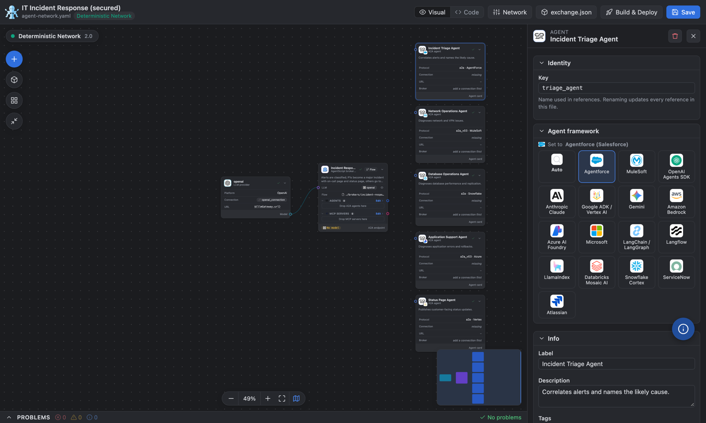

The card skills are optional. Once the agent has a connection (two steps on), the inspector offers **Read skills from the live agent**, which fills them from the running agent.

### Step 3.3. Add the MCP servers

Click **+** → **MCP server** → **Empty**, then fill in:

- **Service Health Monitoring MCP**: **Key** `monitoring_mcp`, **Label** Service Health Monitoring MCP, **Description** Alerts and service health · **Protocol version** `2025-06-18`. The transport is already Streamable HTTP on `/mcp`.
- **Incident Ticketing MCP**: **Key** `itsm_mcp`, **Label** Incident Ticketing MCP, **Description** Incident tickets and on-call paging · **Protocol version** `2025-06-18`. The transport is already Streamable HTTP on `/mcp`.

### Step 3.4. Add the connections

A connection is the URL (and authentication) Agent Fabric uses to reach an agent or an MCP server. Click **+** → **Connection** → **Empty** once per agent and MCP server, and fill in:

| Key | Kind | Registry entry → Name | URL |
|---|---|---|---|
| `triage_agent_connection` | `a2a` | `triage_agent` | `${triageAgent.url}` |
| `network_agent_connection` | `a2a` | `network_agent` | `${networkAgent.url}` |
| `database_agent_connection` | `a2a` | `database_agent` | `${databaseAgent.url}` |
| `app_support_agent_connection` | `a2a` | `app_support_agent` | `${appSupportAgent.url}` |
| `status_page_agent_connection` | `a2a` | `status_page_agent` | `${statusPageAgent.url}` |
| `monitoring_mcp_connection` | `mcp` | `monitoring_mcp` | `${monitoringMcp.url}` |
| `itsm_mcp_connection` | `mcp` | `itsm_mcp` | `${itsmMcp.url}` |

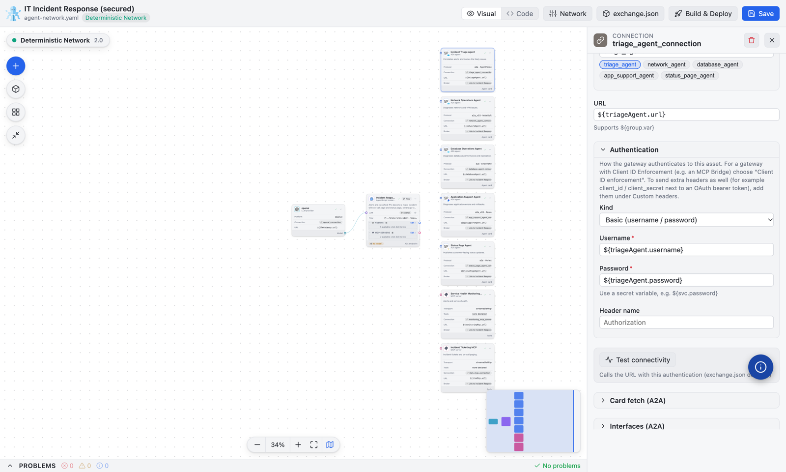

These connections also authenticate. In **Authentication**, pick the kind and type the values exactly as shown. The values are variables, and the secret ones are asked for at deploy time:

- `triage_agent_connection`: **Basic (username / password)**, **username** `${triageAgent.username}`, **password** `${triageAgent.password}`
- `network_agent_connection`: **Client ID enforcement (client_id / client_secret headers)**, **clientId** `${networkAgent.clientId}` (header `client_id`), **clientSecret** `${networkAgent.clientSecret}` (header `client_secret`)
- `database_agent_connection`: **Basic (username / password)**, **username** `${databaseAgent.username}`, **password** `${databaseAgent.password}`
- `app_support_agent_connection`: **Client ID enforcement (client_id / client_secret headers)**, **clientId** `${appSupportAgent.clientId}` (header `client_id`), **clientSecret** `${appSupportAgent.clientSecret}` (header `client_secret`)
- `status_page_agent_connection`: **Basic (username / password)**, **username** `${statusPageAgent.username}`, **password** `${statusPageAgent.password}`
- `monitoring_mcp_connection`: **Client ID enforcement (client_id / client_secret headers)**, **clientId** `${monitoringMcp.clientId}` (header `client_id`), **clientSecret** `${monitoringMcp.clientSecret}` (header `client_secret`)
- `itsm_mcp_connection`: **Basic (username / password)**, **username** `${itsmMcp.username}`, **password** `${itsmMcp.password}`

### Step 3.5. Declare the variables

The Problems bar now shows **Variable ${…} is not declared in exchange.json** for each new variable. Click **Add to exchange.json** on each one.

Then open `exchange.json` (it opens as a form) and, under **Variables**, set the defaults:

| Variable | Default |
|---|---|
| `llmGateway.url` | `https://api.openai.com/v1` |
| `triageAgent.url` | `https://www.a2d-ai.com/api/platform/56c3a3a9-56e1-4cdc-b9cd-c8868fcc7008/a2a` |
| `triageAgent.username` | `octoloom-demo` |
| `networkAgent.url` | `https://www.a2d-ai.com/api/platform/4f5e984b-a170-47d7-a58e-23f6ed5cfa07/a2a` |
| `networkAgent.clientId` | `octoloom-demo-client` |
| `databaseAgent.url` | `https://www.a2d-ai.com/api/platform/d26ed478-0c67-4c5b-8efd-636dcfd27db2/a2a` |
| `databaseAgent.username` | `octoloom-demo` |
| `appSupportAgent.url` | `https://www.a2d-ai.com/api/platform/8272582f-f9b4-42e8-b5f3-cd27c8751e02/a2a` |
| `appSupportAgent.clientId` | `octoloom-demo-client` |
| `statusPageAgent.url` | `https://www.a2d-ai.com/api/platform/7ff8f6e8-6ee3-41e0-855c-efbdd7c7c5f2/a2a` |
| `statusPageAgent.username` | `octoloom-demo` |
| `monitoringMcp.url` | `https://www.a2d-ai.com/api/platform/f76580a4-c9cf-4e67-a5f9-96a717075626/` |
| `monitoringMcp.clientId` | `octoloom-demo-client` |
| `itsmMcp.url` | `https://www.a2d-ai.com/api/platform/3c7aac35-436f-4c5c-b436-7430d2d254d2/` |
| `itsmMcp.username` | `octoloom-demo` |

Leave the secret variables (`openai.apiKey`, `triageAgent.password`, `networkAgent.clientSecret`, `databaseAgent.password`, `appSupportAgent.clientSecret`, `statusPageAgent.password`, `monitoringMcp.clientSecret`, `itsmMcp.password`) empty: deploy asks for them and never stores them.

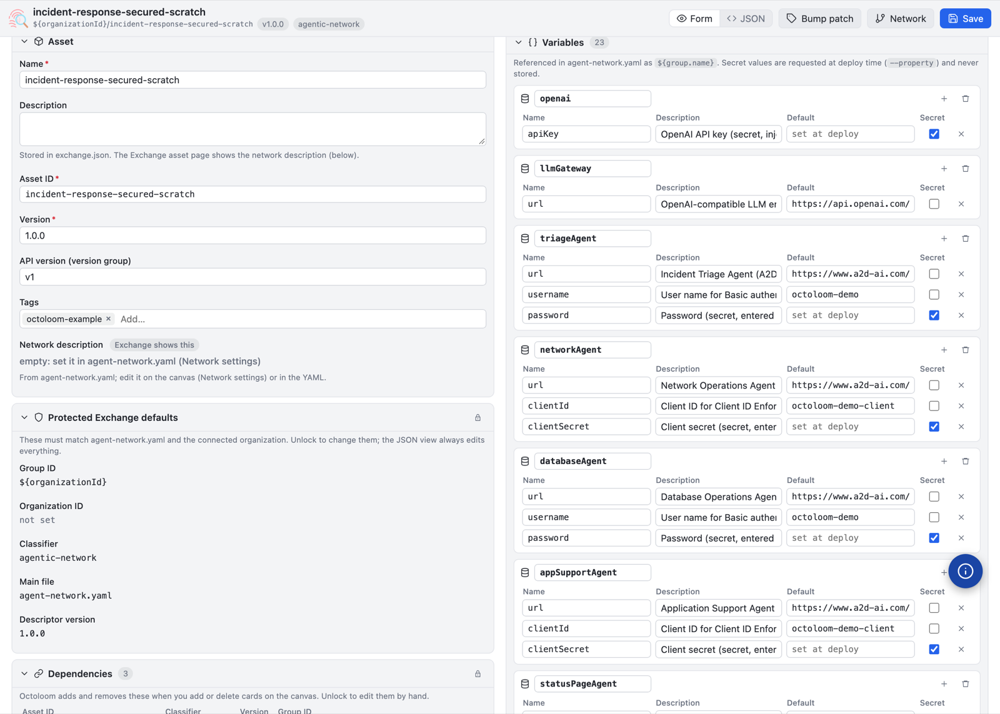

Also click **Remove it** on any **declared but not used** variable that the Problems bar shows.

### Step 3.6. Declare the MCP tools

On each MCP server card, click the **Tools** row (or its pencil). Octoloom reads the tool list from the running server: tick the tools below. You can also type a name in **Add a tool by name…**.

- **Service Health Monitoring MCP**: `get_service_health`
- **Incident Ticketing MCP**: `create_incident`, `page_oncall`

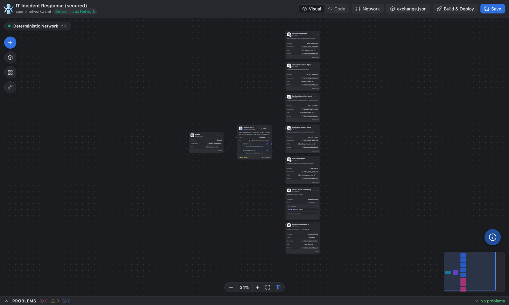

### Step 3.7. Link the agents and MCP servers to the broker

Every agent and MCP card now has a **Broker** row with **Link to Incident Response Broker**. Click it on each card. Octoloom adds the matching actions to the broker flow: one per agent and one per declared MCP tool.

**Link to** also reads the required inputs from the tool schema. In the flow (next step), open **Connections** in the explorer and check that these actions show them under **Inputs** (one per line; type them if they are missing):
- `create_incident`: `service: string`, `priority: string`

### Step 3.8. Build the broker flow

On the broker card (or in its inspector), click **Open broker flow**. Then set up the flow:

1. **Settings → Language Settings**: on the `default` model, set **Reasoning effort (OpenAI)** to `MINIMAL`.
2. **Settings → System Messages**: set the instructions to: *You are the incident commander. Classify first, then act. Customer communication only for P1.*
3. Select the `assistant` subagent and delete it (trash icon). The trigger and the built-in `done` reply stay.
4. Add the steps below in order. Select the step that comes before, click **Add node**, pick the kind and choose **Empty**, then set its **API name** in **General**. Octoloom wires each new step after the selected one, and you set the exact next step in the inspector.

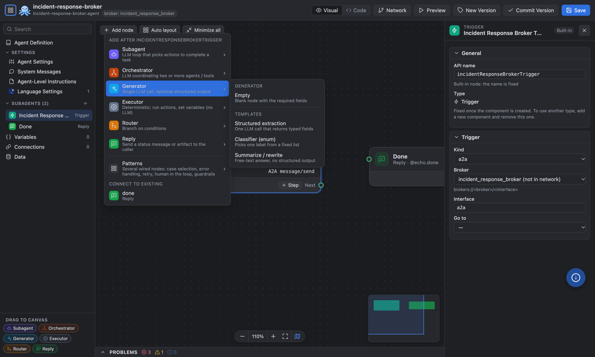

Select the trigger and, under **Go to**, pick `progressClassifyIncident` once that step exists.

#### Generator `classifyIncident`

- **Label** Classify Incident · **Description** Classifies the incident: service, priority and area.
- **System instructions**:

  > Extract the affected service (for example checkout-api, orders-db, vpn-zurich).
  > Priority is "p1" when all users or revenue are affected, "p2" when one team or region is affected, else "p3".
  > Area is "network" for VPN, DNS or connectivity, "database" for databases and replication, otherwise "application".

- **Prompt**:

  > {!@request.payload.message.parts[0].text}

- **Structured output** (**Add field** for each):
  - `service` (string): Affected service
  - `priority` (string): Incident priority · **Allowed values** `p1`, `p2`, `p3`
  - `area` (string): Technical area · **Allowed values** `network`, `database`, `application`
- **Next step (on exit) → Go to**: `progressOpenTicket`

#### Executor `openTicket`

- **Description** Every incident gets a ticket first (no LLM).
- **Steps (do)**: **Run action**
  - **Action** `create_incident`
    - **Bind argument** `service` = `@generator.classifyIncident.output.service`
    - **Bind argument** `priority` = `@generator.classifyIncident.output.priority`
- **Next step (on exit) → Go to**: `priorityRouter`

#### Router `priorityRouter`

- **Description** P1 is a major incident; the rest go to the specialist of the area.
- **Routes** (**+**): **Label** P1 · **When** `@generator.classifyIncident.output.priority == "p1"` · **Go to** `progressMajorIncident`
- **Routes** (**+**): **Label** Network · **When** `@generator.classifyIncident.output.area == "network"` · **Go to** `progressNetwork`
- **Routes** (**+**): **Label** Database · **When** `@generator.classifyIncident.output.area == "database"` · **Go to** `progressDatabase`
- **Otherwise → Go to**: `progressApplication`

#### Orchestrator `majorIncident`

- **Label** Major Incident · **Description** Pages on-call, triages, fixes and posts a status update.
- **System instructions**:

  > Page the on-call engineer, check the service health, ask the triage agent for the cause,
  > ask application support to fix it, then have the status page agent post an update. Summarise the timeline.

- **Reasoning instructions**:

  > P1 on {!@generator.classifyIncident.output.service}. Report: {!@request.payload.message.parts[0].text}

- **Actions** (**+ Add action…**): `page_oncall`, `get_service_health`, `triage_agent`, `app_support_agent`, `status_page_agent`
- **Limits → Max loops**: `8`
- **Next step (on exit) → Go to**: `majorDone`

#### Subagent `network`

- **Label** Network · **Description** Network specialist.
- **Reasoning instructions**:

  > Diagnose {!@generator.classifyIncident.output.service}: {!@request.payload.message.parts[0].text}

- **Actions** (**+ Add action…**): `get_service_health`, `network_agent`
- **Next step (on exit) → Go to**: `specialistDone`

#### Subagent `database`

- **Label** Database · **Description** Database specialist.
- **Reasoning instructions**:

  > Diagnose {!@generator.classifyIncident.output.service}: {!@request.payload.message.parts[0].text}

- **Actions** (**+ Add action…**): `get_service_health`, `database_agent`
- **Next step (on exit) → Go to**: `dbDone`

#### Subagent `application`

- **Label** Application · **Description** Application specialist.
- **Reasoning instructions**:

  > Diagnose {!@generator.classifyIncident.output.service}: {!@request.payload.message.parts[0].text}

- **Actions** (**+ Add action…**): `get_service_health`, `app_support_agent`
- **Next step (on exit) → Go to**: `appDone`

#### Reply `majorDone`

- **Use expression**, then **Message (expression)**: `"Major incident on " + @generator.classifyIncident.output.service + ". " + @orchestrator.majorIncident.output`
- **Task state**: `TASK_STATE_COMPLETED`

#### Reply `specialistDone`

- **Use expression**, then **Message (expression)**: `@generator.classifyIncident.output.service + " (" + @generator.classifyIncident.output.priority + "): " + @subagent.network.output`
- **Task state**: `TASK_STATE_COMPLETED`

#### Reply `dbDone`

- **Use expression**, then **Message (expression)**: `@generator.classifyIncident.output.service + " (" + @generator.classifyIncident.output.priority + "): " + @subagent.database.output`
- **Task state**: `TASK_STATE_COMPLETED`

#### Reply `appDone`

- **Use expression**, then **Message (expression)**: `@generator.classifyIncident.output.service + " (" + @generator.classifyIncident.output.priority + "): " + @subagent.application.output`
- **Task state**: `TASK_STATE_COMPLETED`

#### Reply `progressClassifyIncident`

- **Message text**: Classifying the incident: service, priority and area...
- **Task state**: `TASK_STATE_WORKING` (a progress update: the chat shows it while the broker works, then the flow goes on)
- **Next step (on exit) → Go to**: `classifyIncident`

#### Reply `progressOpenTicket`

- **Message text**: Opening the incident ticket...
- **Task state**: `TASK_STATE_WORKING` (a progress update: the chat shows it while the broker works, then the flow goes on)
- **Next step (on exit) → Go to**: `openTicket`

#### Reply `progressMajorIncident`

- **Message text**: Major incident: paging on-call, triaging, fixing and posting a status update...
- **Task state**: `TASK_STATE_WORKING` (a progress update: the chat shows it while the broker works, then the flow goes on)
- **Next step (on exit) → Go to**: `majorIncident`

#### Reply `progressNetwork`

- **Message text**: Handing over to the network specialist...
- **Task state**: `TASK_STATE_WORKING` (a progress update: the chat shows it while the broker works, then the flow goes on)
- **Next step (on exit) → Go to**: `network`

#### Reply `progressDatabase`

- **Message text**: Handing over to the database specialist...
- **Task state**: `TASK_STATE_WORKING` (a progress update: the chat shows it while the broker works, then the flow goes on)
- **Next step (on exit) → Go to**: `database`

#### Reply `progressApplication`

- **Message text**: Handing over to the application specialist...
- **Task state**: `TASK_STATE_WORKING` (a progress update: the chat shows it while the broker works, then the flow goes on)
- **Next step (on exit) → Go to**: `application`

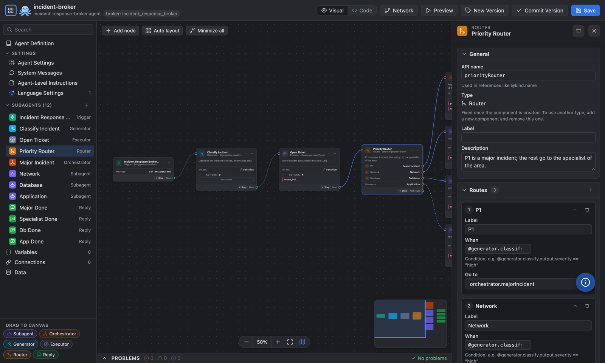

When you are done, the flow matches the template's flow ([Path 2, Step 4](#step-4-follow-the-broker-flow-agentscript)). The built-in `done` reply isn't used by this use case. The Problems bar shows **echo done is not reachable from the trigger** as a warning, and you can leave it.

### Step 3.9. Add the policies

Select the broker or connection, scroll to **Policies** and click **Add policy**. Pick the policy (search by name), choose the **Direction** and set its **Configuration** fields. **Header Injection** has its own header list. Octoloom also adds each policy as an `exchange.json` dependency.

- Broker `incident_response_broker`: **Rate Limiting** (inbound)
  - **rateLimits** (one entry each, **+**): maximumRequests `30`, timePeriodInMilliseconds `60000`
  - **exposeHeaders**: on
- Connection `triage_agent_connection`: **Message Logging (outbound)** (outbound)
  - **loggingConfiguration** (one entry each, **+**): itemName `Upstream calls`, itemData `{'message': '#[attributes.method ++ " " ++ attributes.requestPath]', 'level': 'INFO', 'firstSection': True, 'secondSection': False}`
- Connection `network_agent_connection`: **Message Logging (outbound)** (outbound)
  - **loggingConfiguration** (one entry each, **+**): itemName `Upstream calls`, itemData `{'message': '#[attributes.method ++ " " ++ attributes.requestPath]', 'level': 'INFO', 'firstSection': True, 'secondSection': False}`
- Connection `database_agent_connection`: **Message Logging (outbound)** (outbound)
  - **loggingConfiguration** (one entry each, **+**): itemName `Upstream calls`, itemData `{'message': '#[attributes.method ++ " " ++ attributes.requestPath]', 'level': 'INFO', 'firstSection': True, 'secondSection': False}`
- Connection `app_support_agent_connection`: **Message Logging (outbound)** (outbound)
  - **loggingConfiguration** (one entry each, **+**): itemName `Upstream calls`, itemData `{'message': '#[attributes.method ++ " " ++ attributes.requestPath]', 'level': 'INFO', 'firstSection': True, 'secondSection': False}`
- Connection `status_page_agent_connection`: **Message Logging (outbound)** (outbound)
  - **loggingConfiguration** (one entry each, **+**): itemName `Upstream calls`, itemData `{'message': '#[attributes.method ++ " " ++ attributes.requestPath]', 'level': 'INFO', 'firstSection': True, 'secondSection': False}`
- Connection `monitoring_mcp_connection`: **Message Logging (outbound)** (outbound)
  - **loggingConfiguration** (one entry each, **+**): itemName `Upstream calls`, itemData `{'message': '#[attributes.method ++ " " ++ attributes.requestPath]', 'level': 'INFO', 'firstSection': True, 'secondSection': False}`
- Connection `itsm_mcp_connection`: **Message Logging (outbound)** (outbound)
  - **loggingConfiguration** (one entry each, **+**): itemName `Upstream calls`, itemData `{'message': '#[attributes.method ++ " " ++ attributes.requestPath]', 'level': 'INFO', 'firstSection': True, 'secondSection': False}`

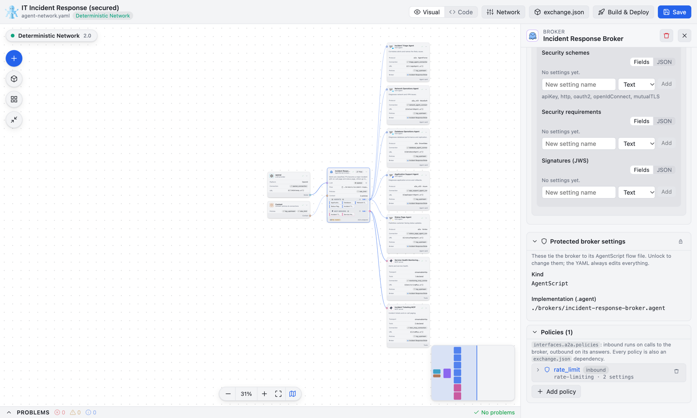

The template declares a policy once under `context.policies` and points to it from each connection. **Add policy** writes each policy on its connection instead. Both give the same result at runtime.

### Step 3.10. Validate, deploy and chat

Run **Validate** from the canvas CLI menu and fix anything in the Problems bar. Then follow Path 2 from [Validate and build](#step-5-validate-and-build) onwards: deploy (enter the secrets), wait for the green light, open the chat and send the same prompts. Your network answers like the template, because it is the same network, built by hand.

## What you learned

- How a deterministic network is built: an AgentScript flow decides every step; the LLM extracts and writes text.
- How the canvas, the inspector and the code view edit the same YAML.
- How to build the same network from a blank project with forms and menus only (Path 3).
- How policies are attached and checked with Governance.
- How authenticated connections use variables and secret variables.
- How to validate, build, deploy, chat and trace with Octoloom.

## Next

- Previous: [Supply Chain Disruption: governed](v2-supply-chain-governed.md)
- Next: [KYC / AML Onboarding: secured](v2-kyc-onboarding-secured.md)
- Same use case, plain variant: [IT Incident Response](v2-incident-response.md)
- Same use case, governed variant: [IT Incident Response: governed](v2-incident-response-governed.md)
- [All tutorials](index.md)

---
Generated from the `v2-incident-response-secured` template (Octoloom `media/templates/v2-incident-response-secured`). Screenshots use fake data.
