# Tutorial: Insurance Claims (FNOL to Payout)

[All tutorials](index.md) · [Getting started](../getting-started.md) · Deterministic network (Agent Network 2.0, AgentScript) · Use case

> Classify a claim, check coverage, gate on fraud risk, then settle through adjuster and payment agents.

| Agents | MCP servers | A2A | Policies | Template id |
|---|---|---|---|---|
| 4 | 2 | 1.0, 0.3.0 | 0 | `v2-insurance-claims` |

There are three ways to use this template:

1. **[Just use it](#path-1-just-use-it)**: create the project, deploy it and chat with it in about 10 minutes.
2. **[Learn step by step](#path-2-learn-step-by-step)**: the same steps, with what each part of the network does and how Octoloom shows it.
3. **[Build it from scratch](#path-3-build-it-from-scratch)**: start from a blank project and build the same network yourself, no code, one screenshot per step.

## Before you start

- VS Code with **Octoloom for Agent Fabric** installed (Marketplace), version 0.9.25 or later.
- An Anypoint organization with Agent Fabric, a connected app (client ID and secret), an environment and a Flex gateway.
- An OpenAI API key (or an OpenAI-compatible LLM gateway).
- Nothing else: all agents and MCP servers are public A²D mocks, so the network runs without any other system.

## Path 1: Just use it

1. **Home → Start → New Deterministic Network.** In the dialog pick **Use cases**, then the card **Insurance Claims (FNOL to Payout)**. Choose a folder and click **Create**.
2. **Deploy.** In **Projects & Deploy**, click **Deploy** on this project (or **Build & Deploy** in the editor) and pick your gateway. Octoloom asks for each secret variable; nothing you type is stored:
   - `openai.apiKey`: OpenAI API key (secret, injected at deploy time)
3. **Chat.** When the status light is green, click **Open chat** and paste:
   - `My car was hit in a parking lot, policy POL-5001`
   - `Water damage in the kitchen, policy POL-5002, about 18,000 CHF`
   - `Storm damage on my roof, policy POL-5003`

Done. The rest of this page explains what you just ran.

## Path 2: Learn step by step

### Step 1. Connect Octoloom

Open **Setup & Connect** (Octoloom side bar) and connect **Agent Fabric**: the connected app client ID and secret and the organization. Pick the environment. A²D isn't needed: the mock URLs are already the defaults in `exchange.json`. The Tooling list shows Node.js, Java and anypoint-cli-v4 with its agent-network plugin. Use **Install** or **Repair** on any red row.

### Step 2. Create the project from the template

On **Home**, click **New Deterministic Network**. In **2 Start from**, choose **Use cases** and click **Insurance Claims (FNOL to Payout)**. The right side shows the template README: what it contains, **Deploy in 3 steps** and **Try it**. Keep the suggested name `insurance-claims` or type your own, pick the folder and click **Create**.

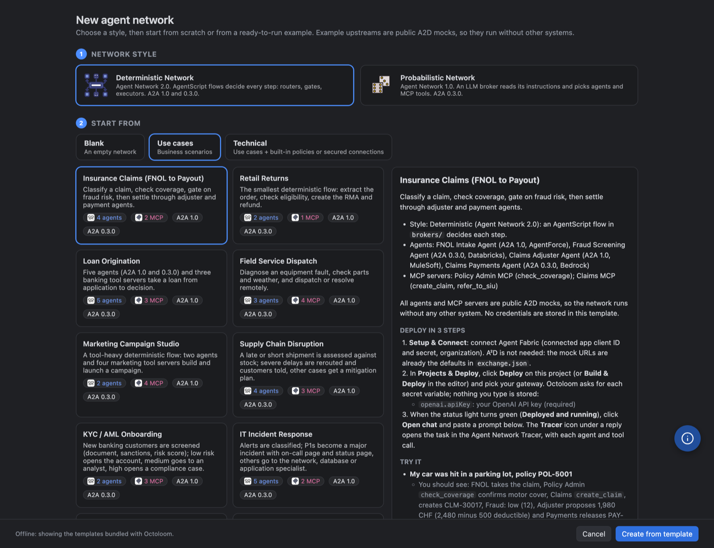

Octoloom writes `agent-network.yaml`, `exchange.json`, `README.md` and the broker flow in `brokers/`, and opens the canvas. Every id gets the template prefix `octo_ic2_`, so several templates can be deployed into one org side by side.

### Step 3. Read the network on the canvas

Each card is a part of `agent-network.yaml`. Click one to open it in the inspector on the right. Each change in the inspector is a change to the text, so the YAML stays the source of truth (**Code** view shows it).

- **Broker Claims Broker** (`octo_ic2_claims_broker`): its AgentScript flow decides every step.
- **Agent FNOL Intake Agent**: Captures the first notice of loss with all required facts.
- **Agent Fraud Screening Agent**: Scores claims for fraud indicators.
- **Agent Claims Adjuster Agent**: Estimates the loss and proposes a settlement.
- **Agent Claims Payments Agent**: Pays settled claims.
- **MCP server Policy Admin MCP**: Policy administration: coverage checks. Tools: `check_coverage`.
- **MCP server Claims MCP**: Claims system of record. Tools: `create_claim`, `refer_to_siu`.

Try this on the canvas: use the zoom bar and the minimap, drag a card, or **Auto layout**. The layout is saved per file. **Minimize all** turns the cards into icon tiles. Click a connection line to see which broker uses which agent or tool.

### Step 4. Follow the broker flow (AgentScript)

Double-click the broker card (or open `brokers/claims-broker.agent`). The flow editor shows the AgentScript program that decides every step. The LLM only extracts fields and writes text, so the same input always takes the same branch.

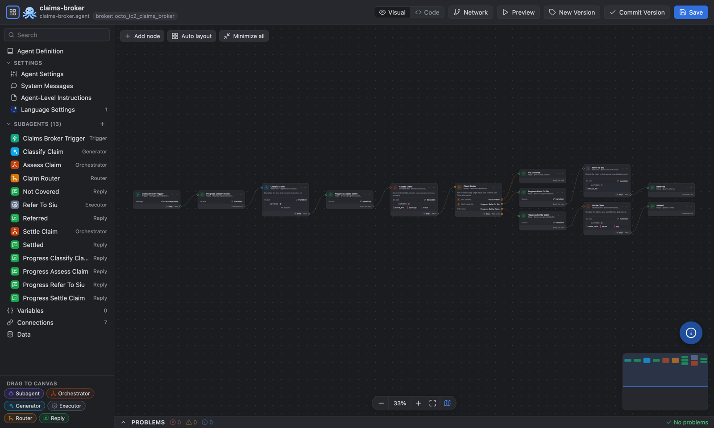

| Step | Kind | What it does |
|---|---|---|
| `claimsBrokerTrigger` | Trigger | Starts the flow when an A2A message arrives at the broker. |
| `classifyClaim` | Generator | Classifies the loss and extracts the policy id. |
| `assessClaim` | Orchestrator | Records the FNOL, checks coverage and screens for fraud. |
| `claimRouter` | Router | Not covered: stop. High fraud risk: refer to SIU. Otherwise settle. |
| `notCovered` | Echo | Ends the flow with the `notCovered` reply. |
| `referToSiu` | Executor | Refers the claim to the special investigations unit. |
| `referred` | Echo | Ends the flow with the `referred` reply. |
| `settleClaim` | Orchestrator | Creates the claim, gets a settlement and pays it. |
| `settled` | Echo | Ends the flow with the `settled` reply. |
| `progressClassifyClaim` | Echo | Progress update (`TASK_STATE_WORKING`): tells the caller what comes next, then goes on to that step. With **Live** on, the chat shows it while the broker works. |
| `progressAssessClaim` | Echo | Progress update (`TASK_STATE_WORKING`): tells the caller what comes next, then goes on to that step. With **Live** on, the chat shows it while the broker works. |
| `progressReferToSiu` | Echo | Progress update (`TASK_STATE_WORKING`): tells the caller what comes next, then goes on to that step. With **Live** on, the chat shows it while the broker works. |
| `progressSettleClaim` | Echo | Progress update (`TASK_STATE_WORKING`): tells the caller what comes next, then goes on to that step. With **Live** on, the chat shows it while the broker works. |

Click a step to edit it in the inspector. **+ Step** adds a node, and **+ Step → Patterns** inserts whole shapes such as retry, human in the loop or a guardrail check. **Code** shows the `.agent` text with completion.

### Step 5. Validate and build

In the canvas toolbar, open the CLI menu: **Validate** does a dry run of build, publish and deploy and lists problems in the Problems panel (click one to jump to the card). **Build** repairs and packages the project locally with anypoint-cli-v4.

The variables of this template (in `exchange.json`, open it for the no-code form):

| Variable | What | Default |
|---|---|---|
| `fnolAgent.url` | FNOL Intake Agent (A2D mock, A2A 1.0) URL | `https://www.a2d-ai.com/api/platform/2fba0256-4819-484e-a00a-5a622f41c178/a2a` |
| `fraudAgent.url` | Fraud Screening Agent (A2D mock, A2A 0.3.0) URL | `https://www.a2d-ai.com/api/platform/d6dbd985-7aa4-4629-be75-860b1fb9d7f0/a2a` |
| `adjusterAgent.url` | Claims Adjuster Agent (A2D mock, A2A 1.0) URL | `https://www.a2d-ai.com/api/platform/8e75ca41-b1ce-4dd8-b84c-90c80d864ce9/a2a` |
| `paymentsAgent.url` | Claims Payments Agent (A2D mock, A2A 0.3.0) URL | `https://www.a2d-ai.com/api/platform/4b5b6ba6-bbc0-48f2-a8f5-fdbe4af3f0bf/a2a` |
| `policyAdminMcp.url` | Policy Admin MCP (A2D mock) base URL | `https://www.a2d-ai.com/api/platform/8de15fa9-276c-459f-8243-c4b4c882fcb1/` |
| `claimsMcp.url` | Claims MCP (A2D mock) base URL | `https://www.a2d-ai.com/api/platform/587c6f66-199a-4a79-b1d4-5c77953ee271/` |

### Step 6. Deploy

Open **Projects & Deploy** and click **Deploy** on the project (or **Deploy…** on the canvas). Pick your gateway (the chips show its status and space), keep **Tracing**, **Wait until the network is ready** and **Publish before deploy** on, then enter the secrets. Nothing you type is stored:

- `openai.apiKey`: OpenAI API key (secret, injected at deploy time)

The square status light goes from blue (deploying) to green (**Deployed and running**). The deployment box lists every broker URL; click one to copy it.

### Step 7. Chat with the broker

Click **Open chat** on the deployment box. On the left is the network (the cards light up as they are called), and on the right is the conversation with its task states. Paste the prompts one at a time:

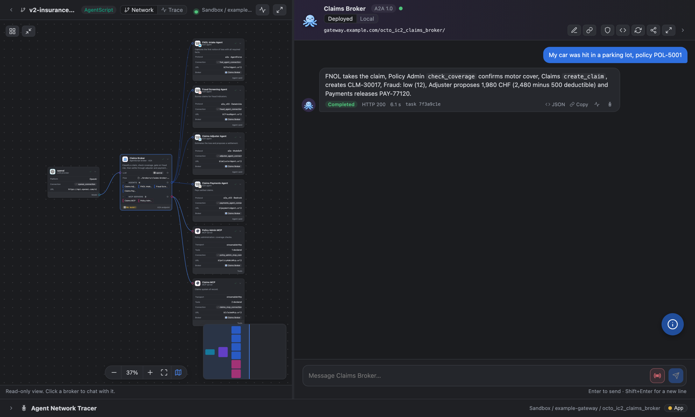

*The reply in the screenshot is an illustration: it shows what the broker answers. The real wording changes from run to run.*

| Prompt | You should see |
|---|---|
| `My car was hit in a parking lot, policy POL-5001` | FNOL takes the claim, Policy Admin `check_coverage` confirms motor cover, Claims `create_claim`, creates CLM-30017, Fraud: low (12), Adjuster proposes 1,980 CHF (2,480 minus 500 deductible) and Payments releases PAY-77120. |
| `Water damage in the kitchen, policy POL-5002, about 18,000 CHF` | Fraud risk high (82): new policy and amount above 10,000 CHF. Claims `refer_to_siu` opens SIU-0091 (investigator R. Meier). No payment. |
| `Storm damage on my roof, policy POL-5003` | Policy Admin: the policy lapsed. The flow ends in the not-covered branch. |

The broker is deterministic: the branches are fixed in the flow in `brokers/` (open the `.agent` file to see them). The LLM only reads the ids from your prompt and writes the reply text, so the same input takes the same branch.

### Step 8. Trace a reply

Under each reply, the **Tracer** icon opens the task in the **Agent Network Tracer**: a waterfall of every call the broker made (gateway, broker, LLM, A2A agents, MCP tools) on one time axis, coloured like the cards. Errors are red. Click a span to see its request and response. The **Network** view shows the same reply as a sequence of calls.

### Step 9. Share it (optional)

The **Share** icon in the chat header opens the Share dialog. **A²D sessions** invites people by email to chat with this deployed broker and brings their passed / failed marks and comments back. **Local portal** generates a small web chat you can run or host anywhere.

## Path 3: Build it from scratch

Here you build the same network yourself, starting from a blank project. Every step uses a form, a menu or a button. You never import the template, and you never type YAML or AgentScript. The names below are the template's names without the `octo_ic2_` prefix. You can use your own names, but keep them consistent.

> The text fields take plain values. Where a value looks like `${group.name}`, type it as shown: it is a **variable** that `exchange.json` declares and that deploy fills in.

### Step 3.1. Create a blank project with a starter broker

Connect Octoloom first, as in [Path 2, Step 1](#step-1-connect-octoloom). Then, on **Home**, click **New Deterministic Network**. In **2 Start from**, choose **Blank** and turn on **Add a starter broker**.

- **Broker name**: `Claims Broker`
- **Name**: `insurance-claims-scratch` (the Exchange asset id; a different name from the template, so both can live in one org)
- **Parent folder**: pick a folder, then click **Create blank project**.

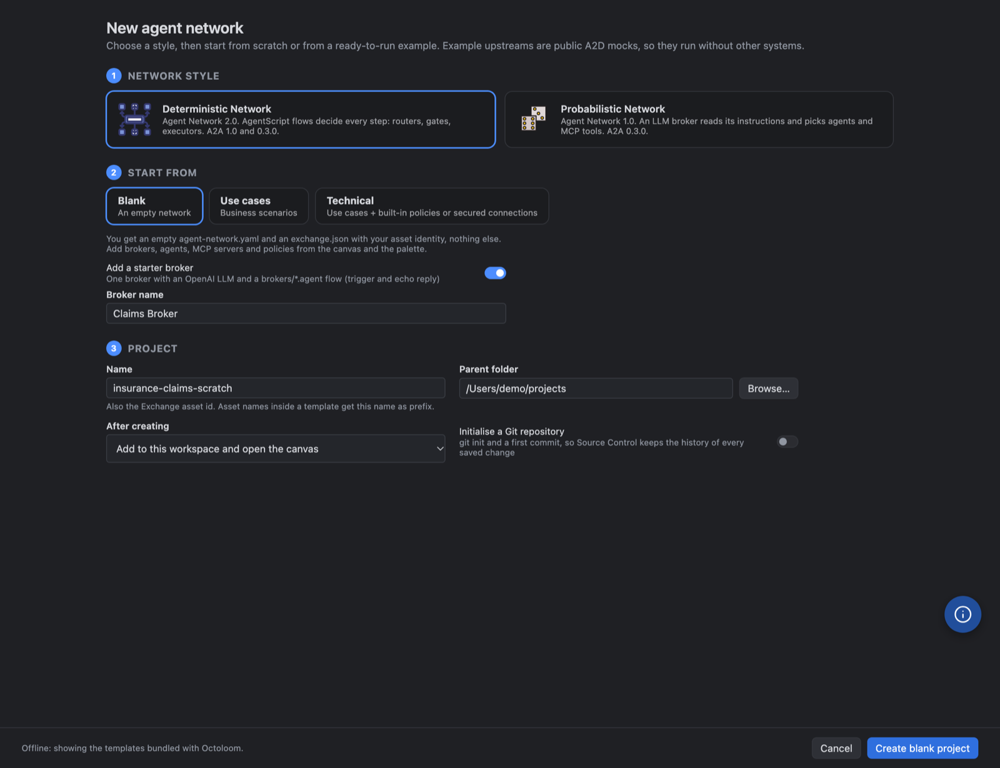

The starter broker `claims_broker` has an OpenAI LLM connection (`openai_connection`, MuleSoft's published OpenAI LLM) and a flow `brokers/claims-broker.agent` with a trigger, one subagent and the built-in `done` reply. The LLM is already done.

### Step 3.2. Add the agents

On the canvas, click **+** (Add to the network) → **Agent** → **Empty**. The new agent opens in the inspector on the right. Fill it in, then repeat for each agent:

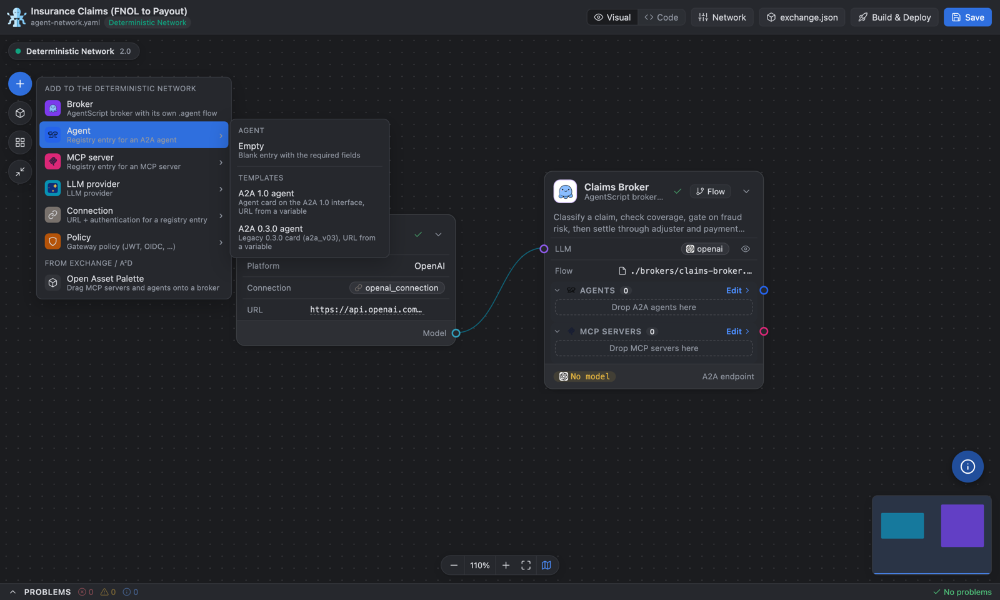

- **FNOL Intake Agent**
  - **Identity → Key**: `fnol_agent`
  - **Info → Label**: FNOL Intake Agent · **Description**: Captures the first notice of loss with all required facts.
  - **Metadata → Platform**: `AgentForce` (or click its icon under **Agent framework**)
  - **Interface**: click `a2a` (A2A 1.0). **Agent card (A2A 1.x)**: **Name** FNOL Intake Agent, **Description** as above, **Supported interfaces → URL** `https://www.a2d-ai.com/api/platform/2fba0256-4819-484e-a00a-5a622f41c178/a2a`, Binding `JSONRPC`, Protocol version `1.0`
- **Fraud Screening Agent**
  - **Identity → Key**: `fraud_agent`
  - **Info → Label**: Fraud Screening Agent · **Description**: Scores claims for fraud indicators.
  - **Metadata → Platform**: `Databricks` (or click its icon under **Agent framework**)
  - **Interface**: keep `a2a_v03` (A2A 0.3.0). **Agent card (A2A 0.3)**: **Name** Fraud Screening Agent, **Description** as above, **URL** `https://www.a2d-ai.com/api/platform/d6dbd985-7aa4-4629-be75-860b1fb9d7f0/a2a`
- **Claims Adjuster Agent**
  - **Identity → Key**: `adjuster_agent`
  - **Info → Label**: Claims Adjuster Agent · **Description**: Estimates the loss and proposes a settlement.
  - **Metadata → Platform**: `MuleSoft` (or click its icon under **Agent framework**)
  - **Interface**: click `a2a` (A2A 1.0). **Agent card (A2A 1.x)**: **Name** Claims Adjuster Agent, **Description** as above, **Supported interfaces → URL** `https://www.a2d-ai.com/api/platform/8e75ca41-b1ce-4dd8-b84c-90c80d864ce9/a2a`, Binding `JSONRPC`, Protocol version `1.0`
- **Claims Payments Agent**
  - **Identity → Key**: `payments_agent`
  - **Info → Label**: Claims Payments Agent · **Description**: Pays settled claims.
  - **Metadata → Platform**: `Bedrock` (or click its icon under **Agent framework**)
  - **Interface**: keep `a2a_v03` (A2A 0.3.0). **Agent card (A2A 0.3)**: **Name** Claims Payments Agent, **Description** as above, **URL** `https://www.a2d-ai.com/api/platform/4b5b6ba6-bbc0-48f2-a8f5-fdbe4af3f0bf/a2a`

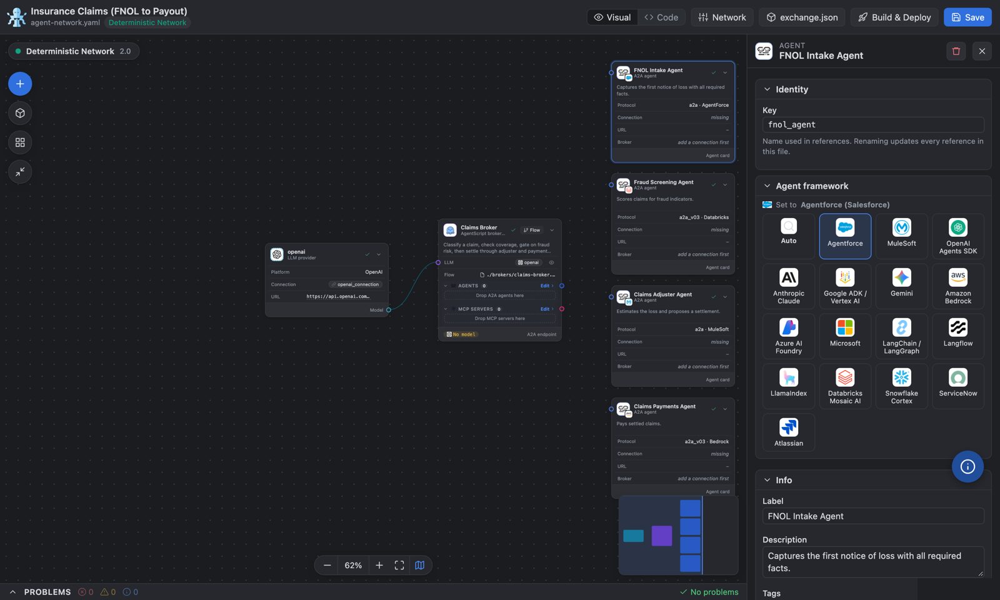

The card skills are optional. Once the agent has a connection (two steps on), the inspector offers **Read skills from the live agent**, which fills them from the running agent.

### Step 3.3. Add the MCP servers

Click **+** → **MCP server** → **Empty**, then fill in:

- **Policy Admin MCP**: **Key** `policy_admin_mcp`, **Label** Policy Admin MCP, **Description** Policy administration: coverage checks · **Protocol version** `2025-06-18`. The transport is already Streamable HTTP on `/mcp`.
- **Claims MCP**: **Key** `claims_mcp`, **Label** Claims MCP, **Description** Claims system of record · **Protocol version** `2025-06-18`. The transport is already Streamable HTTP on `/mcp`.

### Step 3.4. Add the connections

A connection is the URL (and authentication) Agent Fabric uses to reach an agent or an MCP server. Click **+** → **Connection** → **Empty** once per agent and MCP server, and fill in:

| Key | Kind | Registry entry → Name | URL |
|---|---|---|---|
| `fnol_agent_connection` | `a2a` | `fnol_agent` | `${fnolAgent.url}` |
| `fraud_agent_connection` | `a2a` | `fraud_agent` | `${fraudAgent.url}` |
| `adjuster_agent_connection` | `a2a` | `adjuster_agent` | `${adjusterAgent.url}` |
| `payments_agent_connection` | `a2a` | `payments_agent` | `${paymentsAgent.url}` |
| `policy_admin_mcp_connection` | `mcp` | `policy_admin_mcp` | `${policyAdminMcp.url}` |
| `claims_mcp_connection` | `mcp` | `claims_mcp` | `${claimsMcp.url}` |

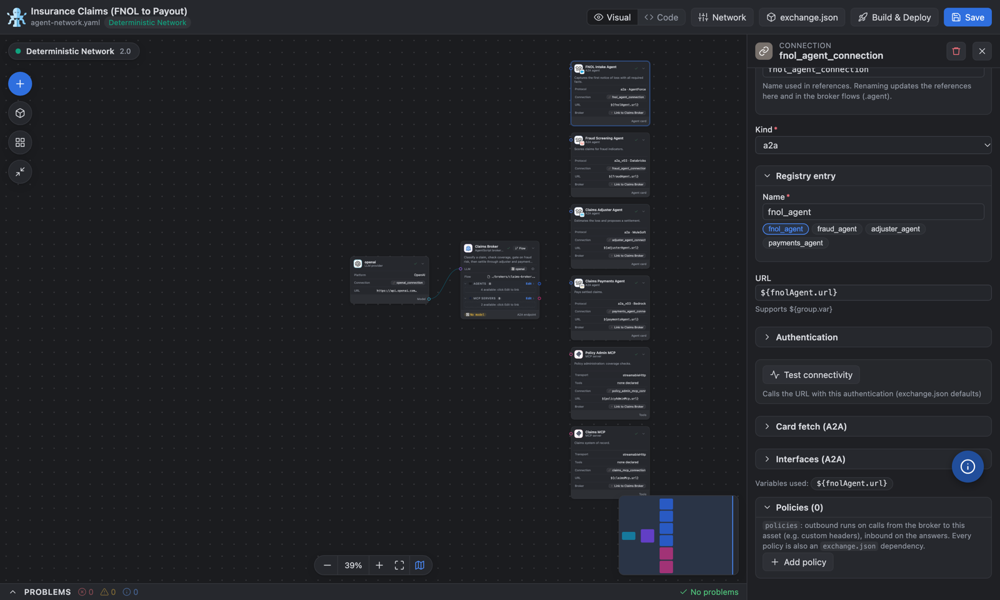

### Step 3.5. Declare the variables

The Problems bar now shows **Variable ${…} is not declared in exchange.json** for each new variable. Click **Add to exchange.json** on each one.

Then open `exchange.json` (it opens as a form) and, under **Variables**, set the defaults:

| Variable | Default |
|---|---|
| `fnolAgent.url` | `https://www.a2d-ai.com/api/platform/2fba0256-4819-484e-a00a-5a622f41c178/a2a` |
| `fraudAgent.url` | `https://www.a2d-ai.com/api/platform/d6dbd985-7aa4-4629-be75-860b1fb9d7f0/a2a` |
| `adjusterAgent.url` | `https://www.a2d-ai.com/api/platform/8e75ca41-b1ce-4dd8-b84c-90c80d864ce9/a2a` |
| `paymentsAgent.url` | `https://www.a2d-ai.com/api/platform/4b5b6ba6-bbc0-48f2-a8f5-fdbe4af3f0bf/a2a` |
| `policyAdminMcp.url` | `https://www.a2d-ai.com/api/platform/8de15fa9-276c-459f-8243-c4b4c882fcb1/` |
| `claimsMcp.url` | `https://www.a2d-ai.com/api/platform/587c6f66-199a-4a79-b1d4-5c77953ee271/` |

Leave the secret variables (`openai.apiKey`) empty: deploy asks for them and never stores them.

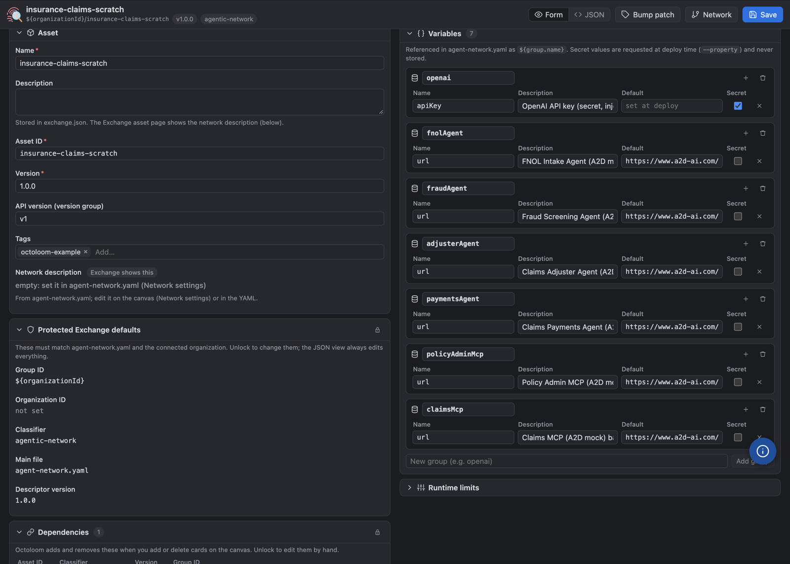

Also click **Remove it** on any **declared but not used** variable that the Problems bar shows.

### Step 3.6. Declare the MCP tools

On each MCP server card, click the **Tools** row (or its pencil). Octoloom reads the tool list from the running server: tick the tools below. You can also type a name in **Add a tool by name…**.

- **Policy Admin MCP**: `check_coverage`
- **Claims MCP**: `create_claim`, `refer_to_siu`

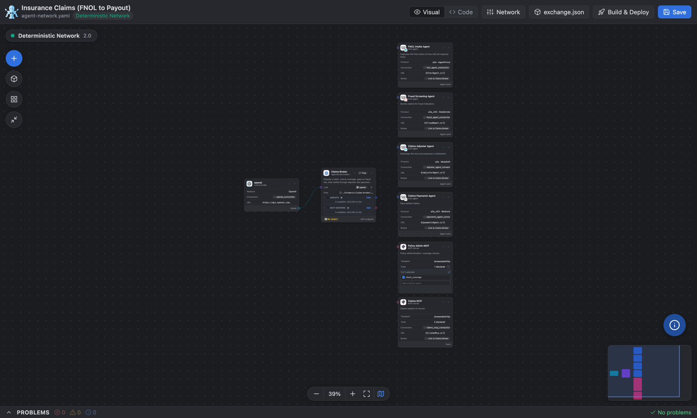

### Step 3.7. Link the agents and MCP servers to the broker

Every agent and MCP card now has a **Broker** row with **Link to Claims Broker**. Click it on each card. Octoloom adds the matching actions to the broker flow: one per agent and one per declared MCP tool.

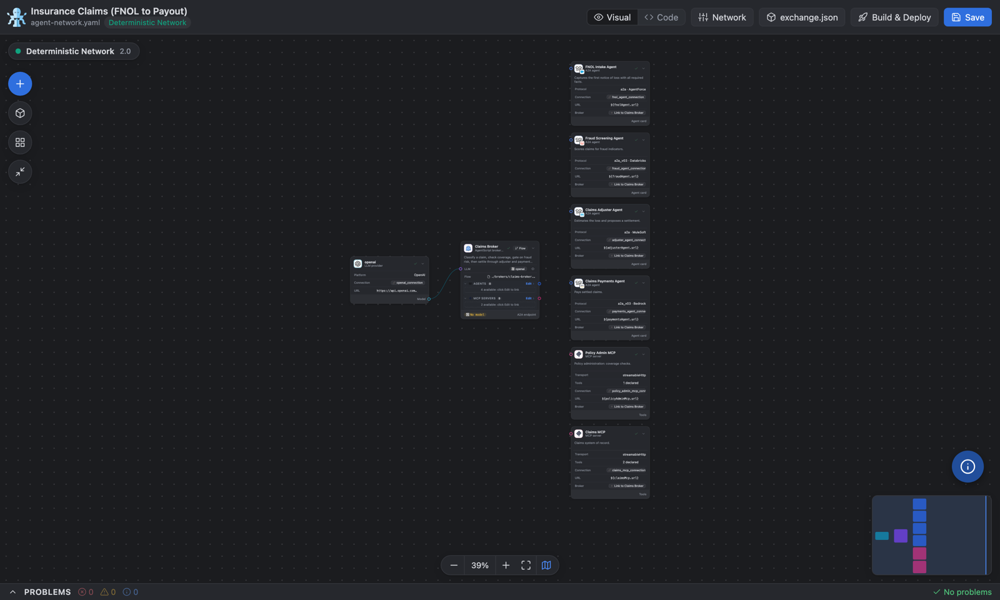

**Link to** also reads the required inputs from the tool schema. In the flow (next step), open **Connections** in the explorer and check that these actions show them under **Inputs** (one per line; type them if they are missing):
- `refer_to_siu`: `policy_id: string`, `reason: string`

### Step 3.8. Build the broker flow

On the broker card (or in its inspector), click **Open broker flow**. Then set up the flow:

1. **Settings → Language Settings**: on the `default` model, set **Reasoning effort (OpenAI)** to `MINIMAL`.
2. **Settings → System Messages**: set the instructions to: *You are a claims handler. Every claim is checked for coverage and fraud before any money moves.*
3. Select the `assistant` subagent and delete it (trash icon). The trigger and the built-in `done` reply stay.
4. Add the steps below in order. Select the step that comes before, click **Add node**, pick the kind and choose **Empty**, then set its **API name** in **General**. Octoloom wires each new step after the selected one, and you set the exact next step in the inspector.

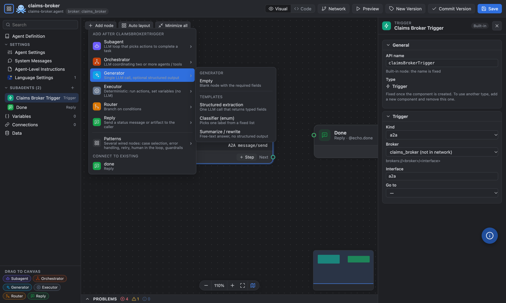

Select the trigger and, under **Go to**, pick `progressClassifyClaim` once that step exists.

#### Generator `classifyClaim`

- **Label** Classify Claim · **Description** Classifies the loss and extracts the policy id.
- **System instructions**:

  > Extract the policy id (for example POL-5001), the loss type and a one-line summary.
  > Loss type is "motor" for vehicles and "property" for homes and buildings.

- **Prompt**:

  > {!@request.payload.message.parts[0].text}

- **Structured output** (**Add field** for each):
  - `policy_id` (string): Policy id, e.g. POL-5001
  - `loss_type` (string): Type of loss · **Allowed values** `motor`, `property`
  - `summary` (string): One-line loss summary
- **Next step (on exit) → Go to**: `progressAssessClaim`

#### Orchestrator `assessClaim`

- **Label** Assess Claim · **Description** Records the FNOL, checks coverage and screens for fraud.
- **System instructions**:

  > 1. Record the first notice of loss with the FNOL agent.
  > 2. Check coverage for the policy and loss type.
  > 3. Ask the Fraud Screening agent for a risk level.
  > Set covered to "yes" or "no" from the coverage tool and fraud_risk to "high" or "low" from the fraud agent.

- **Reasoning instructions**:

  > Policy {!@generator.classifyClaim.output.policy_id}, {!@generator.classifyClaim.output.loss_type}: {!@request.payload.message.parts[0].text}

- **Actions** (**+ Add action…**): `fnol_agent`, `check_coverage`, `fraud_agent`
- **Limits → Max loops**: `6`
- **Structured output** (**Add field** for each):
  - `covered` (string): Coverage result · **Allowed values** `yes`, `no`
  - `fraud_risk` (string): Fraud risk level · **Allowed values** `high`, `low`
  - `detail` (string): What was found
- **Next step (on exit) → Go to**: `claimRouter`

#### Router `claimRouter`

- **Description** Not covered: stop. High fraud risk: refer to SIU. Otherwise settle.
- **Routes** (**+**): **Label** Not covered · **When** `@orchestrator.assessClaim.output.covered == "no"` · **Go to** `notCovered`
- **Routes** (**+**): **Label** High fraud risk · **When** `@orchestrator.assessClaim.output.fraud_risk == "high"` · **Go to** `progressReferToSiu`
- **Otherwise → Go to**: `progressSettleClaim`

#### Reply `notCovered`

- **Use expression**, then **Message (expression)**: `"Claim not covered for policy " + @generator.classifyClaim.output.policy_id + ": " + @orchestrator.assessClaim.output.detail`
- **Task state**: `TASK_STATE_COMPLETED`

#### Executor `referToSiu`

- **Description** Refers the claim to the special investigations unit.
- **Steps (do)**: **Run action**
  - **Action** `refer_to_siu`
    - **Bind argument** `policy_id` = `@generator.classifyClaim.output.policy_id`
    - **Bind argument** `reason` = `"High fraud risk score"`
- **Next step (on exit) → Go to**: `referred`

#### Reply `referred`

- **Use expression**, then **Message (expression)**: `"Claim for policy " + @generator.classifyClaim.output.policy_id + " was referred to special investigations. A specialist will contact you."`
- **Task state**: `TASK_STATE_COMPLETED`

#### Orchestrator `settleClaim`

- **Label** Settle Claim · **Description** Creates the claim, gets a settlement and pays it.
- **System instructions**:

  > Create the claim record, ask the adjuster for a settlement proposal, then pay it with the payments agent.
  > Return a short summary with the claim id, settlement amount and payment id.

- **Reasoning instructions**:

  > Policy {!@generator.classifyClaim.output.policy_id}, {!@generator.classifyClaim.output.loss_type}: {!@generator.classifyClaim.output.summary}

- **Actions** (**+ Add action…**): `create_claim`, `adjuster_agent`, `payments_agent`
- **Limits → Max loops**: `8`
- **Next step (on exit) → Go to**: `settled`

#### Reply `settled`

- **Use expression**, then **Message (expression)**: `@orchestrator.settleClaim.output`
- **Task state**: `TASK_STATE_COMPLETED`

#### Reply `progressClassifyClaim`

- **Message text**: Classifying the loss and reading the policy id...
- **Task state**: `TASK_STATE_WORKING` (a progress update: the chat shows it while the broker works, then the flow goes on)
- **Next step (on exit) → Go to**: `classifyClaim`

#### Reply `progressAssessClaim`

- **Message text**: Recording the FNOL, checking coverage and screening for fraud...
- **Task state**: `TASK_STATE_WORKING` (a progress update: the chat shows it while the broker works, then the flow goes on)
- **Next step (on exit) → Go to**: `assessClaim`

#### Reply `progressReferToSiu`

- **Message text**: Referring the claim to the special investigations unit...
- **Task state**: `TASK_STATE_WORKING` (a progress update: the chat shows it while the broker works, then the flow goes on)
- **Next step (on exit) → Go to**: `referToSiu`

#### Reply `progressSettleClaim`

- **Message text**: Creating the claim, getting a settlement and paying it...
- **Task state**: `TASK_STATE_WORKING` (a progress update: the chat shows it while the broker works, then the flow goes on)
- **Next step (on exit) → Go to**: `settleClaim`

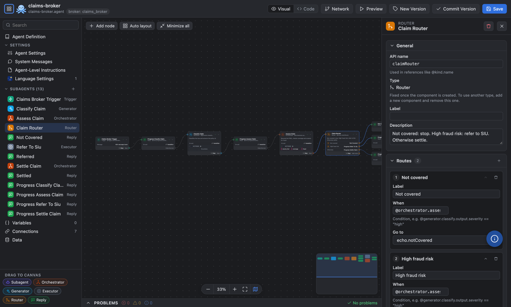

When you are done, the flow matches the template's flow ([Path 2, Step 4](#step-4-follow-the-broker-flow-agentscript)). The built-in `done` reply isn't used by this use case. The Problems bar shows **echo done is not reachable from the trigger** as a warning, and you can leave it.

### Step 3.9. Validate, deploy and chat

Run **Validate** from the canvas CLI menu and fix anything in the Problems bar. Then follow Path 2 from [Validate and build](#step-5-validate-and-build) onwards: deploy (enter the secrets), wait for the green light, open the chat and send the same prompts. Your network answers like the template, because it is the same network, built by hand.

## What you learned

- How a deterministic network is built: an AgentScript flow decides every step; the LLM extracts and writes text.
- How the canvas, the inspector and the code view edit the same YAML.
- How to build the same network from a blank project with forms and menus only (Path 3).
- How to validate, build, deploy, chat and trace with Octoloom.

## Next

- Previous: [IT Incident Response](v2-incident-response.md)
- Next: [KYC / AML Onboarding](v2-kyc-onboarding.md)
- Same use case, governed variant: [Insurance Claims (FNOL to Payout): governed](v2-insurance-claims-governed.md)
- [All tutorials](index.md)

---
Generated from the `v2-insurance-claims` template (Octoloom `media/templates/v2-insurance-claims`). Screenshots use fake data.
