# Tutorial: KYC / AML Onboarding

[All tutorials](index.md) · [Getting started](../getting-started.md) · Deterministic network (Agent Network 2.0, AgentScript) · Use case

> New banking customers are screened (document, sanctions, risk score); low risk opens the account, medium goes to an analyst, high opens a compliance case.

| Agents | MCP servers | A2A | Policies | Template id |
|---|---|---|---|---|
| 2 | 3 | 1.0, 0.3.0 | 0 | `v2-kyc-onboarding` |

There are three ways to use this template:

1. **[Just use it](#path-1-just-use-it)**: create the project, deploy it and chat with it in about 10 minutes.
2. **[Learn step by step](#path-2-learn-step-by-step)**: the same steps, with what each part of the network does and how Octoloom shows it.
3. **[Build it from scratch](#path-3-build-it-from-scratch)**: start from a blank project and build the same network yourself, no code, one screenshot per step.

## Before you start

- VS Code with **Octoloom for Agent Fabric** installed (Marketplace), version 0.9.25 or later.
- An Anypoint organization with Agent Fabric, an environment, a [Small Managed Omni Gateway](../start/gateway.md) and a [connected app](../start/connected-app.md) (client ID and secret). New to Anypoint? **[Before you start](../start/index.md)** shows the trial account, the gateway, the connected app and connecting Octoloom, step by step with videos.
- An OpenAI API key (or an OpenAI-compatible LLM gateway).
- Nothing else: all agents and MCP servers are public A²D mocks, so the network runs without any other system.

## Path 1: Just use it

1. **Home → Start → New Deterministic Network.** In the dialog pick **Use cases**, then the card **KYC / AML Onboarding**. Choose a folder and click **Create**.
2. **Deploy.** In **Projects & Deploy**, click **Deploy** on this project (or **Build & Deploy** in the editor) and pick your gateway. Octoloom asks for each secret variable; nothing you type is stored:
   - `openai.apiKey`: OpenAI API key (secret, injected at deploy time)
3. **Chat.** When the status light is green, click **Open chat** and paste:
   - `Onboard applicant AP-7001, Lena Novak, from Austria`
   - `Onboard applicant AP-7002 from Germany`
   - `Onboard applicant AP-7003, Victor Example, from Panama`
   - `Onboard applicant AP-9999`

Done. The rest of this page explains what you just ran.

## Path 2: Learn step by step

### Step 1. Connect Octoloom

Open **Setup & Connect** (Octoloom side bar) and connect **Agent Fabric**: the connected app client ID and secret and the organization. Pick the environment. A²D isn't needed: the mock URLs are already the defaults in `exchange.json`. The Tooling list shows Node.js, Java and anypoint-cli-v4 with its agent-network plugin. Use **Install** or **Repair** on any red row.

### Step 2. Create the project from the template

On **Home**, click **New Deterministic Network**. In **2 Start from**, choose **Use cases** and click **KYC / AML Onboarding**. The right side shows the template README: what it contains, **Deploy in 3 steps** and **Try it**. Keep the suggested name `kyc-onboarding` or type your own, pick the folder and click **Create**.

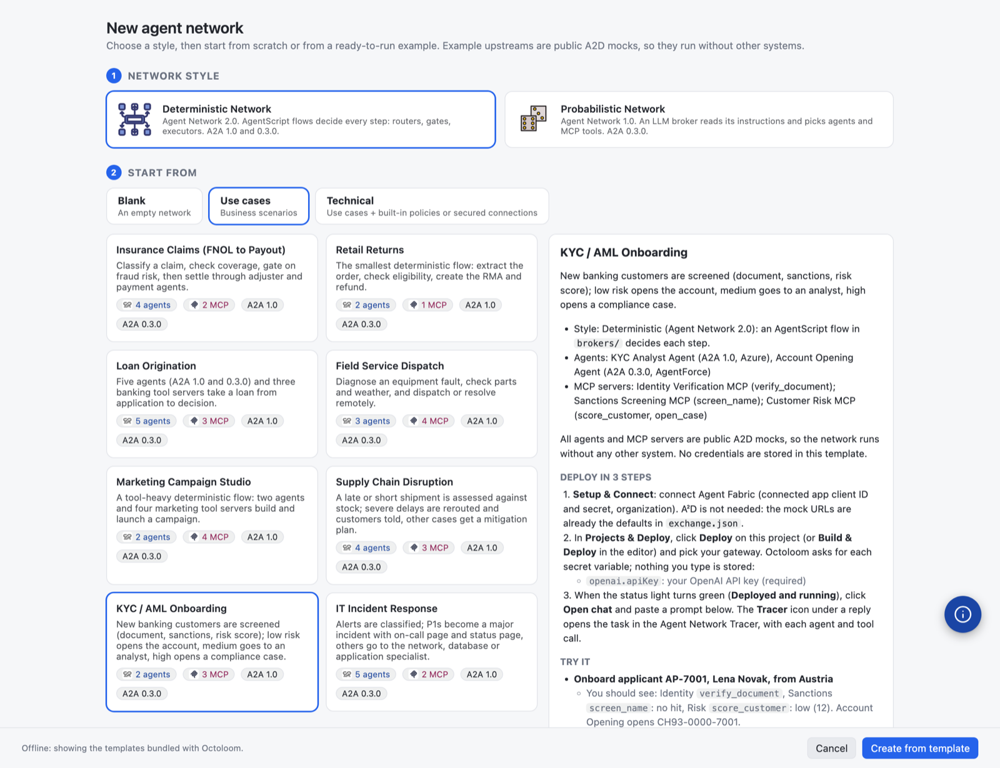

Octoloom writes `agent-network.yaml`, `exchange.json`, `README.md` and the broker flow in `brokers/`, and opens the canvas. Every id gets the template prefix `octo_ko2_`, so several templates can be deployed into one org side by side.

### Step 3. Read the network on the canvas

Each card is a part of `agent-network.yaml`. Click one to open it in the inspector on the right. Each change in the inspector is a change to the text, so the YAML stays the source of truth (**Code** view shows it).

- **Broker KYC Onboarding Broker** (`octo_ko2_kyc_broker`): its AgentScript flow decides every step.
- **Agent KYC Analyst Agent**: Reviews medium-risk applicants and asks for extra documents.
- **Agent Account Opening Agent**: Opens the account and sends the welcome pack.
- **MCP server Identity Verification MCP**: ID document checks. Tools: `verify_document`.
- **MCP server Sanctions Screening MCP**: Sanctions and PEP lists (fictional). Tools: `screen_name`.
- **MCP server Customer Risk MCP**: Risk scoring and compliance cases. Tools: `score_customer`, `open_case`.

Try this on the canvas: use the zoom bar and the minimap, drag a card, or **Auto layout**. The layout is saved per file. **Minimize all** turns the cards into icon tiles. Click a connection line to see which broker uses which agent or tool.

### Step 4. Follow the broker flow (AgentScript)

Double-click the broker card (or open `brokers/kyc-broker.agent`). The flow editor shows the AgentScript program that decides every step. The LLM only extracts fields and writes text, so the same input always takes the same branch.

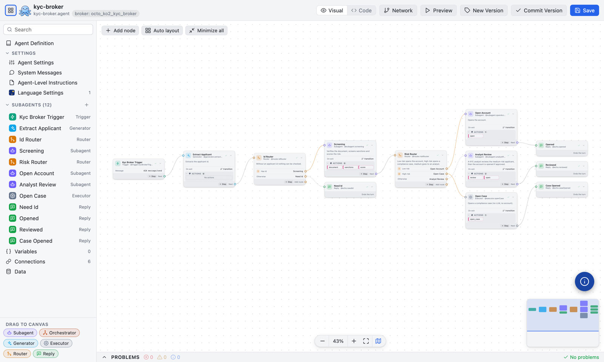

| Step | Kind | What it does |
|---|---|---|
| `kycBrokerTrigger` | Trigger | Starts the flow when an A2A message arrives at the broker. |
| `extractApplicant` | Generator | Extracts the applicant id. |
| `idRouter` | Router | Without an applicant id nothing can be checked. |
| `screening` | Subagent | Verifies the document, screens sanctions and scores the risk. |
| `riskRouter` | Router | Low risk opens the account, high risk opens a compliance case, medium goes to an analyst. |
| `openAccount` | Subagent | Opens the account. |
| `analystReview` | Subagent | A KYC analyst reviews the medium-risk applicant, then the account is opened if approved. |
| `openCase` | Executor | Opens a compliance case (no LLM, no account). |
| `needId` | Echo | Ends the flow with the `needId` reply. |
| `opened` | Echo | Ends the flow with the `opened` reply. |
| `reviewed` | Echo | Ends the flow with the `reviewed` reply. |
| `caseOpened` | Echo | Ends the flow with the `caseOpened` reply. |
| `progressExtractApplicant` | Echo | Progress update (`TASK_STATE_WORKING`): tells the caller what comes next, then goes on to that step. With **Live** on, the chat shows it while the broker works. |
| `progressScreening` | Echo | Progress update (`TASK_STATE_WORKING`): tells the caller what comes next, then goes on to that step. With **Live** on, the chat shows it while the broker works. |
| `progressOpenAccount` | Echo | Progress update (`TASK_STATE_WORKING`): tells the caller what comes next, then goes on to that step. With **Live** on, the chat shows it while the broker works. |
| `progressAnalystReview` | Echo | Progress update (`TASK_STATE_WORKING`): tells the caller what comes next, then goes on to that step. With **Live** on, the chat shows it while the broker works. |
| `progressOpenCase` | Echo | Progress update (`TASK_STATE_WORKING`): tells the caller what comes next, then goes on to that step. With **Live** on, the chat shows it while the broker works. |

Click a step to edit it in the inspector. **+ Step** adds a node, and **+ Step → Patterns** inserts whole shapes such as retry, human in the loop or a guardrail check. **Code** shows the `.agent` text with completion.

### Step 5. Validate and build

In the canvas toolbar, open the CLI menu: **Validate** does a dry run of build, publish and deploy and lists problems in the Problems panel (click one to jump to the card). **Build** repairs and packages the project locally with anypoint-cli-v4.

The variables of this template (in `exchange.json`, open it for the no-code form):

| Variable | What | Default |
|---|---|---|
| `kycAnalystAgent.url` | KYC Analyst Agent (A2D mock, A2A 1.0) URL | `https://www.a2d-ai.com/api/platform/9d2f67ee-62ae-4e7a-85aa-86cc134bd34c/a2a` |
| `accountOpeningAgent.url` | Account Opening Agent (A2D mock, A2A 0.3.0) URL | `https://www.a2d-ai.com/api/platform/7c76d68f-65b2-40ba-9139-77c6a4d796e0/a2a` |
| `identityMcp.url` | Identity Verification MCP (A2D mock) base URL | `https://www.a2d-ai.com/api/platform/bc1c60ca-df29-4d9d-b25c-2b839730f8d5/` |
| `sanctionsMcp.url` | Sanctions Screening MCP (A2D mock) base URL | `https://www.a2d-ai.com/api/platform/b1b3a5b7-5bbc-4764-8194-e6577ab4f52a/` |
| `riskMcp.url` | Customer Risk MCP (A2D mock) base URL | `https://www.a2d-ai.com/api/platform/08c986b9-6c22-4e6d-9323-67d551582ab5/` |

### Step 6. Deploy

Open **Projects & Deploy** and click **Deploy** on the project (or **Deploy…** on the canvas). Pick your gateway (the chips show its status and space), keep **Tracing**, **Wait until the network is ready** and **Publish before deploy** on, then enter the secrets. Nothing you type is stored:

- `openai.apiKey`: OpenAI API key (secret, injected at deploy time)

The square status light goes from blue (deploying) to green (**Deployed and running**). The deployment box lists every broker URL; click one to copy it.

### Step 7. Chat with the broker

Click **Open chat** on the deployment box. On the left is the network (the cards light up as they are called), and on the right is the conversation with its task states. **Live progress** (the antenna button next to Send) is on by default: while the broker works, the chat lists its progress updates (*Extracting the applicant id...*, *Verifying the document, screening sanctions and scoring the risk...*) and keeps them above the answer. Paste the prompts one at a time:

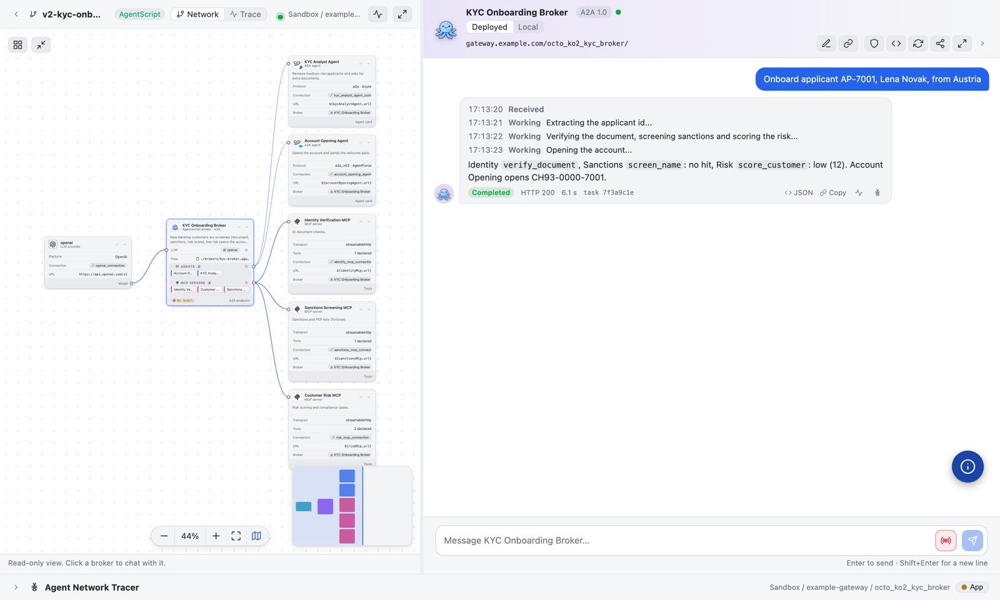

*The reply in the screenshot is an illustration: it shows what the broker answers. The real wording changes from run to run.*

| Prompt | You should see |
|---|---|
| `Onboard applicant AP-7001, Lena Novak, from Austria` | Identity `verify_document`, Sanctions `screen_name`: no hit, Risk `score_customer`: low (12). Account Opening opens CH93-0000-7001. |
| `Onboard applicant AP-7002 from Germany` | Risk medium (48): the KYC Analyst confirms the source of funds, and Account Opening opens CH93-0000-7002 with enhanced monitoring. |
| `Onboard applicant AP-7003, Victor Example, from Panama` | Sanctions hit (0.93), risk high (91): Risk `open_case` opens CMP-2026-0419. No account. |
| `Onboard applicant AP-9999` | No document on file, so the risk band is medium and the KYC Analyst asks for more proof; no account is opened. |

The broker is deterministic: the branches are fixed in the flow in `brokers/` (open the `.agent` file to see them). The LLM only reads the ids from your prompt and writes the reply text, so the same input takes the same branch.

### Step 8. Trace a reply

Under each reply, the **Tracer** icon opens the task in the **Agent Network Tracer**: a waterfall of every call the broker made (gateway, broker, LLM, A2A agents, MCP tools) on one time axis, coloured like the cards. Errors are red. Click a span to see its request and response. The **Network** view shows the same reply as a sequence of calls.

### Step 9. Share it (optional)

The **Share** icon in the chat header opens the Share dialog. **A²D sessions** invites people by email to chat with this deployed broker and brings their passed / failed marks and comments back. **Local portal** generates a small web chat you can run or host anywhere.

## Path 3: Build it from scratch

Here you build the same network yourself, starting from a blank project. Every step uses a form, a menu or a button. You never import the template, and you never type YAML or AgentScript. The names below are the template's names without the `octo_ko2_` prefix. You can use your own names, but keep them consistent.

> The text fields take plain values. Where a value looks like `${group.name}`, type it as shown: it is a **variable** that `exchange.json` declares and that deploy fills in.

### Step 3.1. Create a blank project with a starter broker

Connect Octoloom first, as in [Path 2, Step 1](#step-1-connect-octoloom). Then, on **Home**, click **New Deterministic Network**. In **2 Start from**, choose **Blank** and turn on **Add a starter broker**.

- **Broker name**: `KYC Onboarding Broker`
- **Name**: `kyc-onboarding-scratch` (the Exchange asset id; a different name from the template, so both can live in one org)
- **Parent folder**: pick a folder, then click **Create blank project**.

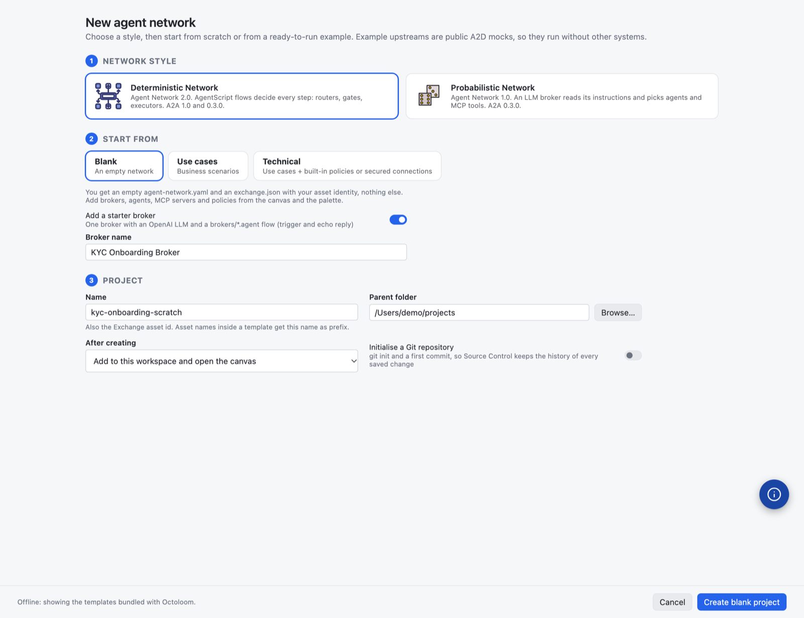

The starter broker `kyc_onboarding_broker` has an OpenAI LLM connection (`openai_connection`, MuleSoft's published OpenAI LLM) and a flow `brokers/kyc-onboarding-broker.agent` with a trigger, one subagent and the built-in `done` reply. The LLM is already done.

### Step 3.2. Add the agents

On the canvas, click **+** (Add to the network) → **Agent** → **Empty**. The new agent opens in the inspector on the right. Fill it in, then repeat for each agent:

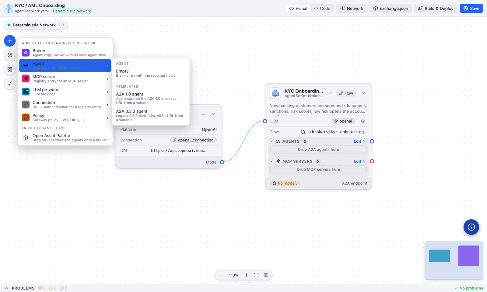

- **KYC Analyst Agent**
  - **Identity → Key**: `kyc_analyst_agent`
  - **Info → Label**: KYC Analyst Agent · **Description**: Reviews medium-risk applicants and asks for extra documents.
  - **Metadata → Platform**: `Azure` (or click its icon under **Agent framework**)
  - **Interface**: click `a2a` (A2A 1.0). **Agent card (A2A 1.x)**: **Name** KYC Analyst Agent, **Description** as above, **Supported interfaces → URL** `https://www.a2d-ai.com/api/platform/9d2f67ee-62ae-4e7a-85aa-86cc134bd34c/a2a`, Binding `JSONRPC`, Protocol version `1.0`
- **Account Opening Agent**
  - **Identity → Key**: `account_opening_agent`
  - **Info → Label**: Account Opening Agent · **Description**: Opens the account and sends the welcome pack.
  - **Metadata → Platform**: `AgentForce` (or click its icon under **Agent framework**)
  - **Interface**: keep `a2a_v03` (A2A 0.3.0). **Agent card (A2A 0.3)**: **Name** Account Opening Agent, **Description** as above, **URL** `https://www.a2d-ai.com/api/platform/7c76d68f-65b2-40ba-9139-77c6a4d796e0/a2a`

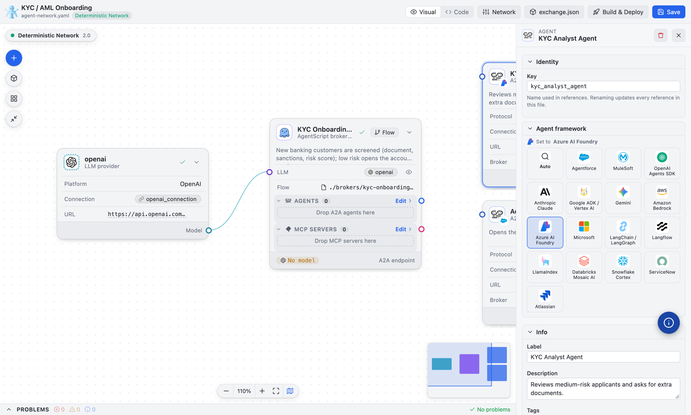

The card skills are optional. Once the agent has a connection (two steps on), the inspector offers **Read skills from the live agent**, which fills them from the running agent.

### Step 3.3. Add the MCP servers

Click **+** → **MCP server** → **Empty**, then fill in:

- **Identity Verification MCP**: **Key** `identity_mcp`, **Label** Identity Verification MCP, **Description** ID document checks · **Protocol version** `2025-06-18`. The transport is already Streamable HTTP on `/mcp`.
- **Sanctions Screening MCP**: **Key** `sanctions_mcp`, **Label** Sanctions Screening MCP, **Description** Sanctions and PEP lists (fictional) · **Protocol version** `2025-06-18`. The transport is already Streamable HTTP on `/mcp`.
- **Customer Risk MCP**: **Key** `risk_mcp`, **Label** Customer Risk MCP, **Description** Risk scoring and compliance cases · **Protocol version** `2025-06-18`. The transport is already Streamable HTTP on `/mcp`.

### Step 3.4. Add the connections

A connection is the URL (and authentication) Agent Fabric uses to reach an agent or an MCP server. Click **+** → **Connection** → **Empty** once per agent and MCP server, and fill in:

| Key | Kind | Registry entry → Name | URL |
|---|---|---|---|
| `kyc_analyst_agent_connection` | `a2a` | `kyc_analyst_agent` | `${kycAnalystAgent.url}` |
| `account_opening_agent_connection` | `a2a` | `account_opening_agent` | `${accountOpeningAgent.url}` |
| `identity_mcp_connection` | `mcp` | `identity_mcp` | `${identityMcp.url}` |
| `sanctions_mcp_connection` | `mcp` | `sanctions_mcp` | `${sanctionsMcp.url}` |
| `risk_mcp_connection` | `mcp` | `risk_mcp` | `${riskMcp.url}` |

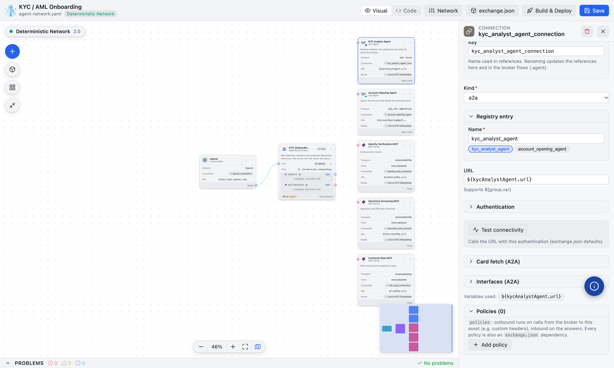

### Step 3.5. Declare the variables

The Problems bar now shows **Variable ${…} is not declared in exchange.json** for each new variable. Click **Add to exchange.json** on each one.

Then open `exchange.json` (it opens as a form) and, under **Variables**, set the defaults:

| Variable | Default |
|---|---|
| `kycAnalystAgent.url` | `https://www.a2d-ai.com/api/platform/9d2f67ee-62ae-4e7a-85aa-86cc134bd34c/a2a` |
| `accountOpeningAgent.url` | `https://www.a2d-ai.com/api/platform/7c76d68f-65b2-40ba-9139-77c6a4d796e0/a2a` |
| `identityMcp.url` | `https://www.a2d-ai.com/api/platform/bc1c60ca-df29-4d9d-b25c-2b839730f8d5/` |
| `sanctionsMcp.url` | `https://www.a2d-ai.com/api/platform/b1b3a5b7-5bbc-4764-8194-e6577ab4f52a/` |
| `riskMcp.url` | `https://www.a2d-ai.com/api/platform/08c986b9-6c22-4e6d-9323-67d551582ab5/` |

Leave the secret variables (`openai.apiKey`) empty: deploy asks for them and never stores them.

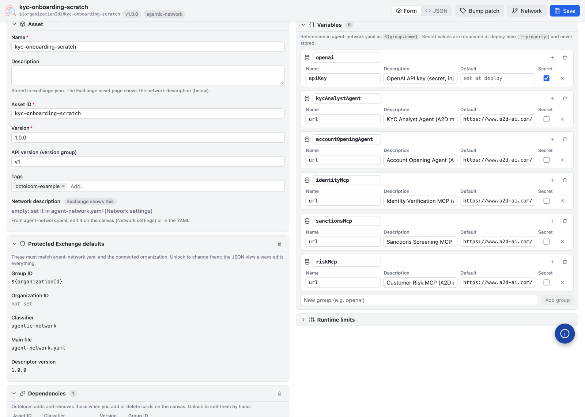

Also click **Remove it** on any **declared but not used** variable that the Problems bar shows.

### Step 3.6. Declare the MCP tools

On each MCP server card, click the **Tools** row (or its pencil). Octoloom reads the tool list from the running server: tick the tools below. You can also type a name in **Add a tool by name…**.

- **Identity Verification MCP**: `verify_document`
- **Sanctions Screening MCP**: `screen_name`
- **Customer Risk MCP**: `score_customer`, `open_case`

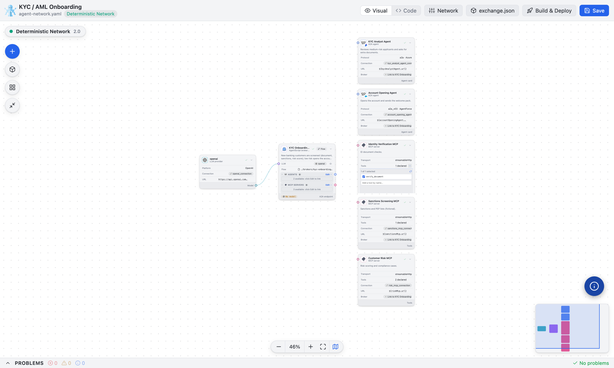

### Step 3.7. Link the agents and MCP servers to the broker

Every agent and MCP card now has a **Broker** row with **Link to KYC Onboarding Broker**. Click it on each card. Octoloom adds the matching actions to the broker flow: one per agent and one per declared MCP tool.

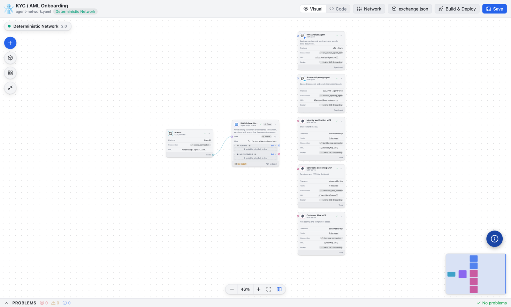

**Link to** also reads the required inputs from the tool schema. In the flow (next step), open **Connections** in the explorer and check that these actions show them under **Inputs** (one per line; type them if they are missing):
- `open_case`: `applicant_id: string`, `reason: string`

### Step 3.8. Build the broker flow

On the broker card (or in its inspector), click **Open broker flow**. Then set up the flow:

1. **Settings → Language Settings**: on the `default` model, set **Reasoning effort (OpenAI)** to `MINIMAL`.
2. **Settings → System Messages**: set the instructions to: *You are the onboarding desk of a bank. Never open an account before identity, sanctions and risk checks are done.*
3. Select the `assistant` subagent and delete it (trash icon). The trigger and the built-in `done` reply stay.
4. Add the steps below in order. Select the step that comes before, click **Add node**, pick the kind and choose **Empty**, then set its **API name** in **General**. Octoloom wires each new step after the selected one, and you set the exact next step in the inspector.

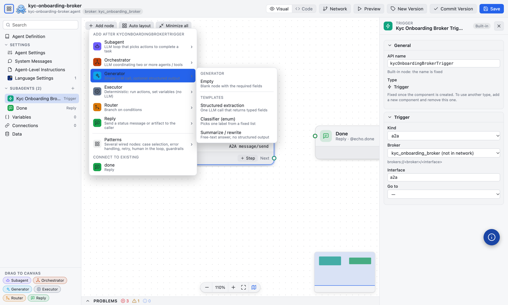

Select the trigger and, under **Go to**, pick `progressExtractApplicant` once that step exists.

#### Generator `extractApplicant`

- **Label** Extract Applicant · **Description** Extracts the applicant id.
- **System instructions**:

  > Extract the applicant id (for example AP-7001) and the applicant name. Use "UNKNOWN" when no id is given.

- **Prompt**:

  > {!@request.payload.message.parts[0].text}

- **Structured output** (**Add field** for each):
  - `applicant_id` (string): Applicant id, e.g. AP-7001, or UNKNOWN
  - `name` (string): Applicant name
- **Next step (on exit) → Go to**: `idRouter`

#### Router `idRouter`

- **Description** Without an applicant id nothing can be checked.
- **Routes** (**+**): **Label** Has id · **When** `@generator.extractApplicant.output.applicant_id != "UNKNOWN"` · **Go to** `progressScreening`
- **Otherwise → Go to**: `needId`

#### Subagent `screening`

- **Label** Screening · **Description** Verifies the document, screens sanctions and scores the risk.
- **System instructions**:

  > Call all three checks for the applicant. Band is "high" when the sanctions screen has hits or the score band is high,
  > "low" when the document is verified, there are no hits and the score band is low, otherwise "medium".

- **Reasoning instructions**:

  > Applicant {!@generator.extractApplicant.output.applicant_id}.

- **Actions** (**+ Add action…**): `verify_document`, `screen_name`, `score_customer`
- **Limits → Max loops**: `5`
- **Structured output** (**Add field** for each):
  - `band` (string): Overall risk band · **Allowed values** `low`, `medium`, `high`
  - `findings` (string): Document, sanctions and score results
- **Next step (on exit) → Go to**: `riskRouter`

#### Router `riskRouter`

- **Description** Low risk opens the account, high risk opens a compliance case, medium goes to an analyst.
- **Routes** (**+**): **Label** Low risk · **When** `@subagent.screening.output.band == "low"` · **Go to** `progressOpenAccount`
- **Routes** (**+**): **Label** High risk · **When** `@subagent.screening.output.band == "high"` · **Go to** `progressOpenCase`
- **Otherwise → Go to**: `progressAnalystReview`

#### Subagent `openAccount`

- **Label** Open Account · **Description** Opens the account.
- **Reasoning instructions**:

  > Identity, sanctions and risk checks are done and passed with low risk: {!@subagent.screening.output.findings}. This is the authorization to open the account. Call the account opening agent once to open an account for {!@generator.extractApplicant.output.applicant_id} ({!@generator.extractApplicant.output.name}) and report the account number.

- **Actions** (**+ Add action…**): `account_opening_agent`
- **Next step (on exit) → Go to**: `opened`

#### Subagent `analystReview`

- **Label** Analyst Review · **Description** A KYC analyst reviews the medium-risk applicant, then the account is opened if approved.
- **Reasoning instructions**:

  > Medium risk for {!@generator.extractApplicant.output.applicant_id}: {!@subagent.screening.output.findings}. Ask the KYC analyst once for a decision. The checks are done; an analyst approval is the authorization to open the account, so when the analyst approves, call the account opening agent once and report the account number and any conditions.

- **Actions** (**+ Add action…**): `kyc_analyst_agent`, `account_opening_agent`
- **Limits → Max loops**: `4`
- **Next step (on exit) → Go to**: `reviewed`

#### Executor `openCase`

- **Description** Opens a compliance case (no LLM, no account).
- **Steps (do)**: **Run action**
  - **Action** `open_case`
    - **Bind argument** `applicant_id` = `@generator.extractApplicant.output.applicant_id`
    - **Bind argument** `reason` = `@subagent.screening.output.findings`
- **Next step (on exit) → Go to**: `caseOpened`

#### Reply `needId`

- **Message text**: Please give the applicant id (for example AP-7001) to start the onboarding.
- **Task state**: `TASK_STATE_COMPLETED`

#### Reply `opened`

- **Use expression**, then **Message (expression)**: `"Onboarding complete for " + @generator.extractApplicant.output.applicant_id + ". " + @subagent.openAccount.output`
- **Task state**: `TASK_STATE_COMPLETED`

#### Reply `reviewed`

- **Use expression**, then **Message (expression)**: `"Analyst review for " + @generator.extractApplicant.output.applicant_id + ": " + @subagent.analystReview.output`
- **Task state**: `TASK_STATE_COMPLETED`

#### Reply `caseOpened`

- **Use expression**, then **Message (expression)**: `"No account opened for " + @generator.extractApplicant.output.applicant_id + ": a compliance case was opened. " + @subagent.screening.output.findings`
- **Task state**: `TASK_STATE_COMPLETED`

#### Reply `progressExtractApplicant`

- **Message text**: Extracting the applicant id...
- **Task state**: `TASK_STATE_WORKING` (a progress update: the chat shows it while the broker works, then the flow goes on)
- **Next step (on exit) → Go to**: `extractApplicant`

#### Reply `progressScreening`

- **Message text**: Verifying the document, screening sanctions and scoring the risk...
- **Task state**: `TASK_STATE_WORKING` (a progress update: the chat shows it while the broker works, then the flow goes on)
- **Next step (on exit) → Go to**: `screening`

#### Reply `progressOpenAccount`

- **Message text**: Opening the account...
- **Task state**: `TASK_STATE_WORKING` (a progress update: the chat shows it while the broker works, then the flow goes on)
- **Next step (on exit) → Go to**: `openAccount`

#### Reply `progressAnalystReview`

- **Message text**: A KYC analyst reviews the medium-risk applicant...
- **Task state**: `TASK_STATE_WORKING` (a progress update: the chat shows it while the broker works, then the flow goes on)
- **Next step (on exit) → Go to**: `analystReview`

#### Reply `progressOpenCase`

- **Message text**: Opening a compliance case...
- **Task state**: `TASK_STATE_WORKING` (a progress update: the chat shows it while the broker works, then the flow goes on)
- **Next step (on exit) → Go to**: `openCase`

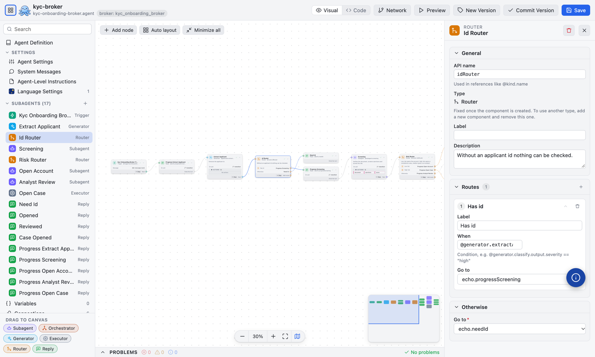

When you are done, the flow matches the template's flow ([Path 2, Step 4](#step-4-follow-the-broker-flow-agentscript)). The built-in `done` reply isn't used by this use case. The Problems bar shows **echo done is not reachable from the trigger** as a warning, and you can leave it.

### Step 3.9. Validate, deploy and chat

Run **Validate** from the canvas CLI menu and fix anything in the Problems bar. Then follow Path 2 from [Validate and build](#step-5-validate-and-build) onwards: deploy (enter the secrets), wait for the green light, open the chat and send the same prompts. Your network answers like the template, because it is the same network, built by hand.

## What you learned

- How a deterministic network is built: an AgentScript flow decides every step; the LLM extracts and writes text.
- How the canvas, the inspector and the code view edit the same YAML.
- How to build the same network from a blank project with forms and menus only (Path 3).
- How to validate, build, deploy, chat and trace with Octoloom.

## Next

- Previous: [Insurance Claims (FNOL to Payout)](v2-insurance-claims.md)
- Next: [Loan Origination](v2-loan-origination.md)
- Same use case, governed variant: [KYC / AML Onboarding: governed](v2-kyc-onboarding-governed.md)
- Same use case, secured variant: [KYC / AML Onboarding: secured](v2-kyc-onboarding-secured.md)
- [All tutorials](index.md)

---
Generated from the `v2-kyc-onboarding` template (Octoloom `media/templates/v2-kyc-onboarding`). Screenshots use fake data.
