# Tutorial: Warranty Repair (fully mocked)

[All tutorials](index.md) · [Getting started](../getting-started.md) · Deterministic network (Agent Network 2.0, AgentScript) · Use case · fully mocked

> Check the device warranty: covered repairs are booked and confirmed, the others get a quote. Three agents, one tool server. Fully mocked: the LLM is an A²D LLM mock too, so no OpenAI key is needed.

| Agents | MCP servers | A2A | Policies | Template id |
|---|---|---|---|---|
| 3 | 1 | 0.3.0, 1.0 | 0 | `v2-warranty-repair` |

There are three ways to use this template:

1. **[Just use it](#path-1-just-use-it)**: create the project, deploy it and chat with it in about 10 minutes.
2. **[Learn step by step](#path-2-learn-step-by-step)**: the same steps, with what each part of the network does and how Octoloom shows it.
3. **[Build it from scratch](#path-3-build-it-from-scratch)**: start from a blank project and build the same network yourself, no code, one screenshot per step.

## Before you start

- VS Code with **Octoloom for Agent Fabric** installed (Marketplace), version 0.9.27 or later.
- An Anypoint organization with Agent Fabric, an environment, a [Small Managed Omni Gateway](../start/gateway.md) and a [connected app](../start/connected-app.md) (client ID and secret). New to Anypoint? **[Before you start](../start/index.md)** shows the trial account, the gateway, the connected app and connecting Octoloom, step by step with videos.
- No OpenAI key: the LLM is an A²D LLM mock as well (`a2dLlm.url`), with scripted answers for the Try it prompts.
- Nothing else: all agents, MCP servers and the LLM are public A²D mocks, so the network runs without any other system or key.

## Path 1: Just use it

1. **Home → Start → New Deterministic Network.** In the dialog pick **Use cases**, then the card **Warranty Repair (fully mocked)**. Choose a folder and click **Create**.
2. **Deploy.** In **Projects & Deploy**, click **Deploy** on this project (or **Build & Deploy** in the editor) and pick your gateway. Octoloom asks for each secret variable; nothing you type is stored:
   - `a2dLlm.apiKey`: A2D LLM mock key (any value works)
3. **Chat.** When the status light is green, click **Open chat** and paste:
   - `My laptop SN-1001 has a flickering screen`
   - `SN-2002 has a swollen battery`

Done. The rest of this page explains what you just ran.

## Path 2: Learn step by step

### Step 1. Connect Octoloom

Open **Setup & Connect** (Octoloom side bar) and connect **Agent Fabric**: the connected app client ID and secret and the organization. Pick the environment. A²D isn't needed: the mock URLs are already the defaults in `exchange.json`. The Tooling list shows Node.js, Java and anypoint-cli-v4 with its agent-network plugin. Use **Install** or **Repair** on any red row.

### Step 2. Create the project from the template

On **Home**, click **New Deterministic Network**. In **2 Start from**, choose **Use cases** and click **Warranty Repair (fully mocked)**. The right side shows the template README: what it contains, **Deploy in 3 steps** and **Try it**. Keep the suggested name `warranty-repair` or type your own, pick the folder and click **Create**.

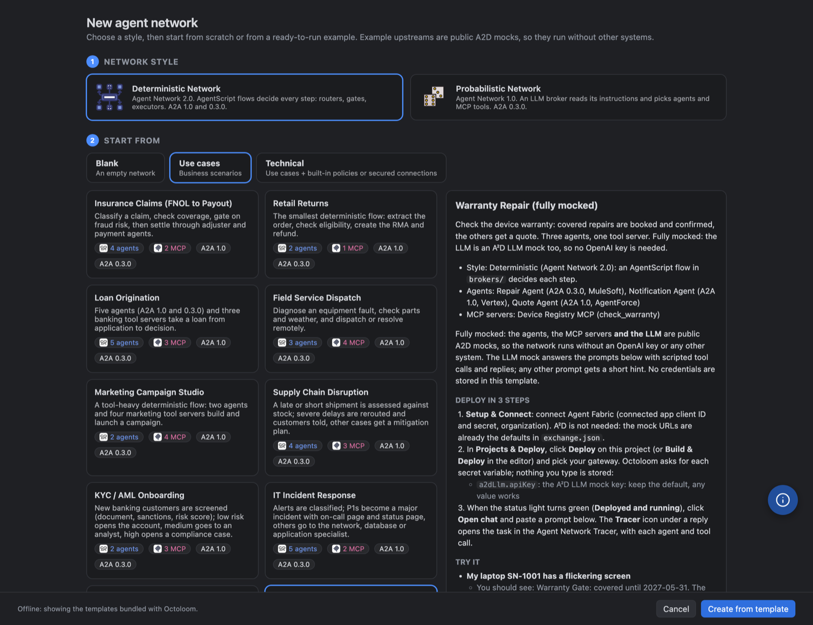

Octoloom writes `agent-network.yaml`, `exchange.json`, `README.md` and the broker flow in `brokers/`, and opens the canvas. Every id gets the template prefix `octo_wr2_`, so several templates can be deployed into one org side by side.

### Step 3. Read the network on the canvas

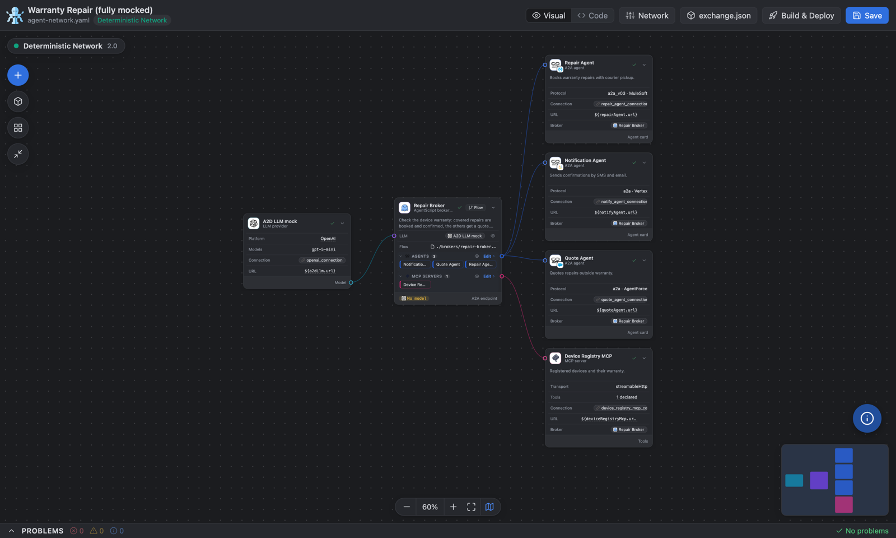

Each card is a part of `agent-network.yaml`. Click one to open it in the inspector on the right. Each change in the inspector is a change to the text, so the YAML stays the source of truth (**Code** view shows it).

- **Broker Repair Broker** (`octo_wr2_repair_broker`): its AgentScript flow decides every step.
- **Agent Repair Agent**: Books warranty repairs with courier pickup.
- **Agent Notification Agent**: Sends confirmations by SMS and email.
- **Agent Quote Agent**: Quotes repairs outside warranty.
- **MCP server Device Registry MCP**: Registered devices and their warranty. Tools: `check_warranty`.

Try this on the canvas: use the zoom bar and the minimap, drag a card, or **Auto layout**. The layout is saved per file. **Minimize all** turns the cards into icon tiles. Click a connection line to see which broker uses which agent or tool.

### Step 4. Follow the broker flow (AgentScript)

Double-click the broker card (or open `brokers/repair-broker.agent`). The flow editor shows the AgentScript program that decides every step. The LLM only extracts fields and writes text, so the same input always takes the same branch.

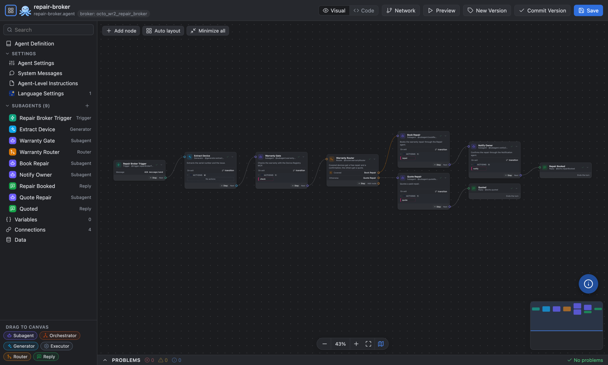

| Step | Kind | What it does |
|---|---|---|
| `repairBrokerTrigger` | Trigger | Starts the flow when an A2A message arrives at the broker. |
| `extractDevice` | Generator | Extracts the serial number and the issue. |
| `warrantyGate` | Subagent | Checks the warranty with the Device Registry MCP. |
| `warrantyRouter` | Router | Covered devices get a free repair and a confirmation; the others get a quote. |
| `bookRepair` | Subagent | Books the warranty repair through the Repair agent. |
| `notifyOwner` | Subagent | Confirms the repair through the Notification agent. |
| `repairBooked` | Echo | Ends the flow with the `repairBooked` reply. |
| `quoteRepair` | Subagent | Quotes a paid repair. |
| `quoted` | Echo | Ends the flow with the `quoted` reply. |
| `progressExtractDevice` | Echo | Progress update (`TASK_STATE_WORKING`): tells the caller what comes next, then goes on to that step. With **Live** on, the chat shows it while the broker works. |
| `progressWarrantyGate` | Echo | Progress update (`TASK_STATE_WORKING`): tells the caller what comes next, then goes on to that step. With **Live** on, the chat shows it while the broker works. |
| `progressBookRepair` | Echo | Progress update (`TASK_STATE_WORKING`): tells the caller what comes next, then goes on to that step. With **Live** on, the chat shows it while the broker works. |
| `progressNotifyOwner` | Echo | Progress update (`TASK_STATE_WORKING`): tells the caller what comes next, then goes on to that step. With **Live** on, the chat shows it while the broker works. |
| `progressQuoteRepair` | Echo | Progress update (`TASK_STATE_WORKING`): tells the caller what comes next, then goes on to that step. With **Live** on, the chat shows it while the broker works. |

Click a step to edit it in the inspector. **+ Step** adds a node, and **+ Step → Patterns** inserts whole shapes such as retry, human in the loop or a guardrail check. **Code** shows the `.agent` text with completion.

### Step 5. Validate and build

In the canvas toolbar, open the CLI menu: **Validate** does a dry run of build, publish and deploy and lists problems in the Problems panel (click one to jump to the card). **Build** repairs and packages the project locally with anypoint-cli-v4.

The variables of this template (in `exchange.json`, open it for the no-code form):

| Variable | What | Default |
|---|---|---|
| `a2dLlm.url` | A2D LLM mock base URL (OpenAI-compatible) | `https://www.a2d-ai.com/api/platform/30cf197e-273b-451b-91fb-e34e1888901e/llm/v1` |
| `repairAgent.url` | Repair Agent (A2D mock, A2A 0.3.0) URL | `https://www.a2d-ai.com/api/platform/783a4158-1abf-45ee-840d-daa0efb3b37c/a2a` |
| `notifyAgent.url` | Notification Agent (A2D mock, A2A 1.0) URL | `https://www.a2d-ai.com/api/platform/f623e618-a913-4caa-beba-b927c7175abb/a2a` |
| `quoteAgent.url` | Quote Agent (A2D mock, A2A 1.0) URL | `https://www.a2d-ai.com/api/platform/bd36453c-218b-4c2f-b198-94a82fd187ce/a2a` |
| `deviceRegistryMcp.url` | Device Registry MCP (A2D mock) base URL | `https://www.a2d-ai.com/api/platform/2716466b-4a56-4875-ba58-fe7b10a2f7a5/` |

### Step 6. Deploy

Open **Projects & Deploy** and click **Deploy** on the project (or **Deploy…** on the canvas). Pick your gateway (the chips show its status and space), keep **Tracing**, **Wait until the network is ready** and **Publish before deploy** on, then enter the secrets. Nothing you type is stored:

- `a2dLlm.apiKey`: A2D LLM mock key (any value works)

The square status light goes from blue (deploying) to green (**Deployed and running**). The deployment box lists every broker URL; click one to copy it.

### Step 7. Chat with the broker

Click **Open chat** on the deployment box. On the left is the network (the cards light up as they are called), and on the right is the conversation with its task states. **Live progress** (the antenna button next to Send) is on by default: while the broker works, the chat lists its progress updates (*Extracting the serial number and the issue...*, *Checking the warranty with the Device Registry MCP...*) and keeps them above the answer. Paste the prompts one at a time:

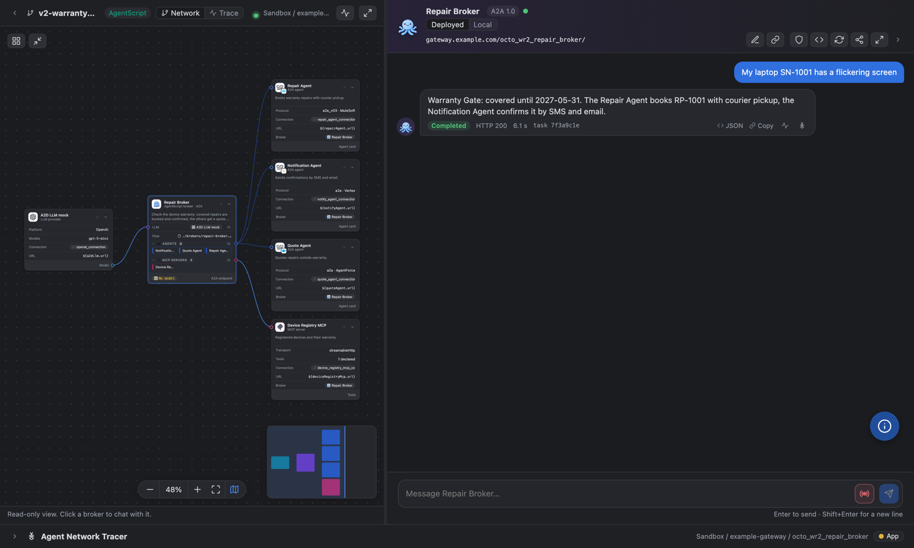

*The LLM is a scripted A²D LLM mock, so the broker gives the same answer every time; the ids in the table are checked by a live deploy.*

| Prompt | You should see |
|---|---|
| `My laptop SN-1001 has a flickering screen` | Warranty Gate: covered until 2027-05-31. The Repair Agent books RP-1001 with courier pickup, the Notification Agent confirms it by SMS and email. |
| `SN-2002 has a swollen battery` | Warranty Gate: expired on 2026-03-01. The Quote Agent sends QT-2002 (89.00 CHF, 3 working days). |

### Step 8. Trace a reply

Under each reply, the **Tracer** icon opens the task in the **Agent Network Tracer**: a waterfall of every call the broker made (gateway, broker, LLM, A2A agents, MCP tools) on one time axis, coloured like the cards. Errors are red. Click a span to see its request and response. The **Network** view shows the same reply as a sequence of calls.

### Step 9. Share it (optional)

The **Share** icon in the chat header opens the Share dialog. **A²D sessions** invites people by email to chat with this deployed broker and brings their passed / failed marks and comments back. **Local portal** generates a small web chat you can run or host anywhere.

## Path 3: Build it from scratch

Here you build the same network yourself, starting from a blank project. Every step uses a form, a menu or a button. You never import the template, and you never type YAML or AgentScript. The names below are the template's names without the `octo_wr2_` prefix. You can use your own names, but keep them consistent.

> The text fields take plain values. Where a value looks like `${group.name}`, type it as shown: it is a **variable** that `exchange.json` declares and that deploy fills in.

### Step 3.1. Create a blank project with a starter broker

Connect Octoloom first, as in [Path 2, Step 1](#step-1-connect-octoloom). Then, on **Home**, click **New Deterministic Network**. In **2 Start from**, choose **Blank** and turn on **Add a starter broker**.

- **Broker name**: `Repair Broker`
- **Name**: `warranty-repair-scratch` (the Exchange asset id; a different name from the template, so both can live in one org)
- **Parent folder**: pick a folder, then click **Create blank project**.

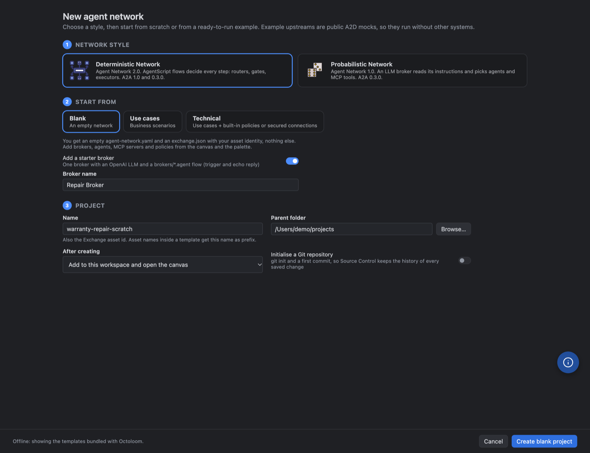

The starter broker `repair_broker` has an OpenAI LLM connection (`openai_connection`, MuleSoft's published OpenAI LLM) and a flow `brokers/repair-broker.agent` with a trigger, one subagent and the built-in `done` reply. This template doesn't use OpenAI: the next step replaces that LLM with the A²D LLM mock.

### Step 3.2. Switch the LLM to the A²D LLM mock

This template needs no OpenAI key: its LLM is an **A²D LLM mock** with scripted answers. Open the **Asset Palette** (Octoloom side bar), pick the **A²D** tab and the **LLMs** filter, then drag **Octoloom Warranty Repair LLM** onto the broker card. The drop writes everything the LLM needs:

- the project LLM `a2d_octoloom_warranty_repair_llm` (`registry.llms`) and its connection `a2d_octoloom_warranty_repair_llm_connection` to the mock URL (no Exchange dependency);
- the variables `a2dOctoloomWarrantyRepairLlm.url` (the mock URL) and `a2dOctoloomWarrantyRepairLlm.apiKey` (the placeholder key `a2d-mock-key`, any value works) in `exchange.json`;
- the broker LLM: the flow's `default` model now targets `llm://a2d_octoloom_warranty_repair_llm_connection` with the model `gpt-5-mini`.

Keep these names: the rest of this tutorial uses them. Then remove the starter OpenAI LLM: select its card (**openai**, below the broker) and click **Remove from network** (trash icon) in the inspector. It removes the OpenAI connection and its `exchange.json` dependency. The Problems bar then shows **Variable openai.apiKey is declared in exchange.json but not used**: click **Remove it**.

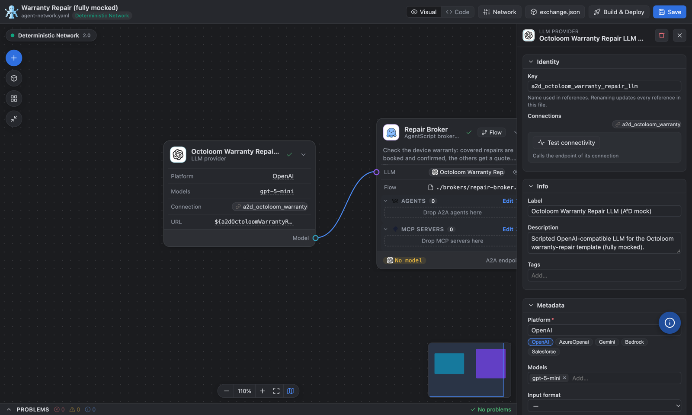

### Step 3.3. Add the agents

On the canvas, click **+** (Add to the network) → **Agent** → **Empty**. The new agent opens in the inspector on the right. Fill it in, then repeat for each agent:

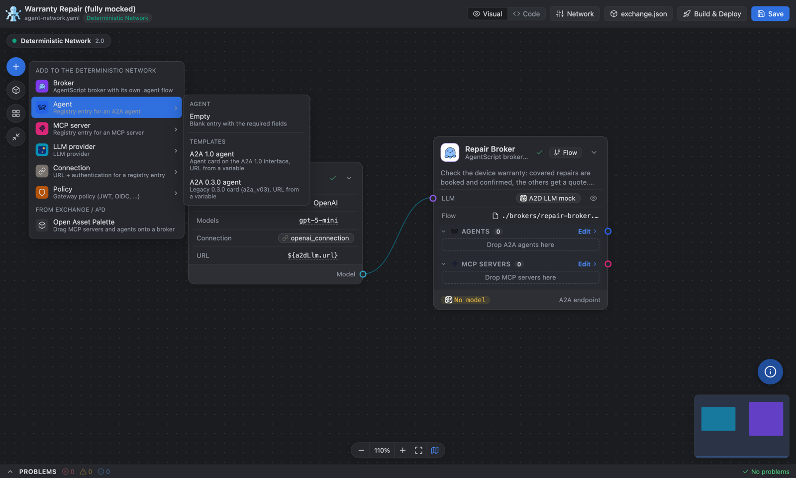

- **Repair Agent**
  - **Identity → Key**: `repair_agent`
  - **Info → Label**: Repair Agent · **Description**: Books warranty repairs with courier pickup.
  - **Metadata → Platform**: `MuleSoft` (or click its icon under **Agent framework**)
  - **Interface**: keep `a2a_v03` (A2A 0.3.0). **Agent card (A2A 0.3)**: **Name** Repair Agent, **Description** as above, **URL** `https://www.a2d-ai.com/api/platform/783a4158-1abf-45ee-840d-daa0efb3b37c/a2a`
- **Notification Agent**
  - **Identity → Key**: `notify_agent`
  - **Info → Label**: Notification Agent · **Description**: Sends confirmations by SMS and email.
  - **Metadata → Platform**: `Vertex` (or click its icon under **Agent framework**)
  - **Interface**: click `a2a` (A2A 1.0). **Agent card (A2A 1.x)**: **Name** Notification Agent, **Description** as above, **Supported interfaces → URL** `https://www.a2d-ai.com/api/platform/f623e618-a913-4caa-beba-b927c7175abb/a2a`, Binding `JSONRPC`, Protocol version `1.0`
- **Quote Agent**
  - **Identity → Key**: `quote_agent`
  - **Info → Label**: Quote Agent · **Description**: Quotes repairs outside warranty.
  - **Metadata → Platform**: `AgentForce` (or click its icon under **Agent framework**)
  - **Interface**: click `a2a` (A2A 1.0). **Agent card (A2A 1.x)**: **Name** Quote Agent, **Description** as above, **Supported interfaces → URL** `https://www.a2d-ai.com/api/platform/bd36453c-218b-4c2f-b198-94a82fd187ce/a2a`, Binding `JSONRPC`, Protocol version `1.0`

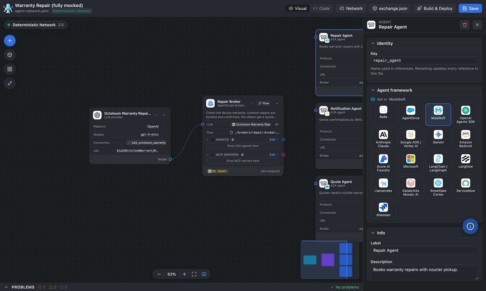

The card skills are optional. Once the agent has a connection (two steps on), the inspector offers **Read skills from the live agent**, which fills them from the running agent.

### Step 3.4. Add the MCP servers

Click **+** → **MCP server** → **Empty**, then fill in:

- **Device Registry MCP**: **Key** `device_registry_mcp`, **Label** Device Registry MCP, **Description** Registered devices and their warranty · **Protocol version** `2025-06-18`. The transport is already Streamable HTTP on `/mcp`.

### Step 3.5. Add the connections

A connection is the URL (and authentication) Agent Fabric uses to reach an agent or an MCP server. Click **+** → **Connection** → **Empty** once per agent and MCP server, and fill in:

| Key | Kind | Registry entry → Name | URL |
|---|---|---|---|
| `repair_agent_connection` | `a2a` | `repair_agent` | `${repairAgent.url}` |
| `notify_agent_connection` | `a2a` | `notify_agent` | `${notifyAgent.url}` |
| `quote_agent_connection` | `a2a` | `quote_agent` | `${quoteAgent.url}` |
| `device_registry_mcp_connection` | `mcp` | `device_registry_mcp` | `${deviceRegistryMcp.url}` |

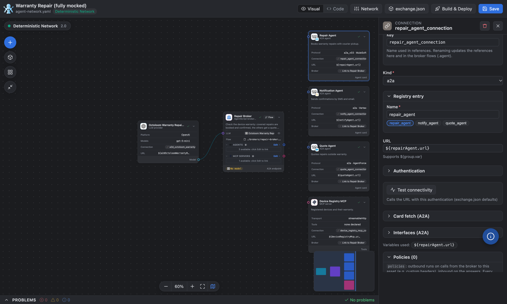

### Step 3.6. Declare the variables

The Problems bar now shows **Variable ${…} is not declared in exchange.json** for each new variable. Click **Add to exchange.json** on each one.

Then open `exchange.json` (it opens as a form) and, under **Variables**, set the defaults:

| Variable | Default |
|---|---|
| `repairAgent.url` | `https://www.a2d-ai.com/api/platform/783a4158-1abf-45ee-840d-daa0efb3b37c/a2a` |
| `notifyAgent.url` | `https://www.a2d-ai.com/api/platform/f623e618-a913-4caa-beba-b927c7175abb/a2a` |
| `quoteAgent.url` | `https://www.a2d-ai.com/api/platform/bd36453c-218b-4c2f-b198-94a82fd187ce/a2a` |
| `deviceRegistryMcp.url` | `https://www.a2d-ai.com/api/platform/2716466b-4a56-4875-ba58-fe7b10a2f7a5/` |
| `a2dOctoloomWarrantyRepairLlm.url` | `https://www.a2d-ai.com/api/platform/30cf197e-273b-451b-91fb-e34e1888901e/llm/v1` |

`a2dOctoloomWarrantyRepairLlm.apiKey` keeps its default `a2d-mock-key` from the drop: the mock accepts any key, so deploy needs no real one.

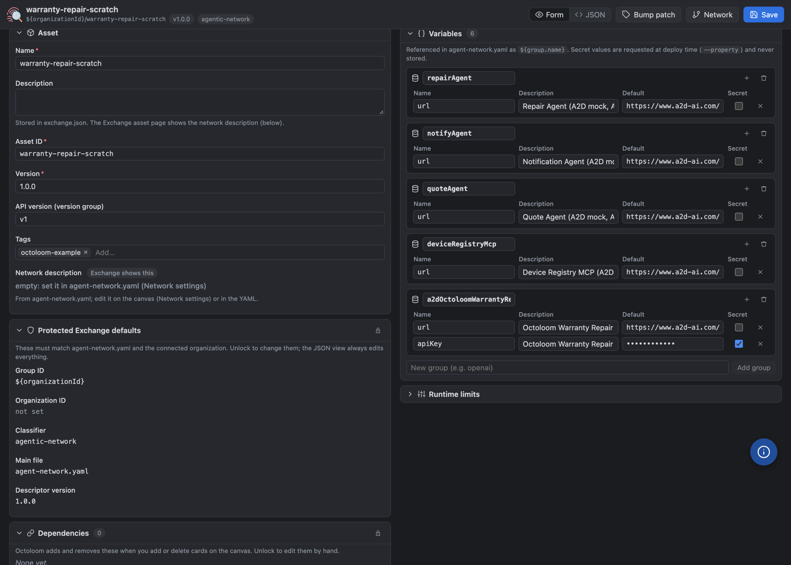

Also click **Remove it** on any **declared but not used** variable that the Problems bar shows.

### Step 3.7. Declare the MCP tools

On each MCP server card, click the **Tools** row (or its pencil). Octoloom reads the tool list from the running server: tick the tools below. You can also type a name in **Add a tool by name…**.

- **Device Registry MCP**: `check_warranty`

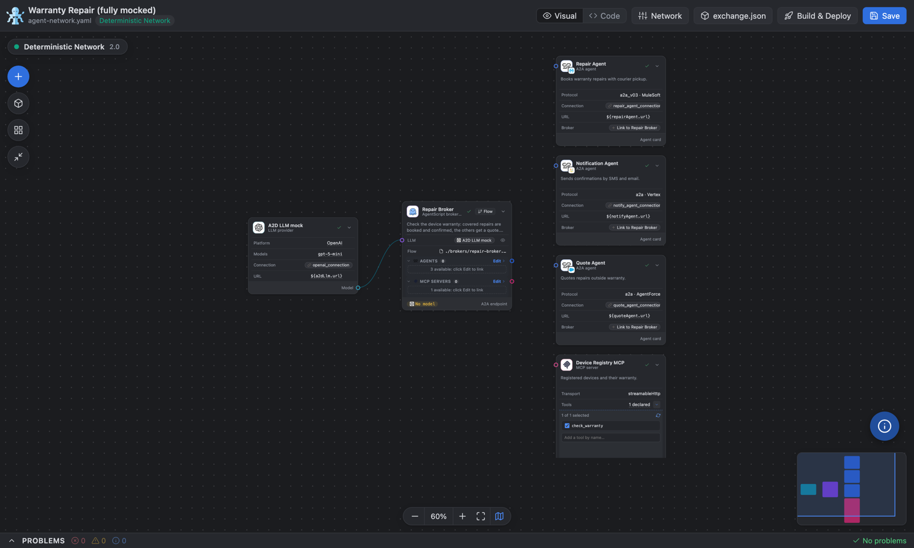

### Step 3.8. Link the agents and MCP servers to the broker

Every agent and MCP card now has a **Broker** row with **Link to Repair Broker**. Click it on each card. Octoloom adds the matching actions to the broker flow: one per agent and one per declared MCP tool.

### Step 3.9. Build the broker flow

On the broker card (or in its inspector), click **Open broker flow**. Then set up the flow:

1. **Settings → Language Settings**: on the `default` model, set **Reasoning effort (OpenAI)** to `MINIMAL` (the mock ignores it; it keeps the flow ready for a real model, like the template).
2. **Settings → System Messages**: set the instructions to: *You are the repair desk of an electronics brand. Repair free of charge only when the registry says the device is covered.*
3. Select the `assistant` subagent and delete it (trash icon). The trigger and the built-in `done` reply stay.
4. Add the steps below in order. Select the step that comes before, click **Add node**, pick the kind and choose **Empty**, then set its **API name** in **General**. Octoloom wires each new step after the selected one, and you set the exact next step in the inspector.

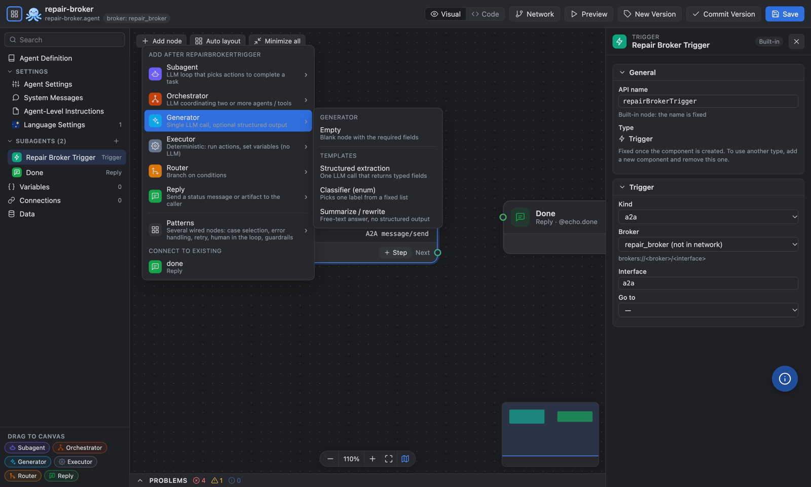

Select the trigger and, under **Go to**, pick `progressExtractDevice` once that step exists.

#### Generator `extractDevice`

- **Label** Extract Device · **Description** Extracts the serial number and the issue.
- **System instructions**:

  > Extract the serial number (for example SN-1001) and a short issue from the message.
  > Use "UNKNOWN" when no serial number is present.

- **Prompt**:

  > {!@request.payload.message.parts[0].text}

- **Structured output** (**Add field** for each):
  - `serial` (string): Serial number, e.g. SN-1001, or UNKNOWN
  - `issue` (string): Short description of the issue
- **Next step (on exit) → Go to**: `progressWarrantyGate`

#### Subagent `warrantyGate`

- **Label** Warranty Gate · **Description** Checks the warranty with the Device Registry MCP.
- **System instructions**:

  > Call the warranty tool for the serial number and report whether the device is covered.
  > Set covered to "yes" only when the tool returns covered true.

- **Reasoning instructions**:

  > Serial: {!@generator.extractDevice.output.serial}. Request: {!@request.payload.message.parts[0].text}

- **Actions** (**+ Add action…**): `check_warranty`
- **Limits → Max loops**: `3`
- **Structured output** (**Add field** for each):
  - `covered` (string): Whether the device is under warranty · **Allowed values** `yes`, `no`
  - `detail` (string): Warranty detail from the tool
- **Next step (on exit) → Go to**: `warrantyRouter`

#### Router `warrantyRouter`

- **Description** Covered devices get a free repair and a confirmation; the others get a quote.
- **Routes** (**+**): **Label** Covered · **When** `@subagent.warrantyGate.output.covered == "yes"` · **Go to** `progressBookRepair`
- **Otherwise → Go to**: `progressQuoteRepair`

#### Subagent `bookRepair`

- **Label** Book Repair · **Description** Books the warranty repair through the Repair agent.
- **Reasoning instructions**:

  > Book a warranty repair for {!@generator.extractDevice.output.serial}: {!@generator.extractDevice.output.issue}. Request: {!@request.payload.message.parts[0].text}

- **Actions** (**+ Add action…**): `repair_agent`
- **Next step (on exit) → Go to**: `progressNotifyOwner`

#### Subagent `notifyOwner`

- **Label** Notify Owner · **Description** Confirms the repair through the Notification agent.
- **Reasoning instructions**:

  > Confirm the repair of {!@generator.extractDevice.output.serial} to the owner. Request: {!@request.payload.message.parts[0].text}

- **Actions** (**+ Add action…**): `notify_agent`
- **Next step (on exit) → Go to**: `repairBooked`

#### Reply `repairBooked`

- **Use expression**, then **Message (expression)**: `"Under warranty (" + @subagent.warrantyGate.output.detail + "). " + @subagent.bookRepair.output + " " + @subagent.notifyOwner.output`
- **Task state**: `TASK_STATE_COMPLETED`

#### Subagent `quoteRepair`

- **Label** Quote Repair · **Description** Quotes a paid repair.
- **Reasoning instructions**:

  > {!@generator.extractDevice.output.serial} is not covered: {!@subagent.warrantyGate.output.detail}. Quote a paid repair for: {!@generator.extractDevice.output.issue}. Request: {!@request.payload.message.parts[0].text}

- **Actions** (**+ Add action…**): `quote_agent`
- **Next step (on exit) → Go to**: `quoted`

#### Reply `quoted`

- **Use expression**, then **Message (expression)**: `"Not covered: " + @subagent.warrantyGate.output.detail + ". " + @subagent.quoteRepair.output`
- **Task state**: `TASK_STATE_COMPLETED`

#### Reply `progressExtractDevice`

- **Message text**: Extracting the serial number and the issue...
- **Task state**: `TASK_STATE_WORKING` (a progress update: the chat shows it while the broker works, then the flow goes on)
- **Next step (on exit) → Go to**: `extractDevice`

#### Reply `progressWarrantyGate`

- **Message text**: Checking the warranty with the Device Registry MCP...
- **Task state**: `TASK_STATE_WORKING` (a progress update: the chat shows it while the broker works, then the flow goes on)
- **Next step (on exit) → Go to**: `warrantyGate`

#### Reply `progressBookRepair`

- **Message text**: Booking the warranty repair through the Repair agent...
- **Task state**: `TASK_STATE_WORKING` (a progress update: the chat shows it while the broker works, then the flow goes on)
- **Next step (on exit) → Go to**: `bookRepair`

#### Reply `progressNotifyOwner`

- **Message text**: Confirming the repair through the Notification agent...
- **Task state**: `TASK_STATE_WORKING` (a progress update: the chat shows it while the broker works, then the flow goes on)
- **Next step (on exit) → Go to**: `notifyOwner`

#### Reply `progressQuoteRepair`

- **Message text**: Quoting a paid repair...
- **Task state**: `TASK_STATE_WORKING` (a progress update: the chat shows it while the broker works, then the flow goes on)
- **Next step (on exit) → Go to**: `quoteRepair`

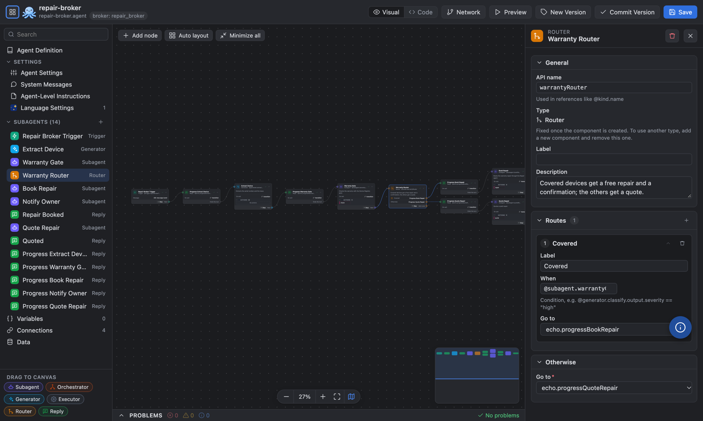

When you are done, the flow matches the template's flow ([Path 2, Step 4](#step-4-follow-the-broker-flow-agentscript)). The built-in `done` reply isn't used by this use case. The Problems bar shows **echo done is not reachable from the trigger** as a warning, and you can leave it.

### Step 3.10. Validate, deploy and chat

Run **Validate** from the canvas CLI menu and fix anything in the Problems bar. Then follow Path 2 from [Validate and build](#step-5-validate-and-build) onwards: deploy (enter the secrets), wait for the green light, open the chat and send the same prompts. Your network answers like the template, because it is the same network, built by hand.

## What you learned

- How a deterministic network is built: an AgentScript flow decides every step; the LLM extracts and writes text.
- How the canvas, the inspector and the code view edit the same YAML.
- How to build the same network from a blank project with forms and menus only (Path 3).
- How to validate, build, deploy, chat and trace with Octoloom.

## Next

- Previous: [Utility Outage (fully mocked)](v2-utility-outage.md)
- Next: [Field Service Dispatch: governed](v2-field-service-governed.md)
- [All tutorials](index.md)

---
Generated from the `v2-warranty-repair` template (Octoloom `media/templates/v2-warranty-repair`). Screenshots use fake data.
