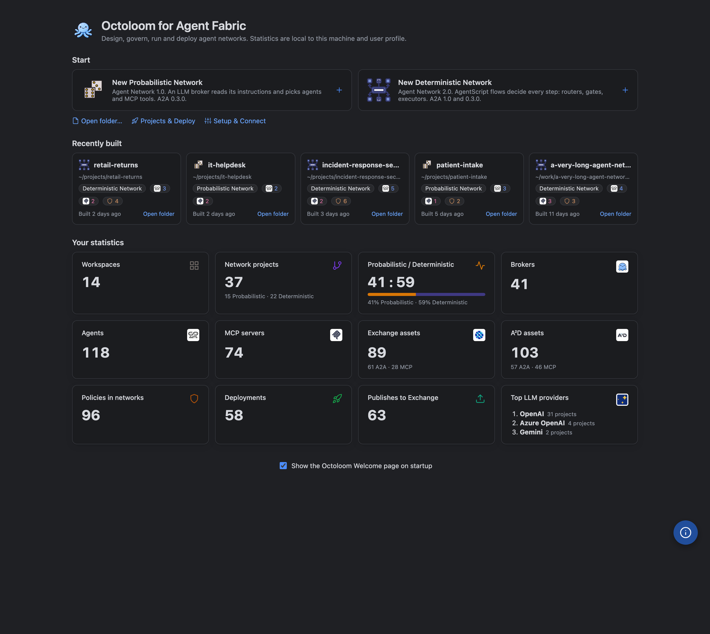
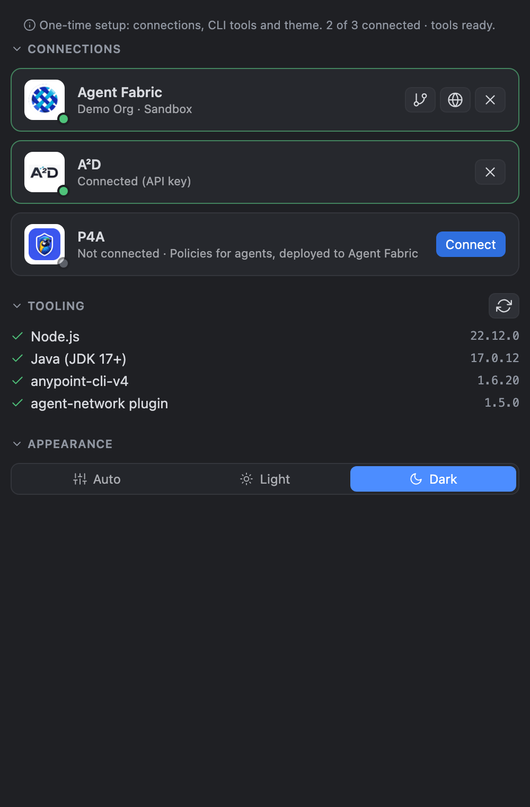
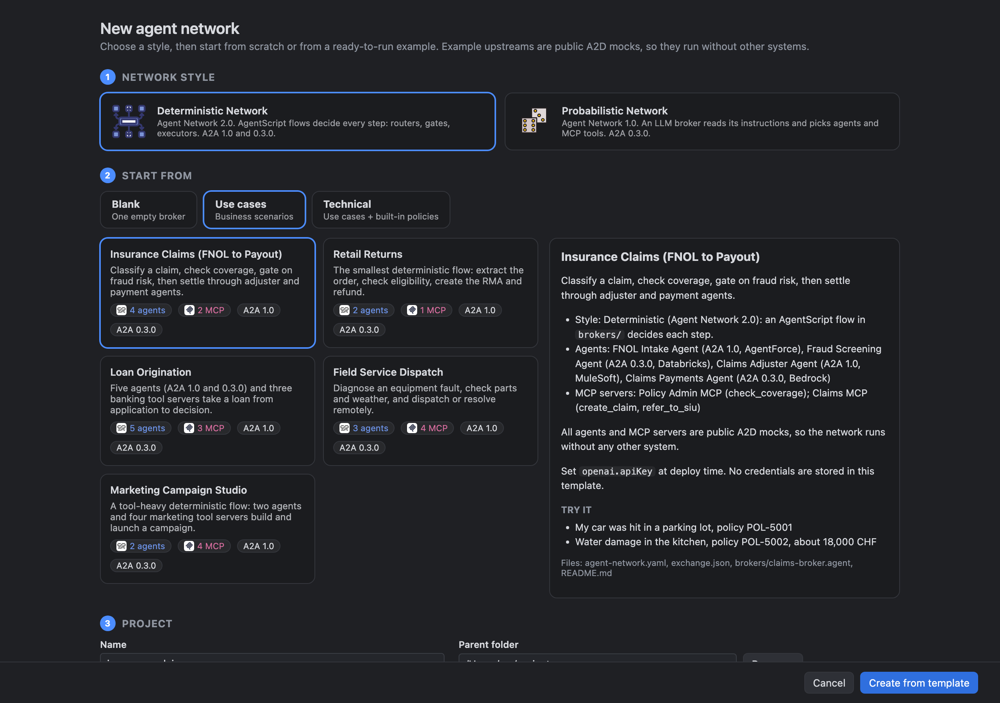
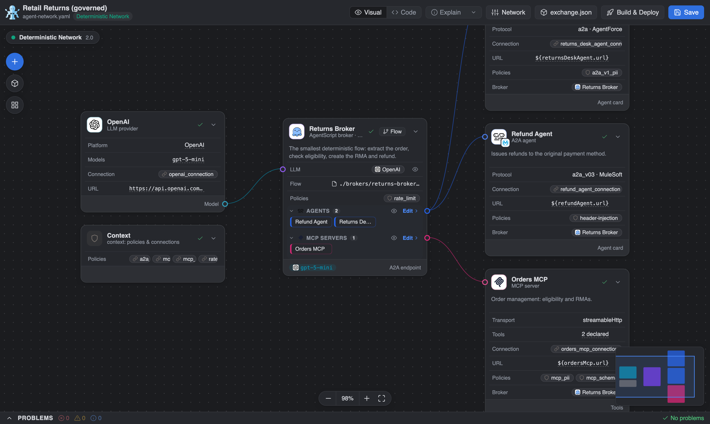
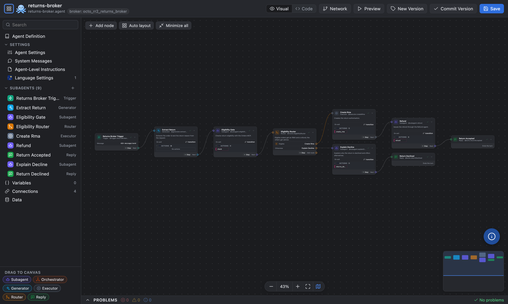
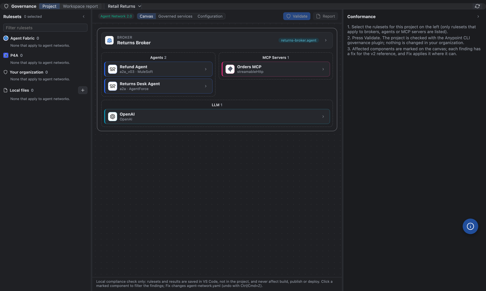
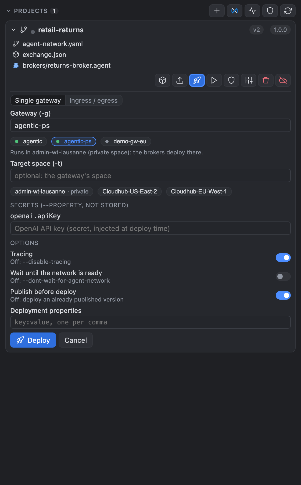
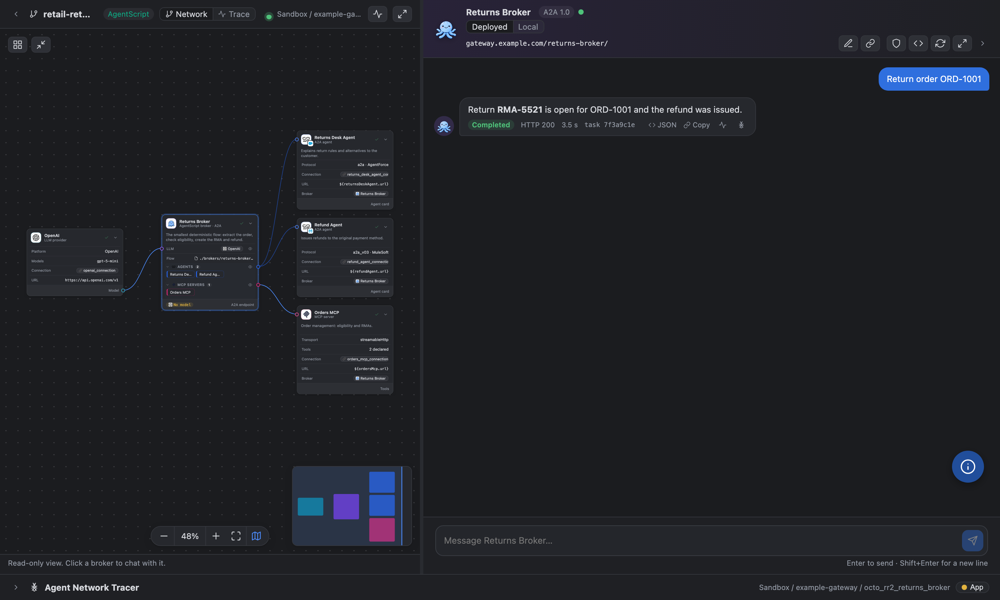
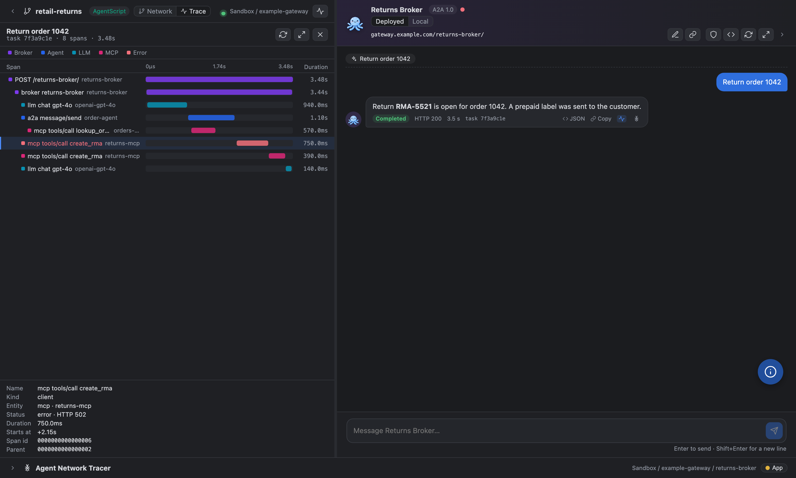
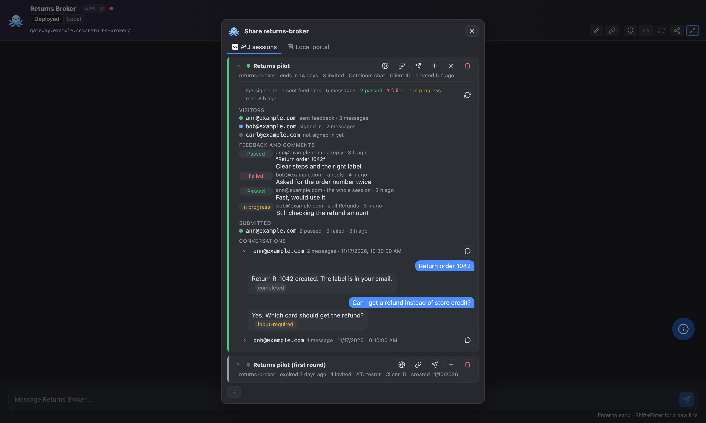

# Getting started with Octoloom

[All tutorials](README.md)

Octoloom for Agent Fabric is a VS Code extension for designing, governing, running and deploying MuleSoft Agent Fabric agent networks. This tour takes about 20 minutes. When it's done you have a network deployed and you've chatted with it. You need an Anypoint organization with Agent Fabric, a gateway and a connected app; if you don't have them yet, do **[Before you start](https://octoloom.a2d-ai.com/start/)** first (trial account, Small Managed Omni Gateway, connected app, with videos). Then pick a [template tutorial](README.md) to go deeper.

## 1. Install and open Home

Install **Octoloom for Agent Fabric** from the VS Code Marketplace. **Home** (the Welcome page) opens when VS Code starts. You can also open it with the home button in Projects & Deploy, or with the command **Octoloom: Welcome**.

- **Start**: create a **Probabilistic** network (Agent Network 1.0, an LLM broker picks agents and tools) or a **Deterministic** network (Agent Network 2.0, an AgentScript flow decides every step).
- **Tutorials**: this page and one tutorial per template.
- **Recently built**: the last five projects you built on this machine.
- **Your statistics**: local totals, never sent anywhere.
- The installed version is under the title, with a link when a newer one is on the Marketplace.

## 2. Setup & Connect

Open the **Octoloom** side bar, then **Setup & Connect**.

1. **Tooling**: Node.js, Java, anypoint-cli-v4 and the agent-network plugin. Click **Install** or **Repair** on any row that isn't green.
2. **Agent Fabric**: the client ID and secret of the [connected app](https://octoloom.a2d-ai.com/start/connected-app/), then the organization and environment ([how to connect](https://octoloom.a2d-ai.com/start/connect-anypoint/)). You need this for the Exchange palette, publish and deploy.
3. **A²D** (optional): your A²D API key, which adds the A²D palette tab and Share → A²D sessions.
4. **IDMC** (optional): Headless IDMC, which adds the IDMC palette tab.

## 3. Create a project from a template

On Home, click **New Deterministic Network** (or Probabilistic). In **2 Start from** pick **Use cases** or **Technical**, then a card. The right side shows the template README with **Deploy in 3 steps** and **Try it**. Pick the folder, then click **Create from template**.

Each template is ready to run: its agents and MCP servers are public A²D mocks. Start with **Retail Returns**, the smallest deterministic flow. Its tutorial is [v2-retail-returns](v2-retail-returns/README.md).

## 4. The canvas

- Every card is a part of `agent-network.yaml`: brokers, agents, MCP servers, LLM providers and policies. Click a card to edit it in the inspector.
- **Visual / Code** switches to the YAML with completion. Both edit the same text.
- The **+** button adds components. The **palette** (cube icon) lists Exchange, A²D and IDMC assets; drag one onto the canvas.
- The zoom bar, minimap, **Auto layout** and **Minimize all** change the view only.
- The **Problems** panel at the bottom lists what's wrong. Click a problem to jump to its card, and use **Fix** where Octoloom can repair it.

## 5. The broker flow (deterministic networks)

Double-click a broker to open its `.agent` file in the flow editor.

- **Trigger** → **Generator** (one LLM call that extracts fields) → **Subagent** / **Executor** (tools and agents) → **Router** (a branch) → **Echo** (the reply).
- **+ Step → Patterns** inserts common shapes: error handling, retry, human in the loop and guardrail check.

## 6. Governance

The shield icon on the canvas runs the Agent Fabric rulesets (and your organization's rulesets) on your machine. Findings show on the cards and in the panel. **Fix** and **Fix all** repair what they can.

## 7. Validate, build and deploy

1. On the canvas, open the CLI menu and click **Validate**: a dry run of build, publish and deploy.
2. **Build** repairs and packages the project locally.
3. Open **Projects & Deploy** and click **Deploy**:

- Pick the gateway from the chips (each shows its status and space; no chip? [create a Small Managed Omni Gateway](https://octoloom.a2d-ai.com/start/gateway/)) and keep the switches on (Tracing, Wait until ready, Publish before deploy).
- Enter the secrets, such as `openai.apiKey`. They're passed to the CLI and never stored.
- The square status light turns green when the network is **Deployed and running**.

## 8. Chat and trace

Click **Open chat** on the deployment, then paste a prompt from the template's **Try it** list. **Live progress** (the antenna button next to Send) is on by default: while a v2 broker works, the chat lists its progress updates (one per flow step) and keeps them above the answer.

The **Tracer** icon under a reply opens the **Agent Network Tracer**: every call the broker made on one time axis.

## 9. Share

The **Share** icon in the chat header opens the Share dialog:

- **A²D sessions** invite people by email to chat with the deployed broker, and bring their marks and comments back.
- **Local portal** generates a small web chat you can host anywhere.

## 10. Explain anything

The floating **i** button turns on Explain mode. Click any part of Octoloom to see what it is, when to use it and examples, or click **Start the guide** for a guided tour of the canvas you're on.

## Next

Pick a template tutorial from the [list](README.md). Each one has **Just use it** (3 steps) and **Learn step by step** (every part explained, with screenshots).
