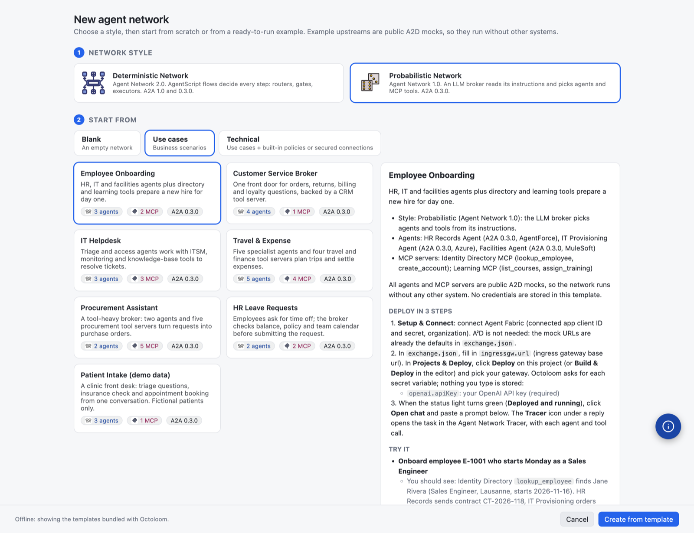
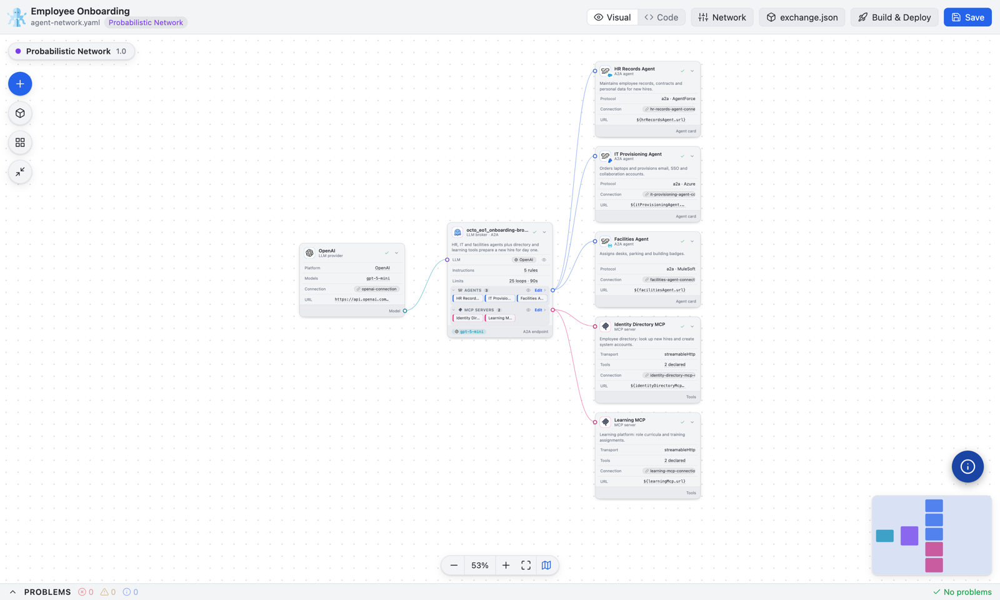
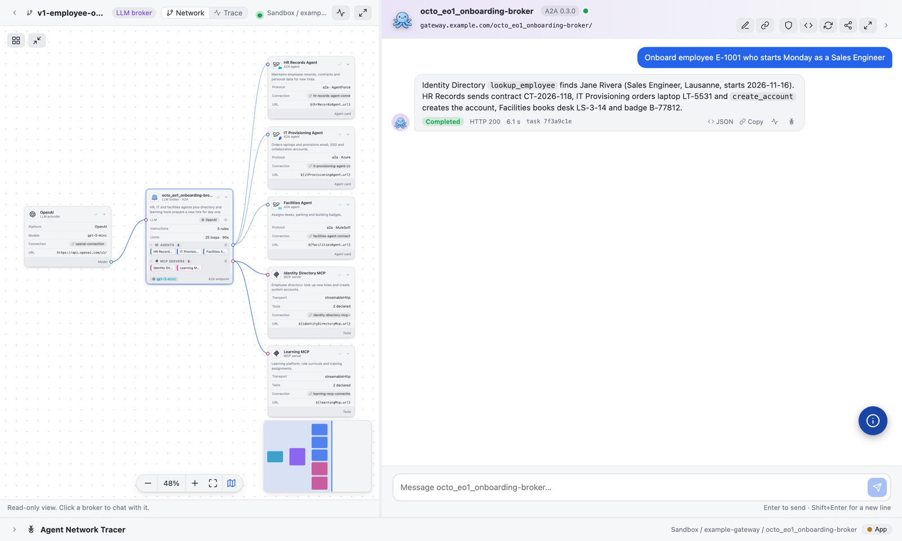

# Tutorial: Employee Onboarding

[All tutorials](../README.md) · [Getting started](../getting-started.md) · Probabilistic network (Agent Network 1.0, LLM broker) · Use case

> HR, IT and facilities agents plus directory and learning tools prepare a new hire for day one.

| Agents | MCP servers | A2A | Policies | Template id |
|---|---|---|---|---|
| 3 | 2 | 0.3.0 | 0 | `v1-employee-onboarding` |

There are two ways to use this template:

1. **[Just use it](#path-1-just-use-it)**: create the project, deploy it and chat with it in about 10 minutes.
2. **[Learn step by step](#path-2-learn-step-by-step)**: the same steps, with what each part of the network does and how Octoloom shows it.

## Before you start

- VS Code with **Octoloom for Agent Fabric** installed (Marketplace), version 0.9.25 or later.
- An Anypoint organization with Agent Fabric, a connected app (client ID and secret), an environment and a Flex gateway.
- An OpenAI API key (or an OpenAI-compatible LLM gateway).
- Nothing else: all agents and MCP servers are public A²D mocks, so the network runs without any other system.

## Path 1: Just use it

1. **Home → Start → New Probabilistic Network.** In the dialog pick **Use cases**, then the card **Employee Onboarding**. Choose a folder and click **Create**.
2. **Deploy.** In `exchange.json`, fill in `ingressgw.url` (ingress gateway base url). In **Projects & Deploy**, click **Deploy** on this project (or **Build & Deploy** in the editor) and pick your gateway. Octoloom asks for each secret variable; nothing you type is stored:
   - `openai.apiKey`: OpenAI API key (secret, injected at deploy time)
3. **Chat.** When the status light is green, click **Open chat** and paste:
   - `Onboard employee E-1001 who starts Monday as a Sales Engineer`
   - `Assign the onboarding training to E-1001`
   - `What is still open for the onboarding of E-1002?`

Done. The rest of this page explains what you just ran.

## Path 2: Learn step by step

### Step 1. Connect Octoloom

Open **Setup & Connect** (Octoloom side bar) and connect **Agent Fabric**: the connected app client ID and secret and the organization. Pick the environment. A²D isn't needed: the mock URLs are already the defaults in `exchange.json`. The Tooling list shows Node.js, Java and anypoint-cli-v4 with its agent-network plugin. Use **Install** or **Repair** on any red row.

### Step 2. Create the project from the template

On **Home**, click **New Probabilistic Network**. In **2 Start from**, choose **Use cases** and click **Employee Onboarding**. The right side shows the template README: what it contains, **Deploy in 3 steps** and **Try it**. Keep the suggested name `employee-onboarding` or type your own, pick the folder and click **Create**.

Octoloom writes `agent-network.yaml`, `exchange.json`, `README.md`, and opens the canvas. Every id gets the template prefix `octo_eo1_`, so several templates can be deployed into one org side by side.

### Step 3. Read the network on the canvas

Each card is a part of `agent-network.yaml`. Click one to open it in the inspector on the right. Each change in the inspector is a change to the text, so the YAML stays the source of truth (**Code** view shows it).

- **Broker octo_eo1_onboarding-broker** (`octo_eo1_onboarding-broker`): the LLM decides which agent or tool to call from its instructions.
  - Instructions:
    - You coordinate employee onboarding for new hires.
    - Always look up the employee in the identity directory first, using the employee id from the request (for example E-1001).
    - Use the HR Records agent for contracts and personal data, the IT Provisioning agent for laptops and accounts, and the Facilities agent for desks and badges.
    - Assign role-based training through the learning tools once accounts exist.
    - Finish with a short checklist of what was done and what is still open.
- **Agent HR Records Agent**: Maintains employee records, contracts and personal data for new hires.
- **Agent IT Provisioning Agent**: Orders laptops and provisions email, SSO and collaboration accounts.
- **Agent Facilities Agent**: Assigns desks, parking and building badges.
- **MCP server Identity Directory MCP**: Employee directory: look up new hires and create system accounts. Tools: `lookup_employee`, `create_account`.
- **MCP server Learning MCP**: Learning platform: role curricula and training assignments. Tools: `list_courses`, `assign_training`.

Try this on the canvas: use the zoom bar and the minimap, drag a card, or **Auto layout**. The layout is saved per file. **Minimize all** turns the cards into icon tiles. Click a connection line to see which broker uses which agent or tool.

### Step 4. Validate and build

In the canvas toolbar, open the CLI menu: **Validate** does a dry run of build, publish and deploy and lists problems in the Problems panel (click one to jump to the card). **Build** repairs and packages the project locally with anypoint-cli-v4.

The variables of this template (in `exchange.json`, open it for the no-code form):

| Variable | What | Default |
|---|---|---|
| `ingressgw.url` | Ingress gateway base URL (the broker is served under it) | (fill in) |
| `identityDirectoryMcp.url` | Identity Directory MCP (A2D mock) base URL | `https://www.a2d-ai.com/api/platform/d0608b5d-b24a-462c-9e10-6e6c536eb215/` |
| `learningMcp.url` | Learning MCP (A2D mock) base URL | `https://www.a2d-ai.com/api/platform/b5a630ea-1d3d-474a-91b1-951f46627398/` |
| `hrRecordsAgent.url` | HR Records Agent (A2D mock, A2A 0.3.0) URL | `https://www.a2d-ai.com/api/platform/6d627753-51a7-4f80-9ac0-00707da79726/a2a` |
| `itProvisioningAgent.url` | IT Provisioning Agent (A2D mock, A2A 0.3.0) URL | `https://www.a2d-ai.com/api/platform/d71282de-bfde-428c-a8a4-97c6a5da3dc6/a2a` |
| `facilitiesAgent.url` | Facilities Agent (A2D mock, A2A 0.3.0) URL | `https://www.a2d-ai.com/api/platform/1f45271b-07ad-42c3-b429-57d0cf223abf/a2a` |

### Step 5. Deploy

Open **Projects & Deploy** and click **Deploy** on the project (or **Deploy…** on the canvas). Pick your gateway (the chips show its status and space), keep **Tracing**, **Wait until the network is ready** and **Publish before deploy** on, then enter the secrets. Nothing you type is stored:

- `openai.apiKey`: OpenAI API key (secret, injected at deploy time)

For a probabilistic network, also fill `ingressgw.url` in `exchange.json` (your ingress gateway base URL) before you deploy.

The square status light goes from blue (deploying) to green (**Deployed and running**). The deployment box lists every broker URL; click one to copy it.

### Step 6. Chat with the broker

Click **Open chat** on the deployment box. On the left is the network (the cards light up as they are called), and on the right is the conversation with its task states. Paste the prompts one at a time:

*The reply in the screenshot is an illustration: it shows what the broker answers. The real wording changes from run to run.*

| Prompt | You should see |
|---|---|
| `Onboard employee E-1001 who starts Monday as a Sales Engineer` | Identity Directory `lookup_employee` finds Jane Rivera (Sales Engineer, Lausanne, starts 2026-11-16). HR Records sends contract CT-2026-118, IT Provisioning orders laptop LT-5531 and `create_account` creates the account, Facilities books desk LS-3-14 and badge B-77812. |
| `Assign the onboarding training to E-1001` | Learning MCP `list_courses` and `assign_training`: 3 courses assigned, due 2026-12-15. |
| `What is still open for the onboarding of E-1002?` | Omar Haddad (Data Analyst, Remote). The broker asks the agents for the open items (contract, laptop, account, badge) and lists them. |

The broker is probabilistic: the LLM picks the agents and tools, so the wording and the order of the calls can change between runs. The ids and numbers come from the mocks and stay the same.

### Step 7. Trace a reply

Under each reply, the **Tracer** icon opens the task in the **Agent Network Tracer**: a waterfall of every call the broker made (gateway, broker, LLM, A2A agents, MCP tools) on one time axis, coloured like the cards. Errors are red. Click a span to see its request and response. The **Network** view shows the same reply as a sequence of calls.

### Step 8. Share it (optional)

The **Share** icon in the chat header opens the Share dialog. **A²D sessions** invites people by email to chat with this deployed broker and brings their passed / failed marks and comments back. **Local portal** generates a small web chat you can run or host anywhere.

## What you learned

- How a probabilistic network is built: an LLM broker with instructions picks agents and MCP tools.
- How the canvas, the inspector and the code view edit the same YAML.
- How to validate, build, deploy, chat and trace with Octoloom.

## Next

- Previous: [Customer Service Broker](../v1-customer-service/README.md)
- Next: [HR Leave Requests](../v1-hr-leave/README.md)
- Same use case, governed variant: [Employee Onboarding: governed](../v1-employee-onboarding-governed/README.md)
- [All tutorials](../README.md)

---
Generated from the `v1-employee-onboarding` template (Octoloom `media/templates/v1-employee-onboarding`). Screenshots use fake data.
