# Tutorial: HR Leave Requests

[All tutorials](../README.md) · [Getting started](../getting-started.md) · Probabilistic network (Agent Network 1.0, LLM broker) · Use case

> Employees ask for time off; the broker checks balance, policy and team calendar before submitting the request.

| Agents | MCP servers | A2A | Policies | Template id |
|---|---|---|---|---|
| 2 | 2 | 0.3.0 | 0 | `v1-hr-leave` |

There are three ways to use this template:

1. **[Just use it](#path-1-just-use-it)**: create the project, deploy it and chat with it in about 10 minutes.
2. **[Learn step by step](#path-2-learn-step-by-step)**: the same steps, with what each part of the network does and how Octoloom shows it.
3. **[Build it from scratch](#path-3-build-it-from-scratch)**: start from a blank project and build the same network yourself, no code, one screenshot per step.

## Before you start

- VS Code with **Octoloom for Agent Fabric** installed (Marketplace), version 0.9.25 or later.
- An Anypoint organization with Agent Fabric, an environment, a [Small Managed Omni Gateway](https://octoloom.a2d-ai.com/start/gateway/) and a [connected app](https://octoloom.a2d-ai.com/start/connected-app/) (client ID and secret). New to Anypoint? **[Before you start](https://octoloom.a2d-ai.com/start/)** shows the trial account, the gateway, the connected app and connecting Octoloom, step by step with videos.
- An OpenAI API key (or an OpenAI-compatible LLM gateway).
- Nothing else: all agents and MCP servers are public A²D mocks, so the network runs without any other system.

## Path 1: Just use it

1. **Home → Start → New Probabilistic Network.** In the dialog pick **Use cases**, then the card **HR Leave Requests**. Choose a folder and click **Create**.
2. **Deploy.** In `exchange.json`, fill in `ingressgw.url` (ingress gateway base url). In **Projects & Deploy**, click **Deploy** on this project (or **Build & Deploy** in the editor) and pick your gateway. Octoloom asks for each secret variable; nothing you type is stored:
   - `openai.apiKey`: OpenAI API key (secret, injected at deploy time)
3. **Chat.** When the status light is green, click **Open chat** and paste:
   - `E-3001 wants vacation from 2026-12-21 to 2026-12-31`
   - `Can E-3002 take 3 days of unpaid leave next week?`
   - `Who in team M-410 is away over Christmas?`

Done. The rest of this page explains what you just ran.

## Path 2: Learn step by step

### Step 1. Connect Octoloom

Open **Setup & Connect** (Octoloom side bar) and connect **Agent Fabric**: the connected app client ID and secret and the organization. Pick the environment. A²D isn't needed: the mock URLs are already the defaults in `exchange.json`. The Tooling list shows Node.js, Java and anypoint-cli-v4 with its agent-network plugin. Use **Install** or **Repair** on any red row.

### Step 2. Create the project from the template

On **Home**, click **New Probabilistic Network**. In **2 Start from**, choose **Use cases** and click **HR Leave Requests**. The right side shows the template README: what it contains, **Deploy in 3 steps** and **Try it**. Keep the suggested name `hr-leave` or type your own, pick the folder and click **Create**.

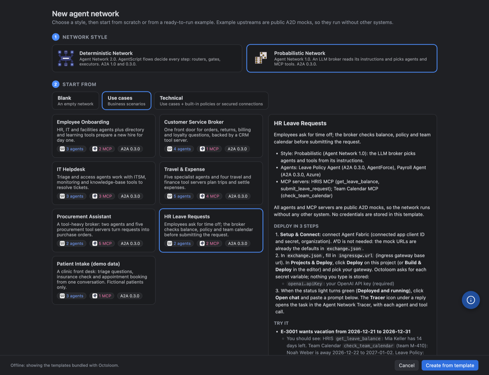

Octoloom writes `agent-network.yaml`, `exchange.json`, `README.md`, and opens the canvas. Every id gets the template prefix `octo_hl1_`, so several templates can be deployed into one org side by side.

### Step 3. Read the network on the canvas

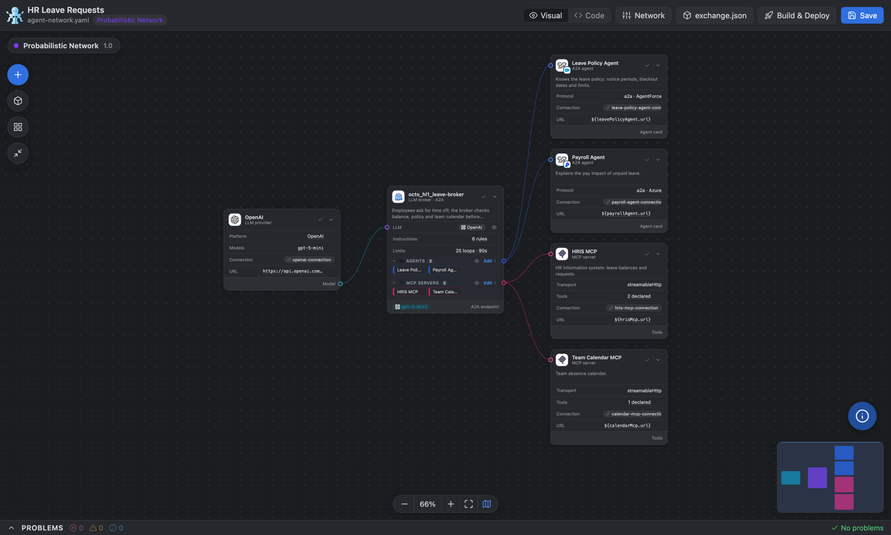

Each card is a part of `agent-network.yaml`. Click one to open it in the inspector on the right. Each change in the inspector is a change to the text, so the YAML stays the source of truth (**Code** view shows it).

- **Broker octo_hl1_leave-broker** (`octo_hl1_leave-broker`): the LLM decides which agent or tool to call from its instructions.
  - Instructions:
    - You help employees request time off.
    - Look up the leave balance with get_leave_balance using the employee id from the request (for example E-3001).
    - Ask the Leave Policy agent whether the request follows the policy (notice period, blackout dates, maximum length).
    - Check the team calendar with check_team_calendar; warn when more than one team member is already away.
    - Submit the request with submit_leave_request only when the balance is enough and the policy agent agrees.
    - Ask the Payroll agent about pay impact only for unpaid leave. Finish with the request id and its status.
- **Agent Leave Policy Agent**: Knows the leave policy: notice periods, blackout dates and limits.
- **Agent Payroll Agent**: Explains the pay impact of unpaid leave.
- **MCP server HRIS MCP**: HR information system: leave balances and requests. Tools: `get_leave_balance`, `submit_leave_request`.
- **MCP server Team Calendar MCP**: Team absence calendar. Tools: `check_team_calendar`.

Try this on the canvas: use the zoom bar and the minimap, drag a card, or **Auto layout**. The layout is saved per file. **Minimize all** turns the cards into icon tiles. Click a connection line to see which broker uses which agent or tool.

### Step 4. Validate and build

In the canvas toolbar, open the CLI menu: **Validate** does a dry run of build, publish and deploy and lists problems in the Problems panel (click one to jump to the card). **Build** repairs and packages the project locally with anypoint-cli-v4.

The variables of this template (in `exchange.json`, open it for the no-code form):

| Variable | What | Default |
|---|---|---|
| `ingressgw.url` | Ingress gateway base URL (the broker is served under it) | (fill in) |
| `hrisMcp.url` | HRIS MCP (A2D mock) base URL | `https://www.a2d-ai.com/api/platform/900a88c1-7dc5-4830-9dcb-bfc61c63210b/` |
| `calendarMcp.url` | Team Calendar MCP (A2D mock) base URL | `https://www.a2d-ai.com/api/platform/eaa685f1-9833-47bd-8297-2f32fab75a25/` |
| `leavePolicyAgent.url` | Leave Policy Agent (A2D mock, A2A 0.3.0) URL | `https://www.a2d-ai.com/api/platform/3566c4df-ed9a-4eb7-8d3c-ea91d77aa114/a2a` |
| `payrollAgent.url` | Payroll Agent (A2D mock, A2A 0.3.0) URL | `https://www.a2d-ai.com/api/platform/b7aad5d7-e511-470f-b9b3-69416a9bfec3/a2a` |

### Step 5. Deploy

Open **Projects & Deploy** and click **Deploy** on the project (or **Deploy…** on the canvas). Pick your gateway (the chips show its status and space), keep **Tracing**, **Wait until the network is ready** and **Publish before deploy** on, then enter the secrets. Nothing you type is stored:

- `openai.apiKey`: OpenAI API key (secret, injected at deploy time)

For a probabilistic network, also fill `ingressgw.url` in `exchange.json` (your ingress gateway base URL) before you deploy.

The square status light goes from blue (deploying) to green (**Deployed and running**). The deployment box lists every broker URL; click one to copy it.

### Step 6. Chat with the broker

Click **Open chat** on the deployment box. On the left is the network (the cards light up as they are called), and on the right is the conversation with its task states. Paste the prompts one at a time:

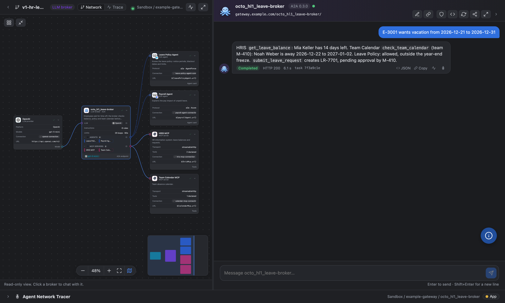

*The reply in the screenshot is an illustration: it shows what the broker answers. The real wording changes from run to run.*

| Prompt | You should see |
|---|---|
| `E-3001 wants vacation from 2026-12-21 to 2026-12-31` | HRIS `get_leave_balance`: Mia Keller has 14 days left. Team Calendar `check_team_calendar` (team M-410): Noah Weber is away 2026-12-22 to 2027-01-02. Leave Policy: allowed, outside the year-end freeze. `submit_leave_request` creates LR-7701, pending approval by M-410. |
| `Can E-3002 take 3 days of unpaid leave next week?` | Luca Rossi has 1 vacation day left and used 2 unpaid days. Leave Policy: up to 5 unpaid days a year with manager approval. Payroll: the next payslip drops by 742.50 CHF gross. A request creates LR-7702. |
| `Who in team M-410 is away over Christmas?` | Team Calendar: Noah Weber, 2026-12-22 to 2027-01-02. |

The broker is probabilistic: the LLM picks the agents and tools, so the wording and the order of the calls can change between runs. The ids and numbers come from the mocks and stay the same.

### Step 7. Trace a reply

Under each reply, the **Tracer** icon opens the task in the **Agent Network Tracer**: a waterfall of every call the broker made (gateway, broker, LLM, A2A agents, MCP tools) on one time axis, coloured like the cards. Errors are red. Click a span to see its request and response. The **Network** view shows the same reply as a sequence of calls.

### Step 8. Share it (optional)

The **Share** icon in the chat header opens the Share dialog. **A²D sessions** invites people by email to chat with this deployed broker and brings their passed / failed marks and comments back. **Local portal** generates a small web chat you can run or host anywhere.

## Path 3: Build it from scratch

Here you build the same network yourself, starting from a blank project. Every step uses a form, a menu or a button. You never import the template, and you never type YAML. The names below are the template's names without the `octo_hl1_` prefix. You can use your own names, but keep them consistent.

> The text fields take plain values. Where a value looks like `${group.name}`, type it as shown: it is a **variable** that `exchange.json` declares and that deploy fills in.

### Step 3.1. Create a blank project with a starter broker

Connect Octoloom first, as in [Path 2, Step 1](#step-1-connect-octoloom). Then, on **Home**, click **New Probabilistic Network**. In **2 Start from**, choose **Blank** and turn on **Add a starter broker**.

- **Broker name**: `leave-broker`
- **Name**: `hr-leave-scratch` (the Exchange asset id; a different name from the template, so both can live in one org)
- **Parent folder**: pick a folder, then click **Create blank project**.

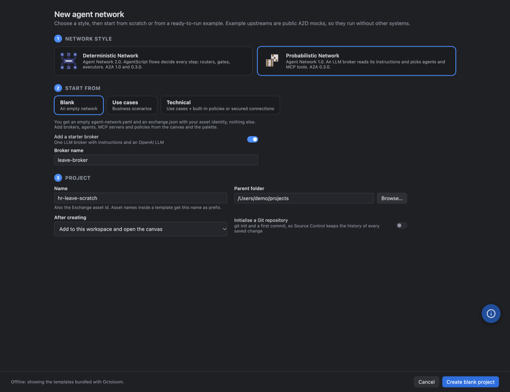

The starter broker is an LLM broker with an OpenAI LLM (`openai` provider, `openai-connection`) and default instructions. The LLM is already done.

### Step 3.2. Add the agents

On the canvas, click **+** (Add to the network) → **Agent** → **Empty**. The new agent opens in the inspector on the right. Fill it in, then repeat for each agent:

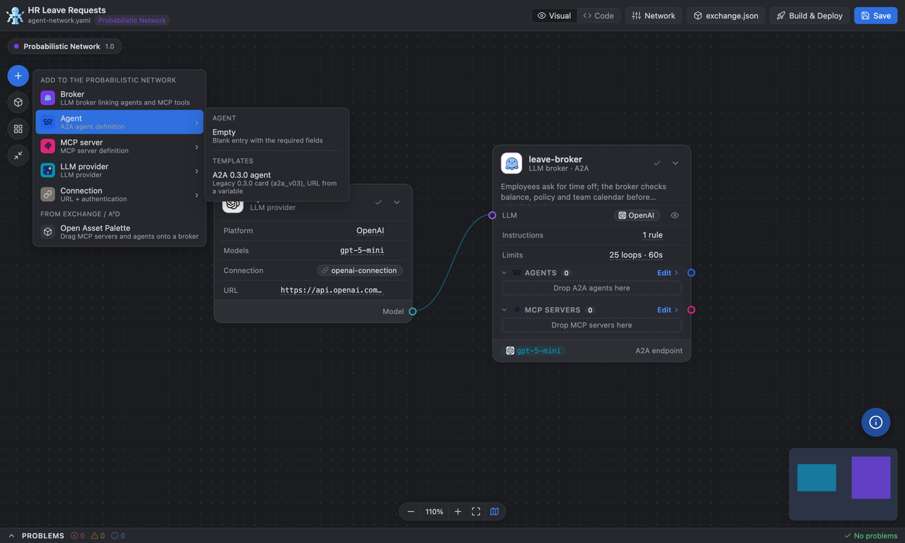

- **Leave Policy Agent**
  - **Identity → Key**: `leave-policy-agent`
  - **Label**: Leave Policy Agent · **Description**: Knows the leave policy: notice periods, blackout dates and limits.
  - **Metadata → Platform**: `AgentForce` (or click its icon under **Agent framework**)
  - **Agent card**: **Name** Leave Policy Agent, **Description** as above, **URL** `${leavePolicyAgent.url}`, **Protocol version** `0.3.0`
- **Payroll Agent**
  - **Identity → Key**: `payroll-agent`
  - **Label**: Payroll Agent · **Description**: Explains the pay impact of unpaid leave.
  - **Metadata → Platform**: `Azure` (or click its icon under **Agent framework**)
  - **Agent card**: **Name** Payroll Agent, **Description** as above, **URL** `${payrollAgent.url}`, **Protocol version** `0.3.0`

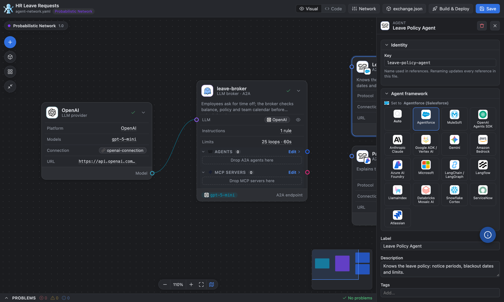

The card skills are optional. Once the agent has a connection (two steps on), the inspector offers **Read skills from the live agent**, which fills them from the running agent.

### Step 3.3. Add the MCP servers

Click **+** → **MCP server** → **Empty**, then fill in:

- **HRIS MCP**: **Key** `hris-mcp`, **Label** HRIS MCP, **Description** HR information system: leave balances and requests. The transport is already Streamable HTTP on `/mcp`.
- **Team Calendar MCP**: **Key** `calendar-mcp`, **Label** Team Calendar MCP, **Description** Team absence calendar. The transport is already Streamable HTTP on `/mcp`.

### Step 3.4. Add the connections

A connection is the URL (and authentication) Agent Fabric uses to reach an agent or an MCP server. Click **+** → **Connection** → **Empty** once per agent and MCP server, and fill in:

| Key | Kind | Target → Name | URL |
|---|---|---|---|
| `hris-mcp-connection` | `mcp` | `hris-mcp` | `${hrisMcp.url}` |
| `calendar-mcp-connection` | `mcp` | `calendar-mcp` | `${calendarMcp.url}` |
| `leave-policy-agent-connection` | `agent` | `leave-policy-agent` | `${leavePolicyAgent.url}` |
| `payroll-agent-connection` | `agent` | `payroll-agent` | `${payrollAgent.url}` |

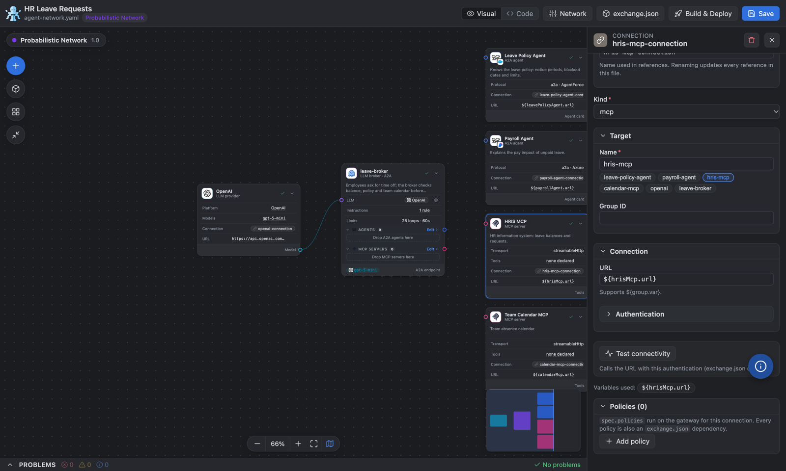

### Step 3.5. Declare the variables

The Problems bar now shows **Variable ${…} is not declared in exchange.json** for each new variable. Click **Add to exchange.json** on each one.

Then open `exchange.json` (it opens as a form) and, under **Variables**, set the defaults:

| Variable | Default |
|---|---|
| `ingressgw.url` | (your ingress gateway URL) |
| `hrisMcp.url` | `https://www.a2d-ai.com/api/platform/900a88c1-7dc5-4830-9dcb-bfc61c63210b/` |
| `calendarMcp.url` | `https://www.a2d-ai.com/api/platform/eaa685f1-9833-47bd-8297-2f32fab75a25/` |
| `leavePolicyAgent.url` | `https://www.a2d-ai.com/api/platform/3566c4df-ed9a-4eb7-8d3c-ea91d77aa114/a2a` |
| `payrollAgent.url` | `https://www.a2d-ai.com/api/platform/b7aad5d7-e511-470f-b9b3-69416a9bfec3/a2a` |

Leave the secret variables (`openai.apiKey`) empty: deploy asks for them and never stores them.

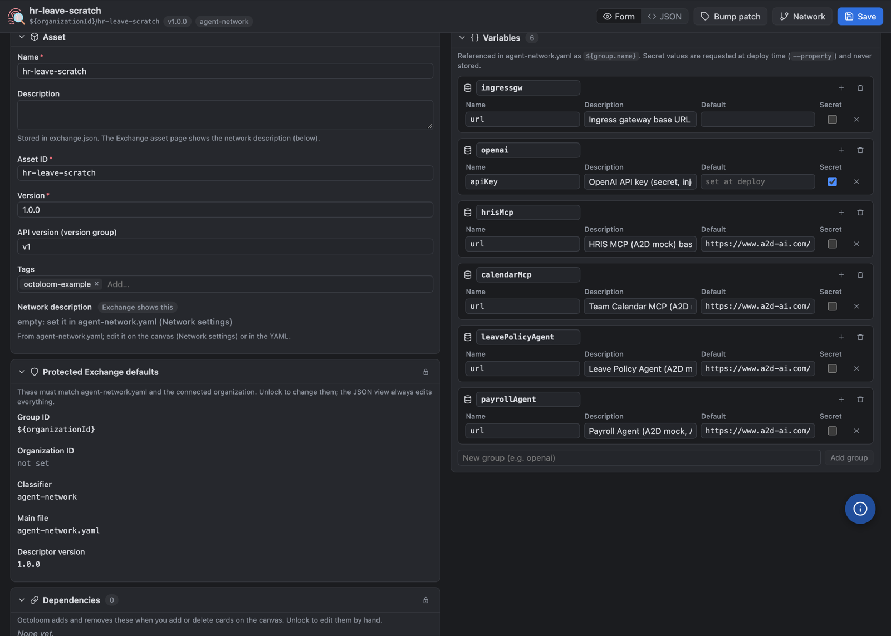

### Step 3.6. Declare the MCP tools

On each MCP server card, click the **Tools** row (or its pencil). Octoloom reads the tool list from the running server: tick the tools below. You can also type a name in **Add a tool by name…**.

- **HRIS MCP**: `get_leave_balance`, `submit_leave_request`
- **Team Calendar MCP**: `check_team_calendar`

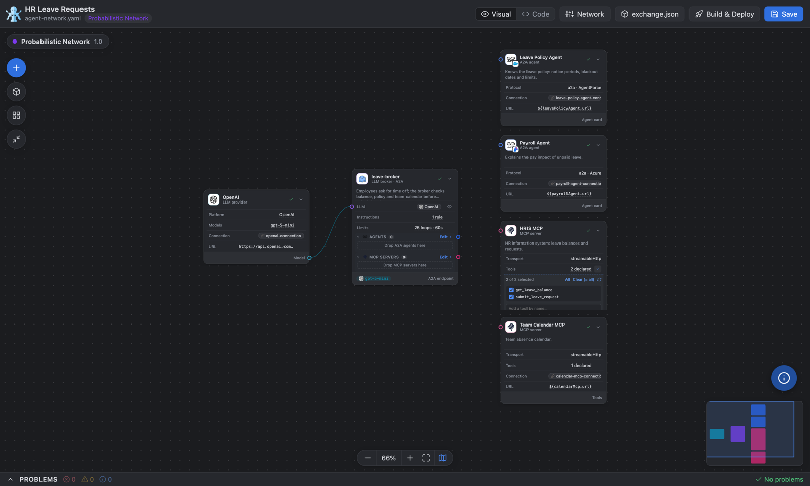

### Step 3.7. Give the broker its agents and tools

Select the broker `leave-broker`. In the inspector:

1. Click **Agents (0)**. In **Add existing agent…**, pick each agent and click **Add**: `leave-policy-agent`, `payroll-agent`.
2. Click **MCP servers (0)**. Add each server with **Add existing MCP server…**, then tick its **Allowed tools**:
   - `hris-mcp`: `get_leave_balance`, `submit_leave_request`
   - `calendar-mcp`: `check_team_calendar`

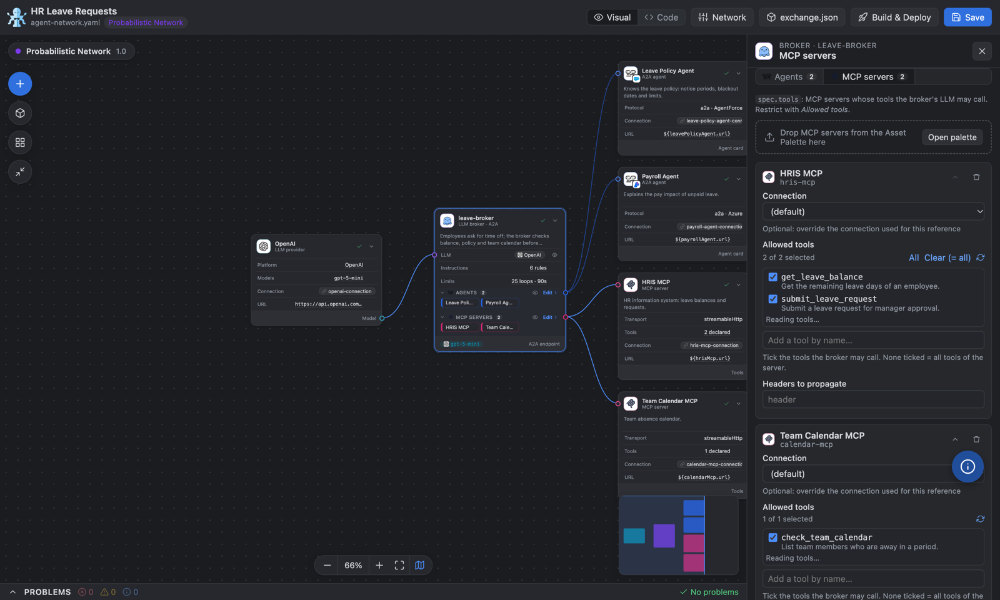

### Step 3.8. Write the broker instructions

Back in the broker inspector, open **Instructions and limits**. Replace the default instruction with these entries, one per line:

- You help employees request time off.
- Look up the leave balance with get_leave_balance using the employee id from the request (for example E-3001).
- Ask the Leave Policy agent whether the request follows the policy (notice period, blackout dates, maximum length).
- Check the team calendar with check_team_calendar; warn when more than one team member is already away.
- Submit the request with submit_leave_request only when the balance is enough and the policy agent agrees.
- Ask the Payroll agent about pay impact only for unpaid leave. Finish with the request id and its status.

Set **Max number of loops** `25`, **Max consecutive errors** `3` and **Task timeout (s)** `90`.
Under **Model parameters → OpenAI**, set **Reasoning effort** to `MINIMAL`. The broker then answers within the gateway timeout.

Optionally, fill the broker's **Agent card (A2A 0.3.0)** description: *Employees ask for time off; the broker checks balance, policy and team calendar before submitting the request.*

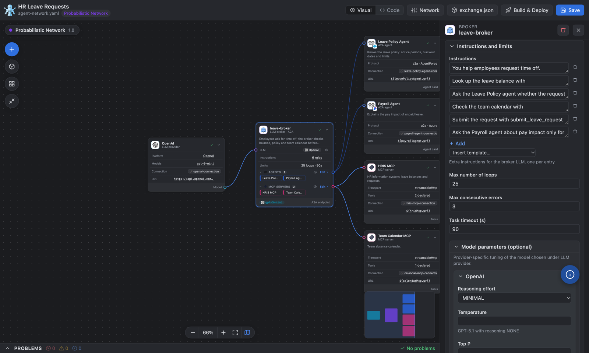

### Step 3.9. Validate, deploy and chat

Run **Validate** from the canvas CLI menu and fix anything in the Problems bar. Then follow Path 2 from [Validate and build](#step-4-validate-and-build) onwards: deploy (enter the secrets), wait for the green light, open the chat and send the same prompts. Your network answers like the template, because it is the same network, built by hand.

## What you learned

- How a probabilistic network is built: an LLM broker with instructions picks agents and MCP tools.
- How the canvas, the inspector and the code view edit the same YAML.
- How to build the same network from a blank project with forms and menus only (Path 3).
- How to validate, build, deploy, chat and trace with Octoloom.

## Next

- Previous: [Employee Onboarding](../v1-employee-onboarding/README.md)
- Next: [IT Helpdesk](../v1-it-helpdesk/README.md)
- Same use case, governed variant: [HR Leave Requests: governed](../v1-hr-leave-governed/README.md)
- Same use case, secured variant: [HR Leave Requests: secured](../v1-hr-leave-secured/README.md)
- [All tutorials](../README.md)

---
Generated from the `v1-hr-leave` template (Octoloom `media/templates/v1-hr-leave`). Screenshots use fake data.
