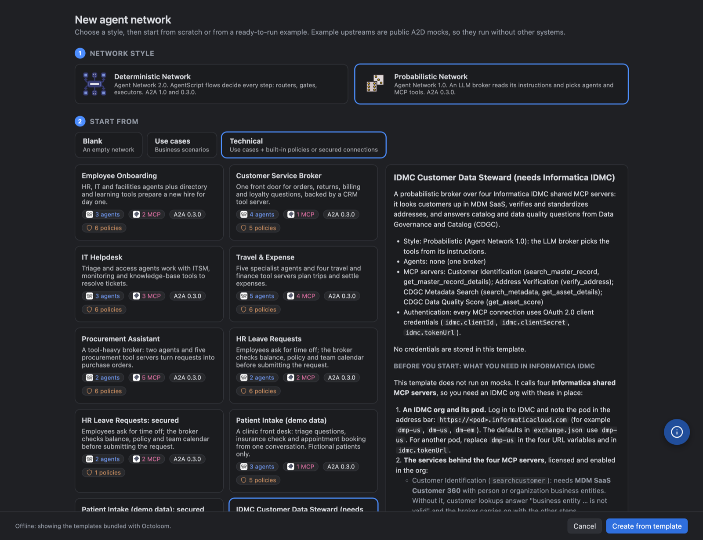
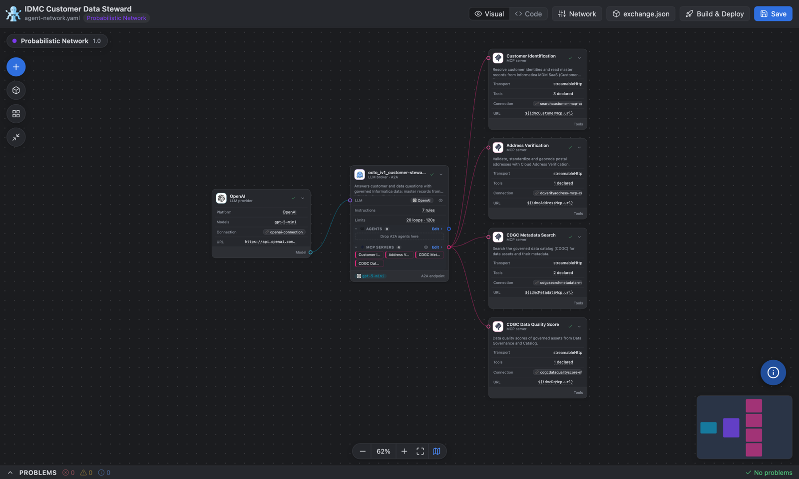
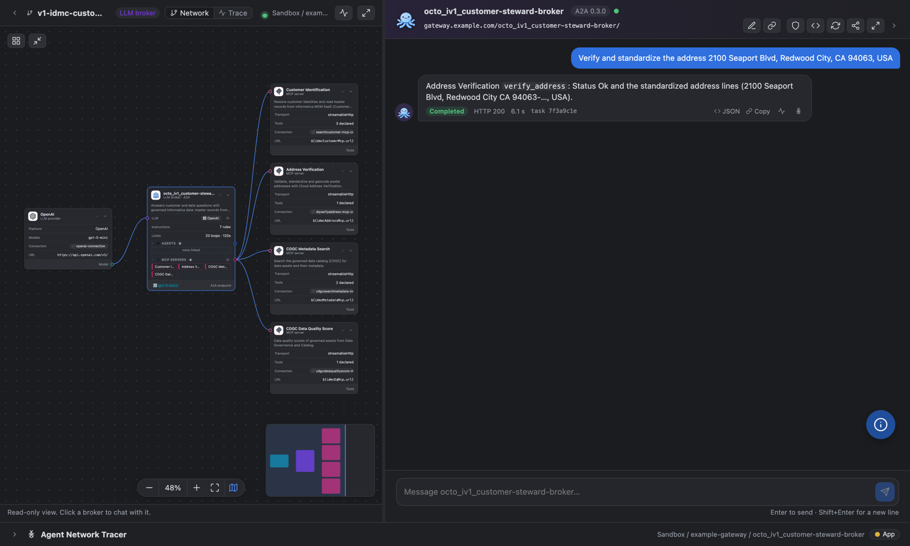

# Tutorial: IDMC Customer Data Steward (needs Informatica IDMC)

[All tutorials](../README.md) · [Getting started](../getting-started.md) · Probabilistic network (Agent Network 1.0, LLM broker) · Technical · IDMC

> One LLM broker over four Informatica shared MCP servers: verify addresses, search the data catalog (CDGC), read data quality scores and look up MDM master records. Needs your own Informatica IDMC org and an IDMC MCP client (OAuth 2.0 client credentials).

| Agents | MCP servers | A2A | Policies | Template id |
|---|---|---|---|---|
| 0 | 4 | 0.3.0 | 0 | `v1-idmc-customer-steward` |

There are two ways to use this template:

1. **[Just use it](#path-1-just-use-it)**: create the project, deploy it and chat with it in about 10 minutes.
2. **[Learn step by step](#path-2-learn-step-by-step)**: the same steps, with what each part of the network does and how Octoloom shows it.

## Before you start

- VS Code with **Octoloom for Agent Fabric** installed (Marketplace), version 0.9.25 or later.
- An Anypoint organization with Agent Fabric, a connected app (client ID and secret), an environment and a Flex gateway.
- An OpenAI API key (or an OpenAI-compatible LLM gateway).
- An Informatica IDMC org with the four shared MCP services and an IDMC MCP client (see the template README, *IDMC setup*).
- Nothing else: the IDMC MCP servers are called with OAuth 2.0 client credentials.

## Path 1: Just use it

1. **Home → Start → New Probabilistic Network.** In the dialog pick **Technical**, then the card **IDMC Customer Data Steward (needs Informatica IDMC)**. Choose a folder and click **Create**.
2. **Deploy.** In `exchange.json`, fill in `ingressgw.url` (ingress gateway base url). Check the pod in the four URL variables and `idmc.tokenUrl`. In **Projects & Deploy**, click **Deploy** on this project (or **Build & Deploy** in the editor) and pick your gateway. Octoloom asks for each secret variable; nothing you type is stored:
   - `openai.apiKey`: OpenAI API key (secret, injected at deploy time)
   - `idmc.clientId`: IDMC MCP client: Client ID (OAuth 2.0 client credentials)
   - `idmc.clientSecret`: IDMC MCP client: Client Secret
3. **Chat.** When the status light is green, click **Open chat** and paste:
   - `Verify and standardize the address 2100 Seaport Blvd, Redwood City, CA 94063, USA`
   - `Which catalog assets hold customer data, and what is their data quality score?`
   - `Check the address 2100 Seaport Blvd, Redwood City, CA 94063 and tell me which catalog assets hold customer address or contact data`
   - `Find the customer John Smith, address 2100 Seaport Blvd, Redwood City, CA 94063`

Done. The rest of this page explains what you just ran.

## Path 2: Learn step by step

### Step 1. Connect Octoloom

Open **Setup & Connect** (Octoloom side bar) and connect **Agent Fabric**: the connected app client ID and secret and the organization. Pick the environment. Also connect **IDMC** (Headless IDMC) if you want the IDMC palette tab. The Tooling list shows Node.js, Java and anypoint-cli-v4 with its agent-network plugin. Use **Install** or **Repair** on any red row.

### Step 2. Create the project from the template

On **Home**, click **New Probabilistic Network**. In **2 Start from**, choose **Technical** and click **IDMC Customer Data Steward (needs Informatica IDMC)**. The right side shows the template README: what it contains, **Deploy in 3 steps** and **Try it**. Keep the suggested name `idmc-customer-steward` or type your own, pick the folder and click **Create**.

Octoloom writes `agent-network.yaml`, `exchange.json`, `README.md`, and opens the canvas. Every id gets the template prefix `octo_iv1_`, so several templates can be deployed into one org side by side.

### Step 3. Read the network on the canvas

Each card is a part of `agent-network.yaml`. Click one to open it in the inspector on the right. Each change in the inspector is a change to the text, so the YAML stays the source of truth (**Code** view shows it).

- **Broker octo_iv1_customer-steward-broker** (`octo_iv1_customer-steward-broker`): the LLM decides which agent or tool to call from its instructions.
  - Instructions:
    - You are a customer data steward. Answer only with data from the Informatica MCP servers.
    - Pick the tools by what the user asks; never ask the user to choose a business entity.
    - For an address check or standardization, call verify_address directly with Request {IO:{Inputs:[{AddressElements:{Country:"USA",Locality:[{Value:<city>}],PostalCode:[{Value:<zip>}],AdministrativeDivision:[{Value:<state>}]},PreformattedData:{PostalDeliveryAddressLines:[<street>]}}]}}. Do not search master records for it.
    - Call verify_address at most once per request. When it returns an error, report the error in one sentence and continue with the other steps; do not retry it.
    - For a catalog or data quality question, call search_metadata with a short knowledgeQuery (for example "customer address"), list the hits with name and type, then call get_asset_score for the best data collection or field.
    - For a named customer, call search_master_record once (entityType "c360.person", or "c360.organization" for a company). When it fails (for example "business entity is not valid"), say so in one sentence and continue with the address and catalog steps.
    - Say clearly when a tool returns no data or an authentication error (the OAuth client or token may be wrong).
- **MCP server Customer Identification**: Resolve customer identities and read master records from Informatica MDM SaaS (Customer 360). Tools: `get_master_record_details`, `get_related_records`, `search_master_record`.
- **MCP server Address Verification**: Validate, standardize and geocode postal addresses with Cloud Address Verification. Tools: `verify_address`.
- **MCP server CDGC Metadata Search**: Search the governed data catalog (CDGC) for data assets and their metadata. Tools: `get_asset_details`, `search_metadata`.
- **MCP server CDGC Data Quality Score**: Data quality scores of governed assets from Data Governance and Catalog. Tools: `get_asset_score`.

Try this on the canvas: use the zoom bar and the minimap, drag a card, or **Auto layout**. The layout is saved per file. **Minimize all** turns the cards into icon tiles. Click a connection line to see which broker uses which agent or tool.

### Step 4. Validate and build

In the canvas toolbar, open the CLI menu: **Validate** does a dry run of build, publish and deploy and lists problems in the Problems panel (click one to jump to the card). **Build** repairs and packages the project locally with anypoint-cli-v4.

The variables of this template (in `exchange.json`, open it for the no-code form):

| Variable | What | Default |
|---|---|---|
| `idmc.tokenUrl` | IDMC MCP client: Token URL | `https://dmp-us.informaticacloud.com/authz-service/oauth/token` |
| `idmcCustomerMcp.url` | Customer Identification (Informatica shared MCP server, pod dmp-us) full server URL (the gateway forwards to it as is) | `https://mcp.dmp-us.informaticacloud.com/mcp-servers/public/searchcustomer` |
| `idmcAddressMcp.url` | Address Verification (Informatica shared MCP server, pod dmp-us) full server URL (the gateway forwards to it as is) | `https://mcp.dmp-us.informaticacloud.com/mcp-servers/public/dqverifyaddress` |
| `idmcMetadataMcp.url` | CDGC Metadata Search (Informatica shared MCP server, pod dmp-us) full server URL (the gateway forwards to it as is) | `https://mcp.dmp-us.informaticacloud.com/mcp-servers/public/cdgcsearchmetadata` |
| `idmcDqMcp.url` | CDGC Data Quality Score (Informatica shared MCP server, pod dmp-us) full server URL (the gateway forwards to it as is) | `https://mcp.dmp-us.informaticacloud.com/mcp-servers/public/cdgcdataqualityscore` |
| `ingressgw.url` | Ingress gateway base URL (the broker is served under it) | (fill in) |

### Step 5. Deploy

Open **Projects & Deploy** and click **Deploy** on the project (or **Deploy…** on the canvas). Pick your gateway (the chips show its status and space), keep **Tracing**, **Wait until the network is ready** and **Publish before deploy** on, then enter the secrets. Nothing you type is stored:

- `openai.apiKey`: OpenAI API key (secret, injected at deploy time)
- `idmc.clientId`: IDMC MCP client: Client ID (OAuth 2.0 client credentials)
- `idmc.clientSecret`: IDMC MCP client: Client Secret

For a probabilistic network, also fill `ingressgw.url` in `exchange.json` (your ingress gateway base URL) before you deploy.

The square status light goes from blue (deploying) to green (**Deployed and running**). The deployment box lists every broker URL; click one to copy it.

### Step 6. Chat with the broker

Click **Open chat** on the deployment box. On the left is the network (the cards light up as they are called), and on the right is the conversation with its task states. Paste the prompts one at a time:

*The reply in the screenshot is an illustration: it shows what the broker answers. The real wording changes from run to run.*

| Prompt | You should see |
|---|---|
| `Verify and standardize the address 2100 Seaport Blvd, Redwood City, CA 94063, USA` | Address Verification `verify_address`: Status Ok and the standardized address lines (2100 Seaport Blvd, Redwood City CA 94063-…, USA). |
| `Which catalog assets hold customer data, and what is their data quality score?` | CDGC Metadata Search `search_metadata`: a list of catalog hits (data collections, classifications, protections, fields) with name and type, then CDGC Data Quality Score `get_asset_score`: the score of the most relevant asset, or that no score is recorded. |
| `Check the address 2100 Seaport Blvd, Redwood City, CA 94063 and tell me which catalog assets hold customer address or contact data` | `verify_address` with Status Ok first, then the catalog hits for customer address and contact data from `search_metadata`. |
| `Find the customer John Smith, address 2100 Seaport Blvd, Redwood City, CA 94063` | Customer Identification `search_master_record`: the master record (business ID, name, address) when MDM SaaS Customer 360 is in place; without it, one sentence with the MDM error ("business entity … is not valid"), then the address check. |

The broker is probabilistic: the LLM picks the tools, so the wording and the order of the calls can change between runs.

### Step 7. Trace a reply

Under each reply, the **Tracer** icon opens the task in the **Agent Network Tracer**: a waterfall of every call the broker made (gateway, broker, LLM, A2A agents, MCP tools) on one time axis, coloured like the cards. Errors are red. Click a span to see its request and response. The **Network** view shows the same reply as a sequence of calls.

### Step 8. Share it (optional)

The **Share** icon in the chat header opens the Share dialog. **A²D sessions** invites people by email to chat with this deployed broker and brings their passed / failed marks and comments back. **Local portal** generates a small web chat you can run or host anywhere.

## What you learned

- How a probabilistic network is built: an LLM broker with instructions picks agents and MCP tools.
- How the canvas, the inspector and the code view edit the same YAML.
- How to validate, build, deploy, chat and trace with Octoloom.

## Next

- Previous: [Patient Intake (demo data): secured](../v1-patient-intake-secured/README.md)
- [All tutorials](../README.md)

---
Generated from the `v1-idmc-customer-steward` template (Octoloom `media/templates/v1-idmc-customer-steward`). Screenshots use fake data.
