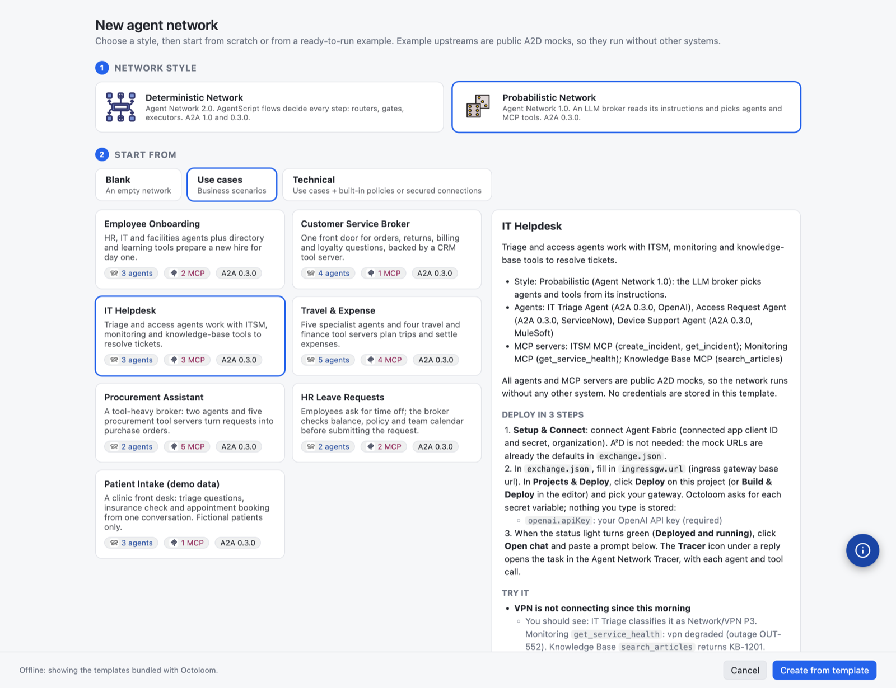
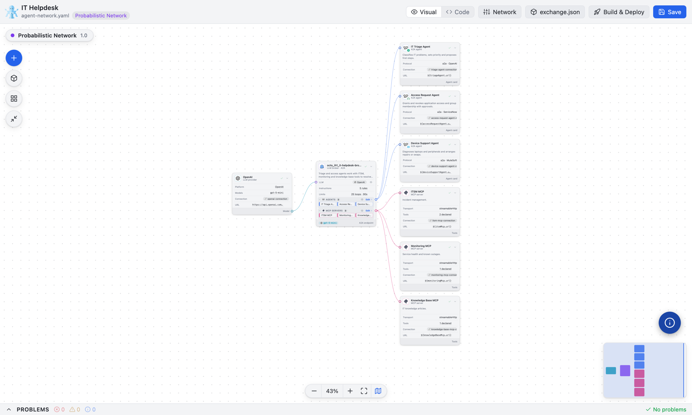
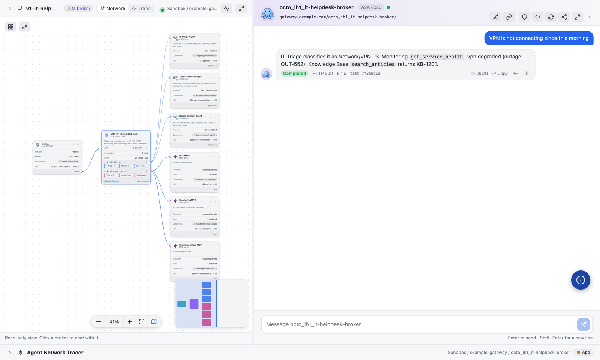

# Tutorial: IT Helpdesk

[All tutorials](../README.md) · [Getting started](../getting-started.md) · Probabilistic network (Agent Network 1.0, LLM broker) · Use case

> Triage and access agents work with ITSM, monitoring and knowledge-base tools to resolve tickets.

| Agents | MCP servers | A2A | Policies | Template id |
|---|---|---|---|---|
| 3 | 3 | 0.3.0 | 0 | `v1-it-helpdesk` |

There are two ways to use this template:

1. **[Just use it](#path-1-just-use-it)**: create the project, deploy it and chat with it in about 10 minutes.
2. **[Learn step by step](#path-2-learn-step-by-step)**: the same steps, with what each part of the network does and how Octoloom shows it.

## Before you start

- VS Code with **Octoloom for Agent Fabric** installed (Marketplace), version 0.9.25 or later.
- An Anypoint organization with Agent Fabric, a connected app (client ID and secret), an environment and a Flex gateway.
- An OpenAI API key (or an OpenAI-compatible LLM gateway).
- Nothing else: all agents and MCP servers are public A²D mocks, so the network runs without any other system.

## Path 1: Just use it

1. **Home → Start → New Probabilistic Network.** In the dialog pick **Use cases**, then the card **IT Helpdesk**. Choose a folder and click **Create**.
2. **Deploy.** In `exchange.json`, fill in `ingressgw.url` (ingress gateway base url). In **Projects & Deploy**, click **Deploy** on this project (or **Build & Deploy** in the editor) and pick your gateway. Octoloom asks for each secret variable; nothing you type is stored:
   - `openai.apiKey`: OpenAI API key (secret, injected at deploy time)
3. **Chat.** When the status light is green, click **Open chat** and paste:
   - `VPN is not connecting since this morning`
   - `I need access to the finance SharePoint`
   - `My laptop screen flickers`
   - `P1: nobody can log in to email. Open an incident`
   - `What is the status of INC-90017?`

Done. The rest of this page explains what you just ran.

## Path 2: Learn step by step

### Step 1. Connect Octoloom

Open **Setup & Connect** (Octoloom side bar) and connect **Agent Fabric**: the connected app client ID and secret and the organization. Pick the environment. A²D isn't needed: the mock URLs are already the defaults in `exchange.json`. The Tooling list shows Node.js, Java and anypoint-cli-v4 with its agent-network plugin. Use **Install** or **Repair** on any red row.

### Step 2. Create the project from the template

On **Home**, click **New Probabilistic Network**. In **2 Start from**, choose **Use cases** and click **IT Helpdesk**. The right side shows the template README: what it contains, **Deploy in 3 steps** and **Try it**. Keep the suggested name `it-helpdesk` or type your own, pick the folder and click **Create**.

Octoloom writes `agent-network.yaml`, `exchange.json`, `README.md`, and opens the canvas. Every id gets the template prefix `octo_ih1_`, so several templates can be deployed into one org side by side.

### Step 3. Read the network on the canvas

Each card is a part of `agent-network.yaml`. Click one to open it in the inspector on the right. Each change in the inspector is a change to the text, so the YAML stays the source of truth (**Code** view shows it).

- **Broker octo_ih1_it-helpdesk-broker** (`octo_ih1_it-helpdesk-broker`): the LLM decides which agent or tool to call from its instructions.
  - Instructions:
    - You are the IT helpdesk for employees.
    - Before opening an incident, check service health with get_service_health and search the knowledge base with search_articles.
    - Use the Triage agent to classify and prioritise problems, the Access Request agent for permissions and group membership, and the Device Support agent for hardware.
    - Open an incident with create_incident only when no article or known outage explains the problem.
    - Always return the incident or article id to the user.
- **Agent IT Triage Agent**: Classifies IT problems, sets priority and proposes first steps.
- **Agent Access Request Agent**: Grants and revokes application access and group membership with approvals.
- **Agent Device Support Agent**: Diagnoses laptops and peripherals and arranges repairs or swaps.
- **MCP server ITSM MCP**: Incident management. Tools: `create_incident`, `get_incident`.
- **MCP server Monitoring MCP**: Service health and known outages. Tools: `get_service_health`.
- **MCP server Knowledge Base MCP**: IT knowledge articles. Tools: `search_articles`.

Try this on the canvas: use the zoom bar and the minimap, drag a card, or **Auto layout**. The layout is saved per file. **Minimize all** turns the cards into icon tiles. Click a connection line to see which broker uses which agent or tool.

### Step 4. Validate and build

In the canvas toolbar, open the CLI menu: **Validate** does a dry run of build, publish and deploy and lists problems in the Problems panel (click one to jump to the card). **Build** repairs and packages the project locally with anypoint-cli-v4.

The variables of this template (in `exchange.json`, open it for the no-code form):

| Variable | What | Default |
|---|---|---|
| `ingressgw.url` | Ingress gateway base URL (the broker is served under it) | (fill in) |
| `itsmMcp.url` | ITSM MCP (A2D mock) base URL | `https://www.a2d-ai.com/api/platform/f5f65633-e17d-47c0-b614-d7938491a0d4/` |
| `monitoringMcp.url` | Monitoring MCP (A2D mock) base URL | `https://www.a2d-ai.com/api/platform/9561493a-b2ee-43ba-8886-a66c16c16c60/` |
| `knowledgeBaseMcp.url` | Knowledge Base MCP (A2D mock) base URL | `https://www.a2d-ai.com/api/platform/24391eb8-75c8-4a2e-b3b1-1381c9cf4447/` |
| `triageAgent.url` | IT Triage Agent (A2D mock, A2A 0.3.0) URL | `https://www.a2d-ai.com/api/platform/db876bb1-f86f-4835-b40f-97c66079debc/a2a` |
| `accessRequestAgent.url` | Access Request Agent (A2D mock, A2A 0.3.0) URL | `https://www.a2d-ai.com/api/platform/d1d495b2-e51a-447e-bdb1-4ac7d36c2fe1/a2a` |
| `deviceSupportAgent.url` | Device Support Agent (A2D mock, A2A 0.3.0) URL | `https://www.a2d-ai.com/api/platform/ba36ab0b-df70-4dd9-bc15-6a17008798cc/a2a` |

### Step 5. Deploy

Open **Projects & Deploy** and click **Deploy** on the project (or **Deploy…** on the canvas). Pick your gateway (the chips show its status and space), keep **Tracing**, **Wait until the network is ready** and **Publish before deploy** on, then enter the secrets. Nothing you type is stored:

- `openai.apiKey`: OpenAI API key (secret, injected at deploy time)

For a probabilistic network, also fill `ingressgw.url` in `exchange.json` (your ingress gateway base URL) before you deploy.

The square status light goes from blue (deploying) to green (**Deployed and running**). The deployment box lists every broker URL; click one to copy it.

### Step 6. Chat with the broker

Click **Open chat** on the deployment box. On the left is the network (the cards light up as they are called), and on the right is the conversation with its task states. Paste the prompts one at a time:

*The reply in the screenshot is an illustration: it shows what the broker answers. The real wording changes from run to run.*

| Prompt | You should see |
|---|---|
| `VPN is not connecting since this morning` | IT Triage classifies it as Network/VPN P3. Monitoring `get_service_health`: vpn degraded (outage OUT-552). Knowledge Base `search_articles` returns KB-1201. |
| `I need access to the finance SharePoint` | Access Request Agent opens access request AR-7781. |
| `My laptop screen flickers` | Knowledge Base returns KB-2210. Device Support pushes a display driver update and books swap SW-3310 for tomorrow 10:00 if it still flickers. |
| `P1: nobody can log in to email. Open an incident` | ITSM `create_incident` creates INC-90001. |
| `What is the status of INC-90017?` | ITSM `get_incident`: in progress, assigned to Alex Kim. |

The broker is probabilistic: the LLM picks the agents and tools, so the wording and the order of the calls can change between runs. The ids and numbers come from the mocks and stay the same.

### Step 7. Trace a reply

Under each reply, the **Tracer** icon opens the task in the **Agent Network Tracer**: a waterfall of every call the broker made (gateway, broker, LLM, A2A agents, MCP tools) on one time axis, coloured like the cards. Errors are red. Click a span to see its request and response. The **Network** view shows the same reply as a sequence of calls.

### Step 8. Share it (optional)

The **Share** icon in the chat header opens the Share dialog. **A²D sessions** invites people by email to chat with this deployed broker and brings their passed / failed marks and comments back. **Local portal** generates a small web chat you can run or host anywhere.

## What you learned

- How a probabilistic network is built: an LLM broker with instructions picks agents and MCP tools.
- How the canvas, the inspector and the code view edit the same YAML.
- How to validate, build, deploy, chat and trace with Octoloom.

## Next

- Previous: [HR Leave Requests](../v1-hr-leave/README.md)
- Next: [Patient Intake (demo data)](../v1-patient-intake/README.md)
- Same use case, governed variant: [IT Helpdesk: governed](../v1-it-helpdesk-governed/README.md)
- [All tutorials](../README.md)

---
Generated from the `v1-it-helpdesk` template (Octoloom `media/templates/v1-it-helpdesk`). Screenshots use fake data.
