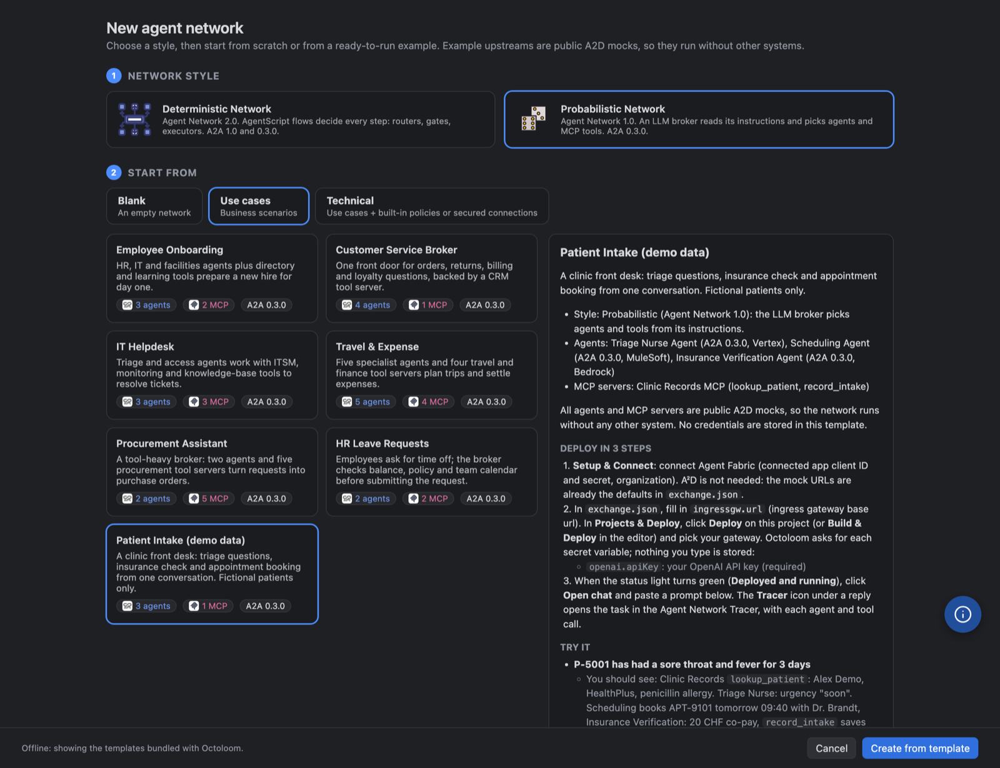
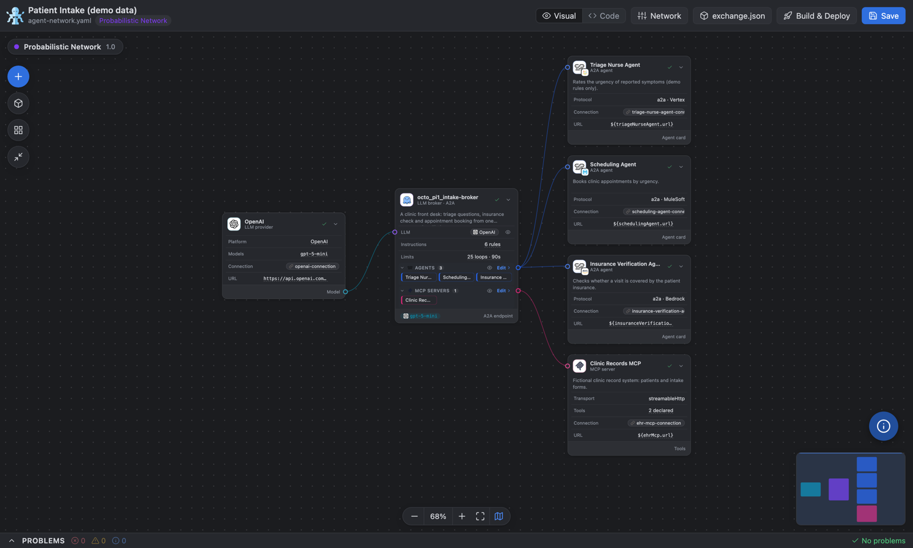
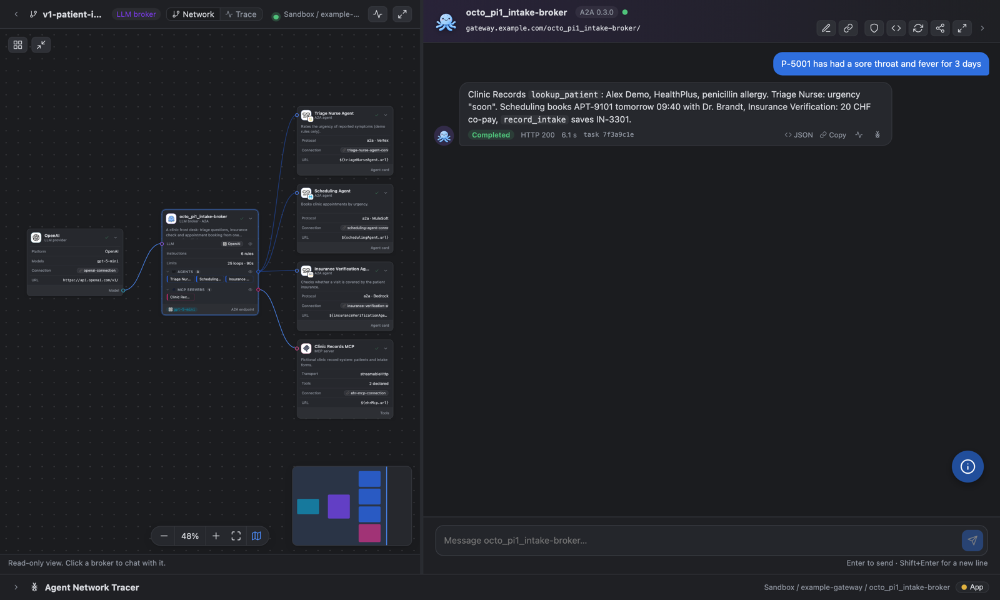

# Tutorial: Patient Intake (demo data)

[All tutorials](../README.md) · [Getting started](../getting-started.md) · Probabilistic network (Agent Network 1.0, LLM broker) · Use case

> A clinic front desk: triage questions, insurance check and appointment booking from one conversation. Fictional patients only.

| Agents | MCP servers | A2A | Policies | Template id |
|---|---|---|---|---|
| 3 | 1 | 0.3.0 | 0 | `v1-patient-intake` |

There are two ways to use this template:

1. **[Just use it](#path-1-just-use-it)**: create the project, deploy it and chat with it in about 10 minutes.
2. **[Learn step by step](#path-2-learn-step-by-step)**: the same steps, with what each part of the network does and how Octoloom shows it.

## Before you start

- VS Code with **Octoloom for Agent Fabric** installed (Marketplace), version 0.9.25 or later.
- An Anypoint organization with Agent Fabric, a connected app (client ID and secret), an environment and a Flex gateway.
- An OpenAI API key (or an OpenAI-compatible LLM gateway).
- Nothing else: all agents and MCP servers are public A²D mocks, so the network runs without any other system.

## Path 1: Just use it

1. **Home → Start → New Probabilistic Network.** In the dialog pick **Use cases**, then the card **Patient Intake (demo data)**. Choose a folder and click **Create**.
2. **Deploy.** In `exchange.json`, fill in `ingressgw.url` (ingress gateway base url). In **Projects & Deploy**, click **Deploy** on this project (or **Build & Deploy** in the editor) and pick your gateway. Octoloom asks for each secret variable; nothing you type is stored:
   - `openai.apiKey`: OpenAI API key (secret, injected at deploy time)
3. **Chat.** When the status light is green, click **Open chat** and paste:
   - `P-5001 has had a sore throat and fever for 3 days`
   - `Book a check-up for P-5002, insurance HealthPlus`
   - `P-5001 has chest pain right now`

Done. The rest of this page explains what you just ran.

## Path 2: Learn step by step

### Step 1. Connect Octoloom

Open **Setup & Connect** (Octoloom side bar) and connect **Agent Fabric**: the connected app client ID and secret and the organization. Pick the environment. A²D isn't needed: the mock URLs are already the defaults in `exchange.json`. The Tooling list shows Node.js, Java and anypoint-cli-v4 with its agent-network plugin. Use **Install** or **Repair** on any red row.

### Step 2. Create the project from the template

On **Home**, click **New Probabilistic Network**. In **2 Start from**, choose **Use cases** and click **Patient Intake (demo data)**. The right side shows the template README: what it contains, **Deploy in 3 steps** and **Try it**. Keep the suggested name `patient-intake` or type your own, pick the folder and click **Create**.

Octoloom writes `agent-network.yaml`, `exchange.json`, `README.md`, and opens the canvas. Every id gets the template prefix `octo_pi1_`, so several templates can be deployed into one org side by side.

### Step 3. Read the network on the canvas

Each card is a part of `agent-network.yaml`. Click one to open it in the inspector on the right. Each change in the inspector is a change to the text, so the YAML stays the source of truth (**Code** view shows it).

- **Broker octo_pi1_intake-broker** (`octo_pi1_intake-broker`): the LLM decides which agent or tool to call from its instructions.
  - Instructions:
    - You are the front desk of a fictional outpatient clinic. All data is demo data; never give medical advice.
    - Find the patient record with lookup_patient using the patient id from the request (for example P-5001).
    - Ask the Triage Nurse agent for the urgency of the symptoms. If the urgency is emergency, tell the user to call the emergency number and stop.
    - Ask the Insurance Verification agent whether the visit is covered.
    - Ask the Scheduling agent for the first slot that matches the urgency, then save the intake with record_intake.
    - Finish with the appointment, the coverage and what the patient should bring.
- **Agent Triage Nurse Agent**: Rates the urgency of reported symptoms (demo rules only).
- **Agent Scheduling Agent**: Books clinic appointments by urgency.
- **Agent Insurance Verification Agent**: Checks whether a visit is covered by the patient insurance.
- **MCP server Clinic Records MCP**: Fictional clinic record system: patients and intake forms. Tools: `lookup_patient`, `record_intake`.

Try this on the canvas: use the zoom bar and the minimap, drag a card, or **Auto layout**. The layout is saved per file. **Minimize all** turns the cards into icon tiles. Click a connection line to see which broker uses which agent or tool.

### Step 4. Validate and build

In the canvas toolbar, open the CLI menu: **Validate** does a dry run of build, publish and deploy and lists problems in the Problems panel (click one to jump to the card). **Build** repairs and packages the project locally with anypoint-cli-v4.

The variables of this template (in `exchange.json`, open it for the no-code form):

| Variable | What | Default |
|---|---|---|
| `ingressgw.url` | Ingress gateway base URL (the broker is served under it) | (fill in) |
| `ehrMcp.url` | Clinic Records MCP (A2D mock) base URL | `https://www.a2d-ai.com/api/platform/94c4f7d4-3a72-4b29-a043-284640c540e0/` |
| `triageNurseAgent.url` | Triage Nurse Agent (A2D mock, A2A 0.3.0) URL | `https://www.a2d-ai.com/api/platform/6334f04d-8eec-4132-8f03-18ff35cac474/a2a` |
| `schedulingAgent.url` | Scheduling Agent (A2D mock, A2A 0.3.0) URL | `https://www.a2d-ai.com/api/platform/fd68731a-35b6-460c-817b-19a000773bdf/a2a` |
| `insuranceVerificationAgent.url` | Insurance Verification Agent (A2D mock, A2A 0.3.0) URL | `https://www.a2d-ai.com/api/platform/be8502c1-78b2-4b69-8a27-0b6a13ed4b8b/a2a` |

### Step 5. Deploy

Open **Projects & Deploy** and click **Deploy** on the project (or **Deploy…** on the canvas). Pick your gateway (the chips show its status and space), keep **Tracing**, **Wait until the network is ready** and **Publish before deploy** on, then enter the secrets. Nothing you type is stored:

- `openai.apiKey`: OpenAI API key (secret, injected at deploy time)

For a probabilistic network, also fill `ingressgw.url` in `exchange.json` (your ingress gateway base URL) before you deploy.

The square status light goes from blue (deploying) to green (**Deployed and running**). The deployment box lists every broker URL; click one to copy it.

### Step 6. Chat with the broker

Click **Open chat** on the deployment box. On the left is the network (the cards light up as they are called), and on the right is the conversation with its task states. Paste the prompts one at a time:

*The reply in the screenshot is an illustration: it shows what the broker answers. The real wording changes from run to run.*

| Prompt | You should see |
|---|---|
| `P-5001 has had a sore throat and fever for 3 days` | Clinic Records `lookup_patient`: Alex Demo, HealthPlus, penicillin allergy. Triage Nurse: urgency "soon". Scheduling books APT-9101 tomorrow 09:40 with Dr. Brandt, Insurance Verification: 20 CHF co-pay, `record_intake` saves IN-3301. |
| `Book a check-up for P-5002, insurance HealthPlus` | Triage "routine", Scheduling books APT-9102 on 2026-11-27 14:00 with Dr. Okafor. The record says Sam Example is insured with CareOne (no co-pay), so the broker may point out the mismatch. |
| `P-5001 has chest pain right now` | Triage Nurse: "emergency". The broker stops and tells the patient to call emergency services; no appointment is booked. |

The broker is probabilistic: the LLM picks the agents and tools, so the wording and the order of the calls can change between runs. The ids and numbers come from the mocks and stay the same.

### Step 7. Trace a reply

Under each reply, the **Tracer** icon opens the task in the **Agent Network Tracer**: a waterfall of every call the broker made (gateway, broker, LLM, A2A agents, MCP tools) on one time axis, coloured like the cards. Errors are red. Click a span to see its request and response. The **Network** view shows the same reply as a sequence of calls.

### Step 8. Share it (optional)

The **Share** icon in the chat header opens the Share dialog. **A²D sessions** invites people by email to chat with this deployed broker and brings their passed / failed marks and comments back. **Local portal** generates a small web chat you can run or host anywhere.

## What you learned

- How a probabilistic network is built: an LLM broker with instructions picks agents and MCP tools.
- How the canvas, the inspector and the code view edit the same YAML.
- How to validate, build, deploy, chat and trace with Octoloom.

## Next

- Previous: [IT Helpdesk](../v1-it-helpdesk/README.md)
- Next: [Procurement Assistant](../v1-procurement/README.md)
- Same use case, governed variant: [Patient Intake (demo data): governed](../v1-patient-intake-governed/README.md)
- Same use case, secured variant: [Patient Intake (demo data): secured](../v1-patient-intake-secured/README.md)
- [All tutorials](../README.md)

---
Generated from the `v1-patient-intake` template (Octoloom `media/templates/v1-patient-intake`). Screenshots use fake data.
