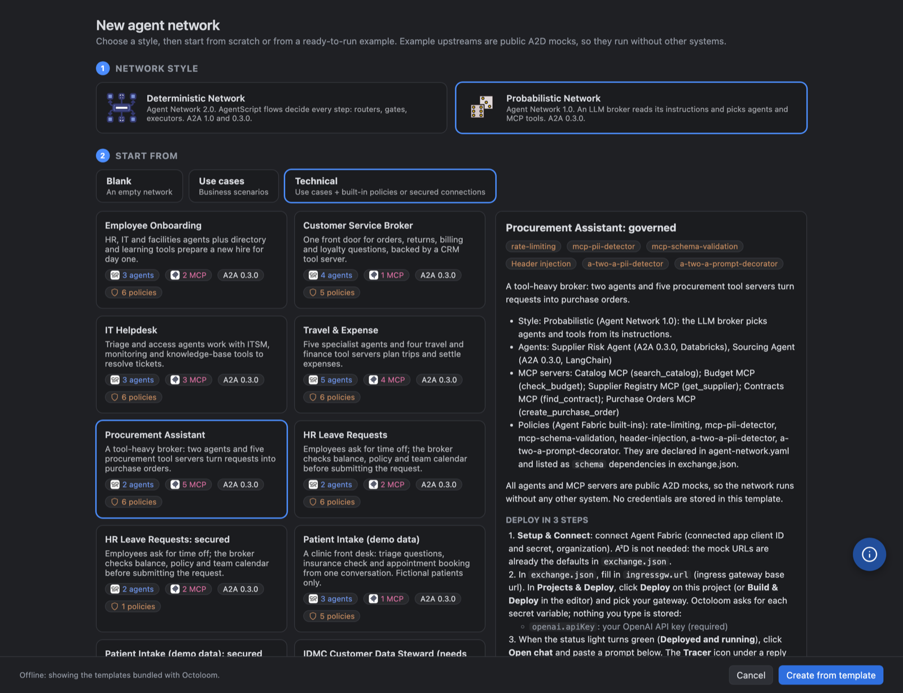
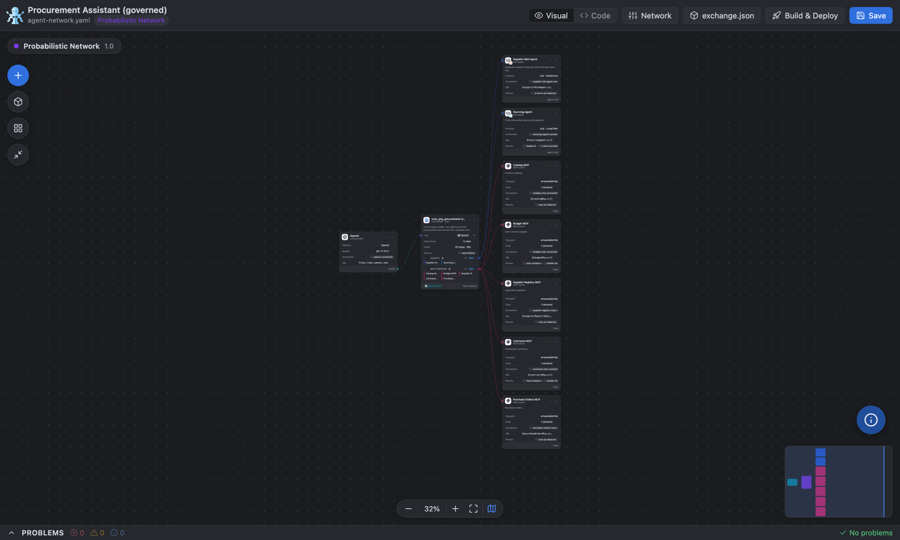

# Tutorial: Procurement Assistant: governed

[All tutorials](../README.md) · [Getting started](../getting-started.md) · Probabilistic network (Agent Network 1.0, LLM broker) · Technical · governed

> A tool-heavy broker: two agents and five procurement tool servers turn requests into purchase orders. Adds built-in policies: rate-limiting, mcp-pii-detector, mcp-schema-validation, header-injection, a-two-a-pii-detector, a-two-a-prompt-decorator.

| Agents | MCP servers | A2A | Policies | Template id |
|---|---|---|---|---|
| 2 | 5 | 0.3.0 | 6 | `v1-procurement-governed` |

There are two ways to use this template:

1. **[Just use it](#path-1-just-use-it)**: create the project, deploy it and chat with it in about 10 minutes.
2. **[Learn step by step](#path-2-learn-step-by-step)**: the same steps, with what each part of the network does and how Octoloom shows it.

## Before you start

- VS Code with **Octoloom for Agent Fabric** installed (Marketplace), version 0.9.25 or later.
- An Anypoint organization with Agent Fabric, a connected app (client ID and secret), an environment and a Flex gateway.
- An OpenAI API key (or an OpenAI-compatible LLM gateway).
- Nothing else: all agents and MCP servers are public A²D mocks, so the network runs without any other system.

## Path 1: Just use it

1. **Home → Start → New Probabilistic Network.** In the dialog pick **Technical**, then the card **Procurement Assistant** (the one with the policies chip). Choose a folder and click **Create**.
2. **Deploy.** In `exchange.json`, fill in `ingressgw.url` (ingress gateway base url). In **Projects & Deploy**, click **Deploy** on this project (or **Build & Deploy** in the editor) and pick your gateway. Octoloom asks for each secret variable; nothing you type is stored:
   - `openai.apiKey`: OpenAI API key (secret, injected at deploy time)
3. **Chat.** When the status light is green, click **Open chat** and paste:
   - `Order 5 monitors for cost centre CC-410`
   - `Is supplier SUP-88 approved? And SUP-91?`
   - `Order 5 monitors for cost centre CC-999`
   - `Find an alternative to MON-27A`
   - `My email is jane.doe@example.com and my phone is +41 79 123 45 67. Order 5 monitors for cost centre CC-410`
   - `Send the first prompt more than 30 times within a minute`

Done. The rest of this page explains what you just ran.

## Path 2: Learn step by step

### Step 1. Connect Octoloom

Open **Setup & Connect** (Octoloom side bar) and connect **Agent Fabric**: the connected app client ID and secret and the organization. Pick the environment. A²D isn't needed: the mock URLs are already the defaults in `exchange.json`. The Tooling list shows Node.js, Java and anypoint-cli-v4 with its agent-network plugin. Use **Install** or **Repair** on any red row.

### Step 2. Create the project from the template

On **Home**, click **New Probabilistic Network**. In **2 Start from**, choose **Technical** and click **Procurement Assistant**. The right side shows the template README: what it contains, **Deploy in 3 steps** and **Try it**. Keep the suggested name `procurement-governed` or type your own, pick the folder and click **Create**.

Octoloom writes `agent-network.yaml`, `exchange.json`, `README.md`, and opens the canvas. Every id gets the template prefix `octo_p1g_`, so several templates can be deployed into one org side by side.

### Step 3. Read the network on the canvas

Each card is a part of `agent-network.yaml`. Click one to open it in the inspector on the right. Each change in the inspector is a change to the text, so the YAML stays the source of truth (**Code** view shows it).

- **Broker octo_p1g_procurement-broker** (`octo_p1g_procurement-broker`): the LLM decides which agent or tool to call from its instructions.
  - Instructions:
    - You turn purchase requests into compliant purchase orders.
    - Find the item in the catalog, check the cost-centre budget and look up the supplier.
    - Ask the Supplier Risk agent to assess any supplier that is not yet approved.
    - Use an existing framework contract when one exists; create the purchase order only when the budget is sufficient.
    - Ask the Sourcing agent for alternatives when an item is unavailable or over budget.
- **Agent Supplier Risk Agent**: Assesses supplier financial, ESG and sanctions risk.
- **Agent Sourcing Agent**: Finds alternative items and suppliers.
- **MCP server Catalog MCP**: Product catalog. Tools: `search_catalog`.
- **MCP server Budget MCP**: Cost-centre budgets. Tools: `check_budget`.
- **MCP server Supplier Registry MCP**: Approved suppliers. Tools: `get_supplier`.
- **MCP server Contracts MCP**: Framework contracts. Tools: `find_contract`.
- **MCP server Purchase Orders MCP**: Purchase orders. Tools: `create_purchase_order`.

Try this on the canvas: use the zoom bar and the minimap, drag a card, or **Auto layout**. The layout is saved per file. **Minimize all** turns the cards into icon tiles. Click a connection line to see which broker uses which agent or tool.

### Step 4. See the policies

This variant adds Agent Fabric policies. Open a broker or connection and look at its **Policies** section. Each policy folds open to show its configuration:
- `rate-limiting`
- `mcp-pii-detector`
- `mcp-schema-validation`
- `header-injection`
- `a-two-a-pii-detector`
- `a-two-a-prompt-decorator`

Run **Governance** (shield icon in the canvas toolbar) to check the project against the Agent Fabric rulesets. It runs locally, and findings show on the cards with **Fix** where one exists.

### Step 5. Validate and build

In the canvas toolbar, open the CLI menu: **Validate** does a dry run of build, publish and deploy and lists problems in the Problems panel (click one to jump to the card). **Build** repairs and packages the project locally with anypoint-cli-v4.

The variables of this template (in `exchange.json`, open it for the no-code form):

| Variable | What | Default |
|---|---|---|
| `ingressgw.url` | Ingress gateway base URL (the broker is served under it) | (fill in) |
| `catalogMcp.url` | Catalog MCP (A2D mock) base URL | `https://www.a2d-ai.com/api/platform/fc34bc2e-353d-47e5-bd83-92e6bf54fc62/` |
| `budgetMcp.url` | Budget MCP (A2D mock) base URL | `https://www.a2d-ai.com/api/platform/f4b4d8b6-3665-461b-bdc7-ddad0844cd4a/` |
| `supplierRegistryMcp.url` | Supplier Registry MCP (A2D mock) base URL | `https://www.a2d-ai.com/api/platform/4ce2b160-071c-4dc2-92c6-8b25b6d6bbd4/` |
| `contractsMcp.url` | Contracts MCP (A2D mock) base URL | `https://www.a2d-ai.com/api/platform/622d4561-4016-44f6-b158-2f642bbb3fe8/` |
| `purchaseOrdersMcp.url` | Purchase Orders MCP (A2D mock) base URL | `https://www.a2d-ai.com/api/platform/701ff77b-9e79-4dda-84bb-867e3aa7ad1b/` |
| `supplierRiskAgent.url` | Supplier Risk Agent (A2D mock, A2A 0.3.0) URL | `https://www.a2d-ai.com/api/platform/61c4b202-4364-402c-bc08-6a6c0c5c719c/a2a` |
| `sourcingAgent.url` | Sourcing Agent (A2D mock, A2A 0.3.0) URL | `https://www.a2d-ai.com/api/platform/6c82f3d9-b7fe-460e-82b8-768e047ba83d/a2a` |

### Step 6. Deploy

Open **Projects & Deploy** and click **Deploy** on the project (or **Deploy…** on the canvas). Pick your gateway (the chips show its status and space), keep **Tracing**, **Wait until the network is ready** and **Publish before deploy** on, then enter the secrets. Nothing you type is stored:

- `openai.apiKey`: OpenAI API key (secret, injected at deploy time)

For a probabilistic network, also fill `ingressgw.url` in `exchange.json` (your ingress gateway base URL) before you deploy.

The square status light goes from blue (deploying) to green (**Deployed and running**). The deployment box lists every broker URL; click one to copy it.

### Step 7. Chat with the broker

Click **Open chat** on the deployment box. On the left is the network (the cards light up as they are called), and on the right is the conversation with its task states. Paste the prompts one at a time:

*The reply in the screenshot is an illustration: it shows what the broker answers. The real wording changes from run to run.*

| Prompt | You should see |
|---|---|
| `Order 5 monitors for cost centre CC-410` | Catalog `search_catalog`: MON-27A, 349 CHF from SUP-88. Budget `check_budget`: CC-410 has 5,200 left. Supplier Risk: SUP-88 approved (risk 23). Contracts `find_contract`: FC-2026-04 (12% off). Purchase Orders `create_purchase_order`: PO-450021, 1,535.60. |
| `Is supplier SUP-88 approved? And SUP-91?` | Supplier Registry `get_supplier` and Supplier Risk: SUP-88 approved (risk 23), SUP-91 not approved (risk 71). |
| `Order 5 monitors for cost centre CC-999` | Budget `check_budget`: CC-999 has only 120 left, so no purchase order is created. |
| `Find an alternative to MON-27A` | Sourcing Agent: 27" QHD monitor MON-27B from SUP-88 at 219 CHF (contract FC-2026-04). |
| `My email is jane.doe@example.com and my phone is +41 79 123 45 67. Order 5 monitors for cost centre CC-410` | Same answer as the first prompt. The PII detector policies log the email and phone number; on the MCP connections with the MCP PII detector they are masked before the tool sees them. Check the policy logs in Anypoint Monitoring. |
| `Send the first prompt more than 30 times within a minute` | The broker answers HTTP 429 (Too Many Requests) once the rate limit of 60 requests per minute is reached. |

The broker is probabilistic: the LLM picks the agents and tools, so the wording and the order of the calls can change between runs. The ids and numbers come from the mocks and stay the same.

### Step 8. Trace a reply

Under each reply, the **Tracer** icon opens the task in the **Agent Network Tracer**: a waterfall of every call the broker made (gateway, broker, LLM, A2A agents, MCP tools) on one time axis, coloured like the cards. Errors are red. Click a span to see its request and response. The **Network** view shows the same reply as a sequence of calls.

### Step 9. Share it (optional)

The **Share** icon in the chat header opens the Share dialog. **A²D sessions** invites people by email to chat with this deployed broker and brings their passed / failed marks and comments back. **Local portal** generates a small web chat you can run or host anywhere.

## What you learned

- How a probabilistic network is built: an LLM broker with instructions picks agents and MCP tools.
- How the canvas, the inspector and the code view edit the same YAML.
- How policies are attached and checked with Governance.
- How to validate, build, deploy, chat and trace with Octoloom.

## Next

- Previous: [Patient Intake (demo data): governed](../v1-patient-intake-governed/README.md)
- Next: [Travel & Expense: governed](../v1-travel-expense-governed/README.md)
- Same use case, plain variant: [Procurement Assistant](../v1-procurement/README.md)
- [All tutorials](../README.md)

---
Generated from the `v1-procurement-governed` template (Octoloom `media/templates/v1-procurement-governed`). Screenshots use fake data.
