# Tutorial: Marketing Campaign Studio: governed

[All tutorials](../README.md) · [Getting started](../getting-started.md) · Deterministic network (Agent Network 2.0, AgentScript) · Technical · governed

> A tool-heavy deterministic flow: two agents and four marketing tool servers build and launch a campaign. Adds built-in policies: a2a-v1-pii-detector, header-injection, mcp-pii-detector, mcp-schema-validation, rate-limiting.

| Agents | MCP servers | A2A | Policies | Template id |
|---|---|---|---|---|
| 2 | 4 | 1.0, 0.3.0 | 5 | `v2-campaign-studio-governed` |

There are three ways to use this template:

1. **[Just use it](#path-1-just-use-it)**: create the project, deploy it and chat with it in about 10 minutes.
2. **[Learn step by step](#path-2-learn-step-by-step)**: the same steps, with what each part of the network does and how Octoloom shows it.
3. **[Build it from scratch](#path-3-build-it-from-scratch)**: start from a blank project and build the same network yourself, no code, one screenshot per step.

## Before you start

- VS Code with **Octoloom for Agent Fabric** installed (Marketplace), version 0.9.25 or later.
- An Anypoint organization with Agent Fabric, an environment, a [Small Managed Omni Gateway](https://octoloom.a2d-ai.com/start/gateway/) and a [connected app](https://octoloom.a2d-ai.com/start/connected-app/) (client ID and secret). New to Anypoint? **[Before you start](https://octoloom.a2d-ai.com/start/)** shows the trial account, the gateway, the connected app and connecting Octoloom, step by step with videos.
- An OpenAI API key (or an OpenAI-compatible LLM gateway).
- Nothing else: all agents and MCP servers are public A²D mocks, so the network runs without any other system.

## Path 1: Just use it

1. **Home → Start → New Deterministic Network.** In the dialog pick **Technical**, then the card **Marketing Campaign Studio** (the one with the policies chip). Choose a folder and click **Create**.
2. **Deploy.** In **Projects & Deploy**, click **Deploy** on this project (or **Build & Deploy** in the editor) and pick your gateway. Octoloom asks for each secret variable; nothing you type is stored:
   - `openai.apiKey`: OpenAI API key (secret, injected at deploy time)
3. **Chat.** When the status light is green, click **Open chat** and paste:
   - `Launch a winter email campaign for segment SEG-VIP`
   - `Plan a social post about our new eco line for SEG-ECO`
   - `Send an email about the eco line to SEG-ECO`
   - `My email is jane.doe@example.com and my phone is +41 79 123 45 67. Launch a winter email campaign for segment SEG-VIP`
   - `Send the first prompt more than 30 times within a minute`

Done. The rest of this page explains what you just ran.

## Path 2: Learn step by step

### Step 1. Connect Octoloom

Open **Setup & Connect** (Octoloom side bar) and connect **Agent Fabric**: the connected app client ID and secret and the organization. Pick the environment. A²D isn't needed: the mock URLs are already the defaults in `exchange.json`. The Tooling list shows Node.js, Java and anypoint-cli-v4 with its agent-network plugin. Use **Install** or **Repair** on any red row.

### Step 2. Create the project from the template

On **Home**, click **New Deterministic Network**. In **2 Start from**, choose **Technical** and click **Marketing Campaign Studio**. The right side shows the template README: what it contains, **Deploy in 3 steps** and **Try it**. Keep the suggested name `campaign-studio-governed` or type your own, pick the folder and click **Create**.

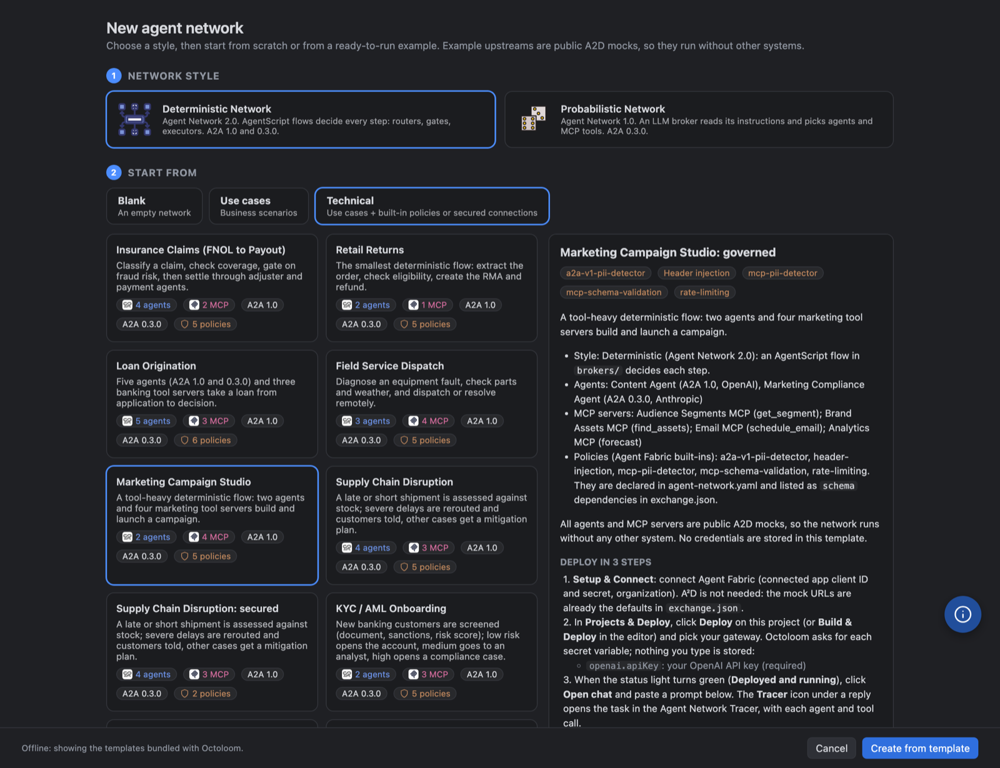

Octoloom writes `agent-network.yaml`, `exchange.json`, `README.md` and the broker flow in `brokers/`, and opens the canvas. Every id gets the template prefix `octo_cs2g_`, so several templates can be deployed into one org side by side.

### Step 3. Read the network on the canvas

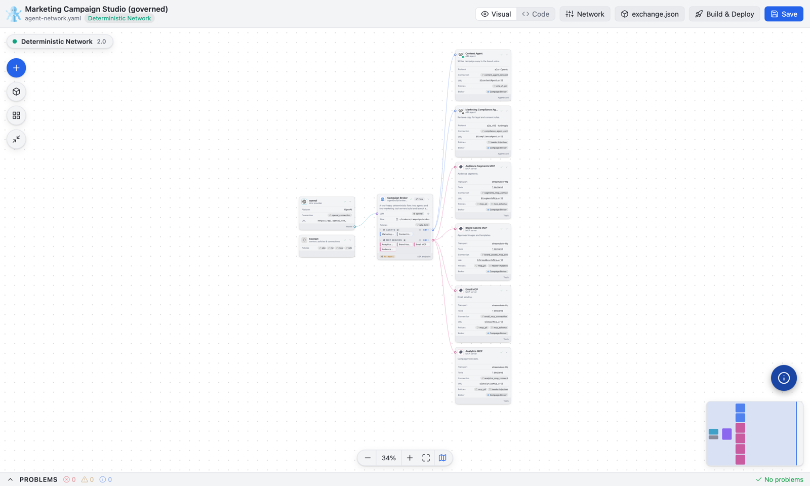

Each card is a part of `agent-network.yaml`. Click one to open it in the inspector on the right. Each change in the inspector is a change to the text, so the YAML stays the source of truth (**Code** view shows it).

- **Broker Campaign Broker** (`octo_cs2g_campaign_broker`): its AgentScript flow decides every step.
- **Agent Content Agent**: Writes campaign copy in the brand voice.
- **Agent Marketing Compliance Agent**: Reviews copy for legal and consent rules.
- **MCP server Audience Segments MCP**: Audience segments. Tools: `get_segment`.
- **MCP server Brand Assets MCP**: Approved images and templates. Tools: `find_assets`.
- **MCP server Email MCP**: Email sending. Tools: `schedule_email`.
- **MCP server Analytics MCP**: Campaign forecasts. Tools: `forecast`.

Try this on the canvas: use the zoom bar and the minimap, drag a card, or **Auto layout**. The layout is saved per file. **Minimize all** turns the cards into icon tiles. Click a connection line to see which broker uses which agent or tool.

### Step 4. Follow the broker flow (AgentScript)

Double-click the broker card (or open `brokers/campaign-broker.agent`). The flow editor shows the AgentScript program that decides every step. The LLM only extracts fields and writes text, so the same input always takes the same branch.

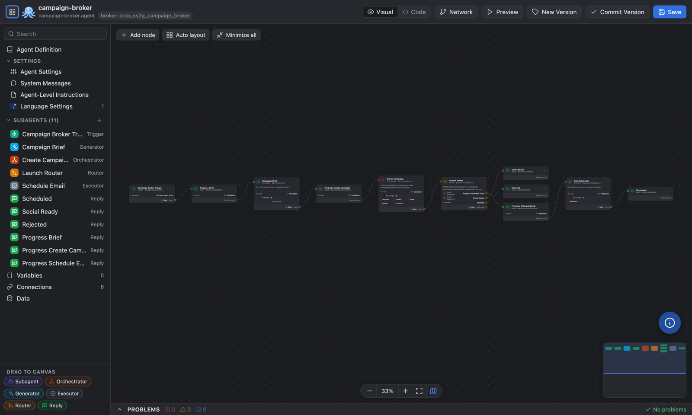

| Step | Kind | What it does |
|---|---|---|
| `campaignBrokerTrigger` | Trigger | Starts the flow when an A2A message arrives at the broker. |
| `brief` | Generator | Turns the request into a campaign brief. |
| `createCampaign` | Orchestrator | Checks the audience, writes copy, gets compliance approval and a forecast. |
| `launchRouter` | Router | Approved email campaigns are scheduled; approved social posts are handed over; the rest are returned. |
| `scheduleEmail` | Executor | Schedules the approved email campaign. |
| `scheduled` | Echo | Ends the flow with the `scheduled` reply. |
| `socialReady` | Echo | Ends the flow with the `socialReady` reply. |
| `rejected` | Echo | Ends the flow with the `rejected` reply. |
| `progressBrief` | Echo | Progress update (`TASK_STATE_WORKING`): tells the caller what comes next, then goes on to that step. With **Live** on, the chat shows it while the broker works. |
| `progressCreateCampaign` | Echo | Progress update (`TASK_STATE_WORKING`): tells the caller what comes next, then goes on to that step. With **Live** on, the chat shows it while the broker works. |
| `progressScheduleEmail` | Echo | Progress update (`TASK_STATE_WORKING`): tells the caller what comes next, then goes on to that step. With **Live** on, the chat shows it while the broker works. |

Click a step to edit it in the inspector. **+ Step** adds a node, and **+ Step → Patterns** inserts whole shapes such as retry, human in the loop or a guardrail check. **Code** shows the `.agent` text with completion.

### Step 5. See the policies

This variant adds Agent Fabric policies. Open a broker or connection and look at its **Policies** section. Each policy folds open to show its configuration:
- `a2a-v1-pii-detector`
- `header-injection`
- `mcp-pii-detector`
- `mcp-schema-validation`
- `rate-limiting`

Run **Governance** (shield icon in the canvas toolbar) to check the project against the Agent Fabric rulesets. It runs locally, and findings show on the cards with **Fix** where one exists.

### Step 6. Validate and build

In the canvas toolbar, open the CLI menu: **Validate** does a dry run of build, publish and deploy and lists problems in the Problems panel (click one to jump to the card). **Build** repairs and packages the project locally with anypoint-cli-v4.

The variables of this template (in `exchange.json`, open it for the no-code form):

| Variable | What | Default |
|---|---|---|
| `contentAgent.url` | Content Agent (A2D mock, A2A 1.0) URL | `https://www.a2d-ai.com/api/platform/5261ec66-5cdc-4b03-84ff-129004f4c483/a2a` |
| `complianceAgent.url` | Marketing Compliance Agent (A2D mock, A2A 0.3.0) URL | `https://www.a2d-ai.com/api/platform/206e0016-f88e-44e4-9a9d-094591cc5284/a2a` |
| `segmentsMcp.url` | Audience Segments MCP (A2D mock) base URL | `https://www.a2d-ai.com/api/platform/8a185e0c-57c4-46de-999e-6f5fa94a7927/` |
| `brandAssetsMcp.url` | Brand Assets MCP (A2D mock) base URL | `https://www.a2d-ai.com/api/platform/7cbd3dc7-ad75-4a42-b17d-f3a4d81ae690/` |
| `emailMcp.url` | Email MCP (A2D mock) base URL | `https://www.a2d-ai.com/api/platform/693ad3bf-5696-43cd-b5a1-830aa3d5ab46/` |
| `analyticsMcp.url` | Analytics MCP (A2D mock) base URL | `https://www.a2d-ai.com/api/platform/9d7ad145-5382-4369-a0c8-14ef0d293ef0/` |

### Step 7. Deploy

Open **Projects & Deploy** and click **Deploy** on the project (or **Deploy…** on the canvas). Pick your gateway (the chips show its status and space), keep **Tracing**, **Wait until the network is ready** and **Publish before deploy** on, then enter the secrets. Nothing you type is stored:

- `openai.apiKey`: OpenAI API key (secret, injected at deploy time)

The square status light goes from blue (deploying) to green (**Deployed and running**). The deployment box lists every broker URL; click one to copy it.

### Step 8. Chat with the broker

Click **Open chat** on the deployment box. On the left is the network (the cards light up as they are called), and on the right is the conversation with its task states. **Live progress** (the antenna button next to Send) is on by default: while the broker works, the chat lists its progress updates (*Turning the request into a campaign brief...*, *Checking the audience, writing the copy, getting compliance approval and a forecast...*) and keeps them above the answer. Paste the prompts one at a time:

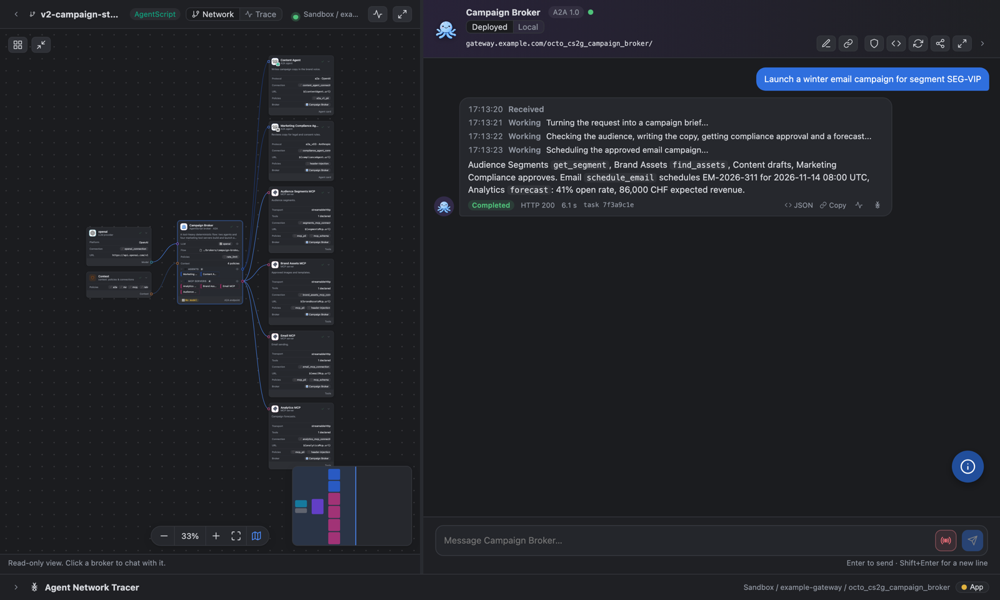

*The reply in the screenshot is an illustration: it shows what the broker answers. The real wording changes from run to run.*

| Prompt | You should see |
|---|---|
| `Launch a winter email campaign for segment SEG-VIP` | Audience Segments `get_segment`, Brand Assets `find_assets`, Content drafts, Marketing Compliance approves. Email `schedule_email` schedules EM-2026-311 for 2026-11-14 08:00 UTC, Analytics `forecast`: 41% open rate, 86,000 CHF expected revenue. |
| `Plan a social post about our new eco line for SEG-ECO` | Compliance approves with a change: "carbon neutral" becomes "lower-impact materials". The flow ends in the social-ready branch. |
| `Send an email about the eco line to SEG-ECO` | SEG-ECO has 0 email-consented contacts: the campaign is returned, nothing is scheduled. |
| `My email is jane.doe@example.com and my phone is +41 79 123 45 67. Launch a winter email campaign for segment SEG-VIP` | Same answer as the first prompt. The PII detector policies log the email and phone number; on the MCP connections with the MCP PII detector they are masked before the tool sees them. Check the policy logs in Anypoint Monitoring. |
| `Send the first prompt more than 30 times within a minute` | The broker answers HTTP 429 (Too Many Requests) once the rate limit of 30 requests per minute is reached. |

The broker is deterministic: the branches are fixed in the flow in `brokers/` (open the `.agent` file to see them). The LLM only reads the ids from your prompt and writes the reply text, so the same input takes the same branch.

### Step 9. Trace a reply

Under each reply, the **Tracer** icon opens the task in the **Agent Network Tracer**: a waterfall of every call the broker made (gateway, broker, LLM, A2A agents, MCP tools) on one time axis, coloured like the cards. Errors are red. Click a span to see its request and response. The **Network** view shows the same reply as a sequence of calls.

### Step 10. Share it (optional)

The **Share** icon in the chat header opens the Share dialog. **A²D sessions** invites people by email to chat with this deployed broker and brings their passed / failed marks and comments back. **Local portal** generates a small web chat you can run or host anywhere.

## Path 3: Build it from scratch

Here you build the same network yourself, starting from a blank project. Every step uses a form, a menu or a button. You never import the template, and you never type YAML or AgentScript. The names below are the template's names without the `octo_cs2g_` prefix. You can use your own names, but keep them consistent.

> The text fields take plain values. Where a value looks like `${group.name}`, type it as shown: it is a **variable** that `exchange.json` declares and that deploy fills in.

### Step 3.1. Create a blank project with a starter broker

Connect Octoloom first, as in [Path 2, Step 1](#step-1-connect-octoloom). Then, on **Home**, click **New Deterministic Network**. In **2 Start from**, choose **Blank** and turn on **Add a starter broker**.

- **Broker name**: `Campaign Broker`
- **Name**: `campaign-studio-governed-scratch` (the Exchange asset id; a different name from the template, so both can live in one org)
- **Parent folder**: pick a folder, then click **Create blank project**.

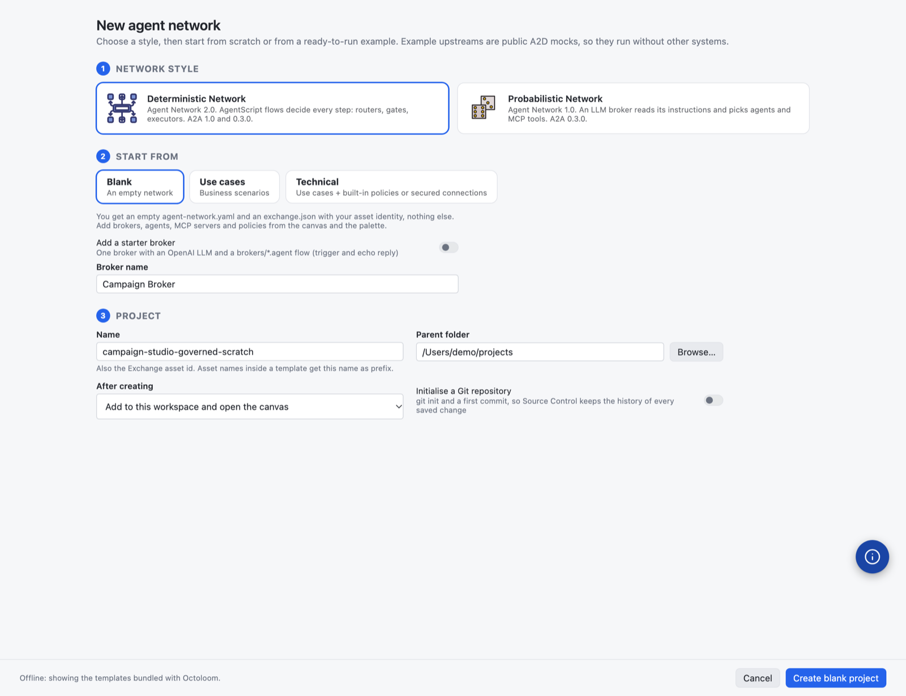

The starter broker `campaign_broker` has an OpenAI LLM connection (`openai_connection`, MuleSoft's published OpenAI LLM) and a flow `brokers/campaign-broker.agent` with a trigger, one subagent and the built-in `done` reply. The LLM is already done.

### Step 3.2. Add the agents

On the canvas, click **+** (Add to the network) → **Agent** → **Empty**. The new agent opens in the inspector on the right. Fill it in, then repeat for each agent:

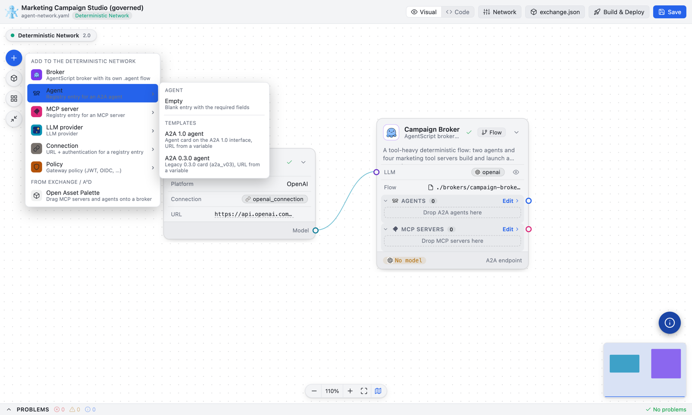

- **Content Agent**
  - **Identity → Key**: `content_agent`
  - **Info → Label**: Content Agent · **Description**: Writes campaign copy in the brand voice.
  - **Metadata → Platform**: `OpenAI` (or click its icon under **Agent framework**)
  - **Interface**: click `a2a` (A2A 1.0). **Agent card (A2A 1.x)**: **Name** Content Agent, **Description** as above, **Supported interfaces → URL** `https://www.a2d-ai.com/api/platform/5261ec66-5cdc-4b03-84ff-129004f4c483/a2a`, Binding `JSONRPC`, Protocol version `1.0`
- **Marketing Compliance Agent**
  - **Identity → Key**: `compliance_agent`
  - **Info → Label**: Marketing Compliance Agent · **Description**: Reviews copy for legal and consent rules.
  - **Metadata → Platform**: `Anthropic` (or click its icon under **Agent framework**)
  - **Interface**: keep `a2a_v03` (A2A 0.3.0). **Agent card (A2A 0.3)**: **Name** Marketing Compliance Agent, **Description** as above, **URL** `https://www.a2d-ai.com/api/platform/206e0016-f88e-44e4-9a9d-094591cc5284/a2a`

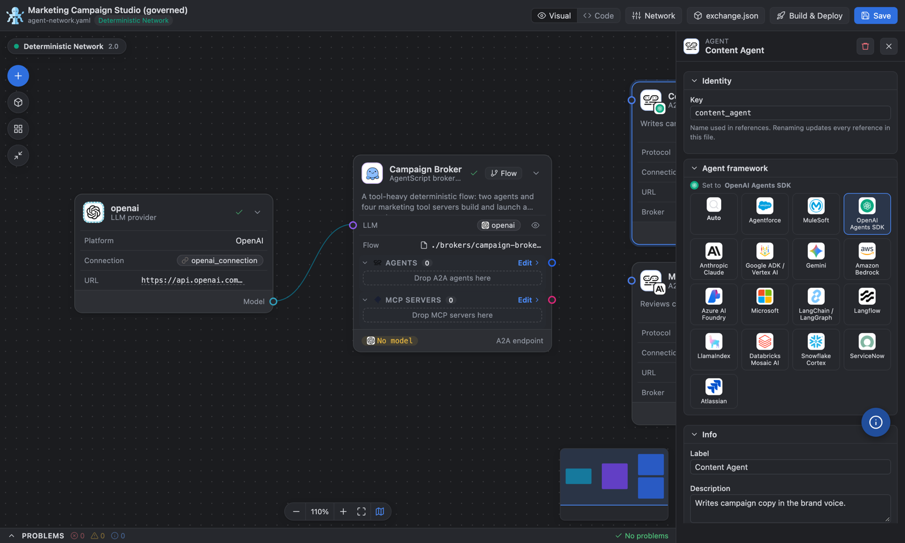

The card skills are optional. Once the agent has a connection (two steps on), the inspector offers **Read skills from the live agent**, which fills them from the running agent.

### Step 3.3. Add the MCP servers

Click **+** → **MCP server** → **Empty**, then fill in:

- **Audience Segments MCP**: **Key** `segments_mcp`, **Label** Audience Segments MCP, **Description** Audience segments · **Protocol version** `2025-06-18`. The transport is already Streamable HTTP on `/mcp`.
- **Brand Assets MCP**: **Key** `brand_assets_mcp`, **Label** Brand Assets MCP, **Description** Approved images and templates · **Protocol version** `2025-06-18`. The transport is already Streamable HTTP on `/mcp`.
- **Email MCP**: **Key** `email_mcp`, **Label** Email MCP, **Description** Email sending · **Protocol version** `2025-06-18`. The transport is already Streamable HTTP on `/mcp`.
- **Analytics MCP**: **Key** `analytics_mcp`, **Label** Analytics MCP, **Description** Campaign forecasts · **Protocol version** `2025-06-18`. The transport is already Streamable HTTP on `/mcp`.

### Step 3.4. Add the connections

A connection is the URL (and authentication) Agent Fabric uses to reach an agent or an MCP server. Click **+** → **Connection** → **Empty** once per agent and MCP server, and fill in:

| Key | Kind | Registry entry → Name | URL |
|---|---|---|---|
| `content_agent_connection` | `a2a` | `content_agent` | `${contentAgent.url}` |
| `compliance_agent_connection` | `a2a` | `compliance_agent` | `${complianceAgent.url}` |
| `segments_mcp_connection` | `mcp` | `segments_mcp` | `${segmentsMcp.url}` |
| `brand_assets_mcp_connection` | `mcp` | `brand_assets_mcp` | `${brandAssetsMcp.url}` |
| `email_mcp_connection` | `mcp` | `email_mcp` | `${emailMcp.url}` |
| `analytics_mcp_connection` | `mcp` | `analytics_mcp` | `${analyticsMcp.url}` |

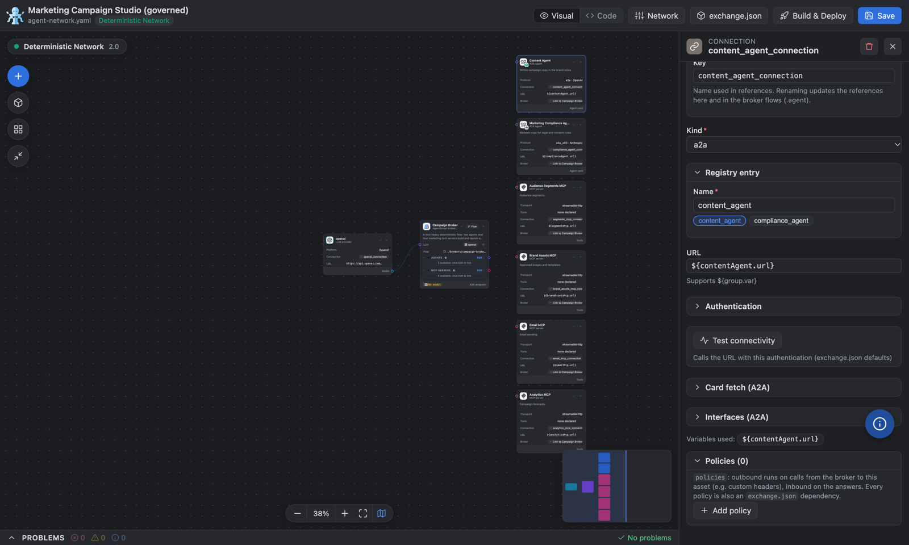

### Step 3.5. Declare the variables

The Problems bar now shows **Variable ${…} is not declared in exchange.json** for each new variable. Click **Add to exchange.json** on each one.

Then open `exchange.json` (it opens as a form) and, under **Variables**, set the defaults:

| Variable | Default |
|---|---|
| `contentAgent.url` | `https://www.a2d-ai.com/api/platform/5261ec66-5cdc-4b03-84ff-129004f4c483/a2a` |
| `complianceAgent.url` | `https://www.a2d-ai.com/api/platform/206e0016-f88e-44e4-9a9d-094591cc5284/a2a` |
| `segmentsMcp.url` | `https://www.a2d-ai.com/api/platform/8a185e0c-57c4-46de-999e-6f5fa94a7927/` |
| `brandAssetsMcp.url` | `https://www.a2d-ai.com/api/platform/7cbd3dc7-ad75-4a42-b17d-f3a4d81ae690/` |
| `emailMcp.url` | `https://www.a2d-ai.com/api/platform/693ad3bf-5696-43cd-b5a1-830aa3d5ab46/` |
| `analyticsMcp.url` | `https://www.a2d-ai.com/api/platform/9d7ad145-5382-4369-a0c8-14ef0d293ef0/` |

Leave the secret variables (`openai.apiKey`) empty: deploy asks for them and never stores them.

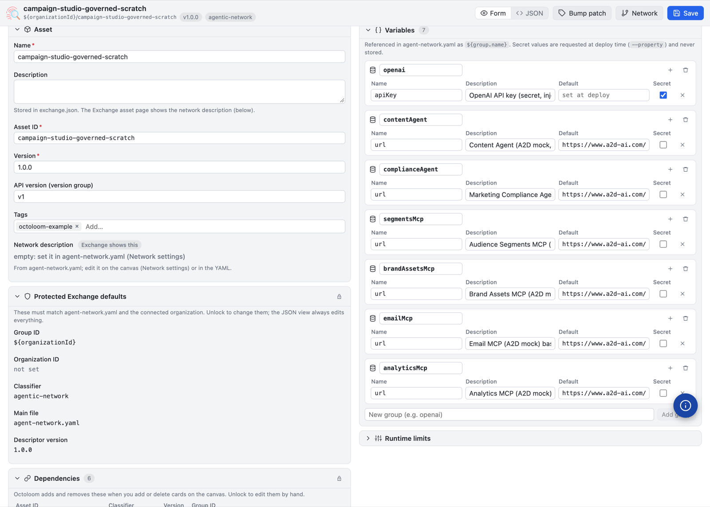

Also click **Remove it** on any **declared but not used** variable that the Problems bar shows.

### Step 3.6. Declare the MCP tools

On each MCP server card, click the **Tools** row (or its pencil). Octoloom reads the tool list from the running server: tick the tools below. You can also type a name in **Add a tool by name…**.

- **Audience Segments MCP**: `get_segment`
- **Brand Assets MCP**: `find_assets`
- **Email MCP**: `schedule_email`
- **Analytics MCP**: `forecast`

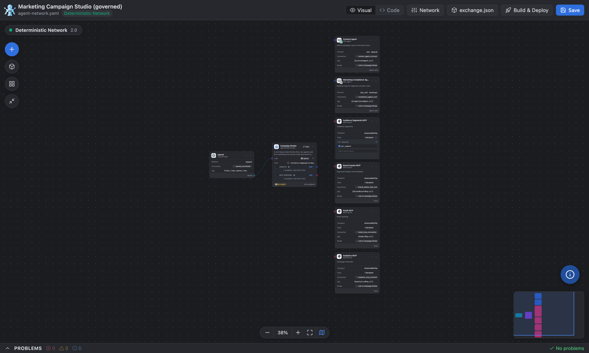

### Step 3.7. Link the agents and MCP servers to the broker

Every agent and MCP card now has a **Broker** row with **Link to Campaign Broker**. Click it on each card. Octoloom adds the matching actions to the broker flow: one per agent and one per declared MCP tool.

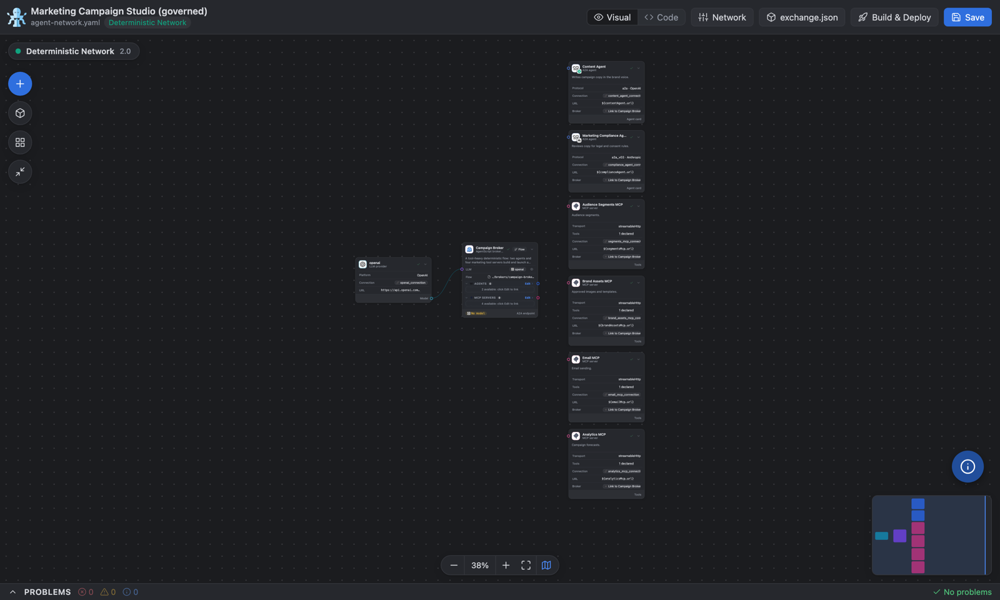

**Link to** also reads the required inputs from the tool schema. In the flow (next step), open **Connections** in the explorer and check that these actions show them under **Inputs** (one per line; type them if they are missing):
- `schedule_email`: `segment_id: string`, `subject: string`

### Step 3.8. Build the broker flow

On the broker card (or in its inspector), click **Open broker flow**. Then set up the flow:

1. **Settings → Language Settings**: on the `default` model, set **Reasoning effort (OpenAI)** to `MINIMAL`.
2. **Settings → System Messages**: set the instructions to: *You build marketing campaigns. Nothing is scheduled without compliance approval and consented audiences.*
3. Select the `assistant` subagent and delete it (trash icon). The trigger and the built-in `done` reply stay.
4. Add the steps below in order. Select the step that comes before, click **Add node**, pick the kind and choose **Empty**, then set its **API name** in **General**. Octoloom wires each new step after the selected one, and you set the exact next step in the inspector.

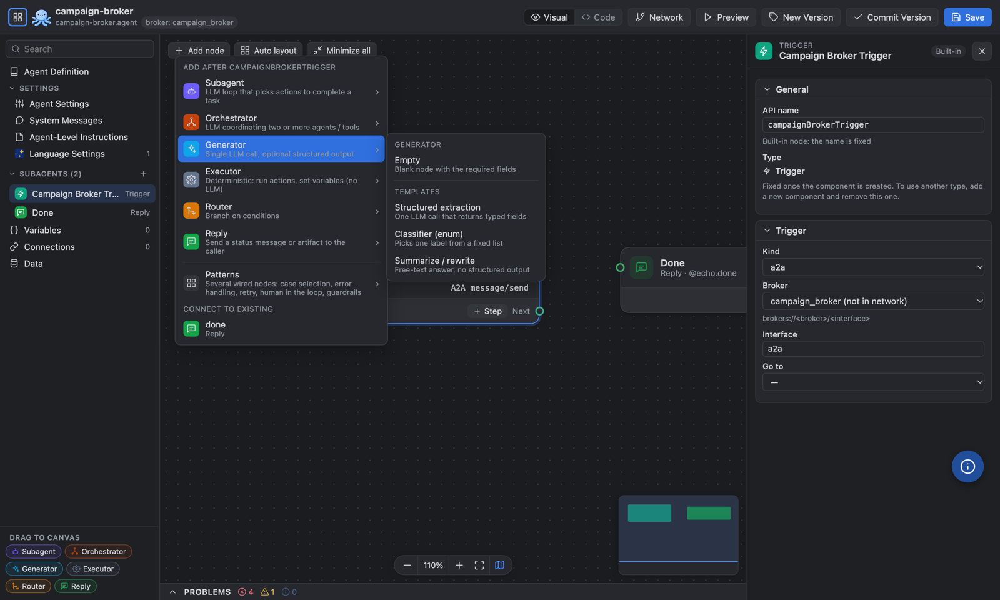

Select the trigger and, under **Go to**, pick `progressBrief` once that step exists.

#### Generator `brief`

- **Label** Campaign Brief · **Description** Turns the request into a campaign brief.
- **Prompt**:

  > Extract the segment id (for example SEG-VIP), the channel and the theme from: {!@request.payload.message.parts[0].text}

- **Structured output** (**Add field** for each):
  - `segment_id` (string): Audience segment id
  - `channel` (string): Campaign channel · **Allowed values** `email`, `social`
  - `theme` (string): Campaign theme
- **Next step (on exit) → Go to**: `progressCreateCampaign`

#### Orchestrator `createCampaign`

- **Label** Create Campaign · **Description** Checks the audience, writes copy, gets compliance approval and a forecast.
- **System instructions**:

  > Check the segment size and consent, find brand assets for the theme, have the content agent write the copy,
  > and have the compliance agent review it. Get a forecast for the segment and channel.
  > Set approved to "yes" only when compliance approved and, for email, the segment has consented contacts.
  > Return the email subject line in subject.
  > Call each tool once, in this order: segment, assets, write, review, forecast. Then set the outputs and stop.

- **Reasoning instructions**:

  > Segment {!@generator.brief.output.segment_id}, channel {!@generator.brief.output.channel}, theme {!@generator.brief.output.theme}.

- **Actions** (**+ Add action…**): `get_segment`, `find_assets`, `content_agent`, `compliance_agent`, `forecast`
- **Limits → Max loops**: `12`
- **Structured output** (**Add field** for each):
  - `approved` (string): Compliance and consent approved · **Allowed values** `yes`, `no`
  - `subject` (string): Email subject or post headline
  - `summary` (string): Copy, assets and forecast
- **Next step (on exit) → Go to**: `launchRouter`

#### Router `launchRouter`

- **Description** Approved email campaigns are scheduled; approved social posts are handed over; the rest are returned.
- **Routes** (**+**): **Label** Email approved · **When** `@orchestrator.createCampaign.output.approved == "yes" and @generator.brief.output.channel == "email"` · **Go to** `progressScheduleEmail`
- **Routes** (**+**): **Label** Social approved · **When** `@orchestrator.createCampaign.output.approved == "yes"` · **Go to** `socialReady`
- **Otherwise → Go to**: `rejected`

#### Executor `scheduleEmail`

- **Description** Schedules the approved email campaign.
- **Steps (do)**: **Run action**
  - **Action** `schedule_email`
    - **Bind argument** `segment_id` = `@generator.brief.output.segment_id`
    - **Bind argument** `subject` = `@orchestrator.createCampaign.output.subject`
- **Next step (on exit) → Go to**: `scheduled`

#### Reply `scheduled`

- **Use expression**, then **Message (expression)**: `"Email campaign scheduled for " + @generator.brief.output.segment_id + ". " + @orchestrator.createCampaign.output.summary`
- **Task state**: `TASK_STATE_COMPLETED`

#### Reply `socialReady`

- **Use expression**, then **Message (expression)**: `"Social post approved and ready to publish: " + @orchestrator.createCampaign.output.summary`
- **Task state**: `TASK_STATE_COMPLETED`

#### Reply `rejected`

- **Use expression**, then **Message (expression)**: `"Campaign not approved: " + @orchestrator.createCampaign.output.summary`
- **Task state**: `TASK_STATE_COMPLETED`

#### Reply `progressBrief`

- **Message text**: Turning the request into a campaign brief...
- **Task state**: `TASK_STATE_WORKING` (a progress update: the chat shows it while the broker works, then the flow goes on)
- **Next step (on exit) → Go to**: `brief`

#### Reply `progressCreateCampaign`

- **Message text**: Checking the audience, writing the copy, getting compliance approval and a forecast...
- **Task state**: `TASK_STATE_WORKING` (a progress update: the chat shows it while the broker works, then the flow goes on)
- **Next step (on exit) → Go to**: `createCampaign`

#### Reply `progressScheduleEmail`

- **Message text**: Scheduling the approved email campaign...
- **Task state**: `TASK_STATE_WORKING` (a progress update: the chat shows it while the broker works, then the flow goes on)
- **Next step (on exit) → Go to**: `scheduleEmail`

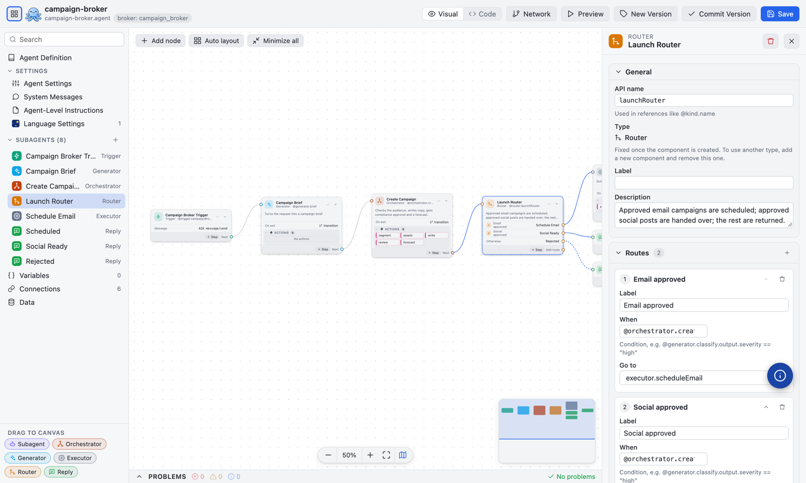

When you are done, the flow matches the template's flow ([Path 2, Step 4](#step-4-follow-the-broker-flow-agentscript)). The built-in `done` reply isn't used by this use case. The Problems bar shows **echo done is not reachable from the trigger** as a warning, and you can leave it.

### Step 3.9. Add the policies

Select the broker or connection, scroll to **Policies** and click **Add policy**. Pick the policy (search by name), choose the **Direction** and set its **Configuration** fields. **Header Injection** has its own header list. Octoloom also adds each policy as an `exchange.json` dependency.

- Broker `campaign_broker`: **Rate Limiting** (inbound)
  - **rateLimits** (one entry each, **+**): maximumRequests `30`, timePeriodInMilliseconds `60000`
  - **exposeHeaders**: on
- Connection `content_agent_connection`: **A2A v1 PII Detector** (inbound)
  - **entities**: `Email`, `US SSN`, `Credit Card`
  - **action**: `Log`
- Connection `compliance_agent_connection`: **Header Injection** (inbound)
  - **inboundHeaders** (one entry each, **+**): `x-correlation-source` = `campaign_broker`
- Connection `segments_mcp_connection`: **MCP PII Detector** (inbound)
  - **entities**: `Email`, `US SSN`, `Credit Card`, `Phone Number`
  - **action**: `Log and mask`
- Connection `segments_mcp_connection`: **MCP Schema Validation** (inbound)
  - **validateToolSchema**: on
- Connection `brand_assets_mcp_connection`: **MCP PII Detector** (inbound)
  - **entities**: `Email`, `US SSN`, `Credit Card`, `Phone Number`
  - **action**: `Log and mask`
- Connection `brand_assets_mcp_connection`: **Header Injection** (inbound)
  - **inboundHeaders** (one entry each, **+**): `x-octoloom-source` = `campaign-studio-governed-v2`
- Connection `email_mcp_connection`: **MCP PII Detector** (inbound)
  - **entities**: `Email`, `US SSN`, `Credit Card`, `Phone Number`
  - **action**: `Log and mask`
- Connection `email_mcp_connection`: **MCP Schema Validation** (inbound)
  - **validateToolSchema**: on
- Connection `analytics_mcp_connection`: **MCP PII Detector** (inbound)
  - **entities**: `Email`, `US SSN`, `Credit Card`, `Phone Number`
  - **action**: `Log and mask`
- Connection `analytics_mcp_connection`: **Header Injection** (inbound)
  - **inboundHeaders** (one entry each, **+**): `x-octoloom-source` = `campaign-studio-governed-v2`

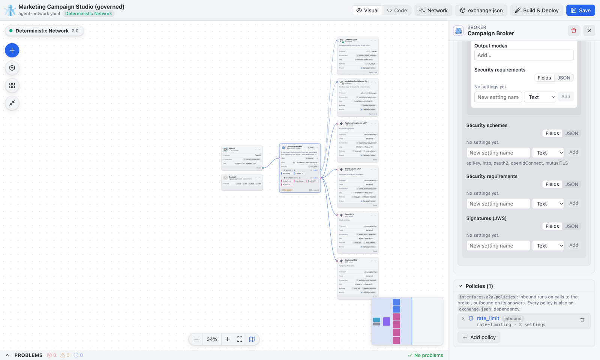

The template declares a policy once under `context.policies` and points to it from each connection. **Add policy** writes each policy on its connection instead. Both give the same result at runtime.

### Step 3.10. Validate, deploy and chat

Run **Validate** from the canvas CLI menu and fix anything in the Problems bar. Then follow Path 2 from [Validate and build](#step-5-validate-and-build) onwards: deploy (enter the secrets), wait for the green light, open the chat and send the same prompts. Your network answers like the template, because it is the same network, built by hand.

## What you learned

- How a deterministic network is built: an AgentScript flow decides every step; the LLM extracts and writes text.
- How the canvas, the inspector and the code view edit the same YAML.
- How to build the same network from a blank project with forms and menus only (Path 3).
- How policies are attached and checked with Governance.
- How to validate, build, deploy, chat and trace with Octoloom.

## Next

- Previous: [Loan Origination: governed](../v2-loan-origination-governed/README.md)
- Next: [Retail Returns: governed](../v2-retail-returns-governed/README.md)
- Same use case, plain variant: [Marketing Campaign Studio](../v2-campaign-studio/README.md)
- [All tutorials](../README.md)

---
Generated from the `v2-campaign-studio-governed` template (Octoloom `media/templates/v2-campaign-studio-governed`). Screenshots use fake data.
