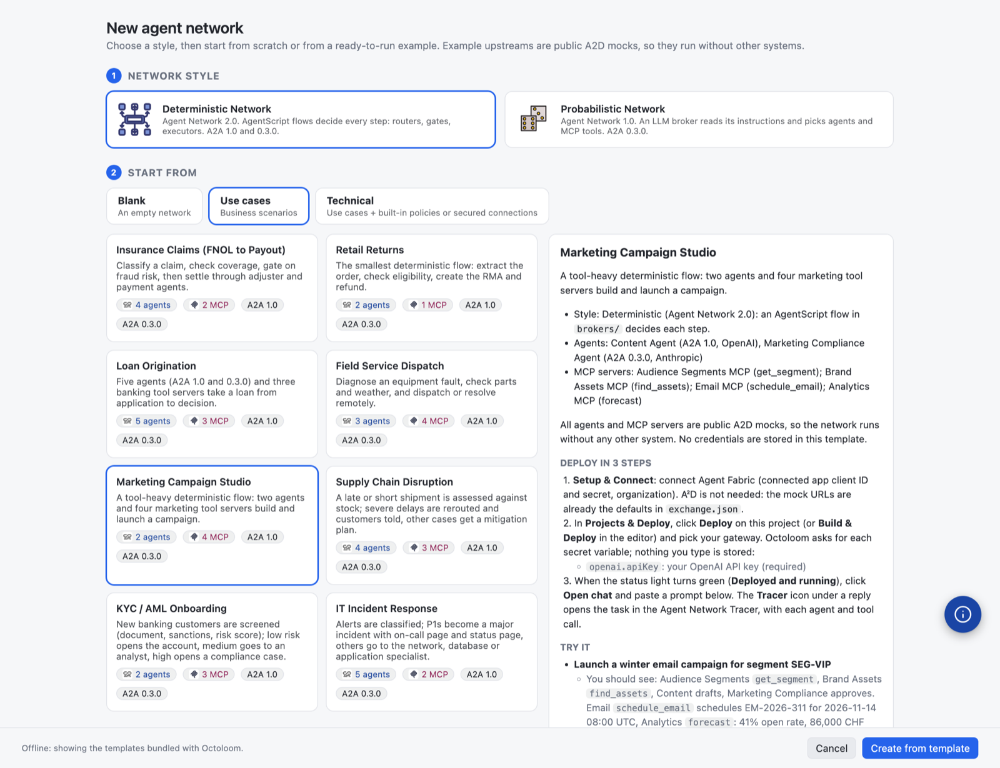
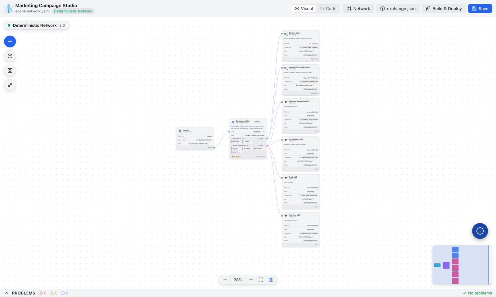
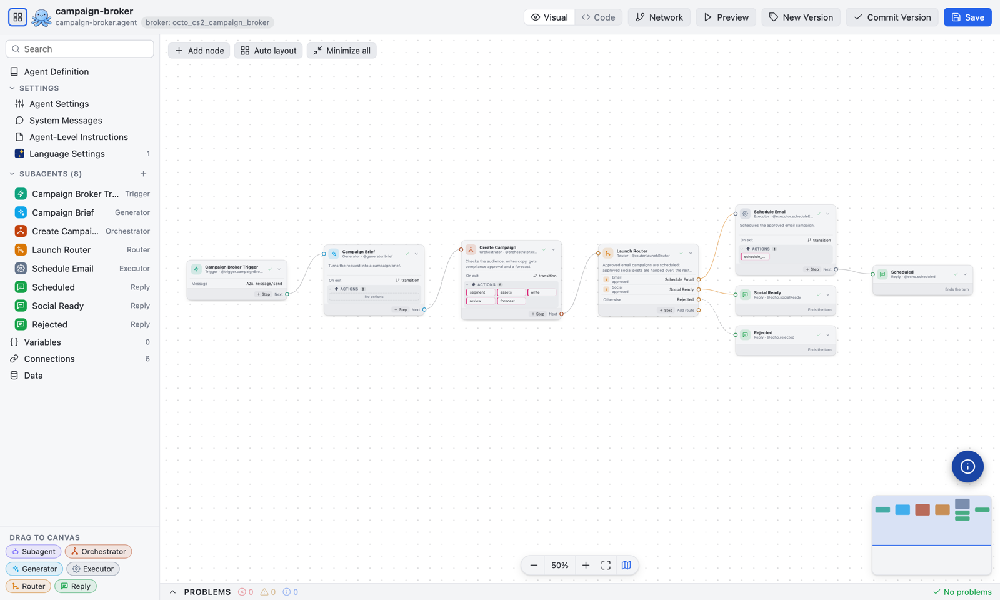
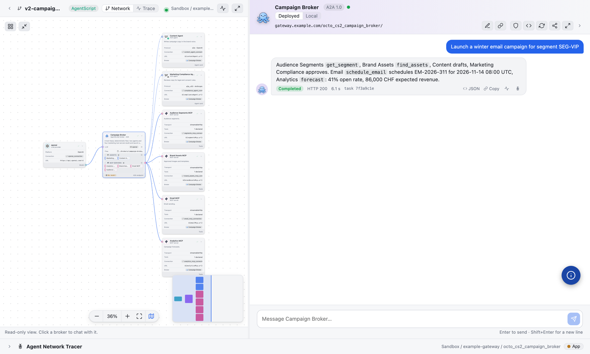

# Tutorial: Marketing Campaign Studio

[All tutorials](../README.md) · [Getting started](../getting-started.md) · Deterministic network (Agent Network 2.0, AgentScript) · Use case

> A tool-heavy deterministic flow: two agents and four marketing tool servers build and launch a campaign.

| Agents | MCP servers | A2A | Policies | Template id |
|---|---|---|---|---|
| 2 | 4 | 1.0, 0.3.0 | 0 | `v2-campaign-studio` |

There are two ways to use this template:

1. **[Just use it](#path-1-just-use-it)**: create the project, deploy it and chat with it in about 10 minutes.
2. **[Learn step by step](#path-2-learn-step-by-step)**: the same steps, with what each part of the network does and how Octoloom shows it.

## Before you start

- VS Code with **Octoloom for Agent Fabric** installed (Marketplace), version 0.9.25 or later.
- An Anypoint organization with Agent Fabric, a connected app (client ID and secret), an environment and a Flex gateway.
- An OpenAI API key (or an OpenAI-compatible LLM gateway).
- Nothing else: all agents and MCP servers are public A²D mocks, so the network runs without any other system.

## Path 1: Just use it

1. **Home → Start → New Deterministic Network.** In the dialog pick **Use cases**, then the card **Marketing Campaign Studio**. Choose a folder and click **Create**.
2. **Deploy.** In **Projects & Deploy**, click **Deploy** on this project (or **Build & Deploy** in the editor) and pick your gateway. Octoloom asks for each secret variable; nothing you type is stored:
   - `openai.apiKey`: OpenAI API key (secret, injected at deploy time)
3. **Chat.** When the status light is green, click **Open chat** and paste:
   - `Launch a winter email campaign for segment SEG-VIP`
   - `Plan a social post about our new eco line for SEG-ECO`
   - `Send an email about the eco line to SEG-ECO`

Done. The rest of this page explains what you just ran.

## Path 2: Learn step by step

### Step 1. Connect Octoloom

Open **Setup & Connect** (Octoloom side bar) and connect **Agent Fabric**: the connected app client ID and secret and the organization. Pick the environment. A²D isn't needed: the mock URLs are already the defaults in `exchange.json`. The Tooling list shows Node.js, Java and anypoint-cli-v4 with its agent-network plugin. Use **Install** or **Repair** on any red row.

### Step 2. Create the project from the template

On **Home**, click **New Deterministic Network**. In **2 Start from**, choose **Use cases** and click **Marketing Campaign Studio**. The right side shows the template README: what it contains, **Deploy in 3 steps** and **Try it**. Keep the suggested name `campaign-studio` or type your own, pick the folder and click **Create**.

Octoloom writes `agent-network.yaml`, `exchange.json`, `README.md` and the broker flow in `brokers/`, and opens the canvas. Every id gets the template prefix `octo_cs2_`, so several templates can be deployed into one org side by side.

### Step 3. Read the network on the canvas

Each card is a part of `agent-network.yaml`. Click one to open it in the inspector on the right. Each change in the inspector is a change to the text, so the YAML stays the source of truth (**Code** view shows it).

- **Broker Campaign Broker** (`octo_cs2_campaign_broker`): its AgentScript flow decides every step.
- **Agent Content Agent**: Writes campaign copy in the brand voice.
- **Agent Marketing Compliance Agent**: Reviews copy for legal and consent rules.
- **MCP server Audience Segments MCP**: Audience segments. Tools: `get_segment`.
- **MCP server Brand Assets MCP**: Approved images and templates. Tools: `find_assets`.
- **MCP server Email MCP**: Email sending. Tools: `schedule_email`.
- **MCP server Analytics MCP**: Campaign forecasts. Tools: `forecast`.

Try this on the canvas: use the zoom bar and the minimap, drag a card, or **Auto layout**. The layout is saved per file. **Minimize all** turns the cards into icon tiles. Click a connection line to see which broker uses which agent or tool.

### Step 4. Follow the broker flow (AgentScript)

Double-click the broker card (or open `brokers/campaign-broker.agent`). The flow editor shows the AgentScript program that decides every step. The LLM only extracts fields and writes text, so the same input always takes the same branch.

| Step | Kind | What it does |
|---|---|---|
| `campaignBrokerTrigger` | Trigger | Starts the flow when an A2A message arrives at the broker. |
| `brief` | Generator | Turns the request into a campaign brief. |
| `createCampaign` | Orchestrator | Checks the audience, writes copy, gets compliance approval and a forecast. |
| `launchRouter` | Router | Approved email campaigns are scheduled; approved social posts are handed over; the rest are returned. |
| `scheduleEmail` | Executor | Schedules the approved email campaign. |
| `scheduled` | Echo | Ends the flow with the `scheduled` reply. |
| `socialReady` | Echo | Ends the flow with the `socialReady` reply. |
| `rejected` | Echo | Ends the flow with the `rejected` reply. |

Click a step to edit it in the inspector. **+ Step** adds a node, and **+ Step → Patterns** inserts whole shapes such as retry, human in the loop or a guardrail check. **Code** shows the `.agent` text with completion.

### Step 5. Validate and build

In the canvas toolbar, open the CLI menu: **Validate** does a dry run of build, publish and deploy and lists problems in the Problems panel (click one to jump to the card). **Build** repairs and packages the project locally with anypoint-cli-v4.

The variables of this template (in `exchange.json`, open it for the no-code form):

| Variable | What | Default |
|---|---|---|
| `contentAgent.url` | Content Agent (A2D mock, A2A 1.0) URL | `https://www.a2d-ai.com/api/platform/5261ec66-5cdc-4b03-84ff-129004f4c483/a2a` |
| `complianceAgent.url` | Marketing Compliance Agent (A2D mock, A2A 0.3.0) URL | `https://www.a2d-ai.com/api/platform/206e0016-f88e-44e4-9a9d-094591cc5284/a2a` |
| `segmentsMcp.url` | Audience Segments MCP (A2D mock) base URL | `https://www.a2d-ai.com/api/platform/8a185e0c-57c4-46de-999e-6f5fa94a7927/` |
| `brandAssetsMcp.url` | Brand Assets MCP (A2D mock) base URL | `https://www.a2d-ai.com/api/platform/7cbd3dc7-ad75-4a42-b17d-f3a4d81ae690/` |
| `emailMcp.url` | Email MCP (A2D mock) base URL | `https://www.a2d-ai.com/api/platform/693ad3bf-5696-43cd-b5a1-830aa3d5ab46/` |
| `analyticsMcp.url` | Analytics MCP (A2D mock) base URL | `https://www.a2d-ai.com/api/platform/9d7ad145-5382-4369-a0c8-14ef0d293ef0/` |

### Step 6. Deploy

Open **Projects & Deploy** and click **Deploy** on the project (or **Deploy…** on the canvas). Pick your gateway (the chips show its status and space), keep **Tracing**, **Wait until the network is ready** and **Publish before deploy** on, then enter the secrets. Nothing you type is stored:

- `openai.apiKey`: OpenAI API key (secret, injected at deploy time)

The square status light goes from blue (deploying) to green (**Deployed and running**). The deployment box lists every broker URL; click one to copy it.

### Step 7. Chat with the broker

Click **Open chat** on the deployment box. On the left is the network (the cards light up as they are called), and on the right is the conversation with its task states. Paste the prompts one at a time:

*The reply in the screenshot is an illustration: it shows what the broker answers. The real wording changes from run to run.*

| Prompt | You should see |
|---|---|
| `Launch a winter email campaign for segment SEG-VIP` | Audience Segments `get_segment`, Brand Assets `find_assets`, Content drafts, Marketing Compliance approves. Email `schedule_email` schedules EM-2026-311 for 2026-11-14 08:00 UTC, Analytics `forecast`: 41% open rate, 86,000 CHF expected revenue. |
| `Plan a social post about our new eco line for SEG-ECO` | Compliance approves with a change: "carbon neutral" becomes "lower-impact materials". The flow ends in the social-ready branch. |
| `Send an email about the eco line to SEG-ECO` | SEG-ECO has 0 email-consented contacts: the campaign is returned, nothing is scheduled. |

The broker is deterministic: the branches are fixed in the flow in `brokers/` (open the `.agent` file to see them). The LLM only reads the ids from your prompt and writes the reply text, so the same input takes the same branch.

### Step 8. Trace a reply

Under each reply, the **Tracer** icon opens the task in the **Agent Network Tracer**: a waterfall of every call the broker made (gateway, broker, LLM, A2A agents, MCP tools) on one time axis, coloured like the cards. Errors are red. Click a span to see its request and response. The **Network** view shows the same reply as a sequence of calls.

### Step 9. Share it (optional)

The **Share** icon in the chat header opens the Share dialog. **A²D sessions** invites people by email to chat with this deployed broker and brings their passed / failed marks and comments back. **Local portal** generates a small web chat you can run or host anywhere.

## What you learned

- How a deterministic network is built: an AgentScript flow decides every step; the LLM extracts and writes text.
- How the canvas, the inspector and the code view edit the same YAML.
- How to validate, build, deploy, chat and trace with Octoloom.

## Next

- Previous: [Loan Origination](../v2-loan-origination/README.md)
- Next: [Retail Returns](../v2-retail-returns/README.md)
- Same use case, governed variant: [Marketing Campaign Studio: governed](../v2-campaign-studio-governed/README.md)
- [All tutorials](../README.md)

---
Generated from the `v2-campaign-studio` template (Octoloom `media/templates/v2-campaign-studio`). Screenshots use fake data.
