# Tutorial: IDMC Data Trust (needs Informatica IDMC)

[All tutorials](../README.md) · [Getting started](../getting-started.md) · Deterministic network (Agent Network 2.0, AgentScript) · Technical · IDMC

> A deterministic flow over four Informatica shared MCP servers: classify the request, then verify the address, search the catalog with data quality scores, or resolve the customer in MDM. Needs your own Informatica IDMC org and an IDMC MCP client (OAuth 2.0 client credentials).

| Agents | MCP servers | A2A | Policies | Template id |
|---|---|---|---|---|
| 0 | 4 |  | 0 | `v2-idmc-data-trust` |

There are three ways to use this template:

1. **[Just use it](#path-1-just-use-it)**: create the project, deploy it and chat with it in about 10 minutes.
2. **[Learn step by step](#path-2-learn-step-by-step)**: the same steps, with what each part of the network does and how Octoloom shows it.
3. **[Build it from scratch](#path-3-build-it-from-scratch)**: start from a blank project and build the same network yourself, no code, one screenshot per step.

## Before you start

- VS Code with **Octoloom for Agent Fabric** installed (Marketplace), version 0.9.25 or later.
- An Anypoint organization with Agent Fabric, a connected app (client ID and secret), an environment and a Flex gateway.
- An OpenAI API key (or an OpenAI-compatible LLM gateway).
- An Informatica IDMC org with the four shared MCP services and an IDMC MCP client (see the template README, *IDMC setup*).
- Nothing else: the IDMC MCP servers are called with OAuth 2.0 client credentials.

## Path 1: Just use it

1. **Home → Start → New Deterministic Network.** In the dialog pick **Technical**, then the card **IDMC Data Trust (needs Informatica IDMC)**. Choose a folder and click **Create**.
2. **Deploy.** Check the pod in the four URL variables and `idmc.tokenUrl`. In **Projects & Deploy**, click **Deploy** on this project (or **Build & Deploy** in the editor) and pick your gateway. Octoloom asks for each secret variable; nothing you type is stored:
   - `openai.apiKey`: OpenAI API key (secret, injected at deploy time)
   - `idmc.clientId`: IDMC MCP client: Client ID (OAuth 2.0 client credentials)
   - `idmc.clientSecret`: IDMC MCP client: Client Secret
3. **Chat.** When the status light is green, click **Open chat** and paste:
   - `Verify and standardize the address 2100 Seaport Blvd, Redwood City, CA 94063, USA`
   - `Which catalog assets hold customer data, and what is their data quality score?`
   - `Check the address 2100 Seaport Blvd, Redwood City, CA 94063 and tell me which catalog assets hold customer address or contact data`
   - `Find the customer John Smith, address 2100 Seaport Blvd, Redwood City, CA 94063`

Done. The rest of this page explains what you just ran.

## Path 2: Learn step by step

### Step 1. Connect Octoloom

Open **Setup & Connect** (Octoloom side bar) and connect **Agent Fabric**: the connected app client ID and secret and the organization. Pick the environment. Also connect **IDMC** (Headless IDMC) if you want the IDMC palette tab. The Tooling list shows Node.js, Java and anypoint-cli-v4 with its agent-network plugin. Use **Install** or **Repair** on any red row.

### Step 2. Create the project from the template

On **Home**, click **New Deterministic Network**. In **2 Start from**, choose **Technical** and click **IDMC Data Trust (needs Informatica IDMC)**. The right side shows the template README: what it contains, **Deploy in 3 steps** and **Try it**. Keep the suggested name `idmc-data-trust` or type your own, pick the folder and click **Create**.

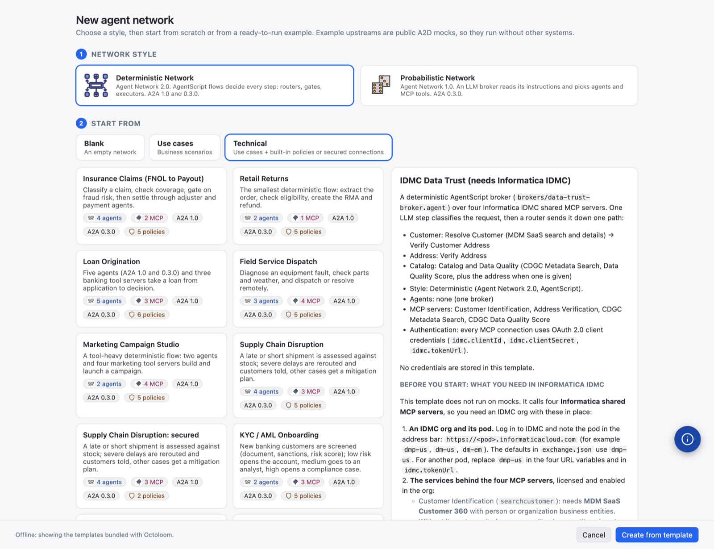

Octoloom writes `agent-network.yaml`, `exchange.json`, `README.md` and the broker flow in `brokers/`, and opens the canvas. Every id gets the template prefix `octo_iv2_`, so several templates can be deployed into one org side by side.

### Step 3. Read the network on the canvas

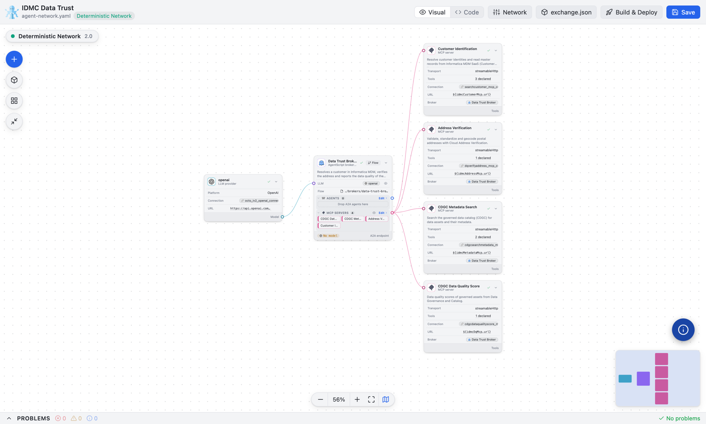

Each card is a part of `agent-network.yaml`. Click one to open it in the inspector on the right. Each change in the inspector is a change to the text, so the YAML stays the source of truth (**Code** view shows it).

- **Broker Data Trust Broker** (`octo_iv2_data_trust_broker`): its AgentScript flow decides every step.
- **MCP server Customer Identification**: Resolve customer identities and read master records from Informatica MDM SaaS (Customer 360). Tools: `get_master_record_details`, `get_related_records`, `search_master_record`.
- **MCP server Address Verification**: Validate, standardize and geocode postal addresses with Cloud Address Verification. Tools: `verify_address`.
- **MCP server CDGC Metadata Search**: Search the governed data catalog (CDGC) for data assets and their metadata. Tools: `get_asset_details`, `search_metadata`.
- **MCP server CDGC Data Quality Score**: Data quality scores of governed assets from Data Governance and Catalog. Tools: `get_asset_score`.

Try this on the canvas: use the zoom bar and the minimap, drag a card, or **Auto layout**. The layout is saved per file. **Minimize all** turns the cards into icon tiles. Click a connection line to see which broker uses which agent or tool.

### Step 4. Follow the broker flow (AgentScript)

Double-click the broker card (or open `brokers/data-trust-broker.agent`). The flow editor shows the AgentScript program that decides every step. The LLM only extracts fields and writes text, so the same input always takes the same branch.

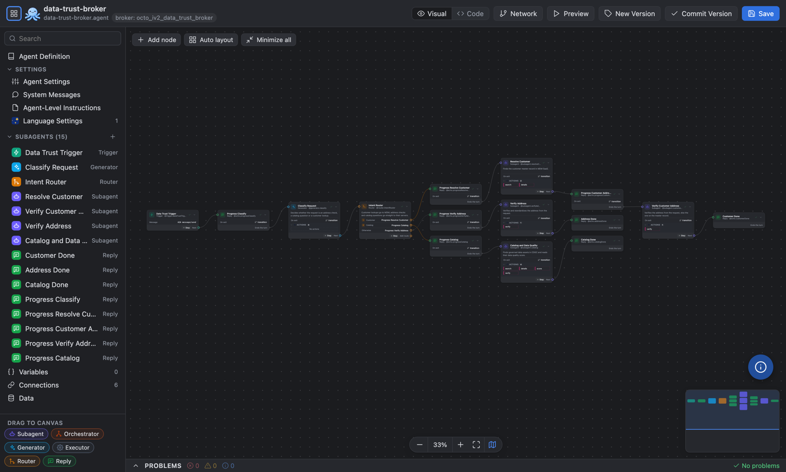

| Step | Kind | What it does |
|---|---|---|
| `dataTrustTrigger` | Trigger | Starts the flow when an A2A message arrives at the broker. |
| `classify` | Generator | Decides whether the request is an address check, a catalog question or a customer lookup. |
| `intentRouter` | Router | Customer lookups go to MDM; address checks and catalog questions go straight to their servers. |
| `resolveCustomer` | Subagent | Finds the customer master record in MDM SaaS. |
| `customerAddress` | Subagent | Verifies the address from the request, else the one on the master record. |
| `verifyAddress` | Subagent | Verifies and standardizes the address from the request. |
| `catalog` | Subagent | Finds governed data assets in CDGC and reads their data quality score. |
| `customerDone` | Echo | Ends the flow with the `customerDone` reply. |
| `addressDone` | Echo | Ends the flow with the `addressDone` reply. |
| `catalogDone` | Echo | Ends the flow with the `catalogDone` reply. |
| `progressClassify` | Echo | Progress update (`TASK_STATE_WORKING`): tells the caller what comes next, then goes on to that step. With **Live** on, the chat shows it while the broker works. |
| `progressResolveCustomer` | Echo | Progress update (`TASK_STATE_WORKING`): tells the caller what comes next, then goes on to that step. With **Live** on, the chat shows it while the broker works. |
| `progressCustomerAddress` | Echo | Progress update (`TASK_STATE_WORKING`): tells the caller what comes next, then goes on to that step. With **Live** on, the chat shows it while the broker works. |
| `progressVerifyAddress` | Echo | Progress update (`TASK_STATE_WORKING`): tells the caller what comes next, then goes on to that step. With **Live** on, the chat shows it while the broker works. |
| `progressCatalog` | Echo | Progress update (`TASK_STATE_WORKING`): tells the caller what comes next, then goes on to that step. With **Live** on, the chat shows it while the broker works. |

Click a step to edit it in the inspector. **+ Step** adds a node, and **+ Step → Patterns** inserts whole shapes such as retry, human in the loop or a guardrail check. **Code** shows the `.agent` text with completion.

### Step 5. Validate and build

In the canvas toolbar, open the CLI menu: **Validate** does a dry run of build, publish and deploy and lists problems in the Problems panel (click one to jump to the card). **Build** repairs and packages the project locally with anypoint-cli-v4.

The variables of this template (in `exchange.json`, open it for the no-code form):

| Variable | What | Default |
|---|---|---|
| `idmc.tokenUrl` | IDMC MCP client: Token URL | `https://dmp-us.informaticacloud.com/authz-service/oauth/token` |
| `idmcCustomerMcp.url` | Customer Identification (Informatica shared MCP server, pod dmp-us) full server URL (the gateway forwards to it as is) | `https://mcp.dmp-us.informaticacloud.com/mcp-servers/public/searchcustomer` |
| `idmcAddressMcp.url` | Address Verification (Informatica shared MCP server, pod dmp-us) full server URL (the gateway forwards to it as is) | `https://mcp.dmp-us.informaticacloud.com/mcp-servers/public/dqverifyaddress` |
| `idmcMetadataMcp.url` | CDGC Metadata Search (Informatica shared MCP server, pod dmp-us) full server URL (the gateway forwards to it as is) | `https://mcp.dmp-us.informaticacloud.com/mcp-servers/public/cdgcsearchmetadata` |
| `idmcDqMcp.url` | CDGC Data Quality Score (Informatica shared MCP server, pod dmp-us) full server URL (the gateway forwards to it as is) | `https://mcp.dmp-us.informaticacloud.com/mcp-servers/public/cdgcdataqualityscore` |

### Step 6. Deploy

Open **Projects & Deploy** and click **Deploy** on the project (or **Deploy…** on the canvas). Pick your gateway (the chips show its status and space), keep **Tracing**, **Wait until the network is ready** and **Publish before deploy** on, then enter the secrets. Nothing you type is stored:

- `openai.apiKey`: OpenAI API key (secret, injected at deploy time)
- `idmc.clientId`: IDMC MCP client: Client ID (OAuth 2.0 client credentials)
- `idmc.clientSecret`: IDMC MCP client: Client Secret

The square status light goes from blue (deploying) to green (**Deployed and running**). The deployment box lists every broker URL; click one to copy it.

### Step 7. Chat with the broker

Click **Open chat** on the deployment box. On the left is the network (the cards light up as they are called), and on the right is the conversation with its task states. **Live progress** (the antenna button next to Send) is on by default: while the broker works, the chat lists its progress updates (*Deciding whether the request is an address check, a catalog question or a customer lookup...*, *Finding the customer master record in MDM SaaS...*) and keeps them above the answer. Paste the prompts one at a time:

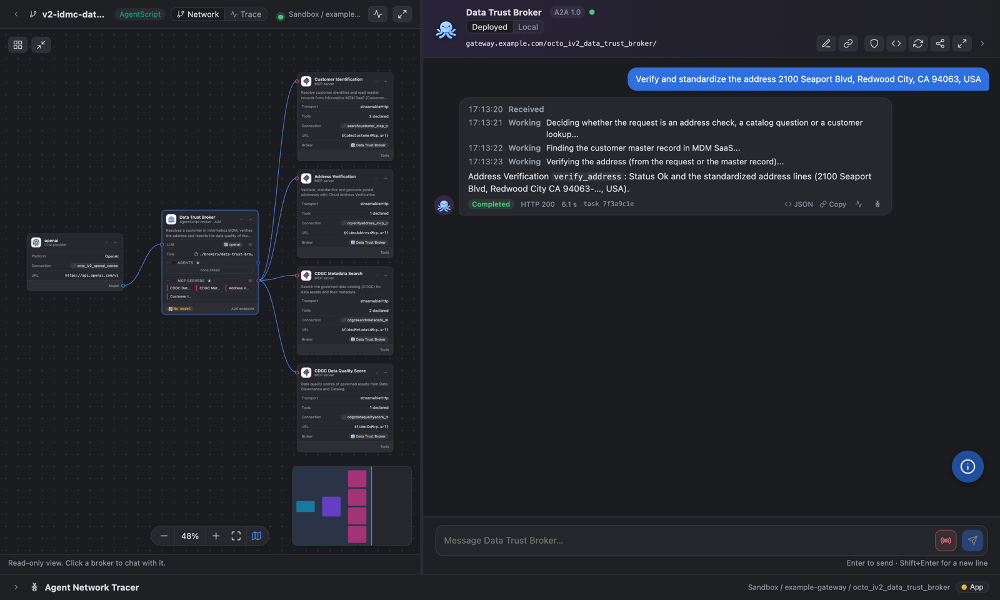

*The reply in the screenshot is an illustration: it shows what the broker answers. The real wording changes from run to run.*

| Prompt | You should see |
|---|---|
| `Verify and standardize the address 2100 Seaport Blvd, Redwood City, CA 94063, USA` | Address Verification `verify_address`: Status Ok and the standardized address lines (2100 Seaport Blvd, Redwood City CA 94063-…, USA). |
| `Which catalog assets hold customer data, and what is their data quality score?` | CDGC Metadata Search `search_metadata`: a list of catalog hits (data collections, classifications, protections, fields) with name and type, then CDGC Data Quality Score `get_asset_score`: the score of the most relevant asset, or that no score is recorded. |
| `Check the address 2100 Seaport Blvd, Redwood City, CA 94063 and tell me which catalog assets hold customer address or contact data` | `verify_address` with Status Ok first, then the catalog hits for customer address and contact data from `search_metadata`. |
| `Find the customer John Smith, address 2100 Seaport Blvd, Redwood City, CA 94063` | Customer Identification `search_master_record`: the master record (business ID, name, address) when MDM SaaS Customer 360 is in place; without it, one sentence with the MDM error ("business entity … is not valid"), then the address check. |

### Step 8. Trace a reply

Under each reply, the **Tracer** icon opens the task in the **Agent Network Tracer**: a waterfall of every call the broker made (gateway, broker, LLM, A2A agents, MCP tools) on one time axis, coloured like the cards. Errors are red. Click a span to see its request and response. The **Network** view shows the same reply as a sequence of calls.

### Step 9. Share it (optional)

The **Share** icon in the chat header opens the Share dialog. **A²D sessions** invites people by email to chat with this deployed broker and brings their passed / failed marks and comments back. **Local portal** generates a small web chat you can run or host anywhere.

## Path 3: Build it from scratch

Here you build the same network yourself, starting from a blank project. Every step uses a form, a menu or a button. You never import the template, and you never type YAML or AgentScript. The names below are the template's names without the `octo_iv2_` prefix. You can use your own names, but keep them consistent.

> The text fields take plain values. Where a value looks like `${group.name}`, type it as shown: it is a **variable** that `exchange.json` declares and that deploy fills in.

### Step 3.1. Create a blank project with a starter broker

Connect Octoloom first, as in [Path 2, Step 1](#step-1-connect-octoloom). Then, on **Home**, click **New Deterministic Network**. In **2 Start from**, choose **Blank** and turn on **Add a starter broker**.

- **Broker name**: `Data Trust Broker`
- **Name**: `idmc-data-trust-scratch` (the Exchange asset id; a different name from the template, so both can live in one org)
- **Parent folder**: pick a folder, then click **Create blank project**.

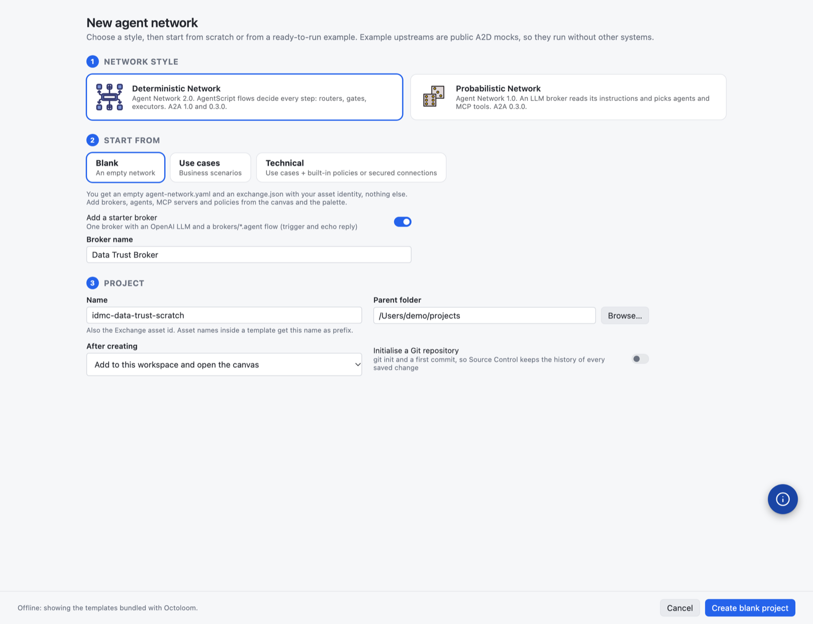

The starter broker `data_trust_broker` has an OpenAI LLM connection (`openai_connection`, MuleSoft's published OpenAI LLM) and a flow `brokers/data-trust-broker.agent` with a trigger, one subagent and the built-in `done` reply. The LLM is already done.

### Step 3.2. Add the MCP servers

Click **+** → **MCP server** → **Empty**, then fill in:

- **Customer Identification**: **Key** `searchcustomer_mcp`, **Label** Customer Identification, **Description** Resolve customer identities and read master records from Informatica MDM SaaS (Customer 360) · **Protocol version** `2025-06-18`. The transport is already Streamable HTTP on `/mcp`.
- **Address Verification**: **Key** `dqverifyaddress_mcp`, **Label** Address Verification, **Description** Validate, standardize and geocode postal addresses with Cloud Address Verification · **Protocol version** `2025-06-18`. The transport is already Streamable HTTP on `/mcp`.
- **CDGC Metadata Search**: **Key** `cdgcsearchmetadata_mcp`, **Label** CDGC Metadata Search, **Description** Search the governed data catalog (CDGC) for data assets and their metadata · **Protocol version** `2025-06-18`. The transport is already Streamable HTTP on `/mcp`.
- **CDGC Data Quality Score**: **Key** `cdgcdataqualityscore_mcp`, **Label** CDGC Data Quality Score, **Description** Data quality scores of governed assets from Data Governance and Catalog · **Protocol version** `2025-06-18`. The transport is already Streamable HTTP on `/mcp`.

### Step 3.3. Add the connections

A connection is the URL (and authentication) Agent Fabric uses to reach an agent or an MCP server. Click **+** → **Connection** → **Empty** once per MCP server, and fill in:

| Key | Kind | Registry entry → Name | URL |
|---|---|---|---|
| `searchcustomer_mcp_connection` | `mcp` | `searchcustomer_mcp` | `${idmcCustomerMcp.url}` |
| `dqverifyaddress_mcp_connection` | `mcp` | `dqverifyaddress_mcp` | `${idmcAddressMcp.url}` |
| `cdgcsearchmetadata_mcp_connection` | `mcp` | `cdgcsearchmetadata_mcp` | `${idmcMetadataMcp.url}` |
| `cdgcdataqualityscore_mcp_connection` | `mcp` | `cdgcdataqualityscore_mcp` | `${idmcDqMcp.url}` |

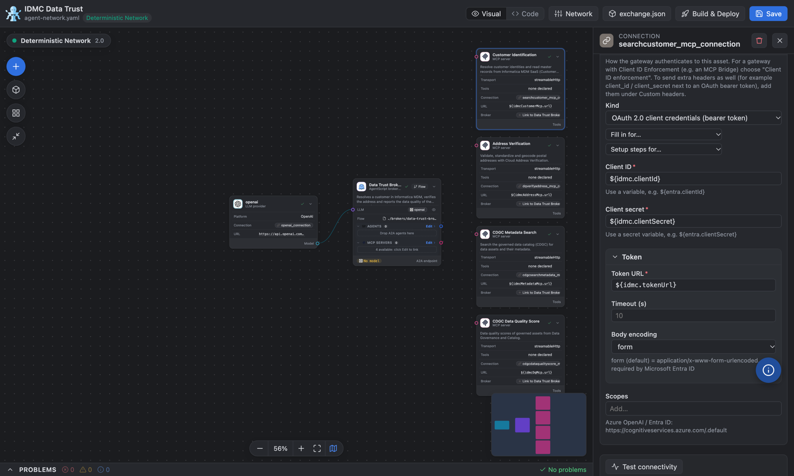

These connections also authenticate. In **Authentication**, pick the kind and type the values exactly as shown. The values are variables, and the secret ones are asked for at deploy time:

- `searchcustomer_mcp_connection`: **OAuth 2.0 client credentials (bearer token)**, **clientId** `${idmc.clientId}`, **clientSecret** `${idmc.clientSecret}`, **Token → Token URL** `${idmc.tokenUrl}`, **Body encoding** `form`
- `dqverifyaddress_mcp_connection`: **OAuth 2.0 client credentials (bearer token)**, **clientId** `${idmc.clientId}`, **clientSecret** `${idmc.clientSecret}`, **Token → Token URL** `${idmc.tokenUrl}`, **Body encoding** `form`
- `cdgcsearchmetadata_mcp_connection`: **OAuth 2.0 client credentials (bearer token)**, **clientId** `${idmc.clientId}`, **clientSecret** `${idmc.clientSecret}`, **Token → Token URL** `${idmc.tokenUrl}`, **Body encoding** `form`
- `cdgcdataqualityscore_mcp_connection`: **OAuth 2.0 client credentials (bearer token)**, **clientId** `${idmc.clientId}`, **clientSecret** `${idmc.clientSecret}`, **Token → Token URL** `${idmc.tokenUrl}`, **Body encoding** `form`

### Step 3.4. Declare the variables

The Problems bar now shows **Variable ${…} is not declared in exchange.json** for each new variable. Click **Add to exchange.json** on each one.

Then open `exchange.json` (it opens as a form) and, under **Variables**, set the defaults:

| Variable | Default |
|---|---|
| `idmc.tokenUrl` | `https://dmp-us.informaticacloud.com/authz-service/oauth/token` |
| `idmcCustomerMcp.url` | `https://mcp.dmp-us.informaticacloud.com/mcp-servers/public/searchcustomer` |
| `idmcAddressMcp.url` | `https://mcp.dmp-us.informaticacloud.com/mcp-servers/public/dqverifyaddress` |
| `idmcMetadataMcp.url` | `https://mcp.dmp-us.informaticacloud.com/mcp-servers/public/cdgcsearchmetadata` |
| `idmcDqMcp.url` | `https://mcp.dmp-us.informaticacloud.com/mcp-servers/public/cdgcdataqualityscore` |

Leave the secret variables (`openai.apiKey`, `idmc.clientId`, `idmc.clientSecret`) empty: deploy asks for them and never stores them.

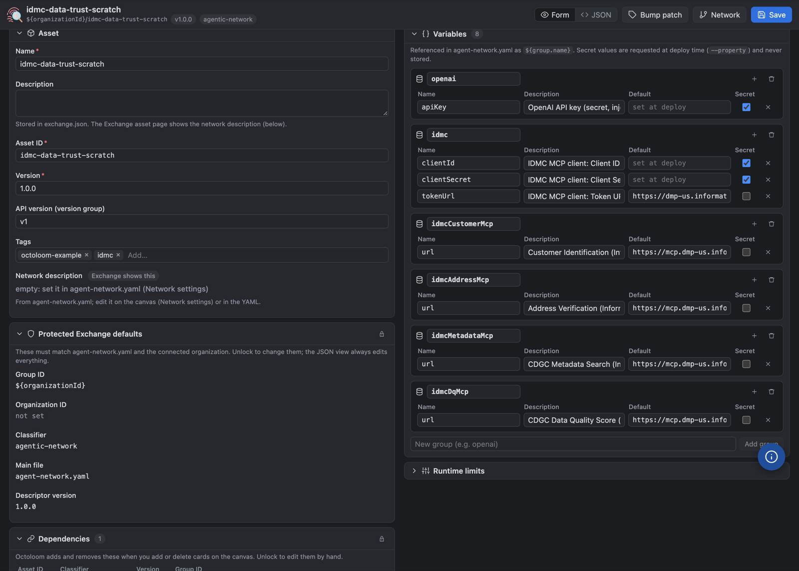

Also click **Remove it** on any **declared but not used** variable that the Problems bar shows.

### Step 3.5. Declare the MCP tools

On each MCP server card, click the **Tools** row (or its pencil). Octoloom reads the tool list from the running server: tick the tools below. You can also type a name in **Add a tool by name…**.

- **Customer Identification**: `get_master_record_details`, `get_related_records`, `search_master_record`
- **Address Verification**: `verify_address`
- **CDGC Metadata Search**: `get_asset_details`, `search_metadata`
- **CDGC Data Quality Score**: `get_asset_score`

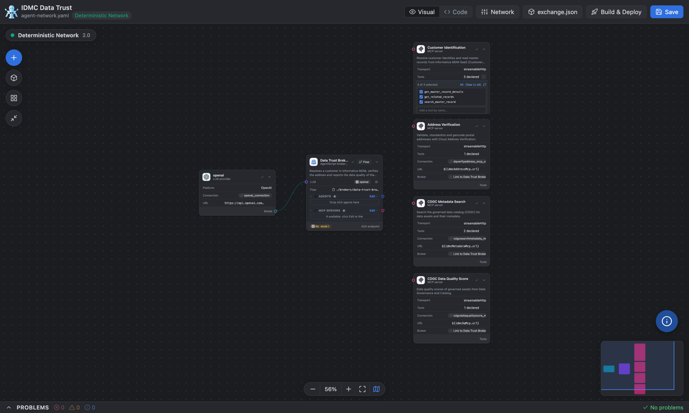

### Step 3.6. Link the MCP servers to the broker

Every MCP card now has a **Broker** row with **Link to Data Trust Broker**. Click it on each card. Octoloom adds the matching actions to the broker flow: one per declared MCP tool.

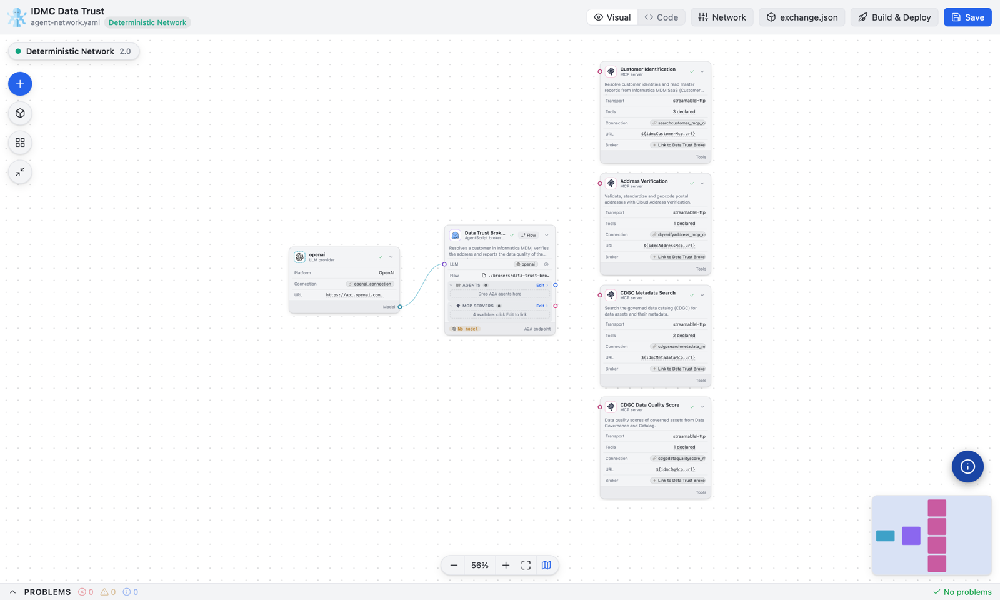

### Step 3.7. Build the broker flow

On the broker card (or in its inspector), click **Open broker flow**. Then set up the flow:

1. **Settings → Language Settings**: on the `default` model, set **Reasoning effort (OpenAI)** to `MINIMAL`.
2. **Settings → System Messages**: set the instructions to: *You are a customer data steward. Use only data the Informatica MCP servers return. When a tool fails or returns nothing, say so in one sentence and continue with the other steps; never ask the user to choose a business entity.*
3. Select the `assistant` subagent and delete it (trash icon). The trigger and the built-in `done` reply stay.
4. Add the steps below in order. Select the step that comes before, click **Add node**, pick the kind and choose **Empty**, then set its **API name** in **General**. Octoloom wires each new step after the selected one, and you set the exact next step in the inspector.

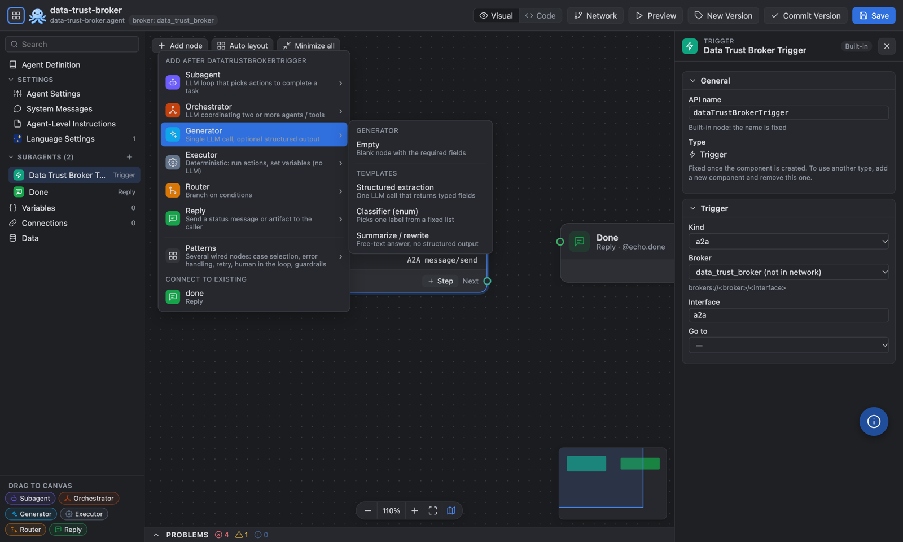

Select the trigger and, under **Go to**, pick `progressClassify` once that step exists.

#### Generator `classify`

- **Label** Classify Request · **Description** Decides whether the request is an address check, a catalog question or a customer lookup.
- **System instructions**:

  > Classify the message.
  > intent = "address" when it only asks to verify or standardize a postal address,
  > "catalog" when it asks about data assets, catalog, classifications, protections or data quality (with or without an address),
  > "customer" when it names a person or company to look up.
  > Extract the postal address on one line, or "NONE". Extract the customer name, or "NONE".
  > catalogQuery = two or three keywords for the catalog search (for example "customer address"), or "NONE".

- **Prompt**:

  > {!@request.payload.message.parts[0].text}

- **Structured output** (**Add field** for each):
  - `intent` (string): What the request needs · **Allowed values** `address`, `catalog`, `customer`
  - `address` (string): Postal address on one line, or NONE
  - `customer` (string): Customer name, or NONE
  - `catalogQuery` (string): Keywords for the catalog search, or NONE
- **Next step (on exit) → Go to**: `intentRouter`

#### Router `intentRouter`

- **Description** Customer lookups go to MDM; address checks and catalog questions go straight to their servers.
- **Routes** (**+**): **Label** Customer · **When** `@generator.classify.output.intent == "customer"` · **Go to** `progressResolveCustomer`
- **Routes** (**+**): **Label** Catalog · **When** `@generator.classify.output.intent == "catalog"` · **Go to** `progressCatalog`
- **Otherwise → Go to**: `progressVerifyAddress`

#### Subagent `resolveCustomer`

- **Label** Resolve Customer · **Description** Finds the customer master record in MDM SaaS.
- **Reasoning instructions**:

  > Find the master record of: {!@generator.classify.output.customer}. Call search_master_record once with entityType "c360.person" (or "c360.organization" for a company), recordsToReturn 5 and the name in search; do not pass fields. When a match is found, call get_master_record_details with its id and entityType. When the call fails (for example "business entity is not valid"), stop and report the error in one sentence.

- **Actions** (**+ Add action…**): `search_master_record`, `get_master_record_details`
- **Limits → Max loops**: `6`
- **Structured output** (**Add field** for each):
  - `summary` (string): Business ID, name and address of the master record, or the error
- **Next step (on exit) → Go to**: `progressCustomerAddress`

#### Subagent `customerAddress`

- **Label** Verify Customer Address · **Description** Verifies the address from the request, else the one on the master record.
- **Reasoning instructions**:

  > Address from the request: {!@generator.classify.output.address}. Master record: {!@subagent.resolveCustomer.output.summary}. Use the request address, else the master record address; when there is none, say so. Call verify_address once with Request {IO:{Inputs:[{AddressElements:{Country:"USA",Locality:[{Value:<city>}],PostalCode:[{Value:<zip>}],AdministrativeDivision:[{Value:<state>}]},PreformattedData:{PostalDeliveryAddressLines:[<street>]}}]}}. Report Status and the standardized address.

- **Actions** (**+ Add action…**): `verify_address`
- **Limits → Max loops**: `5`
- **Next step (on exit) → Go to**: `customerDone`

#### Subagent `verifyAddress`

- **Label** Verify Address · **Description** Verifies and standardizes the address from the request.
- **Reasoning instructions**:

  > Address: {!@generator.classify.output.address}. When it is NONE, say that no address was given. Otherwise call verify_address once with Request {IO:{Inputs:[{AddressElements:{Country:"USA",Locality:[{Value:<city>}],PostalCode:[{Value:<zip>}],AdministrativeDivision:[{Value:<state>}]},PreformattedData:{PostalDeliveryAddressLines:[<street>]}}]}} (Country is the country of the address). Report Status, the standardized address lines and the result details.

- **Actions** (**+ Add action…**): `verify_address`
- **Limits → Max loops**: `5`
- **Next step (on exit) → Go to**: `addressDone`

#### Subagent `catalog`

- **Label** Catalog and Data Quality · **Description** Finds governed data assets in CDGC and reads their data quality score.
- **Reasoning instructions**:

  > When the address {!@generator.classify.output.address} is not NONE, first call verify_address once with Request {IO:{Inputs:[{AddressElements:{Country:"USA",Locality:[{Value:<city>}],PostalCode:[{Value:<zip>}],AdministrativeDivision:[{Value:<state>}]},PreformattedData:{PostalDeliveryAddressLines:[<street>]}}]}} and report Status and the standardized address. Then call search_metadata with knowledgeQuery "{!@generator.classify.output.catalogQuery}" (use "customer" when it is NONE). List up to 8 hits with name and type. Then call get_asset_score for the most relevant data collection or field (its core.identity as id, scheme "internal") and report the score, or say that no score is recorded.

- **Actions** (**+ Add action…**): `search_metadata`, `get_asset_details`, `get_asset_score`, `verify_address`
- **Limits → Max loops**: `10`
- **Next step (on exit) → Go to**: `catalogDone`

#### Reply `customerDone`

- **Use expression**, then **Message (expression)**: `"Customer: " + @subagent.resolveCustomer.output.summary + "\nAddress: " + @subagent.customerAddress.output`
- **Task state**: `TASK_STATE_COMPLETED`

#### Reply `addressDone`

- **Use expression**, then **Message (expression)**: `"Address: " + @subagent.verifyAddress.output`
- **Task state**: `TASK_STATE_COMPLETED`

#### Reply `catalogDone`

- **Use expression**, then **Message (expression)**: `@subagent.catalog.output`
- **Task state**: `TASK_STATE_COMPLETED`

#### Reply `progressClassify`

- **Message text**: Deciding whether the request is an address check, a catalog question or a customer lookup...
- **Task state**: `TASK_STATE_WORKING` (a progress update: the chat shows it while the broker works, then the flow goes on)
- **Next step (on exit) → Go to**: `classify`

#### Reply `progressResolveCustomer`

- **Message text**: Finding the customer master record in MDM SaaS...
- **Task state**: `TASK_STATE_WORKING` (a progress update: the chat shows it while the broker works, then the flow goes on)
- **Next step (on exit) → Go to**: `resolveCustomer`

#### Reply `progressCustomerAddress`

- **Message text**: Verifying the address (from the request or the master record)...
- **Task state**: `TASK_STATE_WORKING` (a progress update: the chat shows it while the broker works, then the flow goes on)
- **Next step (on exit) → Go to**: `customerAddress`

#### Reply `progressVerifyAddress`

- **Message text**: Verifying and standardizing the address...
- **Task state**: `TASK_STATE_WORKING` (a progress update: the chat shows it while the broker works, then the flow goes on)
- **Next step (on exit) → Go to**: `verifyAddress`

#### Reply `progressCatalog`

- **Message text**: Finding governed data assets in CDGC and reading their data quality score...
- **Task state**: `TASK_STATE_WORKING` (a progress update: the chat shows it while the broker works, then the flow goes on)
- **Next step (on exit) → Go to**: `catalog`

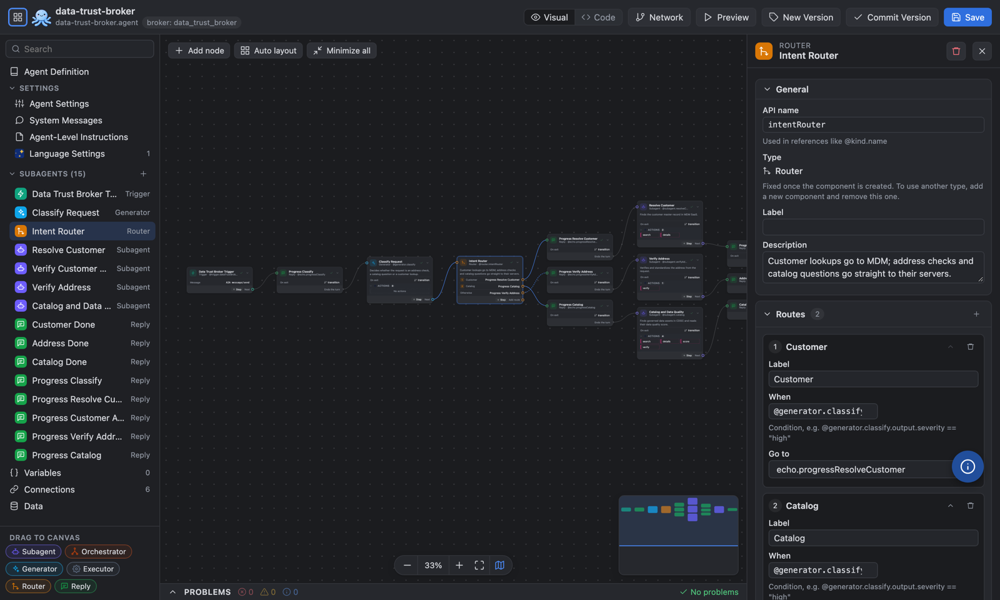

When you are done, the flow matches the template's flow ([Path 2, Step 4](#step-4-follow-the-broker-flow-agentscript)). The built-in `done` reply isn't used by this use case. The Problems bar shows **echo done is not reachable from the trigger** as a warning, and you can leave it.

### Step 3.8. Validate, deploy and chat

Run **Validate** from the canvas CLI menu and fix anything in the Problems bar. Then follow Path 2 from [Validate and build](#step-5-validate-and-build) onwards: deploy (enter the secrets), wait for the green light, open the chat and send the same prompts. Your network answers like the template, because it is the same network, built by hand.

## What you learned

- How a deterministic network is built: an AgentScript flow decides every step; the LLM extracts and writes text.
- How the canvas, the inspector and the code view edit the same YAML.
- How to build the same network from a blank project with forms and menus only (Path 3).
- How to validate, build, deploy, chat and trace with Octoloom.

## Next

- Previous: [Supply Chain Disruption: secured](../v2-supply-chain-secured/README.md)
- [All tutorials](../README.md)

---
Generated from the `v2-idmc-data-trust` template (Octoloom `media/templates/v2-idmc-data-trust`). Screenshots use fake data.
